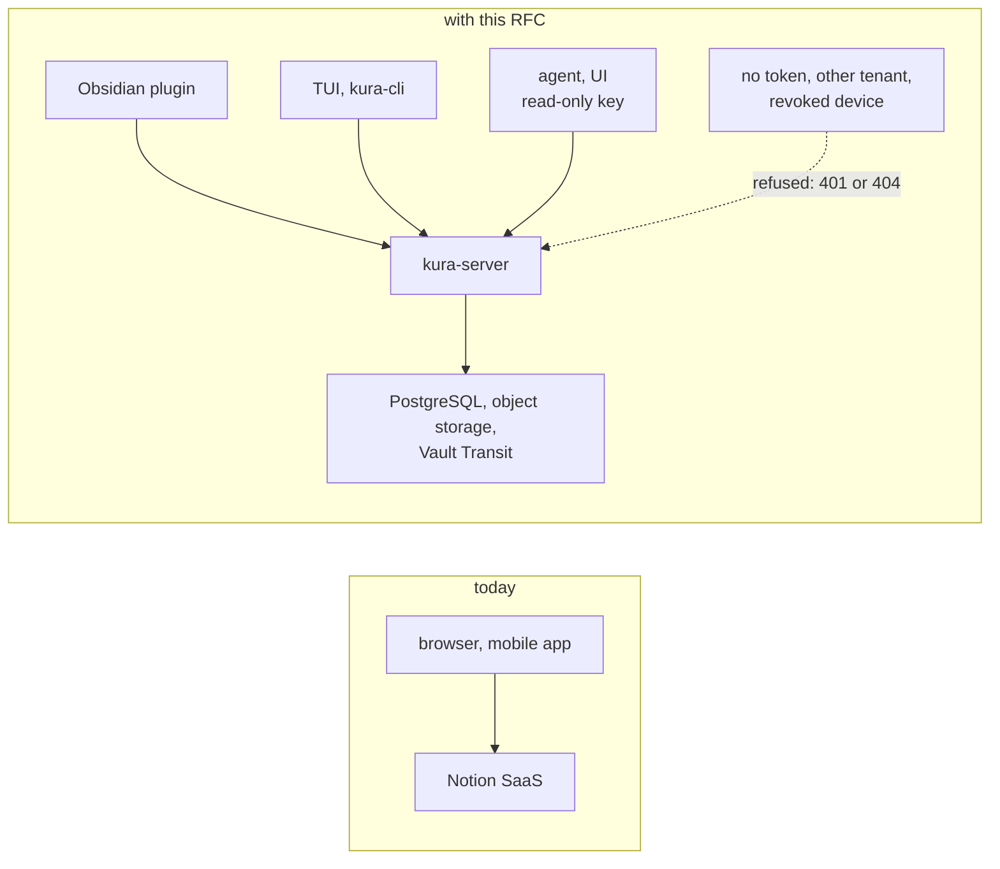
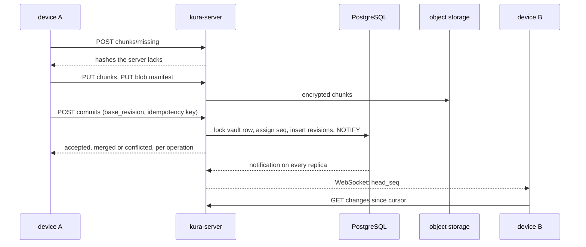
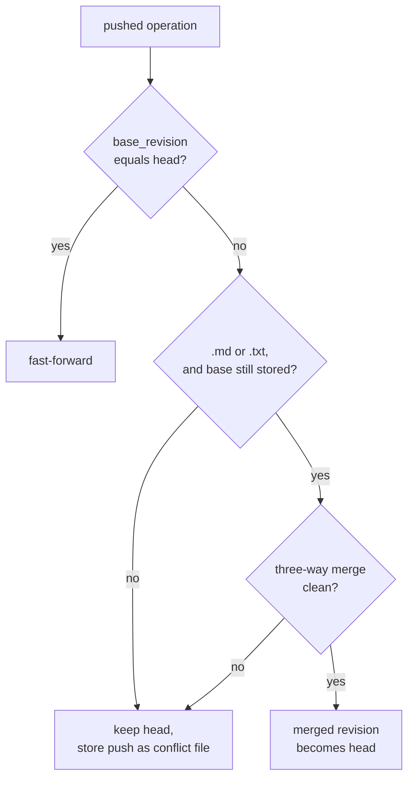
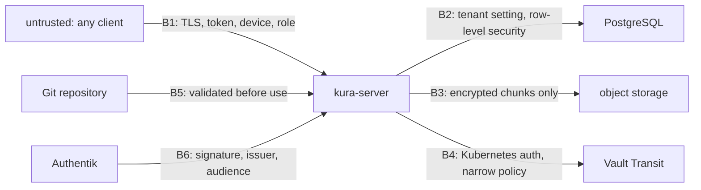

# RFC 0001 — weebo-kura: self-hosted sync backend for Obsidian vaults

Nov 13, 2026 · @Maxime

| Field | Value |
| --- | --- |
| Status | Draft |
| Short | Kura sync backend |
| Settles | How Obsidian vaults are synced across devices through a self-hosted, multi-tenant backend authenticated by OIDC |
| Author | Maxime (batleforc) |
| Co-author | Claude Fable 5.2 |
| Created | 2026-11-13 |
| Supersedes | — |
| Touches | New repository: `crates/kura-server`, `crates/kura-core`, `crates/kura-cli`, `plugin/`, `helm/`, `Containerfile`, `docs/` |
| Risk | high |

This is a greenfield RFC. No code exists yet, so every symbol named below is proposed, and §6.P lists the observations the proof must produce, not observations already made.

## 1. Summary

weebo-kura is a self-hosted, multi-tenant sync backend for Obsidian vaults, written in Rust. It keeps any number of devices in near-real-time sync, authenticates every caller through OIDC against Authentik, and exposes the same vaults to a TUI and, read-only, to an agent or a web UI. It replaces Notion as the home of a personal knowledge base. The project owns both sides of the protocol: `kura-server`, and clients built on one shared crate, `kura-core` (an Obsidian plugin, `kura-cli` and a TUI). The name comes from the Japanese *kura* (蔵), a storehouse for valuables.

### Before / after

```text
# today
Notion (SaaS) <-- browser and mobile app
  proprietary format, no files on disk, not behind our OIDC

# with this RFC
Obsidian plugin (desktop, Android) --+
kura TUI, kura-cli ------------------+--> kura-server --> PostgreSQL
agent or UI (read-only API key) -----+        |       --> object storage
                                              |       --> Vault Transit
                              tokens checked against Authentik
```



The diagram shows the one new trust decision: every request reaches storage only through `kura-server`, which refuses a caller with no valid token, a token for another tenant or a revoked device.

## 2. Motivation

1. **The knowledge base is locked in a SaaS.** Notes live in Notion in a proprietary format. They are not files, so neither the TUI nor an agent can read them, and they sit outside Authentik.
2. **No existing Obsidian sync combines self-hosting with OIDC.** Obsidian Sync cannot be self-hosted. Self-hosted LiveSync requires CouchDB and offers JWT with pre-shared keys, not an OIDC flow. Relay supports OIDC but its login and permission server is proprietary.
3. **The device count is not fixed.** Three devices today, anywhere from 1 to 15 tomorrow. File-level tools such as Syncthing or git give no near-real-time sync on Android and no conflict policy.
4. **Other consumers need the notes without Obsidian.** A TUI must browse and search a vault with no local copy, and an agent must read it through an API. Both need a server that understands content.
5. **The rest of the platform is multi-tenant and GitOps.** A sync service configured by hand, for one user, would be the exception on weebo-si.

## 3. Goals / non-goals

**Goals**

- A change made on one device is visible on other online devices within a few seconds, for 1 to 15 or more devices.
- Every caller is authenticated through OIDC against Authentik, with no static password or shared secret.
- Obsidian on desktop and Android, and a TUI that talks to the backend directly, all sync the same vaults.
- Several tenants share one deployment, with roles at tenant and vault level mapped from OIDC claims.
- The whole configuration is declarative and lives in Git.
- The service is stateless and scales horizontally on Kubernetes.
- An agent or a UI can read and search a vault through the same backend.
- No write is ever silently lost.

**Non-goals**

- **Simultaneous co-editing with live cursors**: one author on many devices does not need a CRDT, and it would add state beside every file.
- **End-to-end encryption**: the server must read notes to merge, index and serve them to an agent.
- **Write access for agents**: read-only in v1, until the write path has run in production.
- **A web UI**: this RFC provides the API a UI would use, not the UI.
- **Public sharing or publishing of notes**: every reader is an authenticated tenant member or a scoped token.
- **iOS**: no device to test on.
- **Background sync on Android while Obsidian is closed**: plugins do not run then.
- **A Notion importer**: the export is converted with existing Obsidian tooling before the first sync.
- **A Kubernetes operator**: the configuration format is designed so one can be added later without a redesign.

## 4. User-facing design

### 4.1 Configuration

Everything a platform operator decides is declared in files, loaded from a mounted directory and reconciled by the server. The documents use the Kubernetes resource shape so that they can become custom resources unchanged if an operator is written later. The API group below is a placeholder.

```yaml
# server.yaml
oidc:
  issuer: https://auth.example.org/application/o/kura/
  audiences: [kura-plugin, kura-cli]        # one client_id per client type
  platformAdmin: { claim: groups, value: kura-platform-admins }
trustedProxies: []                          # CIDRs allowed to set forwarding headers
cors:
  allowedOrigins: [app://obsidian.md, capacitor://localhost, http://localhost]
---
apiVersion: kura.weebo.dev/v1alpha1
kind: Tenant
metadata: { name: maxime }
spec:
  claimMappings:
    claim: groups
    roles: { owner: [kura-maxime-owners], member: [kura-maxime] }
  retention: { maxRevisionAge: 180d, maxRevisionsPerEntry: 200, deletedEntryTtl: 90d }
  quota: { storage: 20Gi, maxFileSize: 2Gi }
  search: { enabled: true }
  deletionPolicy: Retain
---
apiVersion: kura.weebo.dev/v1alpha1
kind: Vault
metadata: { name: knowledge, tenant: maxime }
spec:
  chunking: { min: 256Ki, avg: 1Mi, max: 4Mi }
  configSync: { categories: [plugins, themes, hotkeys] }
  bindings:
    - { role: editor, claimValue: kura-maxime }
```

Defaults, all on the closed side:

- `claimMappings` absent or empty: the tenant has no members.
- `bindings` absent: only tenant `owner` and `admin` can open the vault.
- `search.enabled` absent: false. The index is plaintext (§9), so indexing is opt-in.
- `configSync` absent: the `.obsidian` folder does not sync.
- `deletionPolicy` absent: `Retain`. Removing a document disables the object and keeps its data.
- `trustedProxies` absent or empty: forwarding headers are ignored and the peer address is used. Scoped tokens bound to a CIDR are then checked against the ingress address and refused, which fails closed.
- `cors.allowedOrigins` absent: the three Obsidian origins shown. This default is not the empty list because the plugin cannot work without them, and CORS is not the access control here: the API accepts bearer tokens only, never ambient credentials.
- No secret appears in any file. Vault is reached through the Kubernetes auth method; database and bucket credentials come from External Secrets.

Objects declared in files are read-only through the API. Vaults and vault bindings may instead be created through the API, in which case they are marked as API-managed.

### 4.2 Behaviour rules

- **The uninteresting case**: one device, no conflict. A push whose base matches the head is a fast-forward; nothing is merged and no conflict file is created.
- **Role precedence**: the effective right on a vault is the highest of the caller's tenant role and any vault binding that matches.
- **Paths** are NFC-normalized and unique on their case-folded form. A path that breaks a rule is refused; the client reports the file and never renames it silently.
- **Notifications are hints.** A client always pulls from its cursor, so a lost notification costs latency, never correctness.
- **Server time is the only clock.** Client timestamps are metadata and never order anything.
- **Search disabled**: the search endpoint answers `409` with type `search_disabled`; nothing else changes.
- **Reconciliation** runs at startup and on every file change, without a restart, and is idempotent.

### 4.3 Validation

Rejected at startup or when a file changes. On a bad change the server keeps the last valid configuration.

| Condition | Rationale |
| --- | --- |
| A document fails its schema, or has an unknown `kind` or role | A typo must not silently drop a tenant or a permission |
| Two tenants, or two vaults in one tenant, share a name | Ownership would be ambiguous |
| `chunking` is not `min < avg < max`, or `max` exceeds 4 MiB | Larger bodies break mobile clients (§6.8) |
| A vault's `chunking` differs from the value it was created with | Deduplication against stored chunks would break |
| `oidc.issuer` is not HTTPS or `audiences` is empty | Token validation would be meaningless |

Warnings, and where the operator sees them:

| Condition | Behaviour | Surfaced in |
| --- | --- | --- |
| A tenant or vault was removed from the files with `Retain` | Disabled, data kept | `GET /v1/admin/status`, metric `kura_config_warnings`, startup log |
| A quota is set below current usage | Reads continue, writes are refused | Same, plus the commit error seen by clients |
| Scoped tokens with CIDRs exist while `trustedProxies` is empty | Those tokens are refused | Same |
| `deletedEntryTtl` is shorter than a device's last absence | That device will run a full resync | Same, with the device named |

### 4.4 API surface

All paths are under `/v1`. "OIDC" means an access token plus the `X-Kura-Device` header; "key" means a scoped token. Limits are per-caller defaults and configurable. The OpenAPI document is generated from the handlers with utoipa, and the plugin's client is generated from it.

| Method | Path | Auth | Who may call | Limit |
| --- | --- | --- | --- | --- |
| POST | `/devices` | OIDC | Any tenant member | 10/min |
| GET | `/vaults` | OIDC or key | Returns only vaults the caller can read | 60/min |
| GET | `/vaults/{v}/changes?since=` | OIDC or key | `viewer` and above | 600/min, 1,000 items per page |
| GET | `/vaults/{v}/entries` | OIDC or key | `viewer` and above | 60/min, 1,000 items per page |
| GET | `/vaults/{v}/entries/{e}/revisions` | OIDC or key | `viewer` and above | 60/min |
| POST | `/vaults/{v}/chunks/missing` | OIDC | `editor` and above | 600/min, 1,000 hashes per call |
| PUT | `/vaults/{v}/chunks/{hash}` | OIDC | `editor` and above | Body at most 4 MiB |
| GET | `/vaults/{v}/chunks/{hash}` | OIDC or key | `viewer` and above | 600/min |
| PUT | `/vaults/{v}/blobs/{hash}` | OIDC | `editor` and above | Manifest bounded by `maxFileSize` |
| POST | `/vaults/{v}/commits` | OIDC | `editor` and above | 120/min, 1,000 operations |
| POST | `/vaults/{v}/events/ticket` | OIDC | `viewer` and above | 10/min |
| GET | `/vaults/{v}/events?ticket=` | Ticket | Holder of a fresh ticket | 4 sockets per device |
| GET | `/vaults/{v}/search?q=` | OIDC or key | `viewer` and above | 60/min, 50 results |
| POST | `/vaults/{v}/tokens` | OIDC | Vault `manager`, tenant `admin` | 10/min |
| GET | `/admin/status` | OIDC | Platform admin | 60/min |

A vault the caller cannot read answers `404`, not `403`, so tenants cannot probe for each other's vaults. Errors use `application/problem+json` (RFC 9457) with a stable `type`. Collections are paged by keyset, never by offset.

### 4.5 Mocks

**`kura login` — nominal**

```text
$ kura login --server https://kura.example.org
Open https://auth.example.org/device and enter the code:

    WDJB-MJHT

Waiting for approval... [green]done[/green]
Logged in as maxime. Device "desk-01" registered (profile: desktop).
$ echo $?
0
```

Decides that the code is shown alone on its line, and that the device name and profile are confirmed.

**`kura login` — code expired**

```text
Waiting for approval... [red]expired[/red]
error: the code was not approved within 10 minutes. Run `kura login` again.
$ echo $?
2
```

Decides that an error says what to do next.

**`kura status` — nominal, empty and conflict**

```text
$ kura status
VAULT       ROLE     STATE      PENDING  CONFLICTS  LAST SYNC
knowledge   editor   [green]in sync[/green]    0        0          12s ago
projects    viewer   [yellow]syncing[/yellow]    14       0          now
journal     editor   [red]conflict[/red]   0        2          3m ago

$ kura status          # no vault visible to this user
No vault. Ask a tenant admin for access.
```

Decides the columns and that the role is always visible, since it explains a refused push.

**`kura sync` — refused push (the §6.P refusal)**

```text
$ kura sync projects
[red]error[/red]: projects: push refused, your role is viewer (403 insufficient_role)
Local changes are kept in 14 files and were not uploaded.
$ echo $?
3
```

Decides that a refusal states the role, and that local edits are safe.

**Plugin status bar — every state**

```text
[ Kura: in sync ]   [ Kura: syncing 14 ]   [ Kura: offline ]
[ Kura: 2 conflicts ]   [ Kura: sign in ]   [ Kura: read-only (viewer) ]
```

Decides that state is text, never colour alone. A click opens the panel below.

**Plugin settings — signed in**

```text
+-- Kura Sync -----------------------------------------------+
| Server    [ https://kura.example.org              ]        |
| Account   maxime  -  device "pixel-8" (mobile)   [Sign out] |
| Vault     [ knowledge              v ]  role: editor       |
| Sync Obsidian settings  [x] plugins [x] themes [ ] hotkeys |
| Skip files larger than  [ 200 ] MiB on this device         |
| Conflicts (2)                                              |
|   Meeting notes (conflict pixel-8 2026-11-13).md    [Open] |
|   Ideas (conflict desk-01 2026-11-12).md            [Open] |
| Unsyncable files (1)                                       |
|   drafts/what?.md  -  "?" is not allowed in a name         |
+------------------------------------------------------------+
```

Decides that conflicts and unsyncable files are listed where the user configures sync, each with its reason.

**Plugin sign-in — device code**

```text
+-- Sign in to Kura -----------------------------+
| 1. Open  https://auth.example.org/device [Open] |
| 2. Enter this code:    WDJB-MJHT        [Copy] |
|                                                |
| Waiting for approval...            [Cancel]    |
+------------------------------------------------+
```

Decides that sign-in works on a phone without a redirect: one button opens the browser, one copies the code.

## 5. Architecture

`kura-server` is one stateless Rust binary. All durable state lives in PostgreSQL and object storage, so any replica can serve any request.

### 5.1 Components


It shows that clients reach Authentik only to obtain tokens and reach storage only through the server.

| Layer | Crate or package | Responsibility |
| --- | --- | --- |
| HTTP and WebSocket | `kura-server::http` | Parsing, authentication, authorization, limits, error mapping |
| Domain | `kura-server::sync` | Commits, pulls, merge, retention |
| Storage | `kura-server::store` | PostgreSQL queries, chunk encryption, object storage |
| Shared client logic | `kura-core` | Protocol client, local state, change detection, chunking |
| Shells | `plugin/`, `kura-cli`, TUI | File and network access, UI |

### 5.2 A push crossing the components



It shows that content is stored before the commit references it, and that device B learns of the change by a hint and then pulls.

### 5.3 Deciding the outcome of one pushed operation



It shows that every branch ends with both versions stored.

### 5.4 Invariants

- Because `seq` is assigned while holding a lock on the vault row, no commit can become visible below a `head_seq` a client has already read. A client therefore never skips a change.
- Because a chunk's database row is written only after its object is stored and its hash verified, a manifest never references content the server does not hold.
- Because every query runs with a tenant setting enforced by row-level security, a handler that forgets a tenant filter returns nothing instead of another tenant's rows.
- Because conflicts produce a result and never an error, a client cannot lose an edit by retrying.

## 6. Detailed design

### 6.1 Data model

The source of truth is a change log per vault, ordered by a monotonic sequence number `seq`.

| Entity | Key fields | Notes |
| --- | --- | --- |
| `tenant` | `id`, `slug`, `claim_mappings`, `retention_policy`, `quota_bytes`, `transit_key`, `search_enabled` | Declared in configuration; one Transit key per tenant |
| `vault` | `id`, `tenant_id`, `name`, `wrapped_dek`, `head_seq`, `horizon_seq`, `chunking_params` | A lock on this row serializes commits |
| `role_binding` | `tenant_id`, `vault_id`, `subject`, `role` | Subject is a user or a claim value |
| `entry` | `id`, `vault_id`, `namespace`, `path`, `path_key`, `head_revision`, `last_seq`, `deleted` | Stable id, so a rename keeps its history |
| `revision` | `id`, `entry_id`, `seq`, `base_revision`, `blob_hash`, `size`, `device_id`, `created_at` | Immutable |
| `blob` | `vault_id`, `hash`, `size`, `chunk_hashes` | Manifest of one file version |
| `chunk` | `vault_id`, `hash`, `size`, `object_key`, `created_at` | Addressed by BLAKE3 of the plaintext |
| `device` | `id`, `user_sub`, `name`, `profile`, `last_seen`, `revoked_at` | Removed after 180 days without activity |
| `scoped_token` | `id`, `vault_id`, `path_prefix`, `mode`, `allowed_cidrs`, `expires_at`, `last_used_at`, `token_hash` | §6.2 |
| `commit` | `vault_id`, `idempotency_key`, `result`, `created_at` | Kept 7 days |
| `ws_ticket` | `jti`, `expires_at` | Kept until expiry, 30 seconds |
| `index_job` | `vault_id`, `entry_id`, `revision_id` | Deleted when processed |

Every table carries `tenant_id` and has a stated lifetime; none grows without a purge. Hashes are stored as 32-byte `bytea`, not hex text. Each frequent query has exactly one supporting index:

| Query | Index |
| --- | --- |
| Changes after a cursor | `entry (vault_id, last_seq)` |
| Path lookup and uniqueness | Unique `entry (vault_id, namespace, path_key)` where not deleted |
| History of an entry | `revision (entry_id, seq)` |
| Chunk presence | Primary key `chunk (vault_id, hash)` |
| Search | GIN on the lexeme column; trigram GIN on `path` |
| Garbage collection sweep | `chunk (created_at)` |

### 6.2 Tenancy, authentication and authorization

A user belongs to a tenant when one of the tenant's claim mappings matches a value in the user's token. With Authentik the claim is usually `groups`, so a tenant is in practice a set of groups, one per role.

| Level | Role | Grants |
| --- | --- | --- |
| Tenant | `owner` | Everything, including key rotation and tenant deletion |
| Tenant | `admin` | Create and delete vaults, manage bindings and scoped tokens |
| Tenant | `member` | Access only to vaults where a vault role is bound |
| Vault | `manager` | Read, write, restore, manage the vault's bindings and tokens |
| Vault | `editor` | Read, write, restore |
| Vault | `viewer` | Read, search, list history |

User clients:

- All clients use the OAuth 2.0 device authorization grant (RFC 8628), as public clients with no secret.
- Authentik prerequisites: a device code flow must be created and set on the brand, since none ships by default, and the provider needs the `offline_access` scope mapping, without which no refresh token is issued.
- `auth::verify_access_token` checks signature, issuer, audience and expiry against the JWKS. Keys are cached, at most 16, and refetched on an unknown key id, at most once a minute.
- Role claims are read from the access token. If the configured claim is absent, the server asks the userinfo endpoint and caches the answer for the token's lifetime, in a cache bounded to 10,000 entries.
- Refresh tokens are issued and rotated by Authentik. The plugin stores them in Obsidian's `SecretStorage`, the TUI and CLI in the OS keyring.
- A client registers a device record tied to the token's subject. `auth::require_device` rejects a request whose device is revoked or belongs to another subject.
- Revoking a device blocks that device id at once. It does not invalidate the refresh token the device holds, so a full lockout also requires ending the session in Authentik.

Scoped tokens, for non-interactive consumers:

- Format `kura_<token id>_<secret>`. The secret carries 256 bits of entropy, is stored as a SHA-256 hash and compared in constant time.
- Scope is one vault, an optional path prefix, a mode (`read` only in v1), a mandatory expiry and a CIDR allowlist.
- Each use updates `last_used_at` at most once a minute and emits an audit event.

### 6.3 Sync protocol

Each device keeps one cursor per vault: the last `seq` it has applied.

**Paths**

- Relative, `/`-separated, NFC-normalized UTF-8, at most 255 bytes per segment and 4,096 bytes in total.
- Unique on the case-folded form, so `Note.md` and `note.md` cannot coexist.
- A segment may not be `.` or `..`, end with a dot or a space, or contain a control character or any of `< > : " \ | ? *`.
- Parsed once, at the HTTP boundary, into a `VaultPath` type that cannot hold an invalid value.

**Commits**

- Entry ids are UUIDv7 values generated by the client.
- A commit runs in one transaction that locks the vault row, assigns consecutive `seq` values and updates `head_seq`.
- Each operation comes back `accepted`, `merged` or `conflicted`. A commit fails as a whole only on invalid input: a missing chunk, a forbidden path, an insufficient role or an exceeded quota.
- The idempotency key is stored with the result for 7 days; a retried commit returns the stored result.
- Merges are computed before the lock is taken. The head is rechecked under the lock, and the merge is retried at most 3 times before the operation falls back to a conflict file.

**Pulls**

- `changes` returns at most one item per entry: its current state, when its `last_seq` is greater than the cursor. Pruning history therefore never breaks a pull.
- The response carries the `head_seq` it was computed against. The cursor advances only after every page is applied.
- A vault's `horizon_seq` marks the point below which deleted entries were purged. An older cursor receives `410 Gone` and runs a full resync: fetch the entry list, delete local files absent from the server and unchanged since the last sync, push the rest as new changes.
- Applying a remote change does not trigger a push: the file the client just wrote matches its recorded hash.

**Notifications**

- A web view cannot set an `Authorization` header on a WebSocket. The client requests a ticket, signed by the server, bound to the device and vault, valid 30 seconds. On connection the server inserts its `jti` into `ws_ticket`; a second use fails on the unique key.
- The socket closes when the token behind the ticket expires.
- Each replica holds one dedicated `LISTEN` connection, outside any transaction-mode pooler. When it reconnects after a drop, the replica tells its sockets to pull.
- Each socket has a bounded send queue of 16 messages. A slow consumer is dropped and pulls on reconnect.
- Clients do not poll while the socket is up. They pull on start, on resume and on notification, and fall back to a 60-second timer only while the socket is down.

### 6.4 Chunking and storage

- A file is split by content-defined chunking (FastCDC). Proposed defaults: 256 KiB minimum, 1 MiB average, 4 MiB maximum. Most notes are one chunk.
- A chunk is addressed by the BLAKE3 hash of its plaintext; a blob is the ordered list of those hashes. The server recomputes the hash on upload and rejects a mismatch.
- Upload and download resume by asking which chunks are missing. An edit to a large file re-sends only the chunks around the change.
- Chunk responses are immutable and carry `Cache-Control: private, immutable` and an `ETag`. JSON responses are compressed.
- Hashing, chunking, encryption and merging are CPU work and run on the blocking pool, never on an async worker.

Each chunk is compressed with zstd at level 3 before it is encrypted, and stored compressed only when that saves at least 10%; a one-byte header records the codec used. The chunk hash is always that of the uncompressed plaintext, so addressing and deduplication do not depend on compression.

Compression can never cost data. Before a compressed chunk is stored, `store::put_chunk` decompresses it and checks that the BLAKE3 hash of the result equals the chunk hash. On any mismatch or error the chunk is stored uncompressed and `kura_compress_fallback_total` is incremented. Decompression is bounded to the 4 MiB chunk ceiling. Because the stored bytes are standard zstd frames behind a codec byte, the implementation can be replaced without rewriting any chunk.

### 6.5 Conflict resolution

| Situation | Resolution |
| --- | --- |
| Base matches head | Fast-forward |
| Text file, both sides changed, merge is clean | The merged result becomes the head |
| Text file, overlapping edits | Head kept; the push is stored as a sibling conflict file |
| Text file, base revision pruned by retention | Handled as overlapping edits |
| Non-mergeable file, both sides changed | Head kept; the push is stored as a conflict file |
| Same path created on two devices | Identical content: unified. Otherwise the second becomes a conflict file |
| Edit against a deleted entry | The edit wins and the entry is restored |
| Delete against an entry edited since | The delete is dropped |
| Rename on one side, edit on the other | Both apply |
| Two renames of the same entry | The later commit wins |
| Rename or create onto an occupied path | The incoming entry gets a suffixed name |

Only `.md` and `.txt` files are merged, line by line; a textual merge of `.canvas` or other JSON can produce a file that no longer parses. A conflict file carries the device name and date in its name. Entries in a configuration namespace never produce conflict files, which Obsidian would load as settings: the last write wins and the overwritten version stays in history.

### 6.6 Encryption at rest

- Envelope encryption: one Transit key per tenant, one data key per vault. The data key comes from Transit's `datakey` endpoint and is stored only in wrapped form.
- The plaintext data key is held in a wrapper that cannot be printed or logged and is wiped on drop, in a cache bounded to 1,000 keys with a 10-minute TTL.
- Each chunk is encrypted with AES-256-GCM under the data key, with a random 96-bit nonce and the vault id and chunk hash as associated data.
- The object key in the bucket is a keyed hash of the chunk hash, under a per-vault secret derived from the data key. Holding the bucket alone does not let anyone test whether a known file is stored.
- Rotating a tenant's Transit key means `rewrap` on its data keys; chunks are not re-encrypted.
- Deleting a tenant's Transit key makes its content unrecoverable. Transit requires `deletion_allowed` on the key first, which tenant deletion sets as its last step.

### 6.7 Search

- PostgreSQL full-text search, opt-in per tenant. Only the head revision of each Markdown entry is indexed.
- A commit inserts an `index_job` row in its own transaction. Workers claim jobs with `FOR UPDATE SKIP LOCKED`, at most 100 per batch.
- Each entry is indexed under both the `french` and `english` configurations with accents folded. A trigram index on paths covers fuzzy filename lookups.
- Raw text is not stored a second time; snippets come from decrypting the top results at query time. A note is indexed up to 1 MB of text, the cap of a `tsvector`.
- Queries are filtered by tenant, vault and, for a scoped token, path prefix.
- The database needs the `unaccent` and `pg_trgm` extensions.

### 6.8 Clients

`kura-core` holds all sync logic: protocol client, local state (path to entry id, revision, hash, size and modification time), change detection and chunking. File and network access go through traits, so each shell supplies its own and tests supply fakes.

- **Change detection** rehashes a file only when its size or modification time changed, so starting the client does not rehash the vault.
- **Plugin**: a TypeScript shell implementing the core's traits on the Obsidian API. It requires Obsidian 1.11.4 for `SecretStorage`. The WASM core is embedded in `main.js`, because a community plugin ships as `main.js`, `manifest.json` and `styles.css` only.
- **Plugin transport**: `fetch` against the server's CORS allowlist. Obsidian's `requestUrl` bypasses CORS but passes bodies as base64 on mobile and is reported to crash on bodies of tens of megabytes; the 4 MiB chunk ceiling keeps either transport safe. Calls to Authentik use `requestUrl`.
- **Plugin secrets**: the refresh token lives in `SecretStorage` under an id that includes the server and vault ids, since the store is reported to be shared across vaults on mobile. It is never written to `data.json`.
- **Obsidian configuration**: optional, by category, shared per device profile (`desktop`, `mobile`) as separate namespaces of the vault. The vault API does not expose dot-folders, so the plugin reads `.obsidian` through the adapter API and scans it on app resume and at most every 5 minutes. Workspace state never syncs.
- **Mobile limits**: a file is read into memory before hashing, so the plugin skips files above a configurable size, 200 MiB by default, and lists them as unsyncable.
- **TUI and `kura-cli`**: link the core natively. The TUI needs no local vault and uses the search endpoint. The CLI comes first, as the reference client for protocol tests and as a sync daemon.

### 6.9 History, retention and garbage collection

- Every revision is kept until the tenant's policy prunes it: `maxRevisionAge`, `maxRevisionsPerEntry`, `deletedEntryTtl`. The head of a live entry is never pruned.
- Restoring a revision creates a new revision with the old content.
- Purging deleted entries advances `horizon_seq`. `deletedEntryTtl` should exceed the longest expected absence of a device; the default is 90 days.
- Garbage collection deletes a chunk's row in a transaction that rechecks the chunk is unreferenced, then deletes the object. Chunks younger than 24 hours are never collected.
- Pruning and collection run in batches of 1,000 with a pause between batches, in a configurable off-peak window, and are idempotent.

### 6.10 Configuration reconciliation

- The server watches the configuration directory. A change is parsed and validated as a whole; if any document is invalid, the previous configuration stays in force (§4.3).
- With several replicas, each one loads the files; one takes a PostgreSQL advisory lock to write the resulting state.
- Each object records whether configuration or the API manages it. Status and warnings are served by `GET /v1/admin/status`.
- An operator would feed the same `reconcile` function from custom resources and write status to each resource.

### 6.11 Engineering rules

The code follows the `weebo-good-practice` skill. The points below are the ones this design depends on.

- **No panic on an expected path.** The workspace takes the skill's lint table: no `unwrap`, `expect`, indexing or unchecked arithmetic outside tests, except under a reasoned `#[expect]`. This matters most in `kura-core`: a panic in WASM would kill sync inside Obsidian, so no panic may cross the WASM boundary.
- **Typed errors.** One `thiserror` enum per crate; `anyhow` only in the binaries. Errors are mapped once, at the HTTP boundary, to a stable problem type that leaks no SQL, path or stack.
- **Parse at the trust boundary.** `VaultPath`, `ChunkHash`, `EntryId`, `Seq`, `TenantSlug` and the configuration documents are types whose constructor is the only check.
- **Bounded by default.** Every cache, queue, page, batch, retry and request body in this RFC has a stated limit. Every outbound call has a timeout: 5 seconds to PostgreSQL, Vault and Authentik, 30 seconds to object storage. Retries are capped at 3, with backoff and jitter.
- **Async hygiene.** No blocking work on async workers; spawned tasks tracked in a `JoinSet`; shutdown through a cancellation token that drains sockets and lets running commits finish.
- **Secrets.** Data keys, tokens and tickets use a wrapper that implements neither `Debug` nor `Display`, and are compared in constant time.
- **No `unsafe`** in the workspace beyond what the WASM bindings generate.
- **TypeScript.** The plugin shell compiles with `strict` and `noUncheckedIndexedAccess`, with no `any`, non-null assertion or unchecked cast.
- **Sobriety (RGESN, GR491).** Keyset pagination and field-limited responses; compression and immutable caching; no polling where an event exists; a retention rule for every table; batched, off-peak, idempotent jobs; no dependency that the standard library or an existing one covers.

### 6.P Proof against a real client

Suite: `tests/heavy/sync.sh` and `tests/heavy/authz.sh`, to be written, driving `kura-cli` at the built commit and Obsidian 1.11.4 or later on desktop and Android, against Authentik and a real PostgreSQL, object store and Vault. Nothing below has been run; these are the observations the suite must produce before the RFC can be marked Implemented.

1. `kura sync` on device A after editing `a.md`, then `kura status` on device B: B shows the change within 5 seconds, and the server log shows one commit and one notification.
2. `kura sync` with a token whose role is `viewer` exits 3 with `403 insufficient_role`. The object store shows no new object and `chunk` no new row: the refused bytes were never stored.
3. `curl` with a scoped token from an address outside its CIDR allowlist gets `403 address_not_allowed`. The audit log has one deny event and `last_used_at` is unchanged.
4. `curl` for a vault of another tenant, with a valid token, gets `404`, byte-identical to the answer for a vault that does not exist.
5. A revoked device calling `changes` gets `401 device_revoked`, while another device of the same user succeeds.
6. A device whose cursor is below `horizon_seq` gets `410`, runs a full resync, and a note deleted during its absence is absent afterwards on every device.
7. Two devices editing the same paragraph offline: the second push returns `conflicted`, both versions exist as files, and neither device loses text.
8. `PUT chunks/{hash}` with a body whose BLAKE3 differs gets `422 hash_mismatch`, and no object is written.
9. Obsidian on Android, signed in through the device code flow, syncs a 50 MiB attachment over a connection cut twice; the upload resumes and only missing chunks are re-sent, as shown by the request log.
10. A WebSocket opened twice with the same ticket: the second is closed with `ticket_used`.

**Deliberately untouched**, so reviewers do not go looking:

- Obsidian's own file format and vault layout: the server stores files as opaque paths and bytes, apart from indexing Markdown text.
- Authentik's flows and token lifetimes: this RFC consumes tokens and changes no identity provider behaviour beyond the two prerequisites of §6.2.
- The Notion export: converting it is a one-off step outside the backend.

## 7. Security

**Rating:** high — the service stores the full content of personal notes for several tenants, on the network, behind an authentication layer it implements itself.

### 7.1 Threat model

Assets: note content and history, data keys, tokens and API keys, the tenant boundary, availability, the audit trail. Actors: an anonymous network client, an authenticated member, a member of another tenant, a holder of a scoped token, a stolen or lost device, a reader of the bucket or of a database dump, the platform operator. Attacker-controlled inputs: every HTTP header, path, query and body; file paths and file content; chunk bytes and hashes; commit operations; search queries; WebSocket tickets; the claims of a token until its signature is verified; configuration documents, by whoever can write to the Git repository.



Symbols and tests in the table are proposed names; each test is listed in §14.

| # | Threat (STRIDE) | Where | Mitigation and enforcement | Residual risk |
| --- | --- | --- | --- | --- |
| T1 | Spoofing: forged or foreign token | B1, B6 | `auth::verify_access_token` checks signature, issuer, audience, expiry; test `rejects_token_for_other_audience` | Authentik compromise; accepted by the owner |
| T2 | Spoofing: stolen device or refresh token | B1 | `auth::require_device` blocks a revoked device id; test `revoked_device_is_refused` | The refresh token stays valid until the Authentik session ends; accepted, documented in §6.2 |
| T3 | Elevation: a role above the caller's | B1 | `authz::require_role` on every handler, checked on the vault object before any work; test `viewer_cannot_commit` | None known |
| T4 | Information disclosure across tenants | B2 | Row-level security from a per-transaction tenant setting, and `404` for unreadable vaults; tests `rls_hides_other_tenant`, `foreign_vault_is_404` | A superuser database role bypasses RLS; the server never uses one |
| T5 | Information disclosure: scoped token leak | B1 | Hash at rest, mandatory expiry, CIDR allowlist in `auth::verify_scoped_token`; test `token_outside_cidr_is_refused` | A leak inside the allowed network; limited to read, one vault, until expiry |
| T6 | Tampering: wrong bytes under a hash | B1, B3 | `store::put_chunk` recomputes BLAKE3; AES-GCM authenticates on read; test `hash_mismatch_is_422` | None known |
| T7 | Tampering: path traversal or collision | B1 | `VaultPath::try_from`; fuzz target `fuzz_vault_path`; test `dotdot_is_rejected` | None known |
| T8 | Information disclosure: bucket or dump theft | B3, B2 | Envelope encryption, keyed object keys | The search index and metadata in a database dump are plaintext; accepted, search is opt-in |
| T9 | Denial of service: large or many requests | B1 | Body, page, batch and socket limits (§4.4), per-caller rate limits, tenant quota; test `oversized_chunk_is_413` | A member can fill their own tenant's quota; accepted |
| T10 | Repudiation: who changed or read what | B1 | Every revision records device and subject; audit events for denials and token use | Reads by OIDC users are not audited individually; accepted |
| T11 | Spoofing: replayed WebSocket ticket | B1 | Signed, 30-second, single-use ticket; test `ticket_reuse_is_refused` | The ticket appears in the ingress access log for 30 seconds of validity; accepted |
| T12 | Elevation: malicious configuration change | B5 | Schema validation, `Retain` by default, Git review | Whoever can merge to the repository is a platform admin; by design |
| T13 | Information disclosure: operator reads notes | B2, B3, B4 | None by design | Accepted by the owner: the cost of server-side merge, search and agent access |

### 7.2 Authentication and authorisation

No endpoint is reachable without credentials except the health probes. Authorization is default-deny: an absent binding means no access, and the check runs on the vault object, before any chunk is read or written. Tokens never travel in URLs, with the one exception of the WebSocket ticket (T11). The API accepts bearer credentials only, so there is no cookie and no CSRF surface.

### 7.3 Input handling and injection

- Paths: §6.3. They never become filesystem paths on the server, which stores content in object storage under keys it derives itself.
- SQL: bound parameters only, checked at compile time. Search input goes through `websearch_to_tsquery`, which cannot raise on user input.
- Configuration documents: strict schema, unknown fields rejected.
- Markdown is never rendered by the server. Snippets are returned as plain text.
- No URL from a client is ever fetched, so there is no SSRF surface. The only outbound hosts are configured: Authentik, Vault, PostgreSQL, object storage.
- Three-way merge runs on at most 4 MiB of text per side.

### 7.4 Secrets and cryptography

- Primitives: AES-256-GCM, BLAKE3, SHA-256, and the identity provider's signature algorithm for tokens. All from audited crates (§8); nothing home-made.
- Data keys exist in plaintext only in server memory. Scoped tokens and tickets are compared in constant time.
- No secret is logged, placed in a metric label or returned in an error. Tokens and keys are redacted by type, not by convention (§6.11).
- Rotation: Transit key per tenant by `rewrap`; scoped tokens by expiry; the ticket signing key at each deployment.

### 7.5 Abuse and resource exhaustion

Limits are listed in §4.4 and §6. An unauthenticated caller can only make the server verify a token signature, against a cached key. Quota is checked before chunks are accepted. A slow WebSocket consumer is dropped (§6.3).

### 7.6 Existing defences that still hold

The cluster's network policies, TLS termination at the ingress, and Vault's own audit log are relied on and unchanged. The service adds no privileged workload: it runs as a non-root user with a read-only root filesystem.

## 8. Supply chain

The repository does not exist yet, so no audit has run. Versions, advisories and licences below are not verified: the table states the intended choice and why, and the first phase (§16) pins each one at the latest release that passes `cargo deny` and `cargo audit`. Licences shown are as recalled and must be confirmed by that gate.

| Dependency / image / tool | Why this one | Licence (to confirm) | Alternative we would own instead |
| --- | --- | --- | --- |
| `tokio`, `axum` | Async runtime and HTTP with WebSocket in one stack | MIT | None realistic |
| `sqlx` | Compile-time checked queries, `LISTEN` support | MIT or Apache-2.0 | None realistic |
| S3 client crate (`object_store` or the AWS SDK) | Chunk storage; choice made in phase 2 on transitive weight | Apache-2.0 | A minimal signed-request client: rejected, signing is easy to get wrong |
| `blake3` | Chunk and blob hashing, also in WASM | CC0-1.0 or Apache-2.0 | None |
| `fastcdc` | Content-defined chunking | MIT | About 200 lines; owning it is the fallback if the crate is unmaintained |
| `aes-gcm` | Chunk encryption | MIT or Apache-2.0 | None; no home-made crypto |
| `jsonwebtoken` | Token verification | MIT | None |
| Vault client (`vaultrs` or plain HTTP) | Four Transit calls and Kubernetes auth | MIT or Apache-2.0 | Plain HTTP with the existing client: preferred if `vaultrs` pulls too much |
| Three-way merge crate (`diffy` or equivalent) | Line merge for Markdown | MIT or Apache-2.0 | None; merge correctness is not worth owning |
| `thiserror`, `tracing`, `serde`, `uuid`, `unicode-normalization` | Errors, logs, formats, ids, NFC | MIT or Apache-2.0 | None |
| `secrecy`, `zeroize`, `subtle` | Secret wrappers, wiping, constant-time comparison | MIT, Apache-2.0, BSD-3-Clause | None |
| `opentelemetry` crates | Metrics and traces | Apache-2.0 | None |
| `utoipa` | OpenAPI generated from handlers | MIT or Apache-2.0 | A hand-written spec: rejected, it drifts |
| `wasm-bindgen` | WASM bindings for `kura-core` | MIT or Apache-2.0 | None |
| `obsidian` type package, a bundler, a generated API client | Plugin build | MIT | None |
| PostgreSQL with `unaccent`, `pg_trgm` | Already run on the platform; both extensions ship with PostgreSQL | PostgreSQL | None |
| Runtime base image | Minimal, non-root, pinned by digest | — | None |

Chunk compression (decisions 21 and 23) uses `zenzstd`, a pure-Rust zstd implementation that sets `#![forbid(unsafe_code)]` by default, instead of the usual `zstd` crate, which binds the C library and brings `unsafe` and a C build step.

| Candidate (checked 2026-11-13) | `unsafe` | State | Verdict |
| --- | --- | --- | --- |
| [`zenzstd`](https://github.com/imazen/zenzstd) | None in the default build | 0.1.0, MIT, levels 1 to 15 stable, six fuzz targets, output verified against C zstd; very young, 2 stars | Chosen, with the safeguards below |
| [`structured-zstd`](https://github.com/structured-world/structured-zstd) | Yes, in decoder hot paths | 0.0.59, Apache-2.0, all levels, actively released | Rejected on `unsafe` |
| `zrip` | Yes, in leaf modules | Levels up to 4 | Rejected on `unsafe` |
| `ruzstd` | Not checked | Mature decoder, but its encoder only has the fastest level | Rejected on ratio |
| `zstd` (C binding) | Yes, plus FFI | Reference implementation | Rejected on `unsafe` and the C toolchain |
| `miniz_oxide` (DEFLATE, not zstd) | None | Mature, widely used | Fallback codec |

Safeguards that make a young crate acceptable: it is built with `default-features = false` plus `std`, which leaves out the SIMD dependencies and both `unsafe-*` features; only level 3 is used, inside the stable range; every compressed chunk is verified by round trip before it is stored (§6.4); and frames are standard zstd, so any conforming decoder reads them. Phase 2 confirms the choice by fuzzing the round trip on the real vault and checking with `cargo geiger` that the dependency subtree is free of `unsafe`. If it fails, the codec byte switches new chunks to `miniz_oxide`.

- **Build and release**: a multi-stage `Containerfile` with a cargo-chef dependency layer, following the `weebo-containerfile` skill; CI actions pinned by SHA with least permissions; images and the plugin bundle signed with Sigstore; an SBOM published with each release.
- **Updates**: dependency updates are proposed automatically and gated by the audit task.
- **Typosquatting**: each crate name is checked against its repository before it is added.

## 9. Data and privacy

| Data | Personal? | Where stored | Retention | Who can read it | Leaves the instance? |
| --- | --- | --- | --- | --- | --- |
| Note content and attachments | Yes: whatever the author writes | Object storage, encrypted | Tenant retention policy | Vault role holders; the operator (T13) | No |
| File paths and sizes | Yes: titles can be personal | PostgreSQL, plaintext | With the entry | Same | No |
| Search index | Yes: the words of each note | PostgreSQL, plaintext | Rebuilt from heads; dropped when search is disabled | Same | No |
| OIDC subject | Yes: an identifier | `device`, `revision`, audit events | Device rows 180 days after last activity; revisions per policy | Tenant admins | No |
| Device name and profile | Yes: chosen by the user | `device` | Same | Tenant admins, the user | No |
| Source IP address | Yes | Audit events and access logs only | Log pipeline retention, 30 days proposed | Platform operator | No |
| Scoped token hash | No | `scoped_token` | Until expiry plus 30 days | Nobody; hash only | No |
| Group names from claims | Indirectly | Userinfo cache, in memory | Token lifetime | Nobody | No |

- **Minimisation**: the server stores no email address, display name or user agent. Metric labels carry tenant and vault ids only, never a path, a subject or an address.
- **Lawful basis**: the tenant's own use of its own data; the platform operator is the processor.
- **Export**: a vault is its files. Any client with read access holds a complete, plain copy.
- **Erasure**: deleting a tenant destroys its Transit key, which makes every chunk unreadable at once, backups included; rows and objects are then purged. Removing one user means deleting their device rows; their subject remains in the history of the revisions they authored until retention prunes them.
- **In transit**: TLS everywhere, including to PostgreSQL, Vault and object storage.
- **Backups** inherit the data and must follow the same retention.
- **No telemetry** leaves the instance, and the service works air-gapped apart from reaching its own Authentik.

## 10. Operability

### 10.1 Observability

- **Metrics**, prefix `kura_`, labels limited to `tenant`, `vault` and `outcome`: `commits_total`, `commit_duration_seconds`, `merge_total` by outcome, `notify_lag_seconds`, `ws_connections`, `index_queue_depth`, `chunk_bytes_stored`, `dedup_ratio`, `vault_call_duration_seconds`, `config_warnings`, `authz_denied_total`.
- **Logs**: structured, `info` for lifecycle and configuration changes, `warn` for refused requests, nothing per successful request at `info`. No token, path or note content at any level.
- **Audit events**, to the log pipeline: login, device registration and revocation, every authorization denial, role binding change, scoped token creation and use, restore, tenant key operation.
- **Traces**: one span per request, with child spans for PostgreSQL, object storage and Vault.
- **Alerts**: readiness failing on all replicas; `notify_lag_seconds` above 30 for 5 minutes; `index_queue_depth` growing for 15 minutes; any Vault unwrap failure; a tenant above 90% of quota.

### 10.2 Failure modes

| Failure | Detected by | Behaviour | Recovery |
| --- | --- | --- | --- |
| PostgreSQL down | Readiness probe | Fail closed: `503`; clients queue changes locally | Automatic; clients push on reconnect |
| Object storage down | Readiness probe | Fail closed for chunks; listings still work | Automatic |
| Vault unreachable | Vault call errors | Vaults with a cached key work until the 10-minute TTL; others answer `503` | Automatic |
| Authentik unreachable | JWKS or userinfo errors | Tokens verifiable with cached keys are accepted; an unknown key id is refused | Automatic |
| `LISTEN` connection lost | Connection error | Sockets are told to pull once it is back; clients fall back to the 60-second timer | Automatic |
| Invalid configuration pushed | Validation | Fail closed for the change: the last valid configuration stays; a warning is raised | Fix the file |
| Replica killed mid-commit | Transaction rollback | Nothing is visible; the client retries with the same idempotency key | Automatic |
| Quota reached | Commit error | Writes refused, reads continue | Raise the quota or prune |
| Search index behind | Queue depth | Search returns older results; sync is unaffected | Workers catch up |

Every security decision fails closed. The one deliberate fail-open is availability during a short Vault outage, through the key cache.

### 10.3 Performance and capacity

No number below is measured; each names the probe that will measure it (k6, through the `weebo-testing` skill).

- **Latency budget**: a one-note commit under 200 ms at the 95th percentile, and device-to-device propagation under 5 seconds.
- **Storage growth**: content after deduplication, plus about 100 bytes per chunk and a few hundred bytes per revision in PostgreSQL. A 10,000-note vault with 100 revisions per note stays well under 1 GiB of database.
- **Memory**: bounded by request body size (4 MiB) times concurrent uploads, plus the caches of §6.
- **High availability**: two replicas minimum; nothing is shared between them but PostgreSQL. Resource requests are sized from the load test, with no over-provisioning by default.
- **Backups**: PostgreSQL, the bucket and the Transit keys are all required. The database is dumped before the bucket is copied, so every chunk the dump references exists in the copy. Restore is tested in phase 6.

## 11. Other concerns

- **Accessibility**: the plugin's panel and modal (§4.5) use Obsidian's own setting components, so keyboard path, focus and contrast follow the active theme. State is always text, never colour alone. CLI colours are decoration on top of words and are disabled when output is not a terminal.
- **Internationalisation**: v1 ships English strings only, kept in one table per client so a French locale can be added without touching logic. Search handles French and English content.
- **Compliance**: GDPR applies and is answered in §9. No CRA, NIS2 or SOC 2 control is claimed for a personal platform.
- **Licensing**: the project is released under Apache-2.0 (§15, decision 22), with a NOTICE file. The dependency licences listed in §8 are all permissive and compatible with it.
- **Documentation**: an operator guide (deployment, Authentik prerequisites, backup and restore), a user guide for the plugin, and the generated API reference are written in the phase that ships each surface.
- **Durability of devices**: the plugin requires Obsidian 1.11.4, which excludes older installs. This is a deliberate trade for safe token storage; chunked transfer and the size limit keep old phones and slow links usable.

## 12. Alternatives considered

| Alternative | Why rejected |
| --- | --- |
| Do nothing: stay on Notion | Motivations 1 and 4 stand: no files, no OIDC, nothing for the TUI or an agent to read |
| Obsidian Sync | Cannot be self-hosted and offers no OIDC |
| Self-hosted LiveSync with CouchDB, behind a mesh VPN | OIDC would protect the network path only, not the identity reaching the data; CouchDB is one more database to run, with no tenancy model |
| LiveSync with a custom OIDC proxy in front of CouchDB | The plugin has no OIDC flow, so obtaining and refreshing tokens on mobile would be ours to solve anyway, on a protocol we do not control |
| Fork Relay and write our own control plane | A proven CRDT engine, but a fork to track and a protocol owned elsewhere; co-editing is a non-goal |
| Syncthing or git over Forgejo | No near-real-time on Android, no conflict policy, no API for the TUI or an agent |
| CRDT instead of revisions and merge | Adds per-document state that must be reconciled after every edit made outside the plugin; pays for co-editing nobody needs |
| End-to-end encryption | The server could not merge, index or serve notes to an agent; rejected once agent and UI access became goals |
| Fixed-size chunks | Simpler, but an insertion near the start of a large file would re-send every chunk after it |
| Tenants created through an API | State would live outside Git, against goal 5 |

## 13. Rollout and compatibility

- **Default behaviour**: nothing exists before this RFC, so nothing changes for anyone until a tenant is declared. A deployment with no tenant document serves only health probes.
- **Migration**: the Notion workspace is exported and converted to Markdown with Obsidian's importer, checked locally, then pushed by the first device. Notion stays untouched and readable until the vault has been used for a month.
- **Operator prerequisites**: a PostgreSQL database with `unaccent` and `pg_trgm`; a bucket; a Vault Transit mount and a Kubernetes auth role with the policy of §6.6; in Authentik, a device code flow set on the brand and one public OAuth provider per client type with the `offline_access` scope mapping; a DNS name and certificate; an ingress that preserves the client address.
- **Rollback**: uninstalling the plugin leaves every device with a complete vault of plain files, so abandoning the service loses nothing. Rolling the server back one version is safe as long as schema migrations are additive, which is a rule of the test plan. Rollback re-opens no risk from §7, since it removes surface.
- **Protocol compatibility**: the protocol is versioned in the path. A server keeps the previous major version for at least one release so that a phone can lag behind a desktop.
- **Staged rollout**: one tenant, one vault, `kura-cli` only; then the plugin on desktop; then Android; then search and scoped tokens.

## 14. Test plan

Layers and tooling follow the `weebo-testing` skill.

- **Unit** (`crates/kura-core`, `crates/kura-server`): path parsing; chunking, with the property that reassembled chunks equal the input; three-way merge on every row of §6.5; role resolution; configuration validation, one case per row of §4.3.
- **Integration** (`crates/kura-server/tests`), against real PostgreSQL, object storage and Vault: concurrent commits on one vault never skip a `seq`; idempotent retry; horizon and full resync; garbage collection racing an upload; reconciliation with `Retain` and `Delete`.
- **Simulation** (`crates/kura-core/tests`): N simulated devices applying random edits, renames and deletes with random offline periods; the vaults must converge and no content may be lost.
- **Proof**: §6.P.
- **Security**, one negative test per row of §7.1: `rejects_token_for_other_audience` (T1), `revoked_device_is_refused` (T2), `viewer_cannot_commit` (T3), `rls_hides_other_tenant` and `foreign_vault_is_404` (T4), `token_outside_cidr_is_refused` (T5), `hash_mismatch_is_422` (T6), `dotdot_is_rejected` (T7), `bucket_object_is_not_plaintext` (T8), `oversized_chunk_is_413` (T9), `denial_writes_audit_event` (T10), `ticket_reuse_is_refused` (T11), `invalid_document_keeps_last_config` (T12). T13 has no test: it is an accepted property, not a control.
- **Fuzz targets**: `fuzz_vault_path`, `fuzz_commit_body`, `fuzz_config_document`, `fuzz_merge`, `fuzz_scoped_token`.
- **Load** (k6): the budgets of §10.3, and a soak with 15 devices on one vault for 24 hours.
- **Audit**: `cargo deny` and `cargo audit` green; the image scanned.
- **Lints**: `task lint` with the `weebo-good-practice` lint table, zero warnings; every `#[expect]` named in the hand-over.
- **Existing suites**: none, the repository is new. From phase 2 on, every phase must keep earlier suites green and migrations additive.

## 15. Decisions and open questions

### Resolved

| # | Question | Decision |
| --- | --- | --- |
| 1 | Reuse an existing sync or build one? | **Build server and clients.** No existing option combines self-hosting, real OIDC and no CouchDB. |
| 2 | OIDC at the network or in the application? | **In the application.** Identity must reach the data layer. |
| 3 | Revisions with merge, or CRDT? | **Revisions with three-way merge.** One author on many devices; files stay plain Markdown. |
| 4 | End-to-end or server-side encryption? | **Server-side, envelope encryption with Vault Transit.** Against the first draft, which recommended end-to-end: reversed once agent and UI access became goals. |
| 5 | Where does the merge run? | **On the server.** It reads content anyway, and clients stay thin. |
| 6 | Is the TUI a client of the backend or of a local vault? | **Of the backend.** |
| 7 | Tenancy model? | **Multi-tenant from v1; membership from OIDC claims.** |
| 8 | Roles? | **Three tenant roles and three vault roles, with a configurable claim-to-role mapping.** No custom roles. |
| 9 | History retention scope? | **Per tenant.** |
| 10 | Agent access? | **Read-only in v1, through API keys bound to a CIDR allowlist and an expiry.** |
| 11 | Search? | **Full-text in v1, French and English.** |
| 12 | How is the plaintext index protected? | **Encrypted PostgreSQL storage, and search is opt-in per tenant.** The opt-in default is new in this revision, to put the default on the closed side. |
| 13 | Large files? | **Chunked and resumable, content-defined (FastCDC), BLAKE3.** |
| 14 | Obsidian configuration? | **Optional, by category, shared per device profile.** |
| 15 | Refresh token storage in the plugin? | **Obsidian `SecretStorage`.** |
| 16 | Fan-out between replicas? | **`LISTEN/NOTIFY` first, NATS later.** |
| 17 | Name? | **weebo-kura.** |
| 18 | How is the platform configured? | **GitOps: declarative documents reconciled by the server, shaped for a later operator.** |
| 19 | Safety polling on a timer? | **Only while the WebSocket is down.** Changed from an unconditional 60-second timer by the good-practice review: no polling where an event exists (GR491). |
| 20 | How does a ticket work across replicas? | **Signed by the server, single use enforced in PostgreSQL.** The first design kept tickets in one replica's memory. |
| 21 | Compress chunks before encrypting them? (was open question 3) | Yes, with zstd, kept only when it saves at least 10%. Markdown compresses well; the size leak is accepted. |
| 22 | Project licence? (was open question 8) | Apache-2.0. Same as BatleHub, and compatible with every dependency licence listed in §8. |
| 23 | Which zstd implementation, given the no-unsafe rule? | zenzstd in its safe default build, with round-trip verification of every compressed chunk; miniz\_oxide as the fallback codec. The crate is young, so data safety rests on the verification, not on the crate. |

### Still open

1. **Default quota and maximum file size per tenant.** The examples use 20 GiB and 2 GiB. Recommendation: keep them as defaults and adjust after a month of use.
2. **Chunking parameters.** 256 KiB, 1 MiB and 4 MiB are proposed. To be confirmed by measuring deduplication and request counts on the real vault.
3. **Compress chunks before encrypting them?** Resolved: see decision 21.
4. **Does Authentik place the role claim in the access token?** If not, every login costs a userinfo call. To verify on the real instance.
5. **How is `SecretStorage` scoped on Android** when several vaults are open on one device? The design already namespaces its ids; to verify.
6. **Size and load time of the WASM core on Android.** To measure in phase 4.
7. **Is Obsidian's handling of external modifications enough** when a remote change lands on the note being edited? To test in phase 4; the fallback is to defer applying a change to the open note.
8. **Project licence.** Resolved: see decision 22.
9. **Name availability** for `kura-*` on crates.io, npm and the Obsidian plugin directory.

## 16. Implementation phases

Each phase leaves the tree green and ships with the security controls of the surface it adds. Phases 1 to 3 are useful alone: they give a working sync through `kura-cli`.

| Phase | Content |
| --- | --- |
| 1 | Repository scaffold with the lint table, pinned toolchain, audit gate and `Containerfile`. Server skeleton: configuration loading and validation, declarative tenants, token verification, device registration, roles, row-level security, rate and body limits. Tests T1 to T4, T9, T12. |
| 2 | Chunk and blob storage with envelope encryption and keyed object keys. Compression with round-trip verification, and the evaluation of the zstd crate. Quota. Tests T6, T8. |
| 3 | Changes and commits with the vault lock, idempotency, conflict files; `kura-core` and `kura-cli`; the device simulation. Test T7. |
| 4 | Server-side three-way merge. WebSocket tickets and notifications across replicas. Obsidian plugin on desktop, then Android. Test T11. Open questions 5 to 7. |
| 5 | History API, restore, retention pruning, garbage collection, horizon and full resync. |
| 6 | Helm chart, telemetry, alerts, backup and restore drill, load and soak tests. |
| 7 | Search, opt-in. Scoped tokens with expiry and CIDR allowlist, shipped together with the read endpoints they open. Tests T5, T10. |
| 8 | TUI integration. Obsidian configuration sync by profile. |
| 9 | Notion export, conversion, first push, one month of parallel use, then cutover. |

The heavy suites of §6.P are written in the phase that ships each observation and must all pass before the status moves to Implemented.
