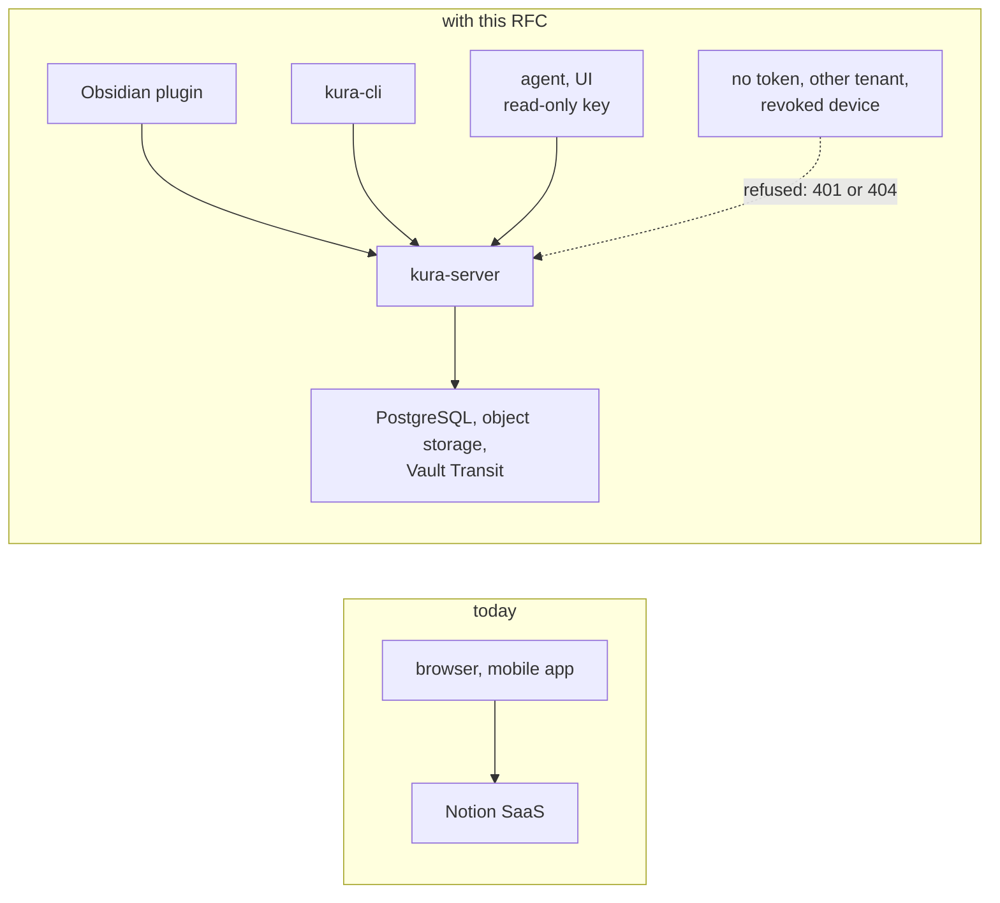
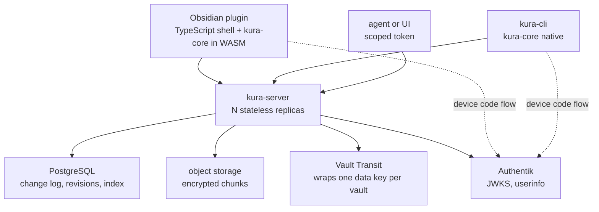
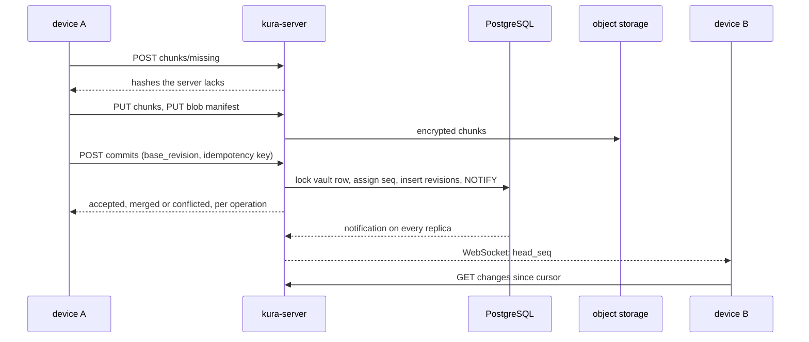
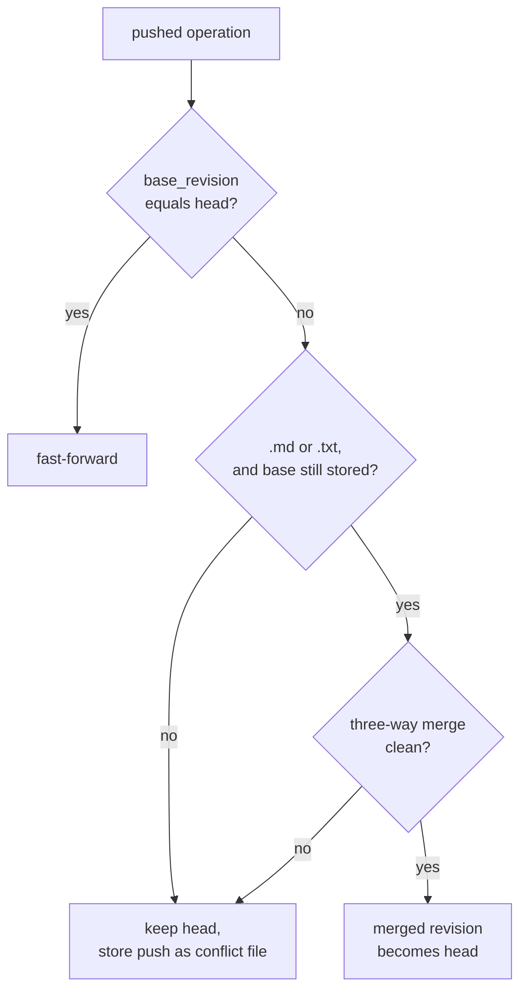
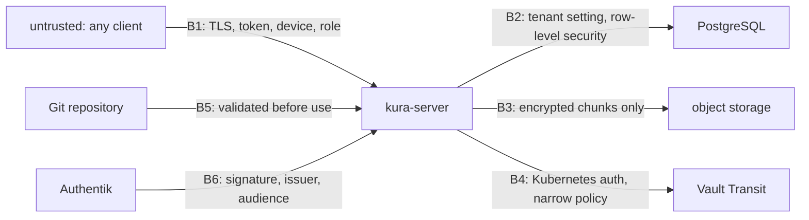

# RFC 0001 — weebo-kura: self-hosted sync backend for Obsidian vaults

Nov 13, 2026 · @Maxime

| Field | Value |
| --- | --- |
| Status | Accepted (2026-11-14) |
| Short | Kura sync backend |
| Settles | How Obsidian vaults are synced across devices through a self-hosted, multi-tenant backend authenticated by OIDC |
| Author | Maxime (batleforc) |
| Co-author | Claude Fable 5.2 |
| Created | 2026-11-13 |
| Supersedes | — |
| Touches | New repository: `crates/kura-api`, `crates/kura-server`, `crates/kura-core`, `crates/kura-cli`, `plugin/`, `helm/`, `Containerfile`, `Containerfile.hardened`, `fuzz/`, `tests/heavy/`, `Taskfile.yml`, `.tasks/`, `docs/` |
| Risk | high |

> **Reference material**, about 18,500 words. For the decision, read §1, §3,
> §4 and §15; the rest is the design to build and review against.

This is a greenfield RFC. No code exists yet, so every symbol named below is proposed, and §6.P lists the observations the proof must produce, not observations already made.

## 1. Summary

weebo-kura is a self-hosted, multi-tenant sync backend for Obsidian vaults, written in Rust. It keeps any number of devices in near-real-time sync, authenticates every caller through OIDC against Authentik, and exposes the same vaults, read-only, to an agent, a web UI or a TUI. It replaces Notion as the home of a personal knowledge base. The project owns both sides of the protocol: `kura-server`, and clients built on one shared crate, `kura-core` (an Obsidian plugin and `kura-cli`; the TUI follows in its own RFC). The name comes from the Japanese *kura* (蔵), a storehouse for valuables.

### Before / after

```text
# today
Notion (SaaS) <-- browser and mobile app
  proprietary format, no files on disk, not behind our OIDC

# with this RFC
Obsidian plugin (desktop, Android) --+
kura-cli ----------------------------+--> kura-server --> PostgreSQL
agent or UI (read-only API key) -----+        |       --> object storage
                                              |       --> Vault Transit
                              tokens checked against Authentik
```



The diagram shows the one new trust decision: every request reaches storage only through `kura-server`, which refuses a caller with no valid token, a token for another tenant or a revoked device.

## 2. Motivation

1. **The knowledge base is locked in a SaaS.** Notes live in Notion in a proprietary format. They are not files, so neither the TUI nor an agent can read them, and they sit outside Authentik.
2. **No existing Obsidian sync combines self-hosting with OIDC.** Obsidian Sync cannot be self-hosted. Self-hosted LiveSync stores data in CouchDB, in object storage or peer to peer, and authenticates with credentials shared by the devices, not an OIDC flow; it has no tenancy and no server that reads content. Relay is reported to support OIDC with a proprietary login and permission server (from its public description, not verified against its source).
3. **The device count is not fixed.** Three devices today, anywhere from 1 to 15 tomorrow. File-level tools such as Syncthing or git handle that count and keep conflict copies, but they identify devices, not users: no OIDC, no tenancy, no roles, and no server a TUI or agent can query.
4. **Other consumers need the notes without Obsidian.** A TUI must browse and search a vault with no local copy, and an agent must read it through an API. Both need a server that understands content.
5. **The rest of the platform is multi-tenant and GitOps.** A sync service configured by hand, for one user, would be the exception on weebo-si.

## 3. Goals / non-goals

**Goals**

- A change made on one device is visible on other online devices within a few seconds, for 1 to 15 devices, the range the soak test covers.
- Every human caller is authenticated through OIDC against Authentik, with no static password or shared secret. The one exception is the scoped token for non-interactive consumers (§6.2): read-only, expiring, revocable and bound to addresses.
- Obsidian on desktop and Android, and `kura-cli`, all sync the same vaults; the API also serves the TUI of a later RFC (decision 41).
- Several tenants share one deployment, with roles at tenant and vault level mapped from OIDC claims.
- The whole configuration is declarative and lives in Git.
- The service is stateless and scales horizontally on Kubernetes.
- An agent or a UI can read and search a vault through the same backend.
- No write is ever silently lost. Two writes are superseded by design and stay in history: the earlier of two concurrent renames of one entry, and an overwritten configuration entry (§6.5).

**Non-goals**

- **Simultaneous co-editing with live cursors**: one author on many devices does not need a CRDT, and it would add state beside every file.
- **End-to-end encryption**: the server must read notes to merge, index and serve them to an agent.
- **Write access for agents**: read-only in v1, until the write path has run in production.
- **A web UI**: this RFC provides the API a UI would use, not the UI.
- **Public sharing or publishing of notes**: every reader is an authenticated tenant member or a scoped token.
- **iOS**: no device to test on.
- **Background sync on Android while Obsidian is closed**: plugins do not run then.
- **A Notion importer**: the export is converted with existing Obsidian tooling before the first sync.
- **A Kubernetes operator**: the configuration documents already have the shape of its custom resources (decision 49); the operator gets its own RFC, generated from `weebo-operator-kit`.
- **A TUI**: its own RFC (decision 41); this one provides the read and search API it will use.
- **Chunk compression**: not in v1 (decision 38); the format keeps a codec byte so it can be added without rewriting chunks.
- **Sharing Obsidian settings between members**: `.obsidian` syncs per user and per profile only (decision 34).

## 4. User-facing design

### 4.1 Configuration

The server's own settings come from one file rendered from the Helm values: they configure a deployment, not a managed object, so they never become a custom resource.

```yaml
# server.yaml, from the Helm values
oidc:
  issuer: https://auth.example.org/application/o/kura/
  audiences: [kura-plugin, kura-cli]        # one client_id per client type
  algorithms: [RS256]
  platformAdmin: { claim: groups, value: kura-platform-admins }
trustedProxies: [10.42.0.0/16]              # Traefik's pod CIDR; empty means ignore forwarding headers
cors:
  allowedOrigins: [app://obsidian.md, capacitor://localhost, http://localhost]
vault:
  address: https://vault.vault:8200
  kubernetesAuth: { mount: kubernetes, role: kura }
  secrets: { database: mv/data/kura/database, bucket: mv/data/kura/bucket }
```

Everything about tenants and vaults is declared in resource documents: every `*.yaml` file in the directory named by `KURA_CONFIG_DIR`, several documents per file allowed, reconciled by the server. They follow the conventions of `weebo-operator-kit` (group `<product>.weebo.io`, version `v1alpha1`, kinds prefixed with the product, camelCase fields, `deletionPolicy: Delete | Orphan`), so the operator of a later RFC applies the same YAML as custom resources (decision 49). Sizes are Kubernetes quantities (`Ki`, `Mi`, `Gi`); durations are an integer followed by `h` or `d`.

```yaml
apiVersion: kura.weebo.io/v1alpha1
kind: KuraTenant                            # cluster-scoped
metadata: { name: maxime }
spec:
  claimMappings:
    claim: groups
    roles: { owner: [kura-maxime-owners], admin: [], member: [kura-maxime] }
  vaultNamespaces: [maxime]                 # namespaces allowed to declare vaults for this tenant
  retention: { maxRevisionAge: 180d, maxRevisionsPerEntry: 200, deletedEntryTtl: 90d }
  quota: { storage: 20Gi, maxFileSize: 500Mi }
  search: { enabled: true }
  deletionPolicy: Orphan
---
apiVersion: kura.weebo.io/v1alpha1
kind: KuraVault                             # namespaced
metadata: { name: knowledge, namespace: maxime }
spec:
  tenantRef: { name: maxime }
  chunking: { min: 256Ki, avg: 1Mi, max: 4Mi }
  configSync: { categories: [plugins, snippets, themes, hotkeys] }
  bindings:
    - { role: editor, claimValue: kura-maxime }
```

The spec types, their defaults and one `validate()` function live in the crate `kura-api`, which depends only on `weebo-kit-api` and `weebo-kit-domain` from the kit, pinned to a git tag. The file loader calls `validate()`; the future operator expresses the same rules as CEL and calls the same function from its `/validate` webhook, since no apiserver runs CEL on files.

Defaults, all on the closed side:

- `claimMappings` absent or empty: the tenant has no members.
- `bindings` absent: only tenant `owner` and `admin` can open the vault.
- `search.enabled` absent: false. The index is plaintext (§9), so indexing is opt-in.
- `configSync` absent: the `.obsidian` folder does not sync. When present, each category syncs per user and per device profile, never between members (decision 34).
- `vaultNamespaces` absent: no namespace may declare a vault for the tenant.
- `deletionPolicy` absent: `Orphan`. Removing a document disables the object and keeps its data. `Delete` disables it at once and schedules its deletion after 30 days, cancelled if the document comes back (decision 33). The annotation `kura.weebo.io/force-orphan` releases an object without any cleanup, as in the kit.
- `chunking` absent: the value stored when the vault was created; the built-in default applies at creation only, so changing it in a later release never invalidates an existing vault.
- `bindings` entries name either `claimValue` (a value of the tenant's mapped claim) or `subject` (an OIDC `sub`).
- `trustedProxies` absent or empty: forwarding headers are ignored and the peer address is used. Scoped tokens bound to a CIDR are then checked against the ingress address and refused, which fails closed.
- `cors.allowedOrigins` absent: the three Obsidian origins shown. This default is not the empty list because the plugin cannot work without them, and CORS is not the access control here: the API accepts bearer tokens only, never ambient credentials.
- No secret appears in any file. The server logs in to Vault through the Kubernetes auth method and reads the database and bucket credentials from Vault's KV store itself, re-reading them when they rotate (decision 48).

Objects declared in files are read-only through the API. Vaults and vault bindings may instead be created through the API, in which case they are marked as API-managed. Tenants have no API in v1; the API the operator needs to manage them arrives with the operator's RFC (decision 51).

### 4.2 Behaviour rules

- **The uninteresting case**: one device, no conflict. A push whose base matches the head is a fast-forward; nothing is merged and no conflict file is created.
- **Role precedence**: the effective right on a vault is the highest of the caller's tenant role and any vault binding that matches.
- **Paths** are NFC-normalized and unique on their case-folded form. A path that breaks a rule is refused; the client reports the file and never renames it silently.
- **Notifications are hints.** A client always pulls from its cursor, so a lost notification costs latency, never correctness.
- **Server time is the only clock.** Client timestamps are metadata and never order anything.
- **Search disabled**: the search endpoint answers `409` with type `search_disabled`; nothing else changes.
- **Reconciliation** runs at startup and on every file change, without a restart, and is idempotent.

### 4.3 Validation

Rejected at startup or when a file changes. On a bad change the server keeps the last valid configuration.

| Condition | Rationale |
| --- | --- |
| A document fails its schema, or has an unknown `kind` or role | A typo must not silently drop a tenant or a permission |
| Two tenants, or two vaults in one namespace, share a name | Ownership would be ambiguous |
| A `KuraVault` has no namespace, or its namespace is not in its tenant's `vaultNamespaces` | A namespace must not attach vaults to a tenant that did not allow it |
| `chunking` is not `min < avg < max`, or `max` exceeds 4 MiB | Larger bodies break mobile clients (§6.8) |
| A vault's `chunking` differs from the value it was created with | Deduplication against stored chunks would break |
| `oidc.issuer` is not HTTPS or `audiences` is empty | Token validation would be meaningless |
| One claim value is mapped by more than one tenant | One group would grant two tenants at once |
| A file declares a vault that already exists as API-managed | Two owners for one object; adopting it is an explicit API call |
| A change removes more than one tenant, or leaves the directory without any tenant | An empty mount or a bad render must not read as a mass removal |

A rejected change is reported with its file, document index and field path, for example `tenants.yaml#2 spec.claimMappings.roles.ownr: unknown role`, in `GET /v1/admin/status`, in the metric `kura_config_rejected_total` and in the log at `warn`. A replica that starts with invalid files serves the last state stored in PostgreSQL and reports the rejection; on a fresh install with no stored state it serves only the health probes and stays unready (decision 31).

Each document's status in `GET /v1/admin/status` has the shape of the kit's status: `observedGeneration` (in file mode, a hash of the document), and `conditions` with `Ready` first, whose reasons come from Kura's own `reason_codes!` catalogue in PascalCase (`Reconciled`, `InvalidDocument`, `QuotaBelowUsage`, `CidrTokensWithoutTrustedProxies`, `DeletionScheduled`, `AwaitingKeyDestruction`). Each warning below is an advisory condition.

Warnings, and where the operator sees them:

| Condition | Behaviour | Surfaced in |
| --- | --- | --- |
| A tenant or vault was removed from the files with `Orphan` | Disabled, data kept | `GET /v1/admin/status`, metric `kura_config_warnings`, startup log |
| A tenant or vault was removed with `Delete` | Disabled; deleted after 30 days unless the document returns | Same, with the date, plus an audit event and an alert |
| A deleted tenant's data is purged but its Transit key still exists | Standing alert until an operator deletes the key | Same |
| A quota is set below current usage | Reads continue, writes are refused | Same, plus the commit error seen by clients |
| Scoped tokens with CIDRs exist while `trustedProxies` is empty | Those tokens are refused | Same |
| `deletedEntryTtl` is shorter than a device's last absence | That device will run a full resync | Same, with the device named |

### 4.4 API surface

All paths are under `/v1`. "OIDC" means an access token plus the `X-Kura-Device` header; "key" means a scoped token. Limits are configurable defaults, counted per device for OIDC callers and per token for keys. In v1 they are enforced in each replica's memory, so with N replicas a caller can reach N times a limit; the defaults are sized for two replicas. A `429` or `503` carries `Retry-After`. The server is built on axum 0.8, the framework of `weebo-operator-kit`. The OpenAPI document is generated from the handlers with `utoipa-axum`, served on a self-hosted Scalar page, and exported by a `dump-spec` subcommand checked by the house drift gates. `kura-core` is the only sync client; a HeyApi client is generated only for a future web UI (decision 37).

| Method | Path | Auth | Who may call | Limit |
| --- | --- | --- | --- | --- |
| POST | `/devices` | OIDC | Any tenant member, at most 20 live devices per user | 10/min |
| GET | `/devices` | OIDC | Own devices; a tenant `admin` sees the tenant's | 60/min |
| DELETE | `/devices/{d}` | OIDC | The device's owner, tenant `admin` | 10/min |
| POST, DELETE | `/vaults`, `/vaults/{v}` | OIDC | Tenant `admin`; API-managed vaults only | 10/min |
| PUT, DELETE | `/vaults/{v}/bindings/{b}` | OIDC | Vault `manager`, tenant `admin`, within the limits of §6.2 | 10/min |
| GET | `/vaults` | OIDC or key | Returns only vaults the caller can read | 60/min |
| GET | `/vaults/{v}/changes?since=` | OIDC or key | `viewer` and above | 600/min, 1,000 items per page |
| GET | `/vaults/{v}/entries` | OIDC or key | `viewer` and above | 60/min, 1,000 items per page |
| GET | `/vaults/{v}/entries/{e}/revisions` | OIDC or key | `viewer` and above | 60/min |
| POST | `/vaults/{v}/entries/{e}/restore` | OIDC | `editor` and above | 60/min |
| GET | `/vaults/{v}/blobs/{hash}` | OIDC or key | `viewer` and above | 600/min |
| POST | `/vaults/{v}/chunks/missing` | OIDC | `editor` and above | 600/min, 1,000 hashes per call |
| PUT | `/vaults/{v}/chunks/{hash}` | OIDC | `editor` and above | Body at most 4 MiB |
| GET | `/vaults/{v}/chunks/{hash}` | OIDC or key | `viewer` and above | 600/min |
| PUT | `/vaults/{v}/blobs/{hash}` | OIDC | `editor` and above | Manifest bounded by `maxFileSize` |
| POST | `/vaults/{v}/commits` | OIDC | `editor` and above | 120/min, 1,000 operations |
| POST | `/vaults/{v}/events/ticket` | OIDC | `viewer` and above | 10/min |
| GET | `/vaults/{v}/events?ticket=` | Ticket | Holder of a fresh ticket | 4 sockets per device |
| POST | `/vaults/{v}/search` | OIDC or key | `viewer` and above; query in the body, never the URL | 60/min, 50 results |
| POST | `/vaults/{v}/tokens` | OIDC | Vault `manager`, tenant `admin` | 10/min |
| GET | `/vaults/{v}/tokens` | OIDC | Vault `manager`, tenant `admin`; never returns a secret | 60/min |
| DELETE | `/vaults/{v}/tokens/{t}` | OIDC | Vault `manager`, tenant `admin` | 10/min |
| GET | `/admin/status` | OIDC | Platform admin | 60/min |
| GET | `/healthz`, `/readyz` (outside `/v1`) | None | Anyone; process state only, no data | — |

Metrics are served on a separate port that the ingress does not expose. Tenant deletion and Transit key rotation have no endpoint in v1: tenants are declared in files, and key operations are operator actions (§6.6).

A vault the caller cannot read answers `404`, not `403`, so tenants cannot probe for each other's vaults. Errors use `application/problem+json` (RFC 9457); `type` is a relative URI under `/v1/problems/`, stable across releases. Collections are paged by keyset, never by offset.

| `type` | Status | Client action |
| --- | --- | --- |
| `invalid_token` | 401 | Refresh once, then sign in |
| `device_revoked` | 401 | Stop syncing; sign in again |
| `device_unknown` | 401 | Re-register silently (row purged after inactivity) |
| `insufficient_role` | 403 | Keep local changes; show the role |
| `address_not_allowed` | 403 | — (keys only) |
| `not_found` | 404 | — |
| `search_disabled` | 409 | Hide search |
| `cursor_expired` | 410 | Full resync (§6.3) |
| `history_rewound` | 410 | Full resync that deletes nothing locally (§6.3) |
| `payload_too_large` | 413 | List the file as unsyncable |
| `invalid_path` | 422 | List the file as unsyncable, with the rule broken |
| `hash_mismatch` | 422 | Re-read the file and retry once |
| `idempotency_conflict` | 422 | Bug report: a key reused with another body |
| `quota_exceeded` | 422 | Keep local changes; show the quota |
| `client_too_old` | 426 | Ask the user to update the client |
| `rate_limited` | 429 | Wait for `Retry-After` |
| `unavailable` | 503 | Back off (§6.3) |

### 4.5 Mocks

**Exit codes**, shared by every `kura` command:

| Code | Meaning | Problem types |
| --- | --- | --- |
| 0 | Done; conflicts, if any, were created as files and are listed | — |
| 1 | Unexpected error: network unreachable after retries, server `503`, local I/O | `unavailable` |
| 2 | Sign-in needed: code expired or denied, token refused, device revoked | `invalid_token`, `device_revoked` |
| 3 | Refused by the server; local changes kept | `insufficient_role`, `quota_exceeded`, `client_too_old` |
| 4 | Some files are unsyncable; the rest synced | `invalid_path`, `payload_too_large` |

Colour is disabled when output is not a terminal or `NO_COLOR` is set.

**`kura login` — nominal**

```text
$ kura login --server https://kura.example.org
Open https://auth.example.org/device and enter the code:

    WDJB-MJHT

Waiting for approval... [green]done[/green]
Logged in as maxime. Device "desk-01" registered (profile: desktop).
$ echo $?
0
```

Decides that the code is shown alone on its line, and that the device name and profile are confirmed. The name comes from `--device-name`, else the host name, and must be a valid path segment (§6.3), since it appears in conflict file names. "maxime" is the token's `preferred_username`, read by the client and never stored by the server (§9).

**`kura login` — code expired**

```text
Waiting for approval... [red]expired[/red]
error: the code was not approved within 10 minutes. Run `kura login` again.
$ echo $?
2

Waiting for approval... [red]denied[/red]
error: the sign-in was refused in Authentik. Run `kura login` to try again.

Waiting for approval... [green]done[/green]
error: maxime belongs to no Kura tenant. Ask your platform admin to add you to a tenant group.
$ echo $?
2
```

Decides that an error says what to do next. The delay shown is the `expires_in` the identity provider returned, not a constant.

**`kura status` — nominal, empty and conflict**

```text
$ kura status
VAULT       ROLE     STATE      PENDING  CONFLICTS  LAST SYNC
knowledge   editor   [green]in sync[/green]    0        0          12s ago
projects    viewer   [yellow]read-only[/yellow]  14       0          now
journal     editor   [red]conflict[/red]   0        2          3m ago

$ kura status          # no vault visible to this user
No vault. Ask a tenant admin for access.

$ kura status          # server unreachable
[red]error[/red]: cannot reach https://kura.example.org (connection refused). Local changes are kept.
$ echo $?
1
```

Decides the columns and that the role is always visible, since it explains a refused push. STATE is one of `in sync`, `syncing`, `read-only` (a viewer with local changes that will not upload), `conflict`, `unsyncable`, `resyncing`, `offline`, `sign in`, `quota full`, `update required`; the plugin status bar uses the same words. A conflict clears when the user deletes or renames the conflict file; the server tracks nothing more.

**`kura sync` — refused push (the §6.P refusal)**

```text
$ kura sync projects
[red]error[/red]: projects: push refused, your role is viewer (403 insufficient_role)
Local changes are kept in 14 files and were not uploaded.
Ask a vault manager for the editor role to upload them.
$ echo $?
3
```

Decides that a refusal states the role, that local edits are safe, and who can change it.

**`kura sync` — full resync after a long absence**

```text
$ kura sync knowledge
[yellow]resync[/yellow]: knowledge: this device was offline longer than the vault keeps deletions (90 days).
Removed 12 local files deleted elsewhere (moved to .trash). Pushed 3 files changed here.
$ echo $?
0
```

```text
$ kura sync knowledge           # the resync would remove 61 of 400 local files
[yellow]resync[/yellow]: knowledge: 61 local files (15%) were deleted elsewhere.
Move them to .trash? [y/N] n
Nothing removed. Run `kura sync knowledge` again to decide.
$ echo $?
3

$ kura sync knowledge           # after a server restore (410 history_rewound)
[yellow]resync[/yellow]: knowledge: the server lost recent history. Nothing is removed on this device.
Re-pushed 7 files the server no longer had.
$ echo $?
0
```

Decides that a resync is announced, with counts, that removed files can be recovered, that a large removal is asked first, and that a server restore never deletes on the device (decision 32).

**`kura attach` — a folder that already holds files**

```text
$ kura attach knowledge ./vault
Attach ./vault to knowledge:
  4,812 files match the server
     12 only here, will be pushed
     30 only on the server, will be downloaded
Continue? [y/N] y
Attached. knowledge is in sync.
$ echo $?
0
```

Decides that attaching, the riskiest step of a migration, shows what will move before it moves (decision 40). The plugin shows the same three counts in a modal when a vault is chosen in its settings; choosing another vault first detaches, discarding the sync state and leaving the files untouched.

**`kura devices` — list and revoke**

```text
$ kura devices
NAME      PROFILE   LAST SEEN    STATE
desk-01   desktop   now          this device
pixel-8   mobile    2 days ago   active
old-tab   mobile    95 days ago  active

$ kura devices revoke old-tab
Device "old-tab" can no longer sync.
To fully lock it out, also end its session in Authentik: https://auth.example.org/if/user/#/settings
$ echo $?
0
```

Decides that revocation repeats the limit of §6.2 and points to the step that completes it.

**`kura token create` — scoped token**

```text
$ kura token create knowledge --prefix agents/ --expires 30d --cidr 10.42.0.0/16
Token kura_01JD3..._****  read  knowledge/agents/  expires 2026-12-14  from 10.42.0.0/16

    kura_01JD3K7Q..._v7cX...

This secret is shown once. Store it now.
$ kura token create knowledge --expires 30d
[red]error[/red]: --cidr is required; a scoped token is always bound to addresses.
$ echo $?
3
```

Decides that the secret is shown once, alone on its line, and that the closed defaults of §6.2 are visible as errors.

**`kura sync --dry-run` — before the first push**

```text
$ kura sync --dry-run ./notion-export
Would push 4,812 files, 1.2 GiB.
Unsyncable (3):
  Projets/Q3: budget.md        ":" is not allowed in a name
  Ideas.md, ideas.md           names differ only by case
  video/demo.mov               larger than maxFileSize (500 MiB)
$ echo $?
4
```

Decides that the migration can be checked before anything is uploaded (§13).

**Plugin status — every state**

```text
desktop status bar:
[ Kura: in sync ]   [ Kura: syncing 14 ]   [ Kura: offline ]
[ Kura: 2 conflicts ]   [ Kura: sign in ]   [ Kura: read-only (viewer) ]
[ Kura: resyncing ]   [ Kura: update required ]   [ Kura: quota full ]

mobile (no status bar): ribbon icon, label "Kura: 2 conflicts"
first line of the settings panel: "State: 2 conflicts"
```

Decides that state is text, never colour alone, and that mobile, where Obsidian shows no plugin status bar, gets the same words through the ribbon label and the settings panel. A click or tap opens the panel below.

**Plugin settings — signed in**

```text
+-- Kura Sync -----------------------------------------------+
| Server    [ https://kura.example.org              ]        |
| Account   maxime  -  device "pixel-8" (mobile)   [Sign out] |
| Vault     [ knowledge              v ]  role: editor       |
| My Obsidian settings  [x] plugins [x] snippets [x] themes  |
|   (between my own mobile devices only)  [ ] hotkeys        |
| Skip files larger than  [ 200 ] MiB on this device         |
| Conflicts (2)                                              |
|   Meeting notes (conflict pixel-8 2026-11-13).md    [Open] |
|   Ideas (conflict desk-01 2026-11-12).md            [Open] |
| Unsyncable files (2)                                       |
|   drafts/what?.md  -  "?" is not allowed in a name         |
|   video/demo.mov   -  larger than 200 MiB on this device   |
+------------------------------------------------------------+
```

The size limit is a per-device setting; the Kura plugin's own folder never syncs (§6.8), so it never travels to another device.

Decides that conflicts and unsyncable files are listed where the user configures sync, each with its reason.

**Plugin sign-in — device code**

```text
+-- Sign in to Kura -----------------------------+
| 1. Open  https://auth.example.org/device [Open] |
| 2. Enter this code:    WDJB-MJHT        [Copy] |
|                                                |
| Waiting for approval...            [Cancel]    |
+------------------------------------------------+
```

Decides that sign-in works on a phone without a redirect: one button opens the browser (with `verification_uri_complete` when the provider returns it), one copies the code. On expiry or denial the modal shows the same text as the CLI and a [Retry] button.

**Plugin — a plugin received from another of my devices**

```text
+-- Kura Sync -----------------------------------------------+
| Plugin "Dataview" 0.5.67 was synced from desk-01.          |
| It is installed but disabled on this device.               |
| Plugins run code with access to this vault.                |
|                                [Keep disabled]  [Enable]   |
+------------------------------------------------------------+
```

Decides that a synced plugin, or a new version of one, never runs before the user agrees on that device (decision 34). Snippets and themes, which are CSS, apply without this step.

The TUI is specified in its own RFC (decision 41).

## 5. Architecture

`kura-server` is one stateless Rust binary. All durable state lives in PostgreSQL and object storage, so any replica can serve any request.

### 5.1 Components



It shows that clients reach Authentik only to obtain tokens and reach storage only through the server.

| Layer | Crate or package | Responsibility |
| --- | --- | --- |
| Configuration types | `kura-api` | `KuraTenant` and `KuraVault` specs, defaults, `validate()`, reason codes; shared with the future operator |
| HTTP and WebSocket | `kura-server::http` (with `auth` and `authz`) | Parsing, authentication, authorization, limits, error mapping |
| Domain | `kura-server::sync` | Commits, pulls, merge, retention |
| Configuration | `kura-server::reconcile` | Loading files, validation, writing the reconciled state |
| Storage | `kura-server::store` | PostgreSQL queries, chunk encryption, object storage, Vault |
| Shared client logic | `kura-core` | Protocol client and wire types shared with the server, local state, change detection, chunking |
| Shells | `plugin/`, `kura-cli` | File and network access, UI |

### 5.2 A push crossing the components



It shows that content is stored before the commit references it, and that device B learns of the change by a hint and then pulls.

### 5.3 Deciding the outcome of one pushed operation



It shows that every branch ends with both versions stored.

### 5.4 Invariants

- Because `seq` is assigned while holding a lock on the vault row, and a pull reads its entries and the `head_seq` it returns in one `REPEATABLE READ` snapshot, no commit can become visible below a `head_seq` a client has already read. A client therefore never skips a change.
- Because a chunk's database row is written only after its object is stored and its hash verified, because each upload writes a new object key, and because garbage collection deletes only the object its own row names, a manifest never references content the server does not hold (decision 24).
- Because every query runs as a role that neither owns the tables nor bypasses row-level security, with `FORCE ROW LEVEL SECURITY` on every table and a transaction-local tenant setting that matches nothing when unset, a handler that forgets a tenant filter returns nothing instead of another tenant's rows (decision 26).
- Because conflicts produce a result and never an error, a client cannot lose an edit by retrying.

## 6. Detailed design

### 6.1 Data model

The source of truth is a change log per vault, ordered by a monotonic sequence number `seq`.

| Entity | Key fields | Notes |
| --- | --- | --- |
| `config_state` | `generation`, `writer_version`, `documents`, `status`, `written_at` | The reconciled configuration authorization reads (decision 31); one current row, history kept 30 days |
| `tenant` | `id`, `slug`, `claim_mappings`, `vault_namespaces`, `retention_policy`, `quota_bytes`, `max_file_size`, `transit_key`, `search_enabled`, `deletion_policy`, `disabled_at`, `delete_after` | Declared in configuration; one Transit key per tenant |
| `vault` | `id`, `tenant_id`, `namespace`, `name`, `epoch`, `wrapped_dek`, `head_seq`, `horizon_seq`, `chunking_params`, `config_sync`, `managed_by`, `disabled_at`, `delete_after` | A lock on this row serializes commits; `epoch` changes on restore or promotion (§6.3) |
| `role_binding` | `tenant_id`, `vault_id`, `subject`, `role`, `managed_by` | Subject is a user or a claim value |
| `entry` | primary key (`vault_id`, `id`), `namespace`, `path`, `path_key`, `head_revision`, `last_seq`, `deleted` | Stable id, so a rename keeps its history |
| `revision` | `id`, `entry_id`, `seq`, `base_revision`, `blob_hash`, `size`, `device_id`, `user_sub`, `created_at` | Immutable; `device_id` has no foreign key, so purging a device keeps attribution |
| `blob` | `vault_id`, `hash`, `size`, `created_at` | Manifest of one file version; collected with its chunks when unreferenced |
| `blob_chunk` | `vault_id`, `blob_hash`, `position`, `chunk_hash` | Ordered chunk list; makes "unreferenced" an index lookup |
| `chunk` | `vault_id`, `hash`, `size`, `object_key`, `created_at`, `last_touched` | Addressed by BLAKE3 of the plaintext; `object_key` unique per upload |
| `search_doc` | `vault_id`, `entry_id`, `lex_fr`, `lex_en` | Head revision's lexemes only (§6.7) |
| `device` | `id`, `user_sub`, `session_sid`, `name`, `profile`, `last_seen`, `revoked_at` | Id generated by the server; removed after 180 days without activity, revoked ids and their `sid` kept (§6.2) |
| `config_entry_pin` | `vault_id`, `device_id`, `entry_id`, `accepted_hash` | Plugin versions a device agreed to enable (decision 34); removed with the device |
| `scoped_token` | `id`, `vault_id`, `path_prefix`, `mode`, `allowed_cidrs`, `expires_at`, `last_used_at`, `token_hash`, `created_by` | §6.2 |
| `commit` | `vault_id`, `device_id`, `idempotency_key`, `request_hash`, `result`, `created_at` | Unique on (`vault_id`, `device_id`, `idempotency_key`); kept 7 days |
| `ws_ticket` | `ticket_hash`, `device_id`, `vault_id`, `token_expires_at`, `expires_at` | Consumed on use; kept at most 30 seconds |
| `index_job` | `vault_id`, `entry_id`, `revision_id`, `attempts` | Deleted when processed; after 5 attempts kept as failed and counted in `index_queue_depth` |

Every table has a stated lifetime; none grows without a purge. Every table carries `tenant_id` except `config_state`, read only by the reconciler and the authorization cache, and `device` and `config_entry_pin`, whose rows belong to an OIDC subject that may sit in several tenants. Those two are isolated by their own row-level policy on `user_sub`, matched against a second transaction-local setting holding the caller's subject. Hashes are stored as 32-byte `bytea`, not hex text. Each frequent query has exactly one supporting index:

| Query | Index |
| --- | --- |
| Changes after a cursor | `entry (vault_id, last_seq)` |
| Path lookup and uniqueness | Unique `entry (vault_id, namespace, path_key)` where not deleted |
| History of an entry | `revision (entry_id, seq)` |
| Chunk presence | Primary key `chunk (vault_id, hash)` |
| Search | GIN on `search_doc.lex_fr` and `lex_en`; trigram GIN on `path` |
| Chunk still referenced? | `blob_chunk (vault_id, chunk_hash)` |
| Garbage collection sweep | `chunk (last_touched)` |

### 6.2 Tenancy, authentication and authorization

A user belongs to a tenant when one of the tenant's claim mappings matches a value in the user's token. With Authentik the claim is usually `groups`, so a tenant is in practice a set of groups, one per role.

| Level | Role | Grants |
| --- | --- | --- |
| Tenant | `owner` | Everything the API offers on the tenant; key rotation and tenant deletion are operator actions (§6.6) |
| Tenant | `admin` | Create and delete vaults, manage bindings and scoped tokens |
| Tenant | `member` | Access only to vaults where a vault role is bound |
| Vault | `manager` | Read, write, restore, manage the vault's bindings and tokens |
| Vault | `editor` | Read, write, restore |
| Vault | `viewer` | Read, search, list history |

User clients:

- All clients use the OAuth 2.0 device authorization grant (RFC 8628), as public clients with no secret.
- Authentik prerequisites: a device code flow must be created and set on the brand, since none ships by default; the provider's authorization flow carries a consent stage, so the user sees the application's name before approving; the provider needs the `offline_access` scope mapping, without which no refresh token is issued, and the `profile` scope, which carries `groups`.
- Authentik facts this design relies on, read in its 2026.8.5 source and to be confirmed on the instance (§6.P): access tokens last 1 hour and refresh tokens 30 days by default, with rotation on; access and ID tokens are signed by the same key with the same `aud` and both carry `nonce` and `sid`, with no distinguishing `typ`; only the access token carries `scope`; access tokens cannot be sender-constrained (DPoP binds only the ID token); with `include_claims_in_id_token` on, the default, mapped claims such as `groups` are in the access token too (decision 46).
- `auth::verify_access_token` checks signature, issuer, audience and expiry against the JWKS, with the accepted algorithms pinned in configuration (never `none`, never taken from the token header alone). It refuses an ID token presented as an access token by requiring the `scope` claim, which only access tokens carry (decision 50). Keys are cached, at most 16, refetched on an unknown key id at most once a minute, and persisted in PostgreSQL so a replica started during an Authentik outage can still verify.
- Role claims are read from the access token. If the configured claim is absent, because `include_claims_in_id_token` was turned off, the server asks the userinfo endpoint and caches the answer for the token's lifetime, in a cache bounded to 10,000 entries.
- Refresh tokens are issued and rotated by Authentik. The plugin stores them in Obsidian's `SecretStorage`, the CLI in the OS keyring. A client refreshes through a single in-flight call and stores the new token before using it; on a network error or `5xx` it keeps the old one and backs off, and it signs out only on `invalid_grant`.
- A client registers a device record tied to the token's subject and its session (`sid`); the server generates the id and never reuses it. `auth::require_device` rejects a request whose device is revoked (`device_revoked`), unknown (`device_unknown`, after the 180-day purge) or owned by another subject.
- Revoking a device blocks that device id at once, closes its sockets, and refuses any later registration from the same `sid`, so the holder of a stolen refresh token cannot come back as a new device (decision 35). The refresh token itself stays valid in Authentik until the session ends there; the CLI and the plugin point to that step. What remains is an access token already issued, usable for at most its 1-hour lifetime, and only by a device id that is not revoked.
- A vault `manager` or tenant `admin` can bind only a claim value from the tenant's own `claimMappings`, or the `sub` of a known tenant member, and only to a role no higher than their own (`authz::check_binding`).

Scoped tokens, for non-interactive consumers:

- Format `kura_<token id>_<secret>`. The secret carries 256 bits of entropy, is stored as a SHA-256 hash and compared in constant time.
- Scope is one vault, an optional path prefix, a mode (`read` only in v1), a mandatory expiry of at most 90 days and a non-empty CIDR allowlist that may not contain `0.0.0.0/0` or `::/0`.
- The path prefix is applied by one function, `authz::visible_under_prefix`, called by every read handler: `changes`, `entries`, `revisions`, `blobs`, `search` and `chunks`. A chunk is served to a prefixed token only if a revision visible under the prefix references it. An entry renamed out of the prefix disappears from the token's view with its whole history; one renamed in shows only revisions made under the prefix.
- A token can be listed and revoked (§4.4). It records its creator, and is revoked when the creator's binding that allowed it is removed through configuration or the API; a group change made only in Authentik is not seen and leaves the token valid until expiry.
- Each use updates `last_used_at` at most once a minute and emits an audit event.

### 6.3 Sync protocol

Each device keeps one cursor per vault: the vault's `epoch` and the last `seq` it has applied. The epoch is derived from PostgreSQL's system identifier and current timeline, which change on every promotion of a standby, and the restore runbook regenerates it explicitly (decision 32).

**Paths**

- Relative, `/`-separated, NFC-normalized UTF-8, at most 255 bytes per segment and 4,096 bytes in total.
- Unique on the case-folded form, so `Note.md` and `note.md` cannot coexist.
- A segment may not be `.` or `..`, end with a dot or a space, or contain a control character or any of `< > : " \ | ? *`.
- In the note namespace, a segment may not start with a dot either. `.obsidian`, `.git`, `.trash` and every other dot-folder can therefore only travel through the per-user configuration namespace and its own rules (§6.8), never as a note (decision 28).
- Parsed once, at the HTTP boundary, into a `VaultPath` type that cannot hold an invalid value. `kura-core` parses every path it receives from the server the same way before writing, and never follows a symbolic link when writing.
- The case-folded `path_key` uses full Unicode case folding, is computed by the server only, and is stored, never recomputed on upgrade.

**Commits**

- Entry ids are UUIDv7 values generated by the client.
- A commit runs in one transaction that locks the vault row, assigns consecutive `seq` values and updates `head_seq`.
- Each operation comes back `accepted`, `merged` or `conflicted`. A commit fails as a whole only on invalid input: a missing chunk, a forbidden path, an insufficient role or an exceeded quota.
- Under the lock, the server checks that every entry id the commit names belongs to the vault or is new to it. Since the key is (`vault_id`, `id`), an id used in another vault or tenant neither collides nor reveals anything (decision 27).
- The idempotency key is scoped to the device, stored with a hash of the request body and the result in the commit's own transaction, after the lock is taken, for 7 days. A retry with the same body returns the stored result; the same key with another body gets `422 idempotency_conflict`. A pushed version whose blob hash equals the current head is `accepted` as a no-op whatever its base, so a retry later than 7 days creates no conflict file against itself.
- Merges are computed before the lock is taken, within a budget of 2 seconds of CPU; past it, the operation becomes a conflict file. The head is rechecked under the lock, and the merge is retried at most 3 times before the operation falls back to a conflict file.

**Pulls**

- `changes` returns at most one item per entry: its current state, when its `last_seq` is greater than the cursor. Pruning history therefore never breaks a pull.
- The response carries the `head_seq` it was computed against, read in the same `REPEATABLE READ` snapshot as the entries (decision 25). Pages are ordered by `last_seq`, so the cursor advances to the last `last_seq` of each page once that page is applied, and an interrupted first sync resumes where it stopped.
- A vault's `horizon_seq` marks the point below which deleted entries were purged. An older cursor receives `410 cursor_expired`. A cursor whose epoch differs from the vault's, or whose `seq` is above `head_seq`, receives `410 history_rewound`: the server lost history the device has seen.
- A full resync, after either answer and when a device attaches (§4.5), first checks the vault id and epoch, then matches each local file to a server entry by the entry id and hash in its local state, never by path alone (decision 32):
  - unchanged locally, changed on the server: take the server version;
  - changed locally: push with the recorded base revision;
  - unknown to the server: push as new;
  - absent from the server, unchanged locally, and recorded below `horizon_seq`: delete, unless the answer was `history_rewound`, in which case it is pushed back instead and nothing local is ever deleted.
- Deleted files go to Obsidian's `.trash` folder, never unlinked. A resync that would delete more than 10% of local files, or more than 50, stops and asks the user first.
- Replication is asynchronous (§13). A failover that loses acknowledged commits changes the timeline, hence the epoch, so every device re-pushes what the server lost and no write is silently dropped.
- Applying a remote change does not trigger a push: the file the client just wrote matches its recorded hash.

**Notifications**

- A web view cannot set an `Authorization` header on a WebSocket. The client requests a ticket: 256 random bits, whose SHA-256 the server stores in `ws_ticket` with the device, the vault and the expiry of the access token behind it, valid 30 seconds. On connection the server consumes it with `DELETE … RETURNING`, so a second use finds nothing. No signing key exists, so nothing has to be shared between replicas or rotated (decision 36).
- The socket closes when the token behind the ticket expires.
- Each replica holds one dedicated `LISTEN` connection, outside any transaction-mode pooler, with TCP keepalives. It sends itself a heartbeat `NOTIFY` every 15 seconds and reconnects after missing two. When it reconnects after a drop, the replica tells its sockets to pull, each after a random delay of 0 to 5 seconds.
- A `NOTIFY` payload carries only the vault id and `seq`, and reaches only sockets whose ticket was for that vault.
- The server pings each socket every 30 seconds with the current `head_seq`; a client that misses a ping treats the socket as down.
- Each socket has a bounded send queue of 16 messages. A slow consumer is dropped and pulls on reconnect.
- Clients do not poll while the socket is up. They pull on start, on resume and on notification, and fall back to a 60-second timer, with ±20% jitter, only while the socket is down.
- Clients reconnect and retry with exponential backoff and decorrelated jitter, from 1 to 60 seconds, and honour `Retry-After`. Obsidian saves coalesce for 5 seconds before a push, so autosave does not exhaust `maxRevisionsPerEntry`.

### 6.4 Chunking and storage

- A file is split by content-defined chunking (FastCDC). Proposed defaults: 256 KiB minimum, 1 MiB average, 4 MiB maximum. Most notes are one chunk.
- A chunk is addressed by the BLAKE3 hash of its plaintext; a blob is the ordered list of those hashes. The server recomputes the hash on upload and rejects a mismatch.
- Upload and download resume by asking which chunks are missing. An edit to a large file re-sends only the chunks around the change. Answering "present" refreshes the chunk's `last_touched`, so garbage collection cannot remove it before the commit that references it.
- Clients read the chunking parameters from `GET /vaults`, never from a compiled-in constant.
- Chunk responses are immutable and carry `Cache-Control: private, immutable` and an `ETag`. JSON responses are compressed.
- Hashing, chunking, encryption and merging are CPU work and run on the blocking pool, never on an async worker.

Chunks are not compressed in v1 (decision 38). Each stored chunk starts with a format-version byte and a codec byte, both part of the associated data (§6.6); v1 writes codec 0, "none". Phase 2 measures what zstd level 3 would save on the real vault; above 20% of stored bytes, a follow-up RFC chooses a codec, and because the hash is always that of the plaintext, adding one later rewrites no chunk and changes no address. A release can read a new codec or format one release before any release writes it, so rolling back one version never meets a chunk it cannot read. On every read the server checks the BLAKE3 of the decrypted plaintext; a chunk that fails is marked corrupt, reported missing by `chunks/missing`, and re-uploaded by the next client that holds it.

### 6.5 Conflict resolution

| Situation | Resolution |
| --- | --- |
| Base matches head | Fast-forward |
| Text file, both sides changed, merge is clean | The merged result becomes the head |
| Text file, overlapping edits | Head kept; the push is stored as a sibling conflict file |
| Text file, base revision pruned by retention | Handled as overlapping edits |
| Non-mergeable file, both sides changed | Head kept; the push is stored as a conflict file |
| Same path created on two devices | Identical content: unified. Otherwise the second becomes a conflict file |
| Edit against a deleted entry | The edit wins and the entry is restored |
| Delete against an entry edited since | The delete is dropped |
| Rename on one side, edit on the other | Both apply |
| Two renames of the same entry | The later commit wins |
| Rename or create onto an occupied path | The incoming entry gets a suffixed name |

Only `.md` and `.txt` files are merged, line by line; a textual merge of `.canvas` or other JSON can produce a file that no longer parses. A conflict file carries the device name and date in its name. Entries in a configuration namespace never produce conflict files, which Obsidian would load as settings: the last write wins and the overwritten version stays in history. Since that namespace belongs to one user and one profile (§6.8), the only writes it can supersede are that user's own.

### 6.6 Encryption at rest

- Envelope encryption: one Transit key per tenant, one data key per vault. The data key comes from Transit's `datakey` endpoint and is stored only in wrapped form, written once with `UPDATE … WHERE wrapped_dek IS NULL` and read back; no chunk is encrypted under a key that was not read back, so two replicas racing cannot create two keys for one vault (decision 29).
- The server talks to Vault with `vaultrs`, logged in through Kubernetes auth. Its policy allows only `datakey`, `decrypt` and `rewrap` on its own Transit keys, and `read` on its own KV path for the database and bucket credentials (decision 48). Creating a tenant's key, setting `deletion_allowed` and deleting it are operator actions under a separate Vault role, outside the server (decision 33).
- The plaintext data key is held in a wrapper that cannot be printed or logged and is wiped on drop, in a cache bounded to 1,000 keys with a 10-minute TTL.
- Each chunk is encrypted with AES-256-GCM under the data key, with a random 96-bit nonce and the vault id, chunk hash, format version and codec byte as associated data. Random nonces bound one data key to about 2³² encryptions; the server counts encryptions per vault and raises a warning at 2³⁰, far above any expected vault.
- The object key in the bucket is a keyed hash of the chunk hash, under a per-vault secret derived from the data key with BLAKE3 `derive_key` and its own context string, followed by a random suffix per upload. Holding the bucket alone does not let anyone test whether a known file is stored, and two uploads of one chunk never share an object.
- Rotating a tenant's Transit key means `rewrap` on its data keys; chunks are not re-encrypted.
- Deleting a tenant's Transit key makes its content unrecoverable. Transit requires `deletion_allowed` on the key first. Both steps are done by an operator once the tenant's 30-day grace period has ended and its rows and objects are purged; until then the status condition `AwaitingKeyDestruction` and its alert stay raised (decision 33). Key versions older than the oldest kept backup are never trimmed, so a restored dump can always unwrap its data keys.

### 6.7 Search

- PostgreSQL full-text search, opt-in per tenant. Only the head revision of each Markdown entry is indexed. The index is plaintext in the database and in its dumps; no encrypted storage is assumed, which is why search is off by default (decision 39).
- A commit inserts an `index_job` row in its own transaction. Workers claim jobs with `FOR UPDATE SKIP LOCKED`, at most 100 per batch.
- Each entry is indexed under both the `french` and `english` configurations with accents folded. A trigram index on paths covers fuzzy filename lookups.
- Raw text is not stored a second time; snippets come from decrypting the top results at query time, at most 1 MiB decrypted per query. PostgreSQL caps a `tsvector` below 1 MB and positions at 16,383, so the indexer truncates a note's text to 256 KiB before `to_tsvector`, and a job that still fails is retried at most 5 times, then kept as failed (§6.1). A query shorter than 2 characters is refused.
- Queries are filtered by tenant, vault and, for a scoped token, path prefix.
- The database needs the `unaccent` and `pg_trgm` extensions.

### 6.8 Clients

`kura-core` holds all sync logic: protocol client, local state (path to entry id, revision, hash, size and modification time), change detection and chunking. File and network access go through traits, so each shell supplies its own and tests supply fakes.

- **Change detection** rehashes a file only when its size or modification time changed, so starting the client does not rehash the vault.
- **Applying a remote change** writes a temporary file and renames it into place, after recording the intended path and hash in a local journal. On start, a file matching the journal's hash is adopted; a file matching neither the old nor the new hash is listed as damaged, never pushed. A change to the note open in the editor is deferred until the note is closed or saved (decision 55; phase 4 tests whether Obsidian's own handling makes this unnecessary).
- **Local state** carries a format version and the device id. An unknown version, or a device id that differs from the one in `SecretStorage` or the keyring (a copied vault folder), discards the state and runs a full resync.
- **Plugin**: a TypeScript shell implementing the core's traits on the Obsidian API, bundled with esbuild, published under the id `weebo-kura` with the display name "Kura Sync". It requires Obsidian 1.11.4 for `SecretStorage`, declared as `minAppVersion`, and checks that `app.secretStorage` exists before use, showing "update Obsidian" otherwise. The WASM core is embedded in `main.js`, because a community plugin ships as `main.js`, `manifest.json` and `styles.css` only. Obsidian mobile shows no plugin status bar, so the state is also shown on a ribbon icon and in the settings panel (§4.5).
- **Plugin transport**: `fetch` against the server's CORS allowlist. Obsidian's `requestUrl` bypasses CORS but passes bodies as base64 on mobile and is reported, in community forums and not reproduced here, to crash on bodies of tens of megabytes; the 4 MiB chunk ceiling keeps either transport safe. Calls to Authentik use `requestUrl`.
- **Plugin secrets**: the refresh token lives in `SecretStorage` under an id that includes the server and vault ids, since the store is reported to be shared across vaults on mobile. It is never written to `data.json`.
- **Obsidian configuration**: optional, by category (`plugins`, `snippets`, `themes`, `hotkeys`), in a namespace of the vault per user and per device profile (`desktop`, `mobile`). The server serves a configuration namespace only to its owner, so settings and plugin code never travel between members (decision 34). The vault API does not expose dot-folders, so the plugin reads `.obsidian` through the adapter API and scans it on app resume and at most every 5 minutes. Workspace state and the Kura plugin's own folder never sync.
- **Synced plugins**: a plugin received from another of the user's devices, or a new version of one, is written disabled. It is enabled only after the user agrees on that device (§4.5), which records the accepted hash in `config_entry_pin`; any later change of hash disables it again until agreed. Snippets and themes, which are CSS, apply without this step.
- **WASM budget**: `main.js` at most 3 MB, and the core loaded in at most 1 second on the Android test phone. Over budget: build with `wasm-opt -Oz`, then strip server-only features from `kura-core`; if still over, ship and record the numbers in §17.
- **Mobile limits**: a file is read into memory before hashing, so the plugin skips files above a configurable size, 200 MiB by default, and lists them as unsyncable.
- **`kura-cli`**: links the core natively. It comes first, as the reference client for protocol tests and as a sync daemon. The TUI is specified in its own RFC and uses the same read and search API (decision 41).

### 6.9 History, retention and garbage collection

- Every revision is kept until the tenant's policy prunes it: `maxRevisionAge`, `maxRevisionsPerEntry`, `deletedEntryTtl`. The head of a live entry is never pruned.
- Restoring a revision creates a new revision with the old content.
- Purging deleted entries advances `horizon_seq`. `deletedEntryTtl` should exceed the longest expected absence of a device; the default is 90 days.
- Garbage collection locks a candidate chunk row with `FOR UPDATE SKIP LOCKED`, rechecks through `blob_chunk` that it is unreferenced, deletes the row, commits, then deletes the object key that row named. A blob `PUT` takes `FOR KEY SHARE` on the chunk rows it references, so the two cannot interleave; a re-upload of the same chunk writes a new object key, so deleting the old one cannot remove it (decision 24). Chunks whose `last_touched` is younger than 24 hours are never collected.
- A sweep deletes objects that have no row and are older than 24 hours, left by a crash between the object `PUT` and the row insert.
- Object deletion pauses while a backup runs (an advisory lock taken by the backup job), so a backup never misses an object its database dump references.
- Pruning and collection run in batches of 1,000 with a pause between batches, in a configurable off-peak window, and are idempotent.

### 6.10 Configuration reconciliation

- The server watches the configuration directory, including Kubernetes' atomic `..data` symlink swap, and re-reads it every 60 seconds in case a watch event was missed. The Helm chart never mounts it with `subPath`, which would never update. A change is parsed and validated as a whole; if any document is invalid, the previous configuration stays in force (§4.3).
- With several replicas, each one loads the files; one takes a transaction-scoped advisory lock (`pg_advisory_xact_lock`) to write the resulting state, stamped with a generation (hash of the files) and the writer's binary version, in `config_state`. A replica writes only if its binary is at least the stored writer's version and its generation differs from the stored one; an older replica, mid-rollout, never overwrites newer state.
- Authorization reads only the reconciled state from PostgreSQL, through a cache refreshed when `config_state` changes, never a replica's own files. All replicas therefore grant the same rights at the same moment, whatever files each has mounted (decision 31).
- A release that adds a configuration field is fully rolled out before any document uses it (§13).
- Each object records whether configuration or the API manages it. Status and warnings are served by `GET /v1/admin/status`, in the kit's status shape (§4.3).
- The operator of a later RFC is generated from `weebo-operator-kit`'s template and uses its `weebo-kit-*` crates. Like every operator built on the kit, it is a separate binary that drives Kura's admin API, with a cluster-scoped `KuraInstance` pointing at the server and the same `KuraTenant` and `KuraVault` documents as custom resources; it shares `kura-api`'s types and `validate()` with the server (decision 49).

### 6.11 Engineering rules

The code follows the `weebo-good-practice` skill. The points below are the ones this design depends on.

- **No panic on an expected path.** The workspace takes the skill's lint table: no `unwrap`, `expect`, indexing or unchecked arithmetic outside tests, except under a reasoned `#[expect]`. This matters most in `kura-core`: a panic in WASM would kill sync inside Obsidian, so no panic may cross the WASM boundary.
- **Typed errors.** One `thiserror` enum per crate; `anyhow` only in the binaries. Errors are mapped once, at the HTTP boundary, to a stable problem type that leaks no SQL, path or stack.
- **Parse at the trust boundary.** `VaultPath`, `ChunkHash`, `EntryId`, `Seq`, `TenantSlug` and the configuration documents are types whose constructor is the only check.
- **Bounded by default.** Every cache, queue, page, batch, retry and request body in this RFC has a stated limit. Every outbound call has a timeout: 5 seconds to PostgreSQL, Vault and Authentik, 30 seconds to object storage. The database role also sets `lock_timeout`, `statement_timeout` and `idle_in_transaction_session_timeout`, so a dropped request cannot hold the vault lock. Retries are capped at 3 in total, including those inside the object storage SDK, with backoff and jitter, and only idempotent calls are retried.
- **Async hygiene.** No blocking work on async workers; spawned tasks tracked in a `JoinSet`; shutdown through a cancellation token that drains sockets and lets running commits finish.
- **Secrets.** Data keys, tokens and tickets use a wrapper that implements no `Display` and only a redacted `Debug`, and are compared in constant time.
- **No `unsafe`** in the workspace beyond what the WASM bindings generate.
- **TypeScript.** The plugin shell compiles with `strict` and `noUncheckedIndexedAccess`, with no `any`, non-null assertion or unchecked cast.
- **Sobriety (RGESN, GR491).** Keyset pagination and field-limited responses; compression and immutable caching; no polling where an event exists; a retention rule for every table; batched, off-peak, idempotent jobs; no dependency that the standard library or an existing one covers.

### 6.P Proof against a real client

Suite: `tests/heavy/sync.sh` and `tests/heavy/authz.sh`, to be written, driving `kura-cli` at the built commit and Obsidian on desktop and Android at the exact version recorded in the suite (1.11.4 at the time of writing), against Authentik and a real PostgreSQL, object store and Vault. Nothing below has been run; these are the observations the suite must produce before the RFC can be marked Implemented.

1. `kura sync` on device A after editing `a.md`, then `kura status` on device B: B shows the change within 5 seconds, `kura_commits_total` moved by one and B's request log shows one `changes` call after the notification and no timer pull.
2. `kura sync` with a token whose role is `viewer` exits 3 with `403 insufficient_role`. The object store shows no new object and `chunk` no new row: the refused bytes were never stored.
3. `curl` with a scoped token from an address outside its CIDR allowlist gets `403 address_not_allowed`. The audit log has one deny event and `last_used_at` is unchanged.
4. `curl` for a vault of another tenant, with a valid token, gets `404`, byte-identical to the answer for a vault that does not exist.
5. A revoked device calling `changes` gets `401 device_revoked`, while another device of the same user succeeds.
6. A device whose cursor is below `horizon_seq` gets `410`, runs a full resync, and a note deleted during its absence is absent afterwards on every device.
7. Two devices editing the same paragraph offline: the second push returns `conflicted`, both versions exist as files, and neither device loses text.
8. `PUT chunks/{hash}` with a body whose BLAKE3 differs gets `422 hash_mismatch`, and no object is written.
9. Obsidian on Android, signed in through the device code flow, syncs a 50 MiB attachment over a connection cut twice; the upload resumes and only missing chunks are re-sent, as shown by the request log.
10. A WebSocket opened twice with the same ticket: the second is closed with `ticket_used`.
11. `kura sync` of a note at `.obsidian/plugins/x/main.js` in the note namespace exits 4 with `422 invalid_path`; no other device receives the file.
12. A plugin enabled on desktop reaches the user's Android phone installed and disabled; Obsidian's plugin list shows it off until [Enable] is tapped. Another member's device receives nothing: its request log shows no item from that configuration namespace.
13. The database is restored from the previous night's backup: every device gets `410 history_rewound`, deletes no local file, re-pushes the notes the restore lost, and the vault afterwards holds every note any device held.
14. After `kura devices revoke old-tab`, the stolen refresh token of `old-tab`, refreshed and presented to `POST /devices`, gets `401 device_revoked`: registration from that `sid` is refused.
15. A real Authentik ID token presented as a bearer token gets `401 invalid_token`.

**Deliberately untouched**, so reviewers do not go looking:

- Obsidian's own file format and vault layout: the server stores files as opaque paths and bytes, apart from indexing Markdown text.
- Authentik's flows and token lifetimes: this RFC consumes tokens and changes no identity provider behaviour beyond the prerequisites of §6.2.
- The operator and the TUI: each has its own RFC (decisions 41 and 49).
- The Notion export: converting it is a one-off step outside the backend.

## 7. Security

**Rating:** high — the service stores the full content of personal notes for several tenants, on the network, behind an authentication layer it implements itself.

### 7.1 Threat model

Assets: note content and history, data keys, tokens and API keys, the tenant boundary, availability, the audit trail. Actors: an anonymous network client, an authenticated member, a member of another tenant, a holder of a scoped token, a stolen or lost device, a reader of the bucket or of a database dump, the platform operator. Attacker-controlled inputs: every HTTP header, path, query and body; file paths and file content; chunk bytes and hashes; commit operations, entry ids and idempotency keys; device names; search queries; WebSocket tickets; the claims of a token until its signature is verified; configuration documents, by whoever can write to the Git repository. In the other direction, everything a client receives from the server is attacker-controlled for that client, since another editor or a stolen device wrote it: paths, file content and synced configuration.



Symbols and tests in the table are proposed names; each test is listed in §14.

| # | Threat (STRIDE) | Where | Mitigation and enforcement | Residual risk |
| --- | --- | --- | --- | --- |
| T1 | Spoofing: forged or foreign token | B1, B6 | `auth::verify_access_token` checks signature, issuer, audience, expiry; tests `rejects_token_for_other_audience`, `rejects_alg_none`, `rejects_id_token_as_access_token`, `rejects_expired_token` | Authentik compromise; accepted by the owner |
| T2 | Spoofing: stolen device or refresh token | B1 | `auth::require_device` blocks a revoked device id; server-generated ids never reused; registration refused from a revoked `sid` (decision 35); tests `revoked_device_is_refused`, `revoked_sid_cannot_register` | An access token already issued stays usable for at most 1 hour by a non-revoked device id of the same session; the refresh token stays valid in Authentik until the user ends the session there. Accepted by the owner (decision 35) |
| T3 | Elevation: a role above the caller's | B1 | `authz::require_role` on every handler, checked on the vault object before any work; test `viewer_cannot_commit` | None known |
| T4 | Information disclosure across tenants | B2 | Row-level security, forced, from a transaction-local tenant setting, under a non-owner role without `BYPASSRLS` (decision 26), and `404` for unreadable vaults; tests `rls_hides_other_tenant`, `foreign_vault_is_404`, `unset_tenant_setting_returns_nothing`, `pooled_connection_does_not_leak_tenant`, `app_role_is_not_owner`, gate test `every_table_forces_rls` | The lookups that run before a tenant is known (scoped token, ticket, vault, device) and the cross-tenant jobs (GC, retention, indexing, reconciliation) go through named `SECURITY DEFINER` functions, listed in the code and each tested; an error in one of them is the residual |
| T5 | Information disclosure: scoped token leak | B1 | Hash at rest, expiry of at most 90 days, non-empty CIDR allowlist, revocation, in `auth::verify_scoped_token`; tests `token_outside_cidr_is_refused`, `revoked_token_is_401`, `expired_token_is_401`, `read_token_cannot_commit` | A leak inside the allowed network; limited to read, one vault, until revoked or expired |
| T6 | Tampering: wrong bytes under a hash | B1, B3 | `store::put_chunk` recomputes BLAKE3; AES-GCM authenticates on read; test `hash_mismatch_is_422` | None known |
| T7 | Tampering: path traversal or collision | B1 | `VaultPath::try_from`; fuzz target `fuzz_vault_path`; test `dotdot_is_rejected` | None known |
| T8 | Information disclosure: bucket or dump theft | B3, B2 | Envelope encryption, keyed object keys; test `bucket_object_is_not_plaintext` | The search index and metadata in a database dump are plaintext; accepted, search is opt-in (decision 39) |
| T9 | Denial of service: large or many requests | B1 | Body, page, batch and socket limits (§4.4), per-caller rate limits, tenant quota; test `oversized_chunk_is_413` | A member can fill their own tenant's quota; accepted |
| T10 | Repudiation: who changed or read what | B1 | Every revision records `device_id` and `user_sub`; audit events for denials and token use; test `denial_writes_audit_event` | Reads by OIDC users are not audited individually; accepted |
| T11 | Spoofing: replayed WebSocket ticket | B1 | 30-second, single-use random ticket stored hashed and bound to device and vault (decision 36); tests `ticket_reuse_is_refused`, `ticket_for_other_vault_is_refused`, `expired_ticket_is_refused` | The ticket appears in the ingress access log for 30 seconds of validity; accepted |
| T12 | Elevation: malicious configuration change | B5 | `kura_api::validate`, `Orphan` by default, `vaultNamespaces`, the mass-removal rule of §4.3, Git review; test `invalid_document_keeps_last_config` | Whoever can merge to the repository is a platform admin; by design |
| T13 | Information disclosure: operator reads notes | B2, B3, B4 | None by design | Accepted by the owner: the cost of server-side merge, search and agent access |
| T14 | Elevation: code pushed to every device through synced files | B1, client | Dot segments refused in the note namespace (decision 28); `kura-core` re-parses every received path and never follows symlinks; test `dot_path_in_note_namespace_is_rejected`. Configuration namespaces served only to their owner, received plugins written disabled until agreed per device and per hash (decision 34); tests `config_namespace_hidden_from_other_member`, `received_plugin_is_disabled`, `plugin_hash_change_disables_it` | A user who enables a plugin pushed by their own stolen device runs it; bounded by the confirmation that names the source device |
| T15 | Elevation: a manager binds a foreign group or a higher role | B1 | `authz::check_binding` (§6.2); tests `manager_cannot_bind_foreign_group`, `manager_cannot_grant_above_own_role` | None known |
| T16 | Information disclosure: prefix-scoped token reads outside its prefix | B1 | `authz::visible_under_prefix` on every read handler, chunks included; tests `prefix_token_cannot_fetch_outside_chunk`, `prefix_token_cannot_read_renamed_history` | A chunk shared by files inside and outside the prefix is readable through the inside one; that is the same content |
| T17 | Tampering: a commit reaching another vault's entry, or replaying another device's result | B1 | Entry key (`vault_id`, `id`) and idempotency key per device with body hash (decision 27); tests `commit_with_foreign_entry_id_is_refused`, `idempotency_key_reuse_different_body_is_422` | None known |
| T18 | Denial of service: tenant data destroyed by the server or one merge | B4, B5 | The server's Vault policy cannot delete keys (§6.6); `Orphan` by default; `Delete` waits 30 days, cancelled when the document returns, with an audit event and an alert (decision 33); tests `server_policy_cannot_delete_key`, `restored_document_cancels_deletion` | An unnoticed removal with `Delete` purges the tenant's rows and objects after 30 days; the key, hence any backup, survives until an operator deletes it |
| T19 | Information disclosure: note words and hashes in URLs | B1 | Search query in the body; spans record the route template, never path parameters or query; test `span_has_no_path_parameters` | The chunk hash stays in ingress access logs; listed in §9 |
| T20 | Information disclosure: size of compressed chunks | B3 | Does not apply in v1: chunks are not compressed (decision 38) | Reconsidered by the RFC that adds a codec |
| T21 | Information disclosure: refresh token read by another Obsidian plugin | Client | Stored in `SecretStorage` under a Kura-specific id | Obsidian plugins share one JavaScript context, so a malicious installed plugin can read it; accepted, as with every Obsidian plugin secret, and bounded by device revocation |

### 7.2 Authentication and authorisation

No endpoint is reachable without credentials except the health probes. Authorization is default-deny: an absent binding means no access, and the check runs on the vault object, before any chunk is read or written. Tokens never travel in URLs, with the one exception of the WebSocket ticket (T11). The API accepts bearer credentials only, so there is no cookie and no CSRF surface.

### 7.3 Input handling and injection

- Paths: §6.3. They never become filesystem paths on the server, which stores content in object storage under keys it derives itself.
- SQL: bound parameters only, checked at compile time. Search input goes through `websearch_to_tsquery`, which cannot raise on user input.
- Configuration documents: strict schema, unknown fields rejected.
- Markdown is never rendered by the server. Snippets are returned as plain text.
- No URL from a client is ever fetched, so there is no SSRF surface. The only outbound hosts are configured: Authentik, Vault, PostgreSQL, object storage.
- Three-way merge runs on at most 4 MiB of text per side.

### 7.4 Secrets and cryptography

- Primitives: AES-256-GCM, BLAKE3, SHA-256, and the identity provider's signature algorithm for tokens. All from audited crates (§8); nothing home-made.
- Data keys exist in plaintext only in server memory. Scoped tokens and tickets are compared in constant time.
- No secret is logged, placed in a metric label or returned in an error. Tokens and keys are redacted by type, not by convention (§6.11).
- Rotation: Transit key per tenant by `rewrap`; scoped tokens by expiry; database and bucket credentials in Vault KV, re-read by the server. Tickets are random and need no key (decision 36).

### 7.5 Abuse and resource exhaustion

Limits are listed in §4.4 and §6. An unauthenticated caller can only make the server verify a token signature, against a cached key. Quota is checked before chunks are accepted. A slow WebSocket consumer is dropped (§6.3).

### 7.6 Existing defences that still hold

The cluster's network policies, TLS termination at the ingress, and Vault's own audit log are relied on and unchanged. The service adds no privileged workload: it runs as a non-root user with a read-only root filesystem.

## 8. Supply chain

The repository does not exist yet, so no audit has run. Versions, known CVEs, maintenance health and licences below are not verified: the table states the intended choice and why, and the first phase (§16) records version, advisories and maintenance for each one, pinned at the latest release that passes `cargo deny` and `cargo audit`. Licences shown are as recalled and must be confirmed by that gate. Every choice in this table is settled (decisions 37 and 43).

| Dependency / image / tool | Why this one | Licence (to confirm) | Alternative we would own instead |
| --- | --- | --- | --- |
| `tokio`, `axum` 0.8 | Async runtime and HTTP with WebSocket in one stack; the framework of `weebo-operator-kit`, so one stack across the operators and this server (decision 37) | MIT | actix-web, the previous house default: rejected to keep one framework |
| `weebo-kit-api`, `weebo-kit-domain` | Status, condition and reference types shared with the future operator; git dependency pinned to a kit tag | The kit's own | Copying the types: rejected, they would drift |
| `sqlx` | Compile-time checked queries, `LISTEN` support | MIT or Apache-2.0 | None realistic |
| `object_store` | Chunk storage on any S3-compatible store, small dependency tree | Apache-2.0 | The AWS SDK: heavier; a minimal signed-request client: rejected, signing is easy to get wrong |
| `reqwest` with rustls | Outbound HTTP to Authentik | MIT or Apache-2.0 | None |
| `blake3` | Chunk and blob hashing, also in WASM | CC0-1.0 or Apache-2.0 | None |
| `fastcdc` | Content-defined chunking | MIT | About 200 lines; owning it is the fallback if the crate is unmaintained |
| `aes-gcm` | Chunk encryption | MIT or Apache-2.0 | None; no home-made crypto |
| `jsonwebtoken` | Token verification | MIT | None |
| `vaultrs` 0.8 | Transit, KV and Kubernetes auth, typed; the version the kit uses | MIT or Apache-2.0 | Plain HTTP with `reqwest`: rejected, it would duplicate what the kit already audits |
| `diffy` | Line merge for Markdown | MIT or Apache-2.0 | None; merge correctness is not worth owning |
| `thiserror`, `tracing`, `serde`, `uuid`, `unicode-normalization` | Errors, logs, formats, ids, NFC | MIT or Apache-2.0 | None |
| `secrecy`, `zeroize`, `subtle` | Secret wrappers, wiping, constant-time comparison | MIT, Apache-2.0, BSD-3-Clause | None |
| `opentelemetry` crates | Metrics and traces | Apache-2.0 | None |
| `utoipa`, `utoipa-axum`, `utoipa-scalar` | OpenAPI generated from handlers, self-hosted Scalar page | MIT or Apache-2.0 | A hand-written spec: rejected, it drifts |
| `wasm-bindgen` | WASM bindings for `kura-core` | MIT or Apache-2.0 | None |
| `obsidian` type package, esbuild | Plugin build, as in Obsidian's sample plugin | MIT | None |
| CloudNativePG, PostgreSQL with `unaccent`, `pg_trgm` | Two instances, barman backups and point-in-time recovery; both extensions ship with PostgreSQL (decision 48) | Apache-2.0, PostgreSQL | One plain PostgreSQL instance: rejected, no failover behind two server replicas |
| Runtime base image | Distroless, non-root, pinned by digest, with the hardened twin of the `weebo-containerfile` skill | — | None |

No compression codec is a dependency in v1 (decision 38). The review of zstd crates made for the earlier draft (zenzstd, the C-bound `zstd`, `ruzstd`) is left to the RFC that adds a codec, if phase 2 shows one is worth it.

- **Build and release**: a multi-stage `Containerfile` with a cargo-chef dependency layer, following the `weebo-containerfile` skill; CI actions pinned by SHA with least permissions; images and the plugin bundle signed with Sigstore; an SBOM published with each release.
- **Updates**: dependency updates are proposed automatically and gated by the audit task.
- **Typosquatting**: each crate name is checked against its repository before it is added.

## 9. Data and privacy

| Data | Personal? | Where stored | Retention | Who can read it | Leaves the instance? |
| --- | --- | --- | --- | --- | --- |
| Note content and attachments | Yes: whatever the author writes | Object storage, encrypted | Tenant retention policy | Vault role holders; the operator (T13) | No |
| File paths and sizes | Yes: titles can be personal | PostgreSQL, plaintext | With the entry | Same | No |
| Search index | Yes: the words of each note | PostgreSQL and its backups, plaintext (decision 39) | Rebuilt from heads; dropped when search is disabled | Same | No |
| OIDC subject | Yes: an identifier | `device`, `revision`, audit events | Device rows 180 days after last activity; revisions per policy | Tenant admins; the revisions API shows other readers the device name only | No |
| Device name and profile | Yes: chosen by the user | `device` | Same | Tenant admins, the user | No |
| Source IP address | Yes | Audit events and access logs only | 30 days (decision 44) | Platform operator | No |
| OIDC session id (`sid`) | Indirectly: a hash of the Authentik session key | `device` | With the device row; kept with a revoked device so the session stays refused | Nobody through the API | No |
| Plugin pins (accepted hashes) | No | `config_entry_pin` | With the device row | The user | No |
| Chunk hash in request paths | Indirectly: confirms a known file | Ingress access logs only; spans record the route template | Same as access logs | Platform operator | No |
| Scoped token hash | No | `scoped_token` | Until expiry plus 30 days | Nobody; hash only | No |
| Group names from claims | Indirectly | Userinfo cache, in memory | Token lifetime | Nobody | No |

- **Minimisation**: the server stores no email address, display name or user agent. Metric labels carry tenant and vault ids only, never a path, a subject or an address.
- **Lawful basis**: the tenant's own use of its own data; the platform operator is the processor.
- **Export**: a vault is its files. Any client with read access holds a complete, plain copy.
- **Erasure**: deleting a tenant destroys its Transit key, which makes every chunk unreadable at once, in the database and bucket backups too; rows and objects are then purged. Vault snapshots taken before the deletion still hold the key until they expire, so erasure is complete only once the oldest such snapshot is gone; snapshot retention is stated with the backups (§10.3). Removing one user means deleting their device rows; their subject remains in the history of the revisions they authored until retention prunes them.
- **In transit**: TLS everywhere, including to PostgreSQL, Vault and object storage.
- **Backups** inherit the data and must follow the same retention.
- **No telemetry** leaves the instance, and the service works air-gapped apart from reaching its own Authentik.

## 10. Operability

### 10.1 Observability

- **Metrics**, prefix `kura_`, labels limited to `tenant`, `vault` and `outcome`: `commits_total`, `commit_duration_seconds`, `merge_total` by outcome, `notify_lag_seconds`, `ws_connections`, `index_queue_depth`, `chunk_bytes_stored`, `dedup_ratio`, `vault_call_duration_seconds`, `config_warnings`, `config_rejected_total`, `authz_denied_total`, `chunk_corrupt_total`, `resync_total` by answer (`cursor_expired`, `history_rewound`).
- **Logs**: structured, `info` for lifecycle and configuration changes, `warn` for refused requests, nothing per successful request at `info`. No token, path or note content at any level.
- **Audit events**, to the log pipeline: login, device registration and revocation, every authorization denial, role binding change, scoped token creation and use, restore, tenant key operation.
- **Traces**: one span per request, with child spans for PostgreSQL, object storage and Vault.
- **Alerts**: readiness failing on all replicas; each dependency (PostgreSQL, object storage, Vault, Authentik) failing for 2 minutes, from per-request errors; `notify_lag_seconds` above 30 for 5 minutes; `pg_notification_queue_usage()` above 50%; `index_queue_depth` growing for 15 minutes; any Vault unwrap failure; any corrupt chunk; any rejected configuration; a deletion scheduled with `Delete`; a tenant awaiting Transit key destruction; a vault epoch change; a tenant above 90% of quota.

### 10.2 Failure modes

| Failure | Detected by | Behaviour | Recovery |
| --- | --- | --- | --- |
| PostgreSQL down | Per-request errors, dependency alert | Fail closed: `503 unavailable` with `Retry-After`; clients queue changes locally | Automatic; clients push on reconnect, with jittered backoff |
| Object storage down | Per-request errors, dependency alert | Fail closed for chunks; listings still work | Automatic |
| Database restored from backup, or failover lost recent commits | Epoch change (timeline or restore runbook), alert | Every device gets `410 history_rewound`, deletes nothing, and re-pushes what the server lost (§6.3) | Automatic once the database is back |
| `NOTIFY` queue filling | `pg_notification_queue_usage()` alert | Commits would fail at commit time; the heartbeat reconnects a stuck listener first | Automatic, alert if not |
| Vault unreachable | Vault call errors | Vaults with a cached key work until the 10-minute TTL; others answer `503` | Automatic |
| Authentik unreachable | JWKS or userinfo errors | Tokens verifiable with cached keys are accepted; an unknown key id is refused | Automatic |
| `LISTEN` connection lost or half-open | Connection error, or two missed heartbeats | Sockets are told to pull once it is back, spread over 5 seconds; clients fall back to the 60-second timer | Automatic |
| Invalid configuration pushed | Validation | Fail closed for the change: the last valid configuration stays, served from PostgreSQL even by a replica that restarts; a warning is raised | Fix the file |
| Replicas of two versions during a rollout | Writer version in `config_state` | The older replica never writes; all replicas authorize from the same stored state | Automatic |
| Replica killed mid-commit | Transaction rollback | Nothing is visible; the client retries with the same idempotency key | Automatic |
| Quota reached | Commit error | Writes refused, reads continue | Raise the quota or prune |
| Search index behind | Queue depth | Search returns older results; sync is unaffected | Workers catch up |

Readiness reports the process only (configuration loaded, port bound), never a shared dependency: a dependency outage marking every replica unready would replace the problem answers above with the ingress's bare `502`.

Every security decision fails closed. The one deliberate fail-open is availability during a short Vault outage, through the key cache.

### 10.3 Performance and capacity

No number below is measured; each names the probe that will measure it (k6, through the `weebo-testing` skill).

- **Latency budget**: a one-note commit under 200 ms at the 95th percentile, and device-to-device propagation under 5 seconds.
- **Storage growth**: content after deduplication, plus about 100 bytes per chunk and a few hundred bytes per revision in PostgreSQL. A 10,000-note vault with 100 revisions per note stays well under 1 GiB of database.
- **Memory**: bounded by request body size (4 MiB) times concurrent uploads, plus the caches of §6.
- **High availability**: two server replicas minimum; nothing is shared between them but PostgreSQL, which runs as a CloudNativePG cluster of two instances with asynchronous replication (decision 48). Resource requests are sized from the load test, with no over-provisioning by default.
- **Backups**: PostgreSQL, the bucket and the Transit keys are all required. PostgreSQL is backed up by CloudNativePG's barman, with point-in-time recovery. The bucket lives on the platform's existing MinIO, which is also the Longhorn backup target, so the bucket is copied to a second location for its backup. The database is backed up before the bucket is copied, and garbage collection deletes no object while the backup runs (§6.9), so every chunk the dump references exists in the copy. Transit keys are backed up through Vault's Raft snapshots on the same schedule, kept 30 days, and key versions older than the oldest kept dump are never trimmed. The restore drill in phase 6 restores all three together, regenerates the vault epochs as the runbook says, and decrypts a sample of chunks.
- **Load scenarios** beyond the budgets: a new device joining a 10,000-note vault, and 5 devices receiving `410` at once, each under the §4.4 limits. If the first attach takes more than 5 minutes, a `POST /vaults/{v}/chunks/batch` returning up to 4 MiB per call is added in a follow-up; nothing is added before the measurement (decision 42).

## 11. Other concerns

- **Accessibility**: the plugin's panel and modal (§4.5) use Obsidian's own setting components, so keyboard path, focus and contrast follow the active theme. State is always text, never colour alone, and on mobile it is the ribbon label a screen reader announces. CLI colours are decoration on top of words and are disabled when output is not a terminal or `NO_COLOR` is set. The TUI and its keyboard path belong to its own RFC (decision 41).
- **Internationalisation**: v1 ships English strings only, kept in one table per client so a French locale can be added without touching logic; relative times and dates go through the same table. Dates in conflict file names are ISO 8601 in every locale. Search handles French and English content.
- **Compliance**: GDPR applies and is answered in §9. No CRA, NIS2 or SOC 2 control is claimed for a personal platform.
- **Licensing**: the project is released under Apache-2.0 (§15, decision 22), with a NOTICE file. The dependency licences listed in §8 are expected to be permissive and compatible with it; the `cargo deny` licence gate of phase 1 confirms it.
- **Deprecation**: nothing exists before this RFC, so nothing is deprecated. Future protocol deprecation follows §13.
- **Documentation**: an operator guide (deployment, Authentik prerequisites, backup and restore), a user guide for the plugin, and the generated API reference are written in the phase that ships each surface.
- **Durability of devices**: the plugin requires Obsidian 1.11.4, which excludes older installs. This is a deliberate trade for safe token storage; chunked transfer and the size limit keep old phones and slow links usable.

## 12. Alternatives considered

| Alternative | Why rejected |
| --- | --- |
| Do nothing: stay on Notion | Motivations 1 and 4 stand: no files, no OIDC, nothing for the TUI or an agent to read |
| Obsidian Sync | Cannot be self-hosted and offers no OIDC |
| Self-hosted LiveSync with CouchDB or object storage, behind a mesh VPN | OIDC would protect the network path only, not the identity reaching the data; no tenancy model, and its encrypted storage gives the server nothing to merge, index or serve to an agent |
| LiveSync with an OIDC-aware proxy in front of CouchDB or object storage | The plugin has no OIDC flow, so obtaining and refreshing tokens on mobile would be ours to solve anyway, on a protocol we do not control; still no tenancy, merge or search on the server |
| Fork Relay and write our own control plane | A proven CRDT engine, but a fork to track and a protocol owned elsewhere; co-editing is a non-goal |
| Syncthing or git over Forgejo | Syncthing syncs on change and keeps conflict copies, but devices are identified by key, not by OIDC; no tenancy or roles; no merge; no API for the TUI or an agent. Git adds commits per edit and no live sync on Android |
| CRDT instead of revisions and merge | Adds per-document state that must be reconciled after every edit made outside the plugin; pays for co-editing nobody needs |
| End-to-end encryption | The server could not merge, index or serve notes to an agent; rejected once agent and UI access became goals |
| Fixed-size chunks | Simpler, but an insertion near the start of a large file would re-send every chunk after it |
| Tenants created through an API by hand | State would live outside Git, against goal 5. The operator's API of a later RFC is different: its input is custom resources kept in Git (decision 51) |
| The server watching custom resources itself, instead of a separate operator | Every Weebo operator is a separate binary built on `weebo-operator-kit`; in-process watching would put a Kubernetes client in the server and leave the kit's runtime unused (decision 49) |

## 13. Rollout and compatibility

- **Default behaviour**: nothing exists before this RFC, so nothing changes for anyone until a tenant is declared. A deployment with no tenant document serves only health probes.
- **Migration**: the Notion workspace is exported and converted to Markdown with Obsidian's importer, checked locally with `kura sync --dry-run` (§4.5) until no file is unsyncable, then pushed by the first device. The push succeeds when the server's file count and bytes equal the converted export. From the export date, Notion is read-only: its members lose edit rights, so no edit can land where it will never be migrated. It stays readable until the vault has been used for a month. Every later device attaches with the confirmation of §4.5, under the resync rules of §6.3 (decision 40).
- **Operator prerequisites** (decision 48):
  - a CloudNativePG cluster of two instances with barman backups, `unaccent` and `pg_trgm`, and no pooler in front of the server's `LISTEN` connection;
  - a dedicated bucket and access key on the existing MinIO, plus a second location the bucket is copied to;
  - in Vault, a Transit mount, a KV path holding the database and bucket credentials, and a Kubernetes auth role `kura` with the policy of §6.6; a separate role for the operator's key deletion; no External Secrets Operator is needed;
  - in Authentik, a device code flow set on the brand, and one public OAuth provider per client type with the `offline_access` and `profile` scope mappings, `include_claims_in_id_token` on, and a consent stage in its authorization flow;
  - a DNS name and certificate;
  - Traefik preserving the client address (`externalTrafficPolicy: Local` or proxy protocol), with its pod CIDR in `trustedProxies`. If it does not, scoped tokens fail closed, and §6.P observation 3 shows it.
- **Rollback**: uninstalling the plugin leaves every device with a complete vault of plain files, so abandoning the service loses nothing. Rolling the server back one version is safe because migrations follow expand and contract: a new column is nullable or has a default; no new constraint or policy lands on an existing write path; a column is dropped one release after the code stops using it. Migrations run as a separate job before the rollout, and the server's migration check ignores migrations newer than itself (sqlx `set_ignore_missing`), so an older binary starts against a newer schema. A codec or format is readable one release before it is written (§6.4). Rollback re-opens no risk from §7, since it removes surface.
- **Protocol compatibility**: the protocol is versioned in the path. Within `/v1` changes are additive only: clients ignore unknown fields, and every enum the client reads has an unknown arm handled as "pull later", so a new outcome or change kind never stops sync in the WASM core. Clients send `X-Kura-Client: <name>/<version>`; a client below the server's minimum gets `426 client_too_old` and shows "update required". A server keeps the previous major version for at least 6 months after the next one ships, so that a phone can lag behind a desktop. A CI gate diffs the OpenAPI document against the last release and fails on a breaking change within a major.
- **Configuration compatibility**: a release that adds a configuration field is rolled out fully before any document uses that field. The documents stay at `kura.weebo.io/v1alpha1`; as in `weebo-operator-kit`, a breaking schema change stays within `v1alpha1` and goes through an offline migration of the documents, with no conversion webhook.
- **Toward the operator**: the operator's RFC adds the tenant API (decision 51) and the `KuraInstance` kind; the existing `KuraTenant` and `KuraVault` files are then applied unchanged as custom resources, and the file loader is retired.
- **Staged rollout**: one tenant, one vault, `kura-cli` only; then the plugin on desktop; then Android; then search and scoped tokens.

## 14. Test plan

Layers and tooling follow the `weebo-testing` skill.

- **Unit** (`crates/kura-api`, `crates/kura-core`, `crates/kura-server`): path parsing; chunking, with the property that reassembled chunks equal the input; three-way merge on every row of §6.5; role resolution; `kura_api::validate`, one case per row of §4.3; resync matching on every case of §6.3, including the deletion guard and `history_rewound`.
- **Integration** (`crates/kura-server/tests`), against real PostgreSQL, object storage and Vault, opt-in by environment variable with a loud skip so `task test` runs without them: concurrent commits on one vault never skip a `seq`; a pull running during commits never moves the cursor past an unseen change; idempotent retry; horizon and full resync; garbage collection racing an upload, in both interleavings of decision 24; reconciliation with `Orphan` and with `Delete` through its grace period; an older replica never overwrites `config_state` written by a newer one; a promotion of the CloudNativePG standby changes every vault's epoch; object storage failing before the row insert leaves no row; two replicas creating one vault's data key keep one.
- **Compatibility**: binary N-1 runs the integration suite against schema N; the OpenAPI document of the last release is diffed against the current one; the contract test and Spectral lint of the house API contract run on the dumped spec.
- **Simulation** (`crates/kura-core/tests`): N simulated devices applying random edits, renames and deletes with random offline periods, including one absent 200 days; the vaults must converge and no content may be lost.
- **Plugin shell**: vitest on the TypeScript shell, with fake core traits.
- **Coverage**: the house 80% gate on each crate and on the plugin shell.
- **Proof**: §6.P.
- **Security**, at least one negative test per row of §7.1, named in the row: T1 to T12 and T14 to T19 as listed there. T13, T20 and T21 have no test: they are accepted properties, not controls.
- **Fuzz targets**: `fuzz_vault_path`, `fuzz_commit_body`, `fuzz_config_document`, `fuzz_merge`, `fuzz_scoped_token`, each landing with its parser (§16).
- **Load** (k6): the budgets and scenarios of §10.3, and a soak with 15 devices on one vault for 24 hours that crosses access-token expiry, a `LISTEN` drop and the pruning window, and asserts flat memory, flat `ws_ticket` and `commit` table sizes and zero lost changes.
- **Audit**: `cargo deny` and `cargo audit` green; the image scanned.
- **Lints**: `task lint` with the `weebo-good-practice` lint table, zero warnings; every `#[expect]` named in the hand-over.
- **Existing suites**: none, the repository is new. From phase 2 on, every phase must keep earlier suites green and migrations additive.

## 15. Decisions and open questions

### Resolved

| # | Question | Decision |
| --- | --- | --- |
| 1 | Reuse an existing sync or build one? | **Build server and clients.** No existing option combines self-hosting, real OIDC and no CouchDB. |
| 2 | OIDC at the network or in the application? | **In the application.** Identity must reach the data layer. |
| 3 | Revisions with merge, or CRDT? | **Revisions with three-way merge.** One author on many devices; files stay plain Markdown. |
| 4 | End-to-end or server-side encryption? | **Server-side, envelope encryption with Vault Transit.** Against the first draft, which recommended end-to-end: reversed once agent and UI access became goals. |
| 5 | Where does the merge run? | **On the server.** It reads content anyway, and clients stay thin. |
| 6 | Is the TUI a client of the backend or of a local vault? | **Of the backend.** The TUI itself moves to its own RFC (decision 41). |
| 7 | Tenancy model? | **Multi-tenant from v1; membership from OIDC claims.** |
| 8 | Roles? | **Three tenant roles and three vault roles, with a configurable claim-to-role mapping.** No custom roles. |
| 9 | History retention scope? | **Per tenant.** |
| 10 | Agent access? | **Read-only in v1, through API keys bound to a CIDR allowlist and an expiry.** |
| 11 | Search? | **Full-text in v1, French and English.** |
| 12 | How is the plaintext index protected? | **Encrypted PostgreSQL storage, and search is opt-in per tenant.** The opt-in default is new in this revision, to put the default on the closed side. Corrected by decision 39: nothing provides encrypted storage, so the index is stated as plaintext and opt-in. |
| 13 | Large files? | **Chunked and resumable, content-defined (FastCDC), BLAKE3.** |
| 14 | Obsidian configuration? | **Optional, by category, shared per device profile.** Narrowed by decision 34: per user and per profile, plugins confirmed per device. |
| 15 | Refresh token storage in the plugin? | **Obsidian `SecretStorage`.** |
| 16 | Fan-out between replicas? | **`LISTEN/NOTIFY` first, NATS later.** |
| 17 | Name? | **weebo-kura.** |
| 18 | How is the platform configured? | **GitOps: declarative documents reconciled by the server, shaped for a later operator.** Made precise by decision 49: the shape of `weebo-operator-kit`. |
| 19 | Safety polling on a timer? | **Only while the WebSocket is down.** Changed from an unconditional 60-second timer by the good-practice review: no polling where an event exists (GR491). |
| 20 | How does a ticket work across replicas? | **Signed by the server, single use enforced in PostgreSQL.** The first design kept tickets in one replica's memory. Superseded by decision 36: random tickets, no signing key. |
| 21 | Compress chunks before encrypting them? (was open question 3) | **Yes, with zstd, kept only when it saves at least 10%.** Markdown compresses well; the size leak is accepted (T20). Superseded by decision 38: no compression in v1. |
| 22 | Project licence? (was open question 8) | **Apache-2.0.** Same as BatleHub; compatibility with the dependency licences is confirmed by the phase 1 gate. |
| 23 | Which zstd implementation, given the no-unsafe rule? | **zenzstd in its safe default build**, with round-trip verification of every compressed chunk; miniz\_oxide as the fallback codec. The crate is young, so data safety rests on the verification, not on the crate. Superseded by decision 38. |

The decisions below were raised by the last review (2026-11-14). Each fixes a defect with one reasonable answer and changes no earlier decision; they are recorded here so the change is visible. The author confirmed them at sign-off, on 2026-11-14.

| # | Question | Decision |
| --- | --- | --- |
| 24 | Garbage collection deletes a chunk re-uploaded or reported present during the sweep | **Object key unique per upload; `chunks/missing` refreshes `last_touched`; blob `PUT` takes `FOR KEY SHARE`, GC `FOR UPDATE SKIP LOCKED`** (§6.9). The fixed object key made the race silent. |
| 25 | A pull could return a `head_seq` newer than the entries it read | **Entries and `head_seq` in one `REPEATABLE READ` snapshot; the cursor advances per page** (§6.3). |
| 26 | Row-level security did not hold for the table owner, roles with `BYPASSRLS`, or a pooled connection | **Non-owner application role, `FORCE ROW LEVEL SECURITY` on every table, tenant set with `set_config(…, true)` and matching nothing when unset; cross-tenant paths through named `SECURITY DEFINER` functions** (T4). |
| 27 | Client-chosen entry ids and idempotency keys could reach another vault or another device's result | **Entry key (`vault_id`, `id`); idempotency key per device with a body hash** (§6.3). Protects goal 8. |
| 28 | A note path such as `.obsidian/plugins/x/main.js` or `.git/hooks/…` could plant code on every device | **Dot segments refused in the note namespace; clients re-parse received paths and never follow symlinks** (§6.3, T14). |
| 29 | Two replicas could create two data keys for one vault | **Write-once `wrapped_dek`, read back before use** (§6.6). |
| 30 | Scoped tokens could not be revoked, had no maximum life, and could be bound to every address | **Revocation and listing; expiry at most 90 days; non-empty CIDR list without a catch-all; revoked with the creator's binding** (§6.2). |

The grilling session of 2026-11-14 settled the questions below with the author. Each keeps its former number in brackets.

| # | Question | Decision |
| --- | --- | --- |
| 31 | Where does authorization read configuration, and how do two binary versions coexist? (was 10, blocker) | **Only from the state reconciled in PostgreSQL (`config_state`).** A replica older than the stored writer never writes; at startup with invalid files a replica serves the last stored state, and a fresh install serves only probes (§6.10, §4.3). |
| 32 | How does a full resync stay safe? (was 11, blocker) | **A vault `epoch` from PostgreSQL's system identifier and timeline, regenerated by the restore runbook; `410 history_rewound`, in which no device deletes anything; matching by entry id and hash; a confirmation above 10% or 50 deletions; deletions to `.trash`; asynchronous replication, made safe by the epoch** (§6.3). Synchronous replication was rejected: it stalls every commit while the standby is down, and the epoch already recovers what a failover loses. |
| 33 | What does `deletionPolicy: Delete` do, and who destroys a tenant's key? (was 12, blocker) | **`Orphan` by default; `Delete` disables at once and deletes after 30 days unless the document returns, with an audit event and an alert; the Transit key is deleted by an operator under a separate Vault role, signalled by a standing `AwaitingKeyDestruction` alert** (§4.1, §6.6). |
| 34 | May plugins and snippets sync, and for whom? (was 13, blocker) | **Every configuration category syncs per user and per profile, never between members; a received plugin, or a new hash of one, is written disabled until enabled on that device; CSS applies without asking; the Kura plugin never syncs** (§6.8). The author chose this over dropping plugin sync from v1, which was the recommendation. |
| 35 | Can revoking a device lock it out without Authentik? (was 14) | **Revocation blocks the device id and refuses any registration from the same `sid`; the client points to ending the session in Authentik; an issued access token stays usable at most 1 hour.** DPoP was ruled out: Authentik does not sender-constrain access tokens. Automating the session's end through Authentik's admin API is the upgrade if the server is ever given an admin token. Device rows are per subject, isolated by a policy on `user_sub` (§6.1). |
| 36 | WebSocket ticket: signed or random? (was 15) | **Random, 256 bits, stored hashed and consumed with `DELETE … RETURNING`; no signing key.** Supersedes decision 20. |
| 37 | HTTP stack and API contract (was 16) | **axum 0.8, the framework of `weebo-operator-kit`, with `utoipa-axum`, Scalar, `dump-spec` and the drift gates; `kura-core` is the only sync client, its wire types shared with the server; HeyApi only for a future web UI.** The review recommended actix, the house contract at the time; the author chose axum to keep one framework with the kit, and updates the `weebo-api-contract` skill to match. |
| 38 | Keep zenzstd? (was 17) | **No compression in v1; the format keeps a codec byte; phase 2 measures the gain, and above 20% a follow-up RFC picks a codec.** Supersedes decisions 21 and 23. |
| 39 | How is the plaintext search index protected? (was 18) | **It is not: the index is plaintext in the database and its dumps, and search is opt-in per tenant.** Corrects decision 12, which named encrypted storage nothing provided. |
| 40 | How does a device with existing files attach? (was 19) | **As a full resync under decision 32, after a confirmation showing what will be pushed and downloaded; switching vault detaches first** (§4.5). |
| 41 | Is the TUI in this RFC? (was 20) | **No: its own RFC.** This one provides the read and search API it will use. |
| 42 | Is a batched chunk download needed? (was 21) | **Not before measuring.** If a new device's first attach exceeds 5 minutes in the phase 6 load test, a batch endpoint is added (§10.3). |
| 43 | Dependencies left open (was 22) | **`object_store`, `vaultrs` 0.8, `reqwest`, `diffy`, esbuild, a distroless image with its hardened twin** (§8). `vaultrs` replaces plain HTTP to share the kit's version. |
| 44 | Placeholders (was 23) | **API group `kura.weebo.io`, following the kit; access logs kept 30 days.** |
| 45 | Default quota and maximum file size (was 1) | **20 GiB per tenant, 500 MiB per file**, reviewed after a month of use. Lower than the 2 GiB first proposed: mobile skips files above 200 MiB anyway. |
| 46 | Does Authentik put the role claim in the access token? (was 4) | **Yes, when the `profile` scope is requested and `include_claims_in_id_token` is on, its default**, read in the 2026.8.5 source; confirmed on the instance by the proof. |
| 47 | Names (was 9) | **Crates `kura-*` with `publish = false`, since `kura`, `kura-core` and `kura-cli` are taken on crates.io; binary `kura`; plugin id `weebo-kura`, displayed "Kura Sync"; nothing on npm.** |
| 48 | Platform services | **CloudNativePG with two instances, barman backups and no pooler on `LISTEN`; the existing MinIO with a dedicated bucket copied elsewhere; credentials read from Vault KV by the server, with no External Secrets Operator; Traefik preserving the client address** (§13). |
| 49 | Shape of the configuration and of the future operator | **Documents follow `weebo-operator-kit`: `kura.weebo.io/v1alpha1`, cluster-scoped `KuraTenant`, namespaced `KuraVault` with `tenantRef`, `deletionPolicy: Delete \| Orphan`, the kit's status shape; types and `validate()` in `kura-api`, which depends on `weebo-kit-api` and `weebo-kit-domain`. The operator gets its own RFC, is generated from the kit's template, uses the `weebo-kit-*` crates, and drives Kura's admin API as a separate binary** (§4.1, §6.10). |
| 50 | How is an ID token refused as an access token? | **By requiring the `scope` claim**, the only claim that tells them apart on Authentik, with a test on a real ID token so an Authentik change breaks the test, not production. |
| 51 | When does the tenant API arrive? | **With the operator's RFC.** In v1, tenants come only from files. |

The four questions left after that session each had a default and a fallback, so they are recorded as decisions whose value a measurement confirms. If the measurement fails, the fallback applies and §17 records it; neither reopens the design.

| # | Question | Decision |
| --- | --- | --- |
| 52 | Chunking parameters (was 2) | **256 KiB minimum, 1 MiB average, 4 MiB maximum**, confirmed in phase 2 by measuring deduplication and request counts on the real vault. Fallback: keep them. A change applies to new vaults only (§4.1). |
| 53 | How is `SecretStorage` scoped on Android with several vaults open? (was 5) | **Secret ids include the server and vault ids** (§6.8), safe whether the store is shared across vaults or not; confirmed in phase 4 on the Android test phone. Fallback: none needed, the namespacing already covers the shared case. |
| 54 | Size and load time of the WASM core on Android (was 6) | **`main.js` at most 3 MB, core loaded in at most 1 second** (§6.8), measured in phase 4. Fallback: `wasm-opt -Oz`, then strip server-only features, then ship and record the numbers in §17. |
| 55 | Is Obsidian's handling of external modifications enough for the open note? (was 7) | **No change is applied to the note open in the editor until it is closed or saved** (§6.8); phase 4 tests whether Obsidian's own handling makes the deferral unnecessary. Fallback: keep the deferral. |

### Still open

None. Every question is settled; the measurements of decisions 52 to 55 are phase exit criteria (§16).

## 16. Implementation phases

Each phase leaves the tree green and ships with the security controls of the surface it adds. Phases 1 to 3 are useful alone: they give a working sync through `kura-cli`.

| Phase | Content |
| --- | --- |
| 1 | Repository scaffold with the lint table, pinned toolchain, audit gate, `Containerfile` and `Containerfile.hardened`. `kura-api` with the `KuraTenant` and `KuraVault` types, `validate()` and reason codes, on `weebo-kit-api` and `weebo-kit-domain`. Server skeleton on axum: configuration loading, `config_state` and authorization from it, token verification, device registration with `sid`, listing and revocation, roles and bindings, row-level security, rate and body limits, audit events for denials, the OpenAPI dump and drift gates. Tests T1, T2, T4, T12, T15, the denial half of T10. Fuzz `fuzz_config_document`. |
| 2 | Chunk and blob storage with envelope encryption, keyed per-upload object keys and the write-once data key, credentials read from Vault KV. The chunk format with its codec byte, and the measurement of what compression would save. Quota. Tests T6, T8, T9 (`oversized_chunk_is_413`). Measurement of decision 52. |
| 3 | Changes and commits with the vault lock, idempotency, conflict files; `kura-core` and `kura-cli`; the device simulation. Tests T3, T7, T14, T17, T19. Fuzz `fuzz_vault_path`, `fuzz_commit_body`. |
| 4 | Server-side three-way merge. WebSocket tickets and notifications across replicas. Obsidian plugin on desktop, then Android. Test T11. Fuzz `fuzz_merge`. Measurements of decisions 53 to 55. |
| 5 | History API, restore, retention pruning, garbage collection, horizon, vault epochs and full resync with its deletion guard, `Delete` with its grace period. Test T18. |
| 6 | Helm chart, telemetry, alerts, backup and restore drill, load and soak tests. |
| 7 | Search, opt-in. Scoped tokens with expiry, CIDR allowlist and revocation, shipped together with the read endpoints they open. Tests T5, T16, the token-use half of T10. Fuzz `fuzz_scoped_token`. |
| 8 | Obsidian configuration sync per user and profile, with plugin confirmation and pins. Test T14 (configuration half). |
| 9 | Notion export, conversion, first push, one month of parallel use, then cutover. |

The heavy suites of §6.P are written in the phase that ships each observation and must all pass before the status moves to Implemented. The TUI and the operator are not phases of this RFC: each follows in its own (decisions 41 and 49).
