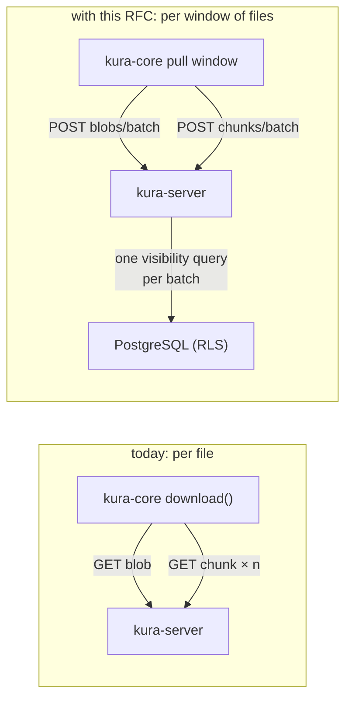
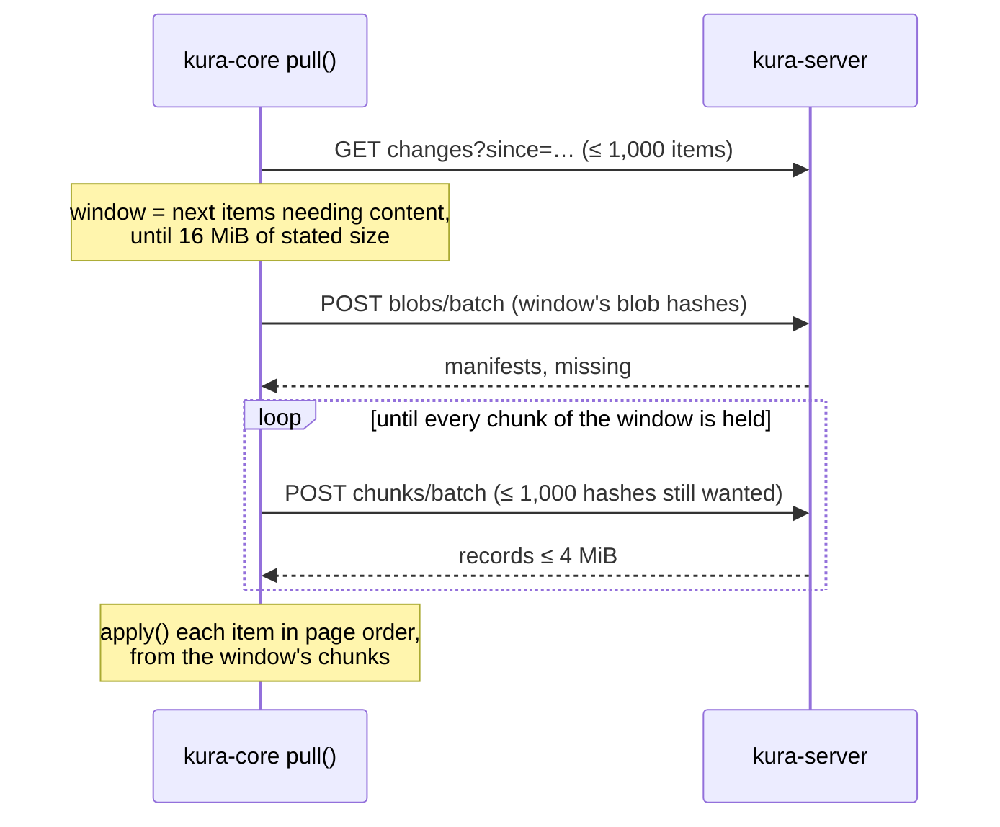
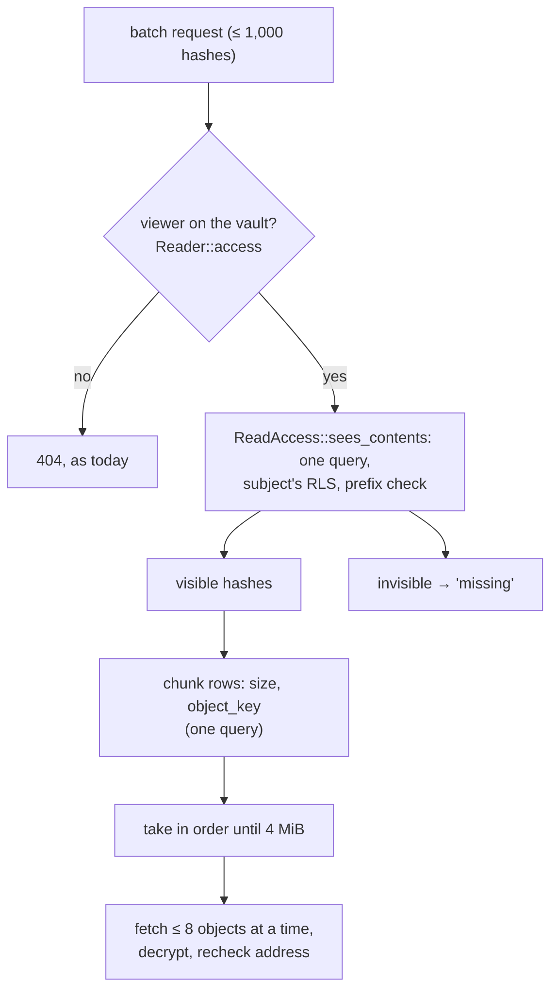
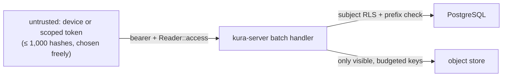

# RFC 0002 — Batched chunk and manifest transfers

| Field | Value |
| --- | --- |
| Status | Draft |
| Short | Batched transfers |
| Settles | How a device downloads (and, in phase 3, uploads) thousands of small files without one request per chunk and per manifest |
| Author | Maxime (batleforc) |
| Co-author | Claude Opus 5.5 |
| Created | 2026-11-15 |
| Supersedes | — |
| Touches | `crates/kura-server` (`app/chunks.rs`, `limits.rs`, `app/reader.rs`), `crates/kura-core` (`sync.rs`, `wire.rs`), `crates/kura-cli` (`api.rs`), `crates/kura-wasm`, `plugin/src/remote.ts`, `perf/attach.sh`, `docs/` |
| Risk | medium |

> **Reference material**, about 5,100 words. For the decision, read §1,
> §2, §12 and §15; the rest is the design to build and review against.

## 1. Summary

RFC 0001 decision 42 promised a batched chunk download if a new device's
first attach of a 10,000-note vault took more than 5 minutes [R1]. Phase 6
measured 974 s for that attach, and 980 s for the first device's push [R2].
The server is not the bottleneck: each file costs two requests in each
direction, and each route is limited to 600 requests a minute per device
[R3]. This RFC adds two read routes: `POST /vaults/{v}/blobs/batch` returns up
to 1,000 manifests, and `POST /vaults/{v}/chunks/batch` returns up to 4 MiB of
chunks in one response. Phase 3 adds the two matching write routes, if
question 3 keeps them. The chunk format, encryption, addressing and
visibility rules stay as they are; only the number of round trips changes.

### Before / after

```text
# today: a new device attaching 10,000 notes of 1–4 KiB
GET /v1/vaults/{v}/blobs/{hash}     × 10,000   (600/min)
GET /v1/vaults/{v}/chunks/{hash}    × 10,000   (600/min)
                                    ≈ 1,000 s, rate-limited

# with this RFC
POST /v1/vaults/{v}/blobs/batch     × 10       (1,000 manifests each)
POST /v1/vaults/{v}/chunks/batch    × ~10      (≤ 1,000 chunks, ≤ 4 MiB each)
                                    ≈ 20 requests
```



The diagram shows that the visibility check moves from one query per hash to
one query per batch. It is the check that keeps scoped tokens and other
users' configuration out (T16, T14), so §7 is about it.

## 2. Motivation

1. **A new device takes 16 minutes to attach a 10,000-note vault.**
   `kura_core::sync::download` makes one `get_blob` call, then one
   `get_chunk` call per chunk [R4]. A small note is one chunk, so a file
   costs two requests. Both routes are limited to 600 a minute per device
   [R3], which puts 10,000 notes at about 1,000 s. `perf/attach.sh` measured
   974 s [R2]. That is three times decision 42's 5-minute budget [R1].
2. **The first push of the Notion migration takes as long.** The upload loop
   sends one `put_chunk` per missing chunk and one `put_blob` per file [R5],
   and both routes are also limited to 600 a minute [R3]. The first device's
   push measured 980 s [R2]. Phase 9 of RFC 0001 is exactly that push [R6].
3. **Raising the limits would not be enough.** 20,000 sequential requests at
   a mobile round trip of 50–100 ms take 1,000–2,000 s whatever the limit.
   The round-trip figure is an estimate, not a probe: the dev stack answers a
   pull in 6.5 ms at p95 on loopback [R2]. §6.P observation 4 measures it on
   the Android phone.
4. **Each request opens its own transactions.** Today a chunk download runs
   the visibility query in one transaction, then the object-key lookup in a
   second one [R7], [R8]. 20,000 requests make 40,000 short transactions,
   where batches make about 40.

## 3. Goals / non-goals

**Goals**

- A new device attaches a 10,000-note vault of about 25 MB in under 5
  minutes on the dev stack. The target is under 60 s, and `perf/attach.sh`
  checks it.
- The same visibility outcome per hash as today. A batch never returns
  content that the single-hash routes would refuse, and it never tells an
  unknown hash from an invisible one.
- Memory stays bounded on both sides, whatever the vault or the file sizes.
- Phase 3, if question 3 keeps it: a first push of 10,000 notes under 5
  minutes.

**Non-goals**

- **Streaming large files.** A file is still held whole in memory, the
  limit S8 records [R9]. Batching small files is a separate problem.
- **A whole-vault archive** (tar or zip of a snapshot). It would bypass
  per-entry visibility, could not resume, and would duplicate what the pull
  already orders (§12).
- **Removing the single-hash routes.** They serve open-file reads, scoped
  tokens and older clients. Removal would be a `/v2` change [R10].
- **Changing the rate limits of existing routes.** They stay as RFC 0001
  §4.4 set them [R3].
- **Compression.** That is decision 38's codec RFC, triggered by its own
  measurement [R11].
- **HTTP/2 multiplexing as the fix.** It cuts handshake cost, not the per-route
  limit or the per-request transactions (§12).

## 4. User-facing design

### 4.1 Configuration

Nothing to configure. The batch sizes are constants of the protocol: 1,000
hashes per call and 4 MiB per chunk response. They match the existing page
size and the largest chunk [R12]. The rate limits are constants of `LIMITS`,
like every other route [R3]. No option means no unsafe default to argue
about.

### 4.2 Behaviour rules

- **Order**: records come back in request order. Each hash appears at most
  once; the server deduplicates the request, keeping the first occurrence.
- **Partial answer**: `chunks/batch` adds found chunks in request order until
  the next one would take the body past 4 MiB. Hashes after that point are
  simply absent, and the client asks for them again. The first record always
  fits, since a chunk is at most 4 MiB [R12].
- **Absent hash**: an unknown chunk, one deleted by garbage collection and
  one the caller may not see all get the same `missing` record. The client
  treats it like a `404` from the single route today: that file fails,
  `report.failed` names it, and the next run retries it [R4].
- **Empty request**: `400 invalid_request`. An empty batch is a client bug,
  not a no-op.
- **Uninteresting case**: a vault with few changes sends batches of one or
  two hashes. The cost is the same as today's single requests.

### 4.3 Validation

Rejected on input:

| Condition | Rationale |
| --- | --- |
| More than 1,000 hashes, or none | Bounds the visibility query and the response |
| A hash that is not 64 lowercase hex characters | Same rule as the path parameter today (`parse_hash`) [R7] |
| Body over 128 KiB | 1,000 hashes in JSON take about 67 KB; X15 showed that the default 64 KiB is too small [R2] |

Warnings: none. A batch either answers or fails like any other request.

### 4.4 API surface

| Method | Path | Auth | Who may call | Limit |
| --- | --- | --- | --- | --- |
| POST | `/v1/vaults/{v}/blobs/batch` | bearer (device or scoped token) | viewer and up; a scoped token within its prefix | 60/min |
| POST | `/v1/vaults/{v}/chunks/batch` | bearer (device or scoped token) | viewer and up; a scoped token within its prefix | 60/min |
| POST | `/v1/vaults/{v}/chunks/upload` (phase 3) | device | editor and up | 60/min |
| POST | `/v1/vaults/{v}/blobs/upload` (phase 3) | device | editor and up | 60/min |

`blobs/batch` takes `{"blobs": ["<hash>", …]}` and returns
`{"manifests": [{"hash", "size", "chunks": […]}], "missing": ["<hash>"]}`.
`chunks/batch` takes `{"chunks": ["<hash>", …]}` and returns
`application/octet-stream`, a sequence of records with no header:

```text
record := hash[32] status[1] length[4, big-endian] bytes[length]
status 0 = found (bytes are the chunk's plaintext), 1 = missing (length 0)
```

utoipa documents both routes on the handlers (`batch_blobs`, `batch_chunks`)
and `docs/api/openapi.json` is regenerated [R13]. The plugin's client is
written by hand, as today, because no HeyApi client exists for a binary body.

### 4.5 Mocks

Nothing changes on screen. `kura attach`, `kura sync` and the plugin keep
their output and only finish sooner. Error texts are those of the single
routes, because a missing chunk still ends as a failed file named in
`report.failed` [R4].

## 5. Architecture

### 5.1 The pull window



The diagram shows that `apply()` still runs item by item in page order. The
cursor and "held" rules of the pull [R4] do not change. Only where the bytes
come from changes.

**Invariant**: a chunk's bytes are checked against their BLAKE3 address and a
blob's manifest against its blob hash before use, exactly as `download()`
does today [R4]. Because the client derives every expected hash from the
change item it already trusts, a wrong or reordered record can only fail a
file. It can never write unchecked bytes.

### 5.2 One visibility query per batch

`ReadAccess::sees_content` (what `Reader::access` returns) runs one query per hash and keeps a hash if one of the
first 200 revisions naming it lies under the caller's prefix. It runs under
the caller's subject, so row-level security hides other users' configuration
[R8]. The batch form is the same query with `= ANY($2)`. It returns the hash
with each `(path, head)` row and keeps the existing 200-row limit per hash
through a window function (`row_number() OVER (PARTITION BY hash)`). The rule
per hash is therefore unchanged, and `sees_content` becomes a call to
`sees_contents(&[hash])` so that both routes share one implementation.



The flowchart shows that authorization (vault role, then visibility per hash)
runs before any object is fetched or decrypted. It also shows that an
invisible hash and an unknown hash leave the same branch.

## 6. Detailed design

### 6.1 `kura-server`

- `app/chunks.rs`: `batch_blobs` and `batch_chunks` reuse `parse_hash`,
  `Reader::access(…, VaultRole::Viewer)` and `read_chunk`'s open-and-check
  [R7]. `read_chunk` is split so that the data key (`store.keys.get`) and the
  object-key lookup are done once per batch. Objects are fetched with
  `futures_util::stream::iter(..).buffered(8)`: at most 8 at a time, results
  in order. `futures-util` is already a dependency.
- The 4 MiB budget is computed from `chunk.size` before any fetch [R14], so
  the server never reads an object it will not send.
- `app/reader.rs`: `ReadAccess::sees_contents(&[ChunkHash], chunk: bool) ->
  HashSet<ChunkHash>`; `sees_content` delegates to it.
- `limits.rs`: the new routes at 60/min. The gate test
  `every_route_has_a_limit` already fails on a route missing from `LIMITS`
  [R3].
- `app/mod.rs`: a 128 KiB body limit on the two read routes, set next to the
  existing 1 MiB exceptions [R15].
- A per-replica semaphore of 8 concurrent `chunks/batch` responses bounds
  memory. Above it, the request gets `503 unavailable` with `Retry-After: 1`,
  which the CLI and the plugin already honour [R19].
- Phase 3: `upload_chunks` reads the framed body (`hash | length | bytes`,
  ≤ 4 MiB of payload, 4 MiB + 64 KiB body limit). It rehashes every record
  before storing it, as `put_chunk` does, checks the quota once for the sum,
  and answers `{"stored": […]}`. `put_blobs` stores up to 1,000 manifests
  with the checks of `put_blob`, all or nothing.

### 6.2 `kura-core`

- `Remote` gains `get_blobs(&[ChunkHash])` (the JSON manifests) and
  `get_chunk_records(&[ChunkHash]) -> Vec<u8>` (the raw response body).
  `wire::parse_records` in `kura-core` is the only parser of the record
  framing, so the CLI and the plugin both pass bytes and the fuzz target
  covers every client. The CLI (`api.rs`), the WASM bridge and the test
  fakes (`Scripted`, the simulation) implement the two methods.
- `download()` has one caller, `apply()`, and so does every pull, including
  the full resync, which resets the cursor to 0 and pulls again [R4]. The
  `apply()` calls that settle a commit result (a conflict's head, one file
  each) keep the single routes.
- `pull()` forms a window from the page's items that need content. It stops
  at 16 MiB of stated size, and a larger file goes alone. The window is
  filled by the two batch calls, then applied item by item through the
  existing `apply()`. `download()` keeps its checks and reads from the
  window's map instead of calling `get_chunk`.
- A stated size is the server's word until the bytes arrive: the window
  reserves memory as records arrive, never from the stated sizes (review
  4 L6) [R4].
- Phase 3: `upload_batch` groups missing chunks into 4 MiB uploads and
  manifests into 1,000-manifest calls [R5].

### 6.3 Clients

- `plugin/src/remote.ts`: `getBlobs` returns the parsed JSON;
  `getChunkRecords` returns the response body as a `Uint8Array`, unparsed.
  `kura-core` parses it inside the WASM core.
- `kura-wasm`: the two new `Remote` methods cross the boundary as byte arrays
  and JSON, like the existing ones.

### 6.P Proof against a real client

The suites are `perf/attach.sh` and `tests/heavy/authz.sh`, on the local
stack (`task dev:stack`, `task dev:run RELEASE=1`), with the real `kura`
binary built from the same tree. The plugin observation runs in Obsidian
1.11.4 on desktop and on the Android test phone [R1].

1. `perf/attach.sh 10000`: device B's `kura attach` of the 10,000-note vault
   finishes in under 300 s (target 60 s). With `RUST_LOG=tower_http=debug`,
   the server's request trace [R21] shows about 20 `POST …/batch` calls and
   no `GET …/chunks/{hash}` or `GET …/blobs/{hash}` from device B. After the attach,
   `kura verify` prints `Equal.`
2. `tests/heavy/authz.sh`, refusal: a scoped token bound to prefix `agents/`
   sends `chunks/batch` with one chunk of a note under `agents/` and one of a
   note outside. The response holds one `found` record and one `missing`
   record. `kura_batch_items_total{route="chunks", outcome="found"}` moved by
   exactly 1, and `found` counts objects fetched, so the refused chunk was
   never fetched or decrypted.
3. `tests/heavy/authz.sh`, refusal: bob (member) sends `chunks/batch` with
   the address of a file in alice's configuration space. The answer is
   `missing`, byte for byte the same record as for a random hash.
4. Obsidian on the Android phone, a new vault attach of 2,000 notes over
   Wi-Fi: the plugin's status goes from `syncing` to `in sync`. The maintainer
   records the time and the number of requests, which settles motivation 3's
   estimate.
5. Phase 3: `perf/attach.sh 10000`, the first device's push finishes in under
   300 s, with no `PUT …/chunks/{hash}` in the request trace.

**Deliberately untouched**, so reviewers do not go looking:

- `crypto::open` and the chunk format: the bytes stored and their check are
  the same [R7].
- `GET /chunks/{hash}` and `GET /blobs/{hash}`: kept unchanged for scoped
  tokens, open notes and older clients.
- `POST /chunks/missing`: already batched (1,000 hashes) since phase 3 [R5].
- The changes feed: already paged by 1,000 [R12].

## 7. Security

**Rating:** medium. The change adds two read routes that return content in
bulk, through the same visibility rule that keeps scoped tokens and other
users' configuration out. Getting the batch form of that rule wrong would
leak content.

### 7.1 Threat model

Assets: note and configuration content, plus the existence of a given content
hash in a vault. Actors: a member with a device, a scoped token holder (an
agent, possibly compromised), and another tenant. The boundary is the one
that exists today, between the caller and `kura-server`. What is new is that
one request now names up to 1,000 objects.



| # | Threat (STRIDE) | Where | Mitigation | Residual risk |
| --- | --- | --- | --- | --- |
| T1 | Information disclosure: a scoped token reads a chunk outside its prefix by mixing it into a batch | `batch_chunks` | `ReadAccess::sees_contents` applies `ReadAccess::sees` to each hash's rows, the same rule as `sees_content` [R8]; test `batch_respects_token_prefix` | The 200-revision shortcut still fails closed for widely shared chunks, as today |
| T2 | Information disclosure: a member reads another member's configuration through its content address | `batch_chunks`, `batch_blobs` | The visibility query runs under the caller's subject, where row-level security hides other owners' entries [R8], [R16]; test `batch_hides_other_members_config` | D70 stands: whoever knows the exact bytes can commit them into their own space [R16] |
| T3 | Information disclosure: probing which hashes a vault holds by comparing `missing` with an error | both routes | Unknown and invisible give the same record or entry, with no status difference; test `batch_missing_is_indistinguishable` | A viewer could already probe their own vault with `chunks/missing` |
| T4 | Denial of service: one request makes the server fetch and decrypt up to 1,000 objects | `batch_chunks` | 4 MiB budget from `chunk.size` before any fetch, 8 objects at a time, 60/min, 8 concurrent responses per replica, then 503 | 240 MiB/min per device is the ceiling; accepted for a self-hosted personal instance |
| T5 | Tampering: a response record carries other bytes than its hash names | client parsing | The client checks each chunk against the hash it asked for and each manifest against its blob hash [R4]; test `a_wrong_record_fails_the_file` | none |
| T6 | Denial of service (client): a hostile server sends a huge `length` | `wire::parse_records` (the one parser, used by the CLI and, through WASM, the plugin) | `length` is checked against the remaining body and against 4 MiB before allocation; fuzz target `fuzz_chunk_records` | none |
| T7 | Elevation (phase 3): uploading bytes under a hash that is not theirs | `upload_chunks` | Each record is rehashed before storage, as in `put_chunk`; editor role checked before the body is read; test `upload_batch_rejects_a_wrong_hash` | none |

### 7.2 Authentication and authorisation

Both read routes take the same `Reader` extractor as `GET /chunks/{hash}`:
a device token, or a scoped token with its address, expiry and revocation
checks [R8]. The vault role is checked first (viewer, `404` on a vault the
caller cannot see, as T4 of RFC 0001). Visibility per hash comes next, and
object access only after both. A bypassed visibility check would give what
`GET /chunks/{hash}` gives with the same bypass, but up to 1,000 times per
request. That is why T1 to T3 each have their own test. The phase 3 write
routes are device-only and require editor, like `PUT /chunks/{hash}`.

### 7.3 Input handling and injection

The JSON bodies hold hex hashes only, parsed by `parse_hash` (64 lowercase
hex characters), with a count of 1–1,000 and a 128 KiB body limit. The hashes
go to SQL as `bytea[]` parameters, never as text. The response framing is
parsed by clients, which is T6 and gets a fuzz target. The phase 3 upload
framing is parsed by the server, which gets the same target on the server
side (`fuzz_chunk_records` covers both directions, since it is one parser in
`kura-core`).

### 7.4 Secrets and cryptography

No new secret or primitive. Chunks are decrypted with the vault's data key by
the existing `crypto::open` (AES-256-GCM, address checked) [R7]. The key is
fetched once per batch instead of once per chunk, through the same
`DataKeys` cache.

### 7.5 Abuse and resource exhaustion

Per device: 60 calls a minute per route, so at most 240 MiB a minute of
chunks. Per replica: 8 concurrent chunk responses, about 32 MiB of buffered
plaintext plus the same in stored bytes while decrypting. An unauthenticated
caller is refused by the extractor before any database work, as on every
token route. A visibility query is bounded at 200 rows per hash, so 200,000
rows per batch at most, which is the same bound as 1,000 single requests,
in one statement.

### 7.6 Existing defences that still hold

Row-level security keyed on tenant and subject [R16], the scoped token's CIDR
and expiry, the audit middleware that logs every denial, `X-Kura-Client`
minimum versions [R10], and the chunk address check on both sides.

## 8. Supply chain

No new dependency, image, action or tool. The server uses `futures-util` and
`bytes`, which are already in `crates/kura-server/Cargo.toml` [R17], and the
plugin uses `DataView` from the platform. `task audit` is unchanged.

## 9. Data and privacy

No new datum is stored, logged or labelled. The routes move the same content
that the single-hash routes already serve, under the same encryption in
transit (TLS at the ingress) and at rest. The request trace
(`tower_http`, debug level) carries the request path, which includes a
hash for the single-hash routes as today. The batch routes put their
hashes in the body, which is never logged.

## 10. Operability

### 10.1 Observability

- **Metrics**: `kura_batch_items_total{route, outcome}`, where `outcome` is
  `found` (an object fetched and sent) or `missing` (nothing fetched), and `kura_batch_response_bytes` (histogram) for
  `chunks/batch`. The labels are bounded: two routes, two outcomes. Kura
  has no per-route request counter today; the 429 and 503 answers are
  already counted (`kura_unavailable_total`).
- **Logs and audit trail**: a refused vault access is logged by the existing
  audit middleware. `missing` records are not audit events, because they are
  indistinguishable by design (T3). Their rate is visible in the counter.
- **Alerts**: none new. Corrupt chunks still raise
  `kura_chunk_corrupt_total`, which is already alerted [R18].

### 10.2 Failure modes

| Failure | Detected by | Behaviour (fail open / closed) | Recovery |
| --- | --- | --- | --- |
| Object store slow or down mid-batch | `503` answers (`kura_unavailable_total`) | The whole response fails with `503`; nothing partial is sent with `found` status (closed) | The client retries with backoff; files already applied keep their cursor [R4] |
| A stored chunk fails its check | `kura_chunk_corrupt_total` | `503`, as the single route does | Restore from backup (operator guide §12) |
| Semaphore full | `503` with `Retry-After: 1` | Refused, never queued without bound | Client retries |
| Old server, new client | `405 Method Not Allowed` on the route (probed, R20) | The client falls back to the single routes for the rest of the run (question 2) | Upgrade the server first (§13) |

### 10.3 Performance and capacity

Target: `perf/attach.sh 10000` under 60 s on the dev stack (§6.P 1). The
budget per batch is about 4 MiB of plaintext and as much ciphertext. CPU is
the same decryption work as today, done in fewer, larger calls. The
estimated request count, about 20 instead of 20,000, still has to be
measured by observation 1.

## 11. Other concerns

- **Accessibility**: no UI change.
- **Internationalisation**: no new string.
- **Compliance**: none touched. The data handled is unchanged.
- **Licensing**: unchanged, since nothing new is linked.
- **Documentation**: the operator guide's limits table (§4) and signals (§8)
  gain the new routes and metrics, and RFC 0001's planned-RFC row points
  here.

## 12. Alternatives considered

| Alternative | Why rejected |
| --- | --- |
| Do nothing | 16 minutes per new device and for the migration push [R2]. On a phone, the attach has to run while Obsidian stays in the foreground; whether Android suspends it is an assumption that observation 4 would settle |
| Raise the per-route limits to 6,000/min | Still 20,000 round trips: 1,000–2,000 s at mobile latency (motivation 3), 40,000 transactions, and a tenfold looser abuse guard on every single-hash route |
| Client-side parallel requests | Bound by the same per-route limit, so the floor is still about 1,000 s, with more concurrent connections per device |
| Whole-vault archive (`GET /vaults/{v}/archive`) | Bypasses per-entry visibility (T16), cannot resume after a drop, and duplicates the ordering that the changes feed already gives |
| Multipart response instead of the record framing | Boundaries have to be scanned for, and a parser is needed on both sides. The fixed 37-byte header is simpler to bound and to fuzz |
| Inline chunks in the changes feed | Mixes metadata paging with a body of unknown size, and breaks the 1,000-item page that the cursor rules rely on [R12] |

## 13. Rollout and compatibility

- **Default behaviour**: the routes exist once the server ships. Clients use
  them when present.
- **Migration**: no schema change, so there is nothing to revert.
- **Order**: server first, then the CLI and the plugin. Within `/v1` the
  change is additive [R10]. An older client keeps using the single routes.
- **Rollback**: redeploy the previous server. New clients then get `405` on
  the batch routes and fall back (question 2). No persisted state depends on
  the change, and no risk closed in §7 reopens.
- **Feature flag**: none, since the fallback covers the window between the
  two deployments.

## 14. Test plan

- **Unit** (`crates/kura-core`): record framing round trip, a truncated
  record, a `length` above the remaining body or above 4 MiB, window
  formation at the 16 MiB edge and with a single large file.
- **Integration** (`crates/kura-server/tests/chunks.rs`): order kept and
  duplicates removed; the 4 MiB cut and the client's second call; 1,001
  hashes give `400`; a body over 128 KiB gives `413`; a hash deleted by GC
  gives `missing`.
- **Simulation** (`tests/sim.rs`): two devices converge with batching on,
  and with a fake server that answers `405` on batch routes.
- **Proof**: §6.P.
- **Security**: `batch_respects_token_prefix` (T1),
  `batch_hides_other_members_config` (T2),
  `batch_missing_is_indistinguishable` (T3), `batch_is_limited_and_bounded`
  (T4: 61st call `429`, ninth concurrent `503`), `a_wrong_record_fails_the_file`
  (T5), fuzz target `fuzz_chunk_records` (T6),
  `upload_batch_rejects_a_wrong_hash` (T7, phase 3).
- **Audit**: `task audit` green, with no new dependency.
- **Existing suites** that must pass unchanged: T14 and T16 tests
  (`config_namespace_hidden_from_other_member`, the scoped token suite), the
  heavy suites `sync.sh` and `authz.sh`, the plugin tests, and the 80%
  coverage gates.

## 15. Decisions and open questions

### Resolved

| # | Question | Decision |
| --- | --- | --- |
| 1 | Route name for chunk download | **`POST /vaults/{v}/chunks/batch`, as decision 42 named it [R1].** A manifest route was not in decision 42, but without it the request count is halved, not removed. |

### Still open

2. **Fallback on an older server.** The server at `85e4fe9` answers
   `405 Method Not Allowed` to `POST …/chunks/batch`, `…/blobs/batch` and
   `…/chunks/upload`, because those paths match the existing
   `/chunks/{hash}` and `/blobs/{hash}` routes, which take only `GET` and
   `PUT` [R20]. Should a new client fall back to the single routes, or
   require a server version? Recommendation: fall back for the rest of the
   run on a `405`. That status cannot be confused with a problem `404`
   ("vault gone", as today). It costs about 20 lines and avoids version
   coupling during an upgrade.
3. **Phase 3 (batched uploads): now, or after a measurement?** The first
   push measured 980 s [R2], but it happens once per migration. Upload
   parsing is new server-side attack surface (T7). Recommendation: do it,
   because the Notion migration of RFC 0001 phase 9 is that push [R6], but
   only after phase 2 has run on real devices.
4. **Window size.** 16 MiB of stated size per window is a guess that trades
   memory on a phone against round trips. Recommendation: keep 16 MiB and
   revisit with observation 4.

## 16. Implementation phases

| Phase | Content |
| --- | --- |
| 1 | `sees_contents` (the batch visibility check) with T1–T3 tests, then `batch_blobs` and `batch_chunks` with their limits, body limits and semaphore (T4). The routes land with their controls. Useful on its own: clients can call them. |
| 2 | `kura-core` window and `Remote` methods, with the CLI, WASM and plugin implementations, the fallback (question 2) and `fuzz_chunk_records`. `perf/attach.sh` reruns, which is observation 1. Useful on its own: this phase closes decision 42. |
| 3 | If question 3 says yes: `upload_chunks` and `put_blobs` with T7, then the client's upload batching. Observation 5. |

## 17. References and sources

| # | Source | Pinned at | Supports |
| --- | --- | --- | --- |
| R1 | RFC 0001, decision 42 and §16 phases 4 and 6 (`docs/RFC/rfc0001-init-project.md:981`) | RFC 0001 Accepted 2026-11-14, tree `85e4fe9` | §1, §3, §6.P, resolved decision 1 |
| R2 | Implementation plan, PR 6.5, X15, X17 (`docs/RFC/rfc0001-implementation-plan.md:72`, `:676-677`); `perf/attach.sh` | run 2026-11-14 on the dev stack, `RELEASE=1`; tree `85e4fe9` | 974 s and 980 s; 6.5 ms pull p95; 413 above 64 KiB |
| R3 | `crates/kura-server/src/limits.rs:21-26` (`LIMITS`), gate `every_route_has_a_limit` | `85e4fe9` | 600/min per route; new limits gated |
| R4 | `crates/kura-core/src/sync.rs` `download()` (about l. 976), `pull()` (about l. 805), review 4 L6 | `85e4fe9` | two requests per file; client-side checks; cursor rules |
| R5 | `crates/kura-core/src/sync.rs` upload batch (about l. 680-705) | `85e4fe9` | one `put_chunk` per missing chunk, one `put_blob` per file; `missing` already batched |
| R6 | RFC 0001 §13 migration paragraph (`rfc0001-init-project.md:1012`); plan PR 9.1/9.2 | `85e4fe9` | the first push is the migration |
| R7 | `crates/kura-server/src/app/chunks.rs` `get_chunk` (l. 331), `read_chunk` (l. 361), `get_blob` (l. 596) | `85e4fe9` | per-request transactions; decrypt and address check; `parse_hash` |
| R8 | `crates/kura-server/src/app/reader.rs:56-90` (`sees_content`, 200-row shortcut, subject transaction) | `85e4fe9` | visibility rule reused per hash |
| R9 | Plan, phase 3 review S8 | `85e4fe9` | whole-file memory limit |
| R10 | RFC 0001 §13 protocol compatibility (`rfc0001-init-project.md:1021`) | Accepted 2026-11-14 | additive `/v1`, `X-Kura-Client` |
| R11 | RFC 0001 decision 38; `docs/readme.md` planned RFCs | `85e4fe9` | compression is its own RFC |
| R12 | `crates/kura-server/migrations/0005_chunks.sql:13` (`chunk.size` ≤ 4,194,304); `changes` page of 1,000 (plan PR 3.3) | `85e4fe9` | 4 MiB per chunk; 1,000-item pages |
| R13 | `task dump-spec`, `task openapi:check` (`.tasks/` and plan PR 1.3) | `85e4fe9` | spec regeneration and drift gate |
| R14 | `crates/kura-server/migrations/0005_chunks.sql:9-19` | `85e4fe9` | budget from `chunk.size` before fetch |
| R15 | `crates/kura-server/src/app/mod.rs:241-258` (body limits) | `85e4fe9` | where the 128 KiB limit goes |
| R16 | `crates/kura-server/migrations/0015_config_spaces.sql:21-24`; plan D70 | `85e4fe9` | subject RLS on `entry`; known-bytes residual |
| R17 | `crates/kura-server/Cargo.toml:11-12` | `85e4fe9` | `futures-util`, `bytes` already present |
| R18 | `deploy/helm/kura/files/alerts.yaml` (corrupt chunk alert); plan PR 6.3 | `85e4fe9` | existing alert covers corruption |
| R19 | `crates/kura-cli/src/api.rs:78-87`; `plugin/src/remote.ts:44-51` | `85e4fe9` | both clients wait out `429`/`503` per `Retry-After` |
| R20 | Probe: `curl -X POST http://127.0.0.1:58080/v1/vaults/<uuid>/{chunks/batch,blobs/batch,chunks/upload,blobs}` against `task dev:run` | 2026-11-15, server at `85e4fe9` | `405` on the first three, `404` on `blobs`: the fallback status, and why the phase 3 manifest route is `blobs/upload` |
| R21 | `crates/kura-server/src/app/mod.rs:302` (`TraceLayer::new_for_http`) | `85e4fe9` | the request trace §6.P reads |
