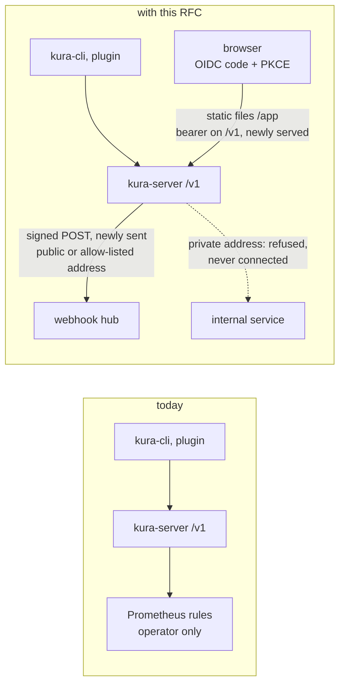
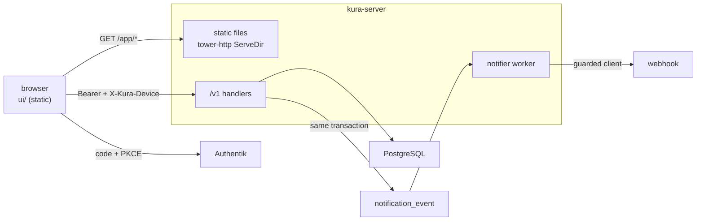
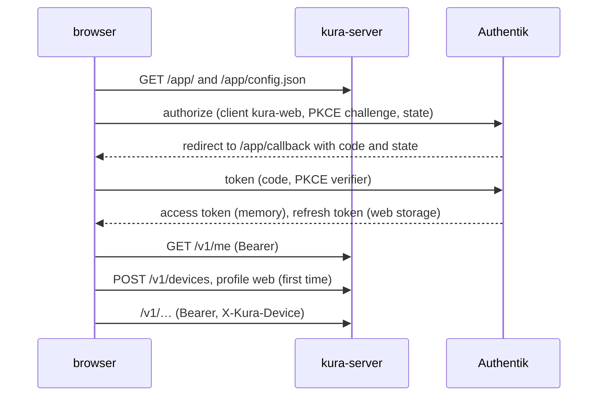
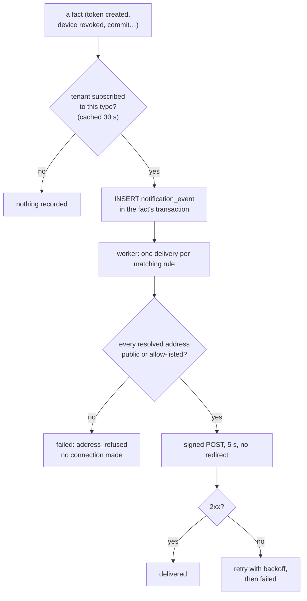
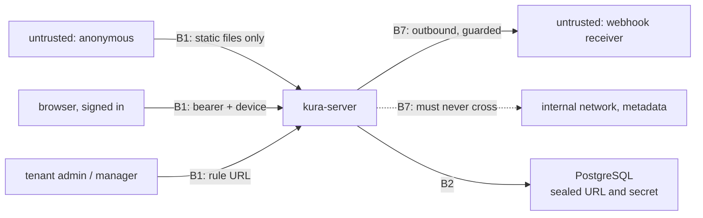

# RFC 0003 — Web console (front and back office) and notifications

| Field | Value |
| --- | --- |
| Status | In review (2026-11-15) |
| Short | Web console, webhooks |
| Settles | How members and managers use Kura from a browser (their vaults and devices; access, keys and notifications), and how a tenant is notified of events on a webhook |
| Author | Maxime (batleforc) |
| Co-author | Claude Fable 5.2 |
| Created | 2026-11-15 |
| Supersedes | — (revisits RFC 0001's non-goal "a web UI") |
| Touches | `ui/` (new), `crates/kura-server` (`app/mod.rs`, `app/me.rs`, `app/vaults.rs`, `app/devices.rs`, `app/notifications.rs`, `notifier.rs`, `net.rs`, `config.rs`, `limits.rs`, `maintenance.rs`, `lib.rs`, migrations `0022`, `0023`), `Containerfile`, `Containerfile.hardened`, `deploy/helm/kura`, `.tasks/`, `tests/heavy/console.sh`, `docs/` |
| Risk | high |

> **Reference material**, about 11,100 words. For the decision, read §1, §3,
> §7.1 and §15; the rest is the design to build and review against.

---

## 1. Summary

Everything Kura manages is done today with `kura-cli` or by editing
configuration files. This RFC adds a web application served by `kura-server`,
in two areas. The **front office** is for every member: their vaults and
their devices (the reader pages are RFC 0005). The **back office** is for
vault managers, tenant admins and the platform admin: who may access a vault,
its scoped tokens (create, list, revoke; a vault's managers manage them
together), devices of the tenant, the configuration status, and
**notifications**. A notification rule sends chosen tenant events (a token
about to expire, a quota nearly full, a device revoked, a vault changed) to a
webhook, so an external hub can centralise them. The browser signs in through
Authentik and calls the same `/v1` API with a bearer token; Kura sets no
cookie. Both the application and outbound webhooks are off until configured.

### Before / after

```text
# today
$ kura token create campaign --prefix Sessions/ --expires 30d --cidr 10.42.0.0/16
$ kura token list campaign
(alerts: Prometheus rules for the operator only)

# with this RFC
https://kura.example.org/app/                  sign in with Authentik
  My vaults · My devices                       front office
  campaign ▸ Access · Keys · Notifications     back office (manager)
POST https://hub.example.org/hooks/kura        {"type":"token.expiring",…}
```



The diagram shows the two new flows, a browser client and an outbound
request, and the outbound request that is refused.

---

## 2. Motivation

1. **Managing access needs the CLI or a file.** Bindings and tokens have
   routes [R1] but their only client is `kura-cli` [R2]. A game master who
   wants to add a player, or see which tokens exist, needs a terminal and a
   device grant on that machine.
2. **A manager cannot list who has access.** The router has `put_binding` and
   `delete_binding` and no read of a vault's bindings [R1]; the configuration
   files are the only place to look, and API-managed bindings are in neither.
3. **Nothing tells a tenant what happens to it.** Security-relevant facts
   (token created, device revoked, binding changed) are audit log lines with
   `target: "audit"` [R3], and the alerts are Prometheus rules for the
   operator [R4]. A tenant admin learns that a token expired when the bot
   stops, and that the quota is full when a push fails.
4. **RFC 0001 provided "the API a UI would use, not the UI"** [R5]. The
   routes exist; this RFC is that UI and the few routes it shows were
   missing.

---

## 3. Goals / non-goals

**Goals**

- A member signs in from a browser with their Authentik account and sees
  their vaults and devices, and can revoke a device.
- A vault manager or tenant admin lists and changes a vault's bindings,
  creates, lists and revokes its scoped tokens, and sees the tenant's
  devices, without the CLI.
- A token's managers are the vault's managers and the tenant's admins, all of
  them: any of them sees and revokes a token another created. Its secret is
  shown once, to its creator.
- A tenant admin or vault manager subscribes a webhook to a closed list of
  events; deliveries are signed, retried, and visible with their outcome.
- The server never connects to an address the operator did not allow.
- The platform admin sees the configuration status in the same place.
- The application can be installed (a PWA) and stays signed in across
  launches when the user asks it to.

**Non-goals**

- **Reading notes in the browser**: RFC 0005 (the reader pages plug into the
  shell defined here).
- **Folder rules of tokens and bindings**: RFC 0004 and RFC 0005; their forms
  gain those fields when those RFCs land.
- **Editing notes, or managing tenants**: tenants stay declared in files
  (RFC 0001 §4.1); the console shows them.
- **Showing a token's secret again, or a link that hands it over**: the
  secret is stored as a hash [R6]; "sharing" a key is co-management.
- **Routing the operator's Prometheus alerts**: Alertmanager already sends
  webhooks; the console does not configure it.
- **Channels other than a webhook** (e-mail, Discord, Matrix): the hub
  behind the webhook does that; the channel is a tagged type so another can
  be added by its own RFC.
- **Note paths or content in a payload**: deferred to a *bis*
  (decision 7).
- **Cookies or a server-side session**: the API takes bearer tokens only
  [R7], and stays so.
- **Offline use**: the application is installable, but its service worker
  caches the application shell only; notes offline are what Obsidian is
  for.
- **Gotify or ntfy payload formats**: one format, made to be transformed
  (decision 20).

---

## 4. User-facing design

### 4.1 Configuration

```yaml
# server.yaml
ui:
  enabled: true                       # serve the application under /app
  dir: /usr/share/kura/ui             # where the built files are (image default)
  oidc:
    clientId: kura-web                # a public client in Authentik; also in oidc.audiences
notifications:
  enabled: true                       # run the delivery worker, accept rules
  webhook:
    allowedCidrs: []                  # private addresses webhooks may reach
    caFile: /etc/kura/hub-ca.pem      # extra trust root, for a private CA
```

- `ui` absent or `enabled: false`: `/app` answers `404` and nothing is
  served. Default off: an HTML surface on the API origin is opt-in.
- `ui.oidc.clientId` must also be listed in `oidc.audiences` [R8]; the issuer
  is the one of `oidc.discovery`.
- `notifications` absent or `enabled: false`: rule routes answer
  `409 notifications_disabled`, no event is recorded, no request leaves.
- `allowedCidrs` absent or empty: only public addresses are reachable.
  Private, loopback, link-local and metadata addresses are refused unless a
  range here covers them. The default is the closed side; a hub inside the
  cluster needs its address listed, narrowly. A receiver reached by its
  public name needs nothing here.
- `caFile` absent: the default trust roots, which a Let's Encrypt
  certificate satisfies. With it, its certificates are trusted in
  addition, for webhooks only. `http` is never accepted.
- CORS is untouched: the application is same-origin, so
  `cors.allowedOrigins` [R7] gains nothing.

A notification rule, created in the back office or through the API:

```json
{
  "name": "hub",
  "events": ["token.expiring", "quota.high", "device.revoked"],
  "vault": null,
  "channel": {
    "type": "webhook",
    "url": "https://notify.example.org/api/v1/compat/json/kura/ops",
    "authorization": "Bearer wnk_…"
  },
  "enabled": true
}
```

A delivery:

```text
POST /api/v1/compat/json/kura/ops HTTP/1.1
Content-Type: application/json
Authorization: Bearer wnk_…            (only when the rule has one)
User-Agent: kura-server/0.4.0
X-Kura-Event: token.expiring
X-Kura-Delivery: 019a8c1e-…            (unique per delivery, stable across retries)
X-Kura-Timestamp: 1763210000
X-Kura-Signature: v1=<hex HMAC-SHA256(secret, timestamp + "." + body)>

{"id":"019a8c1d-…","type":"token.expiring","time":"2026-11-15T12:33:20Z",
 "tenant":"jdr","vault":{"id":"…","name":"campaign"},
 "title":"Token discord-recap expires in 7 days",
 "message":"Vault campaign, tenant jdr: renew or replace it.",
 "data":{"token":{"id":"01JD3K7Q…","name":"discord-recap"},"expiresAt":"2026-11-22T00:00:00Z"}}
```

### 4.2 Behaviour rules

- **The console shows, the API decides.** A page hides what the caller's role
  cannot do, but every action is an existing `/v1` call authorised by the
  server; a hidden button is not a control.
- A browser is a device: it registers one with profile `web` at first
  sign-in and sends it in `X-Kura-Device` like every client. Revoking it in
  "My devices" signs that browser out, by the rule of RFC 0001 decision 35.
- One web device per Authentik session: registering again with the same
  `sid` returns the same device. Web devices idle for 30 days are purged
  (other devices: 180 days [R9]).
- The access token lives in memory only. The refresh token is kept where
  the user chose at sign-in: with "Stay signed in on this device" off, in
  `sessionStorage`, gone with the tab; on, in `localStorage`, so an
  installed application opens signed in. The box is off by default in a
  browser tab and on by default in the installed application.
- Signing out clears the browser's storage, signs the web device out at
  Kura and revokes the refresh token at Authentik. It does not end the
  Authentik session: other applications stay signed in, and signing in
  again works at once.
- Signing out is not revoking. "Revoke", in My devices, is the hard cut of
  RFC 0001 decision 35: it refuses every device of that Authentik session
  until the user signs in to Authentik anew. It is what to use for a lost
  or stolen device, from another one (decision 24).
- Kura sets no lifetime on the session: whatever validity the Authentik
  provider gives its refresh tokens, one day or thirty, works. The operator
  guide advises 14 days for `kura-web`; nothing checks it.
- `/` redirects to `/app` when the application is enabled.
- Events (closed list): `token.created`, `token.revoked`, `token.expiring`
  (7 days before, once), `token.denied` (a valid token from a refused
  address; at most one per token per hour, with the count),
  `binding.changed`, `binding.removed`, `device.registered`,
  `device.revoked`, `vault.created`, `vault.deleted`, `vault.changed` (at
  most one per vault per minute, with the number of commits), `vault.conflict`
  (a conflict file was created), `quota.high` (when the tenant crosses 90%,
  once per crossing), and `ping` (the test button).
- A rule with `vault` set receives only that vault's events. A vault manager
  may only create such rules, for vault-level events; tenant-level events
  (`device.*`, `quota.high`, `vault.created`, `vault.deleted`) need a tenant
  admin.
- A payload names objects by id and name, and carries a ready `title` and
  `message` in English so a receiver can display it or rebuild its own
  text from `type` and `data`. It never carries a note path, note content,
  an OIDC subject, a device name or a secret.
- A rule may hold an `authorization` value, sent as the `Authorization`
  header of each delivery, for receivers that authenticate the sender by a
  key. The signature headers are sent as well, whether or not the receiver
  checks them.
- Delivery is at-least-once and unordered. A `2xx` is success. Anything else
  is retried after 1 min, 5 min, 30 min, 2 h and 6 h, then marked failed. A
  redirect is a failure, never followed. `410 Gone` disables the rule at
  once.
- After 20 consecutive failed deliveries a rule disables itself and says so
  in the back office; an admin re-enables it.
- The uninteresting case: no rule, or no rule for an event's type, and the
  event is not even recorded; with `ui` and `notifications` absent the server
  behaves exactly as before this RFC.
- A rule created up to 30 seconds ago may miss events of that window (the
  per-replica subscription cache, §6.4).

### 4.3 Validation

Rejected at startup (`server.yaml`):

| Condition | Rationale |
| --- | --- |
| `ui.enabled` with no `ui.oidc.clientId`, or a `clientId` absent from `oidc.audiences` | Sign-in would succeed and every call be `401` |
| `ui.dir` missing or without `index.html` | A half-served application |
| `allowedCidrs` containing `0.0.0.0/0` or `::/0`, or an unparsable range | Would disable the guard; same rule as token address lists [R6] |
| `caFile` set but unreadable or holding no certificate | Deliveries would fail one by one later |

Rejected on input (`400 invalid_request` unless noted):

| Condition | Rationale |
| --- | --- |
| A webhook URL that is not `https`, has user-info, is over 2,048 bytes, or whose host is or resolves to an address that is not allowed | SSRF; one message for every case (§4.5) |
| An `authorization` value over 1,024 bytes, or holding a control character | Header injection; the value is sent verbatim |
| An unknown event type, an empty `events`, more than 20 rules in the tenant | Closed list; bounded fan-out |
| A vault manager asking for a tenant-level event or a rule without `vault` (`403 insufficient_role`) | Not theirs to see |
| Any rule route while `notifications.enabled` is false (`409 notifications_disabled`) | Nothing would be delivered |

Warnings, and where the operator sees them:

| Condition | Behaviour | Surfaced in |
| --- | --- | --- |
| A rule disabled itself after failures | No delivery until re-enabled | Banner on the Notifications page; gauge `kura_notification_rules_disabled`; alert `KuraNotificationRuleDisabled` |
| Deliveries pending for more than 15 minutes | Worker behind or stuck | Alert `KuraNotificationsStalled`; the page shows "pending" |
| Rules exist while `notifications.enabled` is false | Rules kept, nothing sent | Banner on the Notifications page; a `WARN` line at startup with the count. Not in `GET /v1/admin/status`: its conditions belong to configuration objects, and this is a `server.yaml` setting |
| `ui.enabled` while the Authentik provider refuses the redirect URI | Sign-in fails at Authentik | Authentik's own error page; `docs/operator.md` names the URI |

### 4.4 API surface

All under `/v1`, generated by utoipa and consumed by the HeyApi client of
`ui/`. `{t}` is a tenant slug; these are the first `/tenants/…` routes.

| Method | Path | Auth | Who may call | Limit |
| --- | --- | --- | --- | --- |
| GET | `/me` | OIDC (no device) | Any authenticated caller: own subject, tenant roles, platform admin flag | 60/min per subject |
| GET | `/vaults/{v}/bindings` | OIDC | Vault `manager`, tenant `admin` | 60/min |
| POST | `/devices` | OIDC | Unchanged; `profile` gains `web` | 10/min (unchanged) |
| POST | `/devices/{d}/sign-out` | OIDC | The owner of a `web` device, for that device | 10/min |
| GET | `/tenants/{t}/notifications` | OIDC | Tenant `admin`: all rules; vault `manager`: rules of their vaults | 60/min |
| POST | `/tenants/{t}/notifications` | OIDC | Same split (§4.2); the answer holds the signing secret, once | 10/min |
| PUT, DELETE | `/tenants/{t}/notifications/{n}` | OIDC | Same split | 10/min |
| POST | `/tenants/{t}/notifications/{n}/test` | OIDC | Same split; sends `ping` | 6/min |
| GET | `/tenants/{t}/notifications/{n}/deliveries` | OIDC | Same split; last 50, newest first | 60/min |
| GET | `/app/*` (outside `/v1`) | None | Anyone, when `ui.enabled`: static files and `/app/config.json` (issuer, client id) | — |

New problem type: `notifications_disabled` (409). A tenant the caller does not
belong to answers `404`, as vaults do.

### 4.5 Mocks

`batlehub-design` is not installed in this repository, so these are
wireframes; the HTML mocks are built with its tokens in phase 1, under
`docs/RFC/assets/`. The reader pages are drawn in RFC 0005 §4.5.

**Signed out, and signing in**

```text
 ┌─────────────────────────────────────────────┐
 │  Kura                                       │
 │  Your vaults, from a browser.               │
 │  [ Sign in with Authentik ]                 │
 │  [ ] Stay signed in on this device          │
 └─────────────────────────────────────────────┘
```

Decides one action and no form: Kura never sees a password. The box is
unticked in a browser tab and ticked in the installed application; its
help text says "Leave unticked on a shared computer".

**Shell — member, then manager**

```text
 Kura   My vaults   My devices                               alice ▾ Sign out
 ──────────────────────────────────────────────────────────────────────────

 Kura   My vaults   My devices   │ Manage: jdr ▾                alice ▾
 ──────────────────────────────────────────────────────────────────────────
 Manage jdr ▸ campaign      Access   Keys   Notifications
              (tenant)      Devices  Notifications
              (platform)    Status
```

Decides that the back office is one more menu, present only when `GET /me`
gives a role that can use it, and grouped by what it acts on.

**No tenant (error)**

```text
   You are signed in as alice, but you are not a member of any Kura tenant.
   Ask an administrator to add your account to a group, then sign in again.
   [ Sign out ]
```

Decides the text for `403 insufficient_role` on device registration [R9].

**Access (bindings) — nominal and empty**

```text
 campaign ▸ Access                                           [ Add access ]
   SUBJECT               ROLE     REACH         SOURCE
   group jdr-mj          manager  whole vault   tenant role
   group jdr-players     viewer   whole vault   configuration   (read only)
   user  bob             editor   whole vault   API             [Change] [Remove]

 campaign ▸ Access
   Only the tenant's owners and admins can open this vault.   [ Add access ]
```

Decides that file-declared bindings are shown but not editable (RFC 0001
§4.1), and that the tenant role's grant is listed so the page is the whole
answer to "who can read this".

**Keys — nominal, empty, created**

```text
 campaign ▸ Keys                                              [ New key ]
   ID        SCOPE          FROM            EXPIRES     LAST USED   BY     STATE
   01JD3K7Q  Sessions/      10.42.0.0/16    2026-12-15  2 min ago   alice  active   [Revoke]
   01JC9P2M  whole vault    10.42.1.7/32    2026-11-20  never       bob    revoked

 campaign ▸ Keys
   No key yet. A key lets a script or a bot read this vault.   [ New key ]

 ┌ Key created ──────────────────────────────────────────────────┐
 │  kura_01JD3K7Q…_v7cX…                               [ Copy ]  │
 │  This secret is shown once. Store it now: nobody, including    │
 │  you, can display it again. Other managers can see and revoke  │
 │  this key, not its secret.                                     │
 │                                        [ I stored it, close ]  │
 └────────────────────────────────────────────────────────────────┘
```

Decides the wording of co-management, and that "BY" shows who created a key
another manager may revoke.

**Notifications — nominal, empty, disabled rule**

```text
 jdr ▸ Notifications                                         [ New rule ]
   NAME   EVENTS                        VAULT      TO                 LAST          STATE
   hub    token.expiring, quota.high    (tenant)   hub.example.org    200 · 1 h ago  on    [Test] [Edit]
   recap  vault.changed                 campaign   10.42.7.15         failed ×20     [red]off[/red]   [Re-enable]

   ⚠ "recap" was switched off after 20 failed deliveries (last: timeout).

 jdr ▸ Notifications
   No rule yet. A rule sends events of this tenant to a webhook.   [ New rule ]
```

Decides that only the host of a URL is ever shown again, and that a
self-disabled rule is a banner, not a silent state.

**New rule — error**

```text
 Webhook URL  [ https://10.0.0.5/hook                          ]
   This address cannot be used. A webhook must be an https address that is
   public, or one the platform operator allowed.
```

Decides one message for "private", "not resolvable" and "not https", so the
form is not a probe of the internal network.

**Deliveries — nominal**

```text
 hub ▸ Deliveries (last 50, kept 7 days)
   TIME                 EVENT            ATTEMPT  RESULT
   2026-11-15 12:33:21  token.expiring   1        200
   2026-11-15 09:02:10  quota.high       3        200
   2026-11-14 22:15:44  device.revoked   6        failed: status_5xx
```

Decides coarse results only (`timeout`, `connect`, `tls`, `status_4xx`,
`status_5xx`, `address_refused`): no response body, no header.

**Forbidden (the §6.P refusal as a viewer sees it)**

```text
 campaign ▸ Keys
   You need the manager role on this vault to see its keys. You are viewer.
   [ Back to campaign ]
```

Decides that the page repeats the server's `insufficient_role` detail [R10].

**My devices, and the tenant's devices**

```text
 My devices
   NAME               KIND     LAST SEEN    STATE
   Firefox on Linux   web      now          this browser   [Sign out here]
   laptop             desktop  2 h ago      active         [Revoke]
   old phone          mobile   2026-08-01   revoked

 jdr ▸ Devices                                   (tenant admin)
   OWNER   NAME       KIND     LAST SEEN   STATE
   bob     bob-pc     desktop  1 d ago     active   [Revoke]
   No other device in this tenant.
```

Decides that the browser itself is a row, named as what revoking it does.

**Add access, and New key (forms)**

```text
 ┌ Add access to campaign ──────────────────────┐
 │ Who    (•) group [ jdr-players ▾ ]           │
 │        ( ) user  [ subject        ]          │
 │ Role   [ viewer ▾ ]   (at most your own)     │
 │                       [ Cancel ] [ Add ]     │
 └──────────────────────────────────────────────┘
   error: "bob-unknown" is not a group or a member of this tenant.

 ┌ New key for campaign ────────────────────────┐
 │ Folder      [ Sessions/      ] (empty: all)  │
 │ Expires in  [ 30 ] days (1 to 90)            │
 │ Allowed from[ 10.42.0.0/16   ] [+]           │
 │                     [ Cancel ] [ Create ]    │
 └──────────────────────────────────────────────┘
   error: At least one address range is required; a key is always bound
          to addresses.
```

Decides that groups come from a list (the tenant's mapped claim values, the
only ones `check_binding` accepts) and that the errors are the server's.

**New rule (form), and its secret**

```text
 ┌ New notification rule ───────────────────────────────────────┐
 │ Name     [ hub                ]                               │
 │ Scope    (•) whole tenant   ( ) one vault [ campaign ▾ ]      │
 │ Events   [x] token.expiring  [x] quota.high  [ ] vault.changed│
 │          [ ] device.revoked  …                                │
 │ Webhook  [ https://hub.example.org/hooks/kura               ] │
 │ Auth     [ Bearer wnk_…          (optional, hidden once saved)] │
 │                                      [ Cancel ] [ Create ]    │
 └───────────────────────────────────────────────────────────────┘

 ┌ Rule created ─────────────────────────────────────────────────┐
 │ Signing secret   whsec_Zk3…                        [ Copy ]   │
 │ Shown once. Your receiver checks X-Kura-Signature with it.    │
 │ The URL will be shown as hub.example.org from now on.         │
 │                                     [ I stored it, close ]    │
 └───────────────────────────────────────────────────────────────┘
```

Decides that a manager sees "one vault" preselected and tenant events
absent, and that the secret dialog mirrors the key dialog.

**Platform status — nominal and rejected configuration**

```text
 Platform ▸ Status          generation 3fa9…  written 2026-11-15 12:10
   KIND        NAME           READY   REASON
   KuraTenant  jdr            True
   KuraVault   jdr/campaign   True
   KuraVault   jdr/old        [yellow]False[/yellow]   DeletionScheduled (2026-12-14)

   ⚠ This replica rejected the last change:
     vaults.yaml#2 spec.bindings[0].role: unknown variant `editr`
```

Decides that the page is `GET /v1/admin/status` as a table, rejection first.

**Session ended, and API unavailable**: as RFC 0005 §4.5.

---

## 5. Architecture

### 5.1 Components



The wiring shows that the browser is one more client of `/v1` with no
privileged path, and that the only component that calls out is the worker.

### 5.2 Sign-in



**Invariant: because Kura never sets a cookie and credentials are attached
only by the application's own code, no request a third-party page makes to
Kura is authenticated; there is nothing for CSRF to ride.** The server's
check is `verify_access_token`,
unchanged [R8].

### 5.3 From a fact to a webhook



**Invariant: because the address check is the client's resolver, it runs on
the addresses actually connected to, at every attempt; a name that passed at
creation and now points inside is refused at send time.**

---

## 6. Detailed design

### 6.1 `ui/` and how it is served

- `ui/` is a pnpm package built to static files, on the stack of
  `weebo-notify-v2`'s `web/` [R30]: Vue 3, Vite, TypeScript, vue-router,
  Pinia, Tailwind 4, reka-ui primitives wrapped as local components,
  vue-i18n with `fr` and `en`, Vitest, Playwright, Biome. It calls the API
  only through the client generated by HeyApi from `docs/api/openapi.json`
  with its axios client (repository guideline).
- Three pieces come from `proxy-cache`'s `ui/` instead [R31]: the BatleHub
  design tokens as `tokens.css`; the router guard that gates a page on what
  its route declares and refuses a page missing from the table; and the
  empty-state, async-state, destructive-confirm and copy-button components.
  The coverage gate is 80%, as the rest of this repository.
- The application is installable: a web manifest and a service worker that
  caches the built shell (hashed assets, `index.html`) and nothing else. It
  never stores a response from `/v1`, and it does not hold credentials.
- `app::app` [R7] mounts `ServeDir` on `/app` when `ui.enabled`, with
  `index.html` as fallback for client routes. `tower-http` is in the tree
  with `trace` and `cors` [R11]; the `fs` feature is added.
- A middleware like `docs_csp` [R7] sets on `/app/*`:
  `Content-Security-Policy: default-src 'none'; script-src 'self';
  style-src 'self'; img-src 'self' blob:; font-src 'self';
  connect-src 'self' <issuer origin>; frame-ancestors 'none';
  base-uri 'none'; form-action 'none'; worker-src 'self';
  manifest-src 'self'`, plus what RFC 0005's note frame needs (a `srcdoc`
  frame, `data:` images and the hash of its one bridge script; the exact
  directives are proven by its §6.P
  observation 6), `Referrer-Policy: no-referrer`,
  `X-Content-Type-Options: nosniff`. Hashed assets are `immutable`,
  `index.html` and `config.json` are `no-cache`.
- `Containerfile` and `Containerfile.hardened` gain a UI build stage and
  copy its output to `ui.dir` (the `weebo-containerfile` pattern).

### 6.2 Sign-in and the web device

- The browser is a public client using the authorization code flow with
  PKCE, written on Web Crypto after `weebo-notify-v2`'s `web/src/auth/pkce.ts`
  and its spec file [R30], with no OIDC library (decision 6). It asks for
  `openid profile offline_access`.
- After the exchange the page replaces the URL (`history.replaceState`) so
  the code does not stay in history; the post-login target is an in-app path
  only.
- One module, `ui/src/auth/session.ts`, is the only code that touches
  storage: access token in memory; refresh token in `sessionStorage` or
  `localStorage` by the sign-in box (§4.2). `weebo-notify-v2` keeps it in
  `sessionStorage` only [R30], which loses the session when an installed
  application is relaunched; this is the model on trial here (decision 17).
- Refresh follows RFC 0001 §6.2's rule for clients: one in flight, across
  tabs, under a Web Lock (`navigator.locks`), the new token stored before it
  is used, sign-out only on `invalid_grant`. Without the lock, rotation would
  sign out the tab that lost the race.
- Sign-out: clear both storages, `POST /v1/devices/{d}/sign-out`, then
  Authentik's revocation endpoint for the refresh token. The route accepts
  the caller's own `web` device only and marks it signed out: it stops
  counting as live and its id is refused as `device_unknown`, but the
  session is not banned, so the same Authentik session can register a web
  device again. `DELETE /v1/devices/{d}` cannot serve here: a revoked device
  bans its whole session, in `register_device` and in `require_device`
  [R9][R12], so the next sign-in, and the plugin or CLI approved in the same
  Authentik session, would be refused (decision 24).
- `devices::Profile` [R9] gains `Web`, and migration `0022_web_profile.sql`
  widens the
  table's `CHECK (profile IN ('desktop', 'mobile'))` [R28].
  `register_device` returns the caller's
  live `web` device of the same `sid` when there is one, inside the advisory
  lock it already takes [R9]. `space::resolve` refuses the configuration
  space for a `web` device. The purge loop [R9] removes `web` devices idle
  30 days.
- The device id is kept in `localStorage`; it is an identifier, not a
  credential (`require_device` binds it to the subject and session [R12]).

### 6.3 New read routes

- `me::get_me` takes `Caller` [R13] (no device: it is called before
  registration) and returns the subject, `authz::memberships` [R14] as slug
  and role, and the platform admin flag.
- `vaults::list_bindings` requires `manager` through the helper
  `put_binding` already uses, then `check_binding`'s first condition [R14],
  and returns `BindingView` rows [R1] plus the tenant role's grant as a
  read-only row.

### 6.4 Notifications (migration `0023_notifications.sql`)

- `notification_rule`: id, tenant, optional vault, name, `events text[]`,
  channel kind, the URL and the signing secret **sealed** (§7.4), the URL's
  host in clear for display, `enabled`, `disabled_reason`,
  `consecutive_failures`, creator, dates. At most 20 per tenant.
- `notification_event`: id (UUIDv7), tenant, optional vault, type, payload
  (`jsonb`, at most 4 KiB), date. Inserted in the transaction of the fact,
  at the places that write an audit line today (`scoped_token_created`,
  `scoped_token_revoked`, `binding_changed`, `binding_removed`,
  `device_registered`, `device_revoked`, `vault_created`, `vault_deleted`)
  [R3], in the commit transaction for `vault.changed` and `vault.conflict`,
  in `verify_key` for `token.denied`, in the storage refresh for
  `quota.high`, and in the daily `devices::purge_loop` [R9] for
  `token.expiring`. `token.denied` has a unique key on (token, hour), as
  `vault.changed` has on (vault, minute), so a leaked key hammered from a
  wrong address produces one delivery an hour, not one per request.
  `vault.changed` has a unique key on (vault, minute) and `ON CONFLICT`
  increments its count.
- `notification_delivery`: event, rule, attempts, next attempt, claim time,
  status, coarse result. The worker claims with `FOR UPDATE SKIP LOCKED`, the
  pattern of `index_job` [R15]; a claim older than 2 minutes is taken over.
- Every table has `tenant_id` and row-level security like the others, and a
  purge: events and deliveries after 7 days, in the same daily loop.
- The subscription cache: each replica holds the set of (tenant, type) with
  an enabled rule, refreshed every 30 seconds; a fact whose pair is absent
  records nothing. This keeps the commit path at zero extra writes for
  tenants without rules.
- `notifier::run` joins `background()` [R16] when `notifications.enabled`.
  Four deliveries in flight at most.

### 6.5 The guarded client (`net.rs`)

- A dedicated `reqwest::Client`, not the one that talks to Authentik or
  Vault: `redirect(Policy::none())`, `no_proxy()`, a custom `dns_resolver`
  [R17], connect timeout 3 s, total 5 s. The response body is never read.
- `net::webhook_allowed(addr, allowed)`: true if a configured range contains
  the address; otherwise false for loopback, RFC 1918, link-local
  (`169.254.0.0/16`, which holds cloud metadata), `100.64.0.0/10`,
  unspecified, multicast, broadcast, `fc00::/7`, `fe80::/10`, `::1`, and for
  an IPv4-mapped IPv6 address whose IPv4 form is refused; true for the rest.
- The resolver drops refused addresses; with none left the connection fails
  as `address_refused`. A URL whose host is an IP literal does not go through
  the resolver, so the literal is checked by the same function before the
  request is built, at creation and at every attempt.
- With `caFile`, its certificates are added with `add_root_certificate`
  [R17] to this client only. A rule's `authorization` is set as a sensitive
  header value on the request and nowhere else.
- `auth::keys::safe_endpoint` [R18] is not reused: it checks the scheme only
  and allows loopback over `http`, which is right for a configured issuer and
  wrong for a tenant-supplied URL.

### 6.P Proof against a real client

Suite `tests/heavy/console.sh` on the local stack, beside `authz.sh` [R19].
Clients: Chromium driven by `@playwright/test` at the version `ui/` pins
(`^1.64.1` in
`weebo-notify-v2` [R30]) against the dev
Authentik, `curl`, and a webhook receiver: an `https` listener on
`127.0.0.1:8443` with the dev certificate that logs each request. The test
`server.yaml` has `allowedCidrs: [127.0.0.1/32]` and `caFile` set to the dev
CA, since the receiver's certificate is not publicly trusted.

1. Alice signs in through Authentik in Chromium and lands on "My vaults".
   The recorded requests to `/v1` all carry `Authorization: Bearer` and
   `X-Kura-Device`; no response from Kura has a `Set-Cookie`. Success.
2. Alice creates a key on the Keys page: the dialog shows `kura_…`. After a
   reload the secret is in no DOM node and in no `/v1` response body.
3. Bob, a `viewer`, opens `/app/vaults/<id>/keys` by URL: the page shows the
   forbidden text of §4.5, and the recorded `GET /v1/vaults/<id>/tokens` is
   `403 insufficient_role`. The response body lists no token. This is the
   refusal.
4. Alice creates a rule to `https://127.0.0.1:8443/hook` and clicks Test: the
   receiver logs one `POST` with `X-Kura-Event: ping`; the test recomputes
   the HMAC with `openssl dgst -sha256 -hmac <secret>` and it matches. The
   rule has `authorization: Bearer test-key`: the receiver logs that
   header, and `GET …/notifications` returns no field holding it.
5. Alice revokes a device: the receiver logs `device.revoked` within 10 s;
   `jq` finds no key named `sub`, `path` or `name` of a device in the body.
6. A rule to `https://127.0.0.2:8443/hook` (a second listener is bound
   there): `400 invalid_request` with the text of §4.5, and that listener's
   log is empty. A rule row inserted directly in the database with that URL,
   then tested: the delivery is `failed: address_refused` and the listener's
   log is still empty. The refused connection was never made.
7. The receiver answers `500`: the delivery row shows `attempts = 1`,
   status pending, `next_attempt_at` about one minute ahead.
8. With `ui.enabled: false`, `curl -sI /app/` is `404`; with
   `notifications.enabled: false`, creating a rule is `409`.

**Deliberately untouched**, so reviewers do not go looking:

- `auth/` — token verification is the same for the `kura-web` audience; no
  browser-specific path.
- `app/mod.rs` `cors` — same-origin, so no origin is added.
- `app/tokens.rs` — the Keys page calls the three existing routes; co-
  management is already what `manage` allows [R6].
- `notify.rs` — the vault event channel for devices is unrelated to outbound
  notifications despite the name; the new module is `notifier`.
- `deploy/helm/kura/files/alerts.yaml` existing rules — the operator's
  alerts are not routed by Kura.
- `plugin/`, `crates/kura-cli` — no change.

---

## 7. Security

**Rating:** high — the server starts making HTTP requests to tenant-supplied
URLs, and a refresh token may now sit in a browser's storage on the API's
origin.

### 7.1 Threat model

Assets: the access token in the browser, token secrets shown once, webhook
URLs and signing secrets, the internal network reachable from the pod, event
metadata, availability of the commit path. Actors: an anonymous client, a
member, a vault manager or tenant admin acting against the platform, another
tenant, a malicious or compromised webhook receiver, a third-party web page
open in the same browser. Attacker-controlled inputs: the webhook URL and
its DNS answers, the receiver's response, every field of a rule, everything
the browser renders that came from the API (names of vaults, devices, tokens,
subjects), the `code` and `state` of the callback.



| # | Threat (STRIDE) | Where | Mitigation | Residual risk |
| --- | --- | --- | --- | --- |
| T1 | Elevation / information disclosure: SSRF, a rule URL reaches an internal service or cloud metadata (literal address, DNS answer, DNS rebinding, IPv4-mapped IPv6, redirect) | B7 | `net::webhook_allowed` in the client's resolver and on literals at every attempt, redirects off (§6.5) | A range in `allowedCidrs` is reachable by every tenant admin of the instance; the operator keeps it to the hub's address |
| T2 | Information disclosure: delivery results used to scan what is behind an allowed range or to read responses | B7 | Body never read; coarse results; `https` only | Open or closed `https` ports inside an allowed range can be told apart; accepted with T1's residual |
| T3 | Spoofing: someone else posts fake events to the receiver, or replays one | B7 | HMAC-SHA256 over timestamp and body with a per-rule secret; delivery id for dedupe; documented 5-minute tolerance for receivers | A receiver that does not verify is on its own: `weebo-notify-v2` checks no signature today and authenticates the sender by its key alone [R32] |
| T4 | Information disclosure: a webhook URL (often a secret itself) or signing secret leaks through the API, logs, metrics or errors | B1, B2 | URL, signing secret and `authorization` value sealed at rest (§7.4); only the host is returned after creation; never a metric label or log field | The host name is visible to the tenant's admins and in the audit event |
| T5 | Information disclosure: a payload carries more than its recipient should have (note paths, subjects), or a manager subscribes to another vault's or the tenant's events | B1, B7 | Payloads by id and name only (§4.2); the manager split of §4.2 in `notifications::authorize` | Names of vaults and tokens leave the instance to a URL a manager chose; a rule outlives its creator's role (decision 10) |
| T6 | Denial of service: events or deliveries slow the commit path, flood a receiver, or grow without bound | B2, B7 | Nothing recorded without a subscribed rule; `vault.changed` at most one a minute; 4 in flight; 6 attempts; self-disable after 20 failures; 7-day purge; 20 rules per tenant | A slow receiver holds one of four slots for 5 s per attempt; `token.denied` is one an hour per token |
| T7 | Elevation: the console lets a caller do what the API would refuse | B1 | The console holds no privilege: every action is a `/v1` call checked by `require_role`, `check_binding`, `manage` | None: a tampered console is a `curl` |
| T8 | Elevation: script injected into the console (stored names, a compromised dependency) reads the token or acts as the user | B1 | Framework text binding only, no raw HTML outside RFC 0005's renderer; CSP `script-src 'self'`, no inline; `pnpm audit`, lockfile | A malicious package version that passes audit runs as the user; accepted, as for any bundled client |
| T9 | Spoofing / elevation: sign-in flaws (code interception, forged callback, open redirect, token in storage) | B1 | PKCE, `state` checked, in-app redirect targets only, URL replaced after exchange, access token in memory | The refresh token is T14 |
| T10 | Tampering: clickjacking or cross-site requests against the console | B1 | `frame-ancestors 'none'`; no cookie, so no ambient credential | None known |
| T11 | Information disclosure: `GET /me`, the bindings list or the tenant routes reveal other tenants or subjects to the wrong caller | B1 | `me` returns the caller's own memberships; bindings need `manager`; an unknown or foreign tenant is `404` | Managers see the subjects bound to their vault, which is the purpose |
| T12 | Denial of service: browsers exhaust a user's 20 devices | B1 | One web device per `sid`, 30-day purge (§6.2) | A user with 20 live sessions must revoke one; the message says so [R9] |
| T14 | Information disclosure / elevation: the refresh token in web storage is read by injected script, or left behind on a shared computer | B1 | Notes render in a sandboxed frame with an opaque origin (RFC 0005 decision 9); CSP without inline script; text binding only; rotation; "Stay signed in" off by default in a tab; sign-out revokes the refresh token at Authentik; "Revoke" refuses the whole session at Kura [R12] | A script that does run in the application's origin takes a refresh token valid until Authentik expires or revokes it, or until someone revokes the device. Accepted by the owner on 2026-11-15, who chose web storage over a cookie session so an installed application stays signed in; Kura is the trial of this model before `weebo-notify-v2` |
| T13 | Repudiation: rule changes or deliveries leave no trace | B1 | Audit events `notification_rule_created`, `_changed`, `_deleted`, `_disabled`; deliveries kept 7 days | Deliveries older than 7 days are gone |

### 7.2 Authentication and authorisation

The static files and `/app/config.json` are the only new unauthenticated
surface; they hold the application and two public values (issuer, client
id). Every data route keeps `Caller` or `DeviceCaller`. Default deny: no
role, no rule routes (`404` for a foreign tenant, `403` below the needed
role). Authorisation is on the object: a manager's rule is checked against
the vault it names, on create, change, delete, test and reading deliveries.
What a bypass of the console gains: nothing, the API is the boundary (T7).

### 7.3 Input handling and injection

- The webhook URL is parsed once into scheme, host and port; the stored and
  the dialled value are the parsed form. Header values are fixed strings or
  hex, with one exception: a rule's `authorization`, refused at input when
  it holds a control character or exceeds 1,024 bytes, and set through the
  HTTP library's typed header value, which rejects CR and LF again.
- Rule bodies use `deny_unknown_fields`, a closed enum of events, bounded
  lengths. Payloads are built by the server from typed values, at most
  4 KiB.
- The callback's `code` and `state` go only to the token endpoint and a
  comparison; the post-login path is matched against the application's
  routes.
- A fuzz target `fuzz_webhook_target` feeds URLs to the parser and the
  literal check and asserts that nothing refused by `webhook_allowed` is
  returned as dialable.

### 7.4 Secrets and cryptography

- The signing secret is 32 random bytes from `aws_lc_rs::rand`, as token
  secrets are [R6], shown once as `whsec_<base64url>`. HMAC-SHA256 from
  `aws_lc_rs::hmac`, already in the tree [R21]; nothing home-made.
- The secret must be recoverable to sign, so it is sealed, with the URL,
  using `store::crypto::seal` [R22] under a key protected by the tenant's
  Transit key: the envelope the chunks use. The key is one data key per
  tenant for notification secrets (decision 8); the `authorization` value
  is sealed with it too. Without configured storage keys, rule creation
  answers `503`.
- Rotation: `PUT` with `rotateSecret: true` returns a new secret once.
- None of the three values is logged, labelled or returned again. In the
  browser, the access token stays in memory and the refresh token is in web
  storage, by the user's choice (T14).

### 7.5 Abuse and resource exhaustion

Rule routes have rows in `limits::LIMITS` [R23] (the gate test requires it);
`test` is 6/min. The static files cost a file read; the unauthenticated
caller can make the server do nothing else. Outbound work is bounded by T6's
numbers: at most 20 rules × the event rate of a tenant, four at a time.

### 7.6 Existing defences that still hold

Bearer-only authentication with pinned algorithms, device binding and
revocation, row-level security, `404` for foreign objects, rate limits per
device, the denial audit, tokens stored as hashes and shown once, and the
Scalar page's own CSP are relied on and unchanged.

---

## 8. Supply chain

`task audit` already runs `pnpm audit` for `plugin/` [R24]; it gains `ui/`.
None of the packages below has been audited yet: there is no lockfile until
phase 1 creates it, and the first `task audit` with it is a phase 1 exit
condition. Versions are the latest published on 2026-11-15 [R20].

| Dependency / image / tool | Version | Why this one | Licence | Known CVEs (`task audit`) | Maintenance |
| --- | --- | --- | --- | --- | --- |
| `vue`, `vue-router`, `pinia`, `vue-i18n` | `^3.5.44`, `^5.4.0`, `^4.1.0`, `^11.4.16`, the ranges `weebo-notify-v2` pins [R30] | The owner's reference stack, same design base (decision 4) | `vue` MIT [R20]; the others recorded with the lockfile | Not audited yet | To check with the first audit |
| `vite`, `typescript`, `tailwindcss`, `reka-ui` | `^8.3.5`, `^6.0.3`, `^4.3.3`, `^2.11.0` [R30] | Build, types, the tokens' utility layer, accessible primitives | `vite` MIT, `typescript` Apache-2.0 [R20]; the others recorded with the lockfile | Not audited yet | Same |
| `vitest`, `@playwright/test`, `@biomejs/biome` (dev) | `^5.0.5`, `^1.64.1`, `^2.6.3` [R30] | Unit tests, the real browser of §6.P, lint | `@playwright/test` Apache-2.0 [R20]; the others recorded with the lockfile | Not audited yet | Same |
| `@hey-api/openapi-ts` + `axios` | `~0.99.0`, `^1.20.0` [R30] | The repository's client generation guideline | MIT, MIT | Not audited yet | Same |
| PKCE module (no package) | — | About a hundred lines on Web Crypto with their spec file, after `weebo-notify-v2` [R30]; `oidc-client-ts` 3.5.0 (Apache-2.0 [R20]) was the alternative (decision 6) | Ours | — | Ours |
| `tower-http` feature `fs` | 0.7 (in `Cargo.lock`) [R11] | `ServeDir`; no new crate name | MIT | `task audit` unchanged for the crate; the feature's added transitive crates are checked by `cargo deny` in phase 1 | In tree |
| Node base image (build stage only) | Pinned by digest in phase 1 | Builds `ui/`; not in the runtime image | — | Trivy on the built image, as today | updatecli |

- **Build and release**: one more build stage in both Containerfiles; the
  runtime image gains static files only, no interpreter. The SBOM gains the
  JavaScript packages. No new CI permission.
- **Updates**: the `ui/` lockfile joins the dependency update flow the
  plugin's lockfile follows.
- Server-side, webhooks add no crate: `reqwest`, `aws-lc-rs` and `ipnet` are
  in the tree [R11][R21].

---

## 9. Data and privacy

| Data | Personal? | Where stored | Retention | Who can read it | Leaves the instance? |
| --- | --- | --- | --- | --- | --- |
| Web device row (subject, `sid`, name such as "Firefox on Linux") | Yes | `device`, as today | 30 days idle | Its owner, tenant admins | No |
| Device id, and the refresh token when "Stay signed in" is on, in the browser's storage | Identifier; credential | `localStorage` (or `sessionStorage` when off) | Until sign-out, clearing, or Authentik's expiry | The user, and any script in the application's origin (T14) | No |
| `GET /me` answer | Yes: the caller's own subject and roles | Not stored | — | The caller | No |
| Notification rule: URL (sealed), host, creator's subject | Creator: yes | `notification_rule` | Until deleted | Tenant admins, the vault's managers | No |
| Event payloads: ids and names of vaults, tokens, devices (id only), and an English `title` and `message` built from them | No by design (§4.2); a name can be personal if someone made it so | `notification_event` | 7 days | Nobody through the API | **Yes: to the rule's URL** |
| Delivery log: time, event type, attempt, coarse result | No | `notification_delivery` | 7 days | Same as the rule | No |

- Payloads are the only data that leave, to a destination a tenant admin or
  manager chose; they are minimised to ids and names, with no subject, so a
  receiver learns that "a device was revoked", not whose. Air-gapped
  deployments leave `notifications.enabled` off and lose nothing else.
- Erasure: a person's web devices go with the existing device routes; rules
  they created keep their subject as creator until the rule is deleted.
- No analytics, no third-party request from the application (fonts and
  assets are bundled; CSP `default-src 'none'`).

---

## 10. Operability

### 10.1 Observability

- **Metrics**: `kura_notification_deliveries_total{outcome}` (the coarse
  results of §4.5), `kura_notification_pending`,
  `kura_notification_oldest_pending_seconds`,
  `kura_notification_rules_disabled`. No tenant, rule or host label.
- **Logs and audit trail**: the audit events of T13, with the rule id and the
  host, never the URL; `device_registered` gains `profile`.
- **Alerts**: `KuraNotificationsStalled` (oldest pending above 15 minutes
  for 10 minutes) and `KuraNotificationRuleDisabled` (gauge above 0), each
  with its promtool test, as `task alerts:test` requires [R24]. Neither
  pages: notifications are not on the sync path.

### 10.2 Failure modes

| Failure | Detected by | Behaviour (fail open / closed) | Recovery |
| --- | --- | --- | --- |
| Receiver down or slow | Delivery results, self-disable | Retries, then failed; sync unaffected | Automatic; re-enable if disabled |
| DNS failure, or an address not allowed | `address_refused` / `connect` | Closed: no connection | Fix the URL or `allowedCidrs` |
| Worker crashed mid-delivery | Claim older than 2 minutes | The delivery is taken over; the receiver may see it twice (same delivery id) | Automatic |
| PostgreSQL down | Existing alerts | No event recorded (the fact's transaction fails too); nothing lost that happened | Automatic |
| Transit or storage keys unavailable | `503` on rule creation; deliveries fail to unseal | Closed: nothing sent unsigned | Automatic when Vault returns |
| Subscription cache stale | — | Up to 30 s of events missed after a rule is created; none after | Automatic |
| Authentik down | Sign-in fails at Authentik | The console cannot sign in; already signed-in tabs work until the token expires; CLI and plugin as RFC 0001 | Automatic |
| `ui.dir` missing at startup | Startup error (§4.3) | Closed: the server does not start half-configured | Fix the image or the setting |
| Database restored from backup | RFC 0001 epoch handling | Pending deliveries of the restored state are sent again; receivers dedupe on the id | Automatic |

### 10.3 Performance and capacity

- Commit path: zero extra writes without a subscribed rule; one upsert per
  vault per minute with one. `task perf:run:commit` must stay within its
  200 ms p95 with a `vault.changed` rule present (§14).
- Storage: an event row is under 4 KiB and lives 7 days; a tenant producing
  one event a minute holds about 10,000 rows.
- Static files: served from disk; the bundle's budget is 300 kB gzipped for
  the console without the reader, measured in CI in phase 1. The number is a
  target, not a measurement.
- Multi-replica: rules and deliveries are in PostgreSQL; `SKIP LOCKED` lets
  every replica work the queue. The rule tables are in the database backup
  with everything else.

---

## 11. Other concerns

- **Accessibility**: WCAG 2.2 AA. Every action of §4.5 is reachable by
  keyboard in the order drawn; dialogs trap focus and return it; the
  one-time secret is announced and its copy button labelled; tables have
  header cells; states ("off", "revoked", "failed") are words, not only
  colour; contrast comes from the design system's tokens in both themes;
  reduced motion is respected. The `accessibilite-check` review runs on the
  phase 1 and 2 diffs.
- **Internationalisation**: English and French from one string table per
  language, no concatenated sentences, dates and numbers through `Intl`.
- **Compliance**: none claimed; the audit events of T13 are the evidence a
  control on configuration change would use.
- **Licensing**: all listed packages are MIT or Apache-2.0; the JavaScript
  licence policy is recorded beside the plugin's.
- **Documentation**: `docs/operator.md` gains `ui`, `notifications`, the
  Authentik `kura-web` provider with its redirect URI, and the webhook
  receiver contract (headers, signature check, dedupe), with a worked
  example for `weebo-notify-v2`: the `[[transforms]]` block for its
  `/api/v1/compat/json/{transform}/{channel}` route and the `wnk_` key as
  the rule's `authorization` [R32]. `docs/readme.md`
  lists the three RFCs. RFC 0001 gets a header pointer for its "web UI"
  non-goal.

---

## 12. Alternatives considered

| Alternative | Why rejected |
| --- | --- |
| Do nothing: the CLI is the management client | Motivations 1 to 3 stand; players and a game master without a terminal have no path |
| Serve the application from a separate container and origin | A second image to build, scan and sign, and a CORS origin with a bearer-token API; same-origin needs neither |
| Embed the files in the binary (`rust-embed`) | A new crate for what `ServeDir` on a read-only directory does |
| Server-side session with a cookie, even limited to session routes | The only model that keeps the refresh token out of the page's reach; the owner rejected cookies on 2026-11-15, and it adds session state and CSRF handling to a server that has neither [R7] (decision 17) |
| No refresh token: back to Authentik at each reload and expiry | The draft's choice. The owner is certain the redirect would annoy, and an installed application would meet it at every launch (decision 5) |
| Refresh token in `sessionStorage` only, as `weebo-notify-v2` | Lost when an installed application is relaunched, the problem the owner has there today [R30] |
| Gotify- or ntfy-shaped payloads, which `weebo-notify-v2` also accepts | Message formats for people: the ids a hub needs to act would be lost, and each is one more format to keep tested; addable later as a rule's `format` (decision 20) |
| Let Alertmanager carry tenant events | Tenant events are not metrics; per-tenant routing would put tenant ids and names in labels, and tenants cannot configure Alertmanager |
| Push events through the existing vault socket only | A hub is not a device and holds no socket; the socket carries `seq` only [R25] |
| No address guard, rely on NetworkPolicy | The chart leaves egress open on purpose [R26]; a guard in the client holds on every cluster |
| Follow redirects after re-checking the target | More code on the boundary for no receiver that needs it |
| A separate RFC for notifications | Considered (decision 9); phases 3 and 4 are already independent |

---

## 13. Rollout and compatibility

- **Default behaviour**: `ui` and `notifications` absent: no page, no event,
  no outbound request. `GET /me` and `GET …/bindings` exist regardless; they
  expose nothing new to their callers.
- **Migration**: `0022` (phase 1) adds the `web` profile value and the
  sign-out state; `0023` (phase 3) adds three tables;
  reversible by dropping them (rules are lost).
- **Operator prerequisites**: in Authentik, a public OAuth provider
  `kura-web` with redirect URI `https://<host>/app/callback` and the
  `profile` and `offline_access` scopes; its client id in `oidc.audiences`
  and `ui.oidc.clientId`. A refresh token validity of 14 days is advised for
  that provider and not required (decision 23).
  For notifications: egress from the pod to the receivers; a receiver
  certificate the default roots accept (Let's Encrypt does) or its CA in
  `caFile` (the owner's local instance uses a private CA; no existing client
  in the server loads one [R29]); `allowedCidrs` only for a receiver on a
  private address, which includes a public name that resolves to a
  private address from inside the cluster (split DNS, hairpin): the guard
  judges the address it connects to. For `weebo-notify-v2` as receiver: a
  `[[transforms]]`
  block and a `wnk_` key with `publish` on the channel [R32].
- **Rollback**: an older binary ignores the new tables and serves no `/app`.
  Web devices remain as rows with profile `web`; the older binary reads
  `profile` as a string [R9] and lists them, and the widened `CHECK` stays.
  Phase 1 proves it with the previous release against a migrated database.
  No risk of §7 re-opens: an older binary sends nothing.
- **Kill switches**: `ui.enabled: false`, `notifications.enabled: false`,
  each effective at restart.
- **Staged rollout**: phase 1 on one tenant with the front office; back
  office; then notifications with one rule to the owner's hub.

---

## 14. Test plan

- **Unit** (`net.rs`): `webhook_allowed` over every refused range, the
  allow-list override, IPv4-mapped addresses.
- **Unit** (`config.rs`, `app/notifications.rs`): each row of §4.3.
- **Integration** (PostgreSQL, a local listener): event recorded only when
  subscribed; fan-out to matching rules; backoff schedule; takeover of a
  stale claim; self-disable at 20; purge; signature bytes against a known
  vector.
- **UI** (`ui/` tests, 80% gate as the plugin [R24]): role-driven
  navigation, the one-time secret dialog, every empty and error state of
  §4.5.
- **Proof**: §6.P, `tests/heavy/console.sh`.
- **Security**, one per row of §7.1: `webhook_private_literal_is_refused`,
  `webhook_rebinding_is_refused_at_send` (a resolver that changes its
  answer), `webhook_mapped_v6_is_refused`, `webhook_redirect_is_failure`
  (T1); `delivery_result_is_coarse_and_body_unread` (T2);
  `signature_rejects_altered_body` (T3); `rule_never_returns_url_or_secret`
  and `logs_have_no_webhook_url` (T4); `payload_has_no_path_or_subject`,
  `manager_cannot_subscribe_tenant_events`,
  `manager_cannot_read_other_vault_rule` (T5); `no_rule_no_event_row`,
  `vault_changed_is_one_per_minute` (T6); §6.P observation 3 (T7);
  `console_has_no_inline_script` (CSP header and a build check) (T8);
  `callback_rejects_wrong_state`, `post_login_target_is_in_app` (T9);
  `app_sets_frame_ancestors_none`, `kura_sets_no_cookie` (T10);
  `me_shows_only_own_tenants`, `bindings_need_manager`,
  `foreign_tenant_is_404` (T11); `web_device_is_reused_per_sid` (T12);
  `refresh_token_storage_follows_the_box`,
  `sign_out_clears_storage_and_closes_the_device`,
  `sign_in_works_after_sign_out_in_the_same_session`,
  `refresh_is_single_flight_across_tabs`,
  `service_worker_stores_no_api_response` (T14, with RFC 0005's frame
  test); `authorization_is_sealed_and_never_returned`,
  `authorization_rejects_control_characters` (T4);
  `rule_changes_are_audited` (T13). Fuzz `fuzz_webhook_target`.
- **Audit**: `task audit` green with `ui/` and the `fs` feature.
- **Existing suites** that must pass unchanged: `every_route_has_a_limit`
  [R23], `task openapi:check` and `openapi:lint`, `tests/heavy/authz.sh` and
  `sync.sh`, `task alerts:test`, `task perf:run:commit`.

---

## 15. Decisions and open questions

### Resolved

Questions 4 to 16 were open in the first draft (as 1 to 13) and keep their
order; 17 to 23 came out of the owner's review of 2026-11-15.

| # | Question | Decision |
| --- | --- | --- |
| 1 | Which alerts feed webhooks? | **Tenant and vault events emitted by Kura, with a webhook as the channel.** Chosen by the owner on 2026-11-15, who runs a hub that centralises them; the operator's Prometheus alerts stay with Alertmanager. |
| 2 | What does "sharing an API key" mean? | **Co-management: a vault's managers and the tenant's admins all see and revoke its keys; the secret is never shown again.** The API already behaves so [R6]. |
| 3 | Cookies or bearer tokens for the browser? | **Bearer; Kura sets no cookie.** Keeps RFC 0001's "never cookies" [R7]; confirmed by decision 17. |
| 4 | Which UI framework? | **The stack of `weebo-notify-v2` (Vue 3, Vite, Pinia, Tailwind 4, reka-ui, vue-i18n), with the tokens, route guard and state components of `proxy-cache`.** The owner's reference; the design tokens are framework-neutral [R27]. |
| 5 | A refresh token in the browser? | **Yes.** Against the draft's recommendation, which was none: the owner is certain the redirect would annoy. Where it is kept is decision 17. |
| 6 | `oidc-client-ts`, or the flow written by hand? | **By hand, after `weebo-notify-v2`'s module.** Against the draft's recommendation: the code exists, is tested and runs there; one dependency fewer to audit. |
| 7 | Note paths in `vault.changed`? | **Not in this RFC; a *bis*, opt-in per rule and limited to folders, once RFC 0004 and 0005 are in.** |
| 8 | Which key seals the URL, secret and `authorization`? | **One data key per tenant for notification secrets, wrapped by the tenant's Transit key.** Its derivation is designed against `store/` in phase 3. |
| 9 | Split notifications into their own RFC? | **No: one RFC; phases 1 and 2 may be accepted and built before 3 and 4.** |
| 10 | Does a rule die with its creator's role? | **No: a rule belongs to the tenant and survives its creator.** Payloads carry no content. |
| 11 | `/app` or `/`? | **`/app`, and `/` redirects to it when the application is enabled.** |
| 12 | Rules declared in `KuraTenant` files as well? | **API-managed only; the operator RFC decides a declarative form.** |
| 14 | Is the event list right? | **Yes, as §4.2, with `vault.changed` at one a minute and `token.denied` at one an hour.** |
| 15 | How does the server reach a hub on a private network? | **`https` only, with `caFile` for a private CA; the hub is called by its public name.** The owner's local instance has a private CA; the future one sits behind Traefik with Let's Encrypt, which the default roots accept. No `http`, no private range to allow in production. |
| 16 | Where do warnings about database state surface? | **As conditions set by the reconciler, in `admin/status`.** One channel for warnings. |
| 17 | Where does the browser keep its session? | **Access token in memory; refresh token in `sessionStorage`, or in `localStorage` when the user ticks "Stay signed in on this device"; no cookie, no server-side session.** The owner prefers web storage to cookies and needs an installed application to stay signed in; the risk is T14, bounded by RFC 0005's note frame. Kura is the trial of this model before `weebo-notify-v2`. |
| 18 | Is the application a PWA? | **Installable, with a service worker that caches the shell only; no offline reading.** Enough to try the session model as an installed application without storing decrypted notes. |
| 19 | How does Kura authenticate to a receiver that wants a key? | **An optional `authorization` value per rule, sealed and never shown again; the HMAC signature is sent as well.** `weebo-notify-v2` takes a `wnk_` key as a bearer and checks no signature [R32]; without this the key would sit in the URL. |
| 20 | Which payload format? | **Kura's own JSON, with `title` and `message` added, transformed on the receiver's side; no Gotify or ntfy format now.** |
| 21 | Who serves the application? | **`kura-server` itself, same origin, as `proxy-cache` does; no separate nginx container.** One image, no CORS setting. |
| 22 | What does "Sign out" do? | **Clears the storage, revokes the refresh token, leaves the Authentik session.** The owner also approved "revokes the web device"; that part was reopened as question 24 and settled there. |
| 24 | Does signing out revoke the web device, or only sign it out? | **Only signs it out: a `sign-out` state that bans nothing; "Revoke" stays the hard cut.** Chosen by the owner on 2026-11-15, reversing the revocation approved earlier that day: a revoked device bans its Authentik session [R9][R12], so signing in again, and the plugin or CLI of that session, would be refused. Cost accepted: after a sign-out a stolen refresh token is stopped by Authentik's revocation, not by Kura. |
| 23 | How long may a browser session last? | **Whatever Authentik sets; 14 days is advised in the operator guide and never enforced.** The owner's Authentik may set anything from a day to thirty. |

### Still open

13. **Authentik facts to confirm on the local instance, first step of
    phase 1.** Not the owner's decisions, but each can change the design:
    that a public client's code flow and token refresh are allowed from the
    application's origin (CORS on the token endpoint); that its access
    tokens carry `sid` or `auth_time`, which `require_session` needs [R12];
    that refresh tokens rotate and a reused one is refused; that the
    revocation endpoint accepts a public client; that the refresh validity
    is set per provider; and whether a second sign-in in one Authentik
    session carries the same `sid` and `auth_time`, the assumption behind
    decision 24.

---

## 16. Implementation phases

| Phase | Content |
| --- | --- |
| 1 | `GET /me`, `GET …/bindings`, `Profile::Web` (migration `0022`) with reuse per `sid`, sign-out and the 30-day purge; `ui` settings, static serving with its headers; `ui/` scaffold on the stack of §6.1: sign-in with the session module, the manifest and service worker, shell, My vaults, My devices; Containerfile stage; `task audit` and tests for `ui/`. Tests T7 to T12 and T14. Useful alone: a member sees vaults and revokes devices. |
| 2 | Back office on existing routes: Access, Keys, tenant Devices, platform Status, vault create and delete. §6.P observations 1 to 3. |
| 3 | Notifications server side: migration `0023`, the guarded client and its fuzz target, events at their sites, worker, routes, metrics, alerts. Off by default. Tests T1 to T6, T13. |
| 4 | Notifications pages; §6.P observations 4 to 8; operator docs for the receiver contract. |

Each phase leaves the tree green. The address guard, the signature and the
sealing land in phase 3 with the first outbound request, not after; the CSP
and the device binding land in phase 1 with the first page.

---

## 17. References and sources

| # | Source | Pinned at | Supports |
| --- | --- | --- | --- |
| R1 | `crates/kura-server/src/app/mod.rs:225-275` (`v1_router`: `put_binding`, `delete_binding`, token routes, no bindings list), `app/vaults.rs:84-100` (`PutBinding`, `BindingView`) | `d1bad91` | §2.1, §2.2, §6.3 |
| R2 | `crates/kura-cli/src/commands.rs:1004` (`kura token`), `crates/kura-cli/src/api.rs:348` | `d1bad91` | §2.1 |
| R3 | `grep -rn 'event = "' crates/kura-server/src`, run 2026-11-15: twelve audit events, log lines only | `d1bad91` | §2.3, §6.4 |
| R4 | `deploy/helm/kura/files/alerts.yaml` (18 rules, e.g. `KuraTenantQuotaHigh` at line 67) | `d1bad91` | §2.3 |
| R5 | RFC 0001 (Accepted): §3 non-goals ("A web UI: this RFC provides the API a UI would use, not the UI"), §4.1, decision 35 | `docs/RFC/rfc0001-init-project.md` at `d1bad91` | §2.4, §3, §4.2 |
| R6 | `crates/kura-server/src/app/tokens.rs:59-66` (`IssuedToken`, shown once), `:89-108` (`check_cidrs`), `:110-126` (`manage`: any manager), `:204-208` (random secret, SHA-256) | `d1bad91` | §3, §4.3, §7.4, decision 2 |
| R7 | `crates/kura-server/src/app/mod.rs:303-343` (`app`, `docs_csp`, `cors`: "bearer tokens, never cookies") | `d1bad91` | §3, §4.1, §5.2, §6.1 |
| R8 | `crates/kura-server/src/config.rs:63-64` (`audiences`: one `client_id` per client type), `crates/kura-server/src/auth/mod.rs:115` (`set_audience`) | `d1bad91` | §4.1, §5.2 |
| R9 | `crates/kura-server/src/app/devices.rs:21-28` (`MAX_DEVICES`, `Profile`), `:104-160` (`register_device`: membership, advisory lock, limit), `:284` (purge at 180 days) | `d1bad91` | §4.2, §6.2, T12 |
| R10 | `crates/kura-server/src/authz.rs:299-308` (`require_role` detail "… required, you are …") | `d1bad91` | §4.5 |
| R11 | `Cargo.toml:36` (`tower-http` 0.7, features `trace`, `cors`), `:69` (`reqwest` 0.13, `rustls`, `json`); `Cargo.lock` (`reqwest` 0.13.5) | `d1bad91` | §6.1, §8 |
| R12 | `crates/kura-server/src/app/device.rs:57-64` (`require_session`), `:66-113` (`require_device`) | `d1bad91` | §6.2, T14, question 13 |
| R13 | `crates/kura-server/src/app/caller.rs:11-14`, `:32-55` (`Caller`) | `d1bad91` | §6.3 |
| R14 | `crates/kura-server/src/authz.rs:18-63` (`memberships`), `:357-374` (`check_binding`) | `d1bad91` | §6.3 |
| R15 | `crates/kura-server/migrations/0014_search.sql:36-48` (`index_job`), RFC 0001 §6.7 (`FOR UPDATE SKIP LOCKED`) | `d1bad91` | §6.4 |
| R16 | `crates/kura-server/src/lib.rs:30-61` (`background`) | `d1bad91` | §6.4 |
| R17 | `reqwest` 0.13.5 source: `src/async_impl/client.rs:1392` (`redirect`), `:1436` (`no_proxy`), `:2327` (`dns_resolver`); `:1911` (`add_root_certificate`); `src/redirect.rs:58` (`Policy::none`) | crate version 0.13.5, read 2026-11-15 | §6.5 |
| R18 | `crates/kura-server/src/auth/keys.rs:33-43` (`safe_endpoint`) | `d1bad91` | §6.5 |
| R19 | `tests/heavy/authz.sh:1-40` | `d1bad91` | §6.P |
| R20 | `pnpm view <package> version license` for `react`, `vue`, `vite`, `typescript`, `@hey-api/openapi-ts`, `axios`, `oidc-client-ts`, `@playwright/test`, run 2026-11-15 | npm registry, 2026-11-15 | §6.P, §8 |
| R21 | `aws-lc-rs` 1.19.0 source: `src/lib.rs:257` (`pub mod hmac`); `crates/kura-server/Cargo.toml` (`aws-lc-rs`, `ipnet`, `reqwest` in dependencies) | crate version, read 2026-11-15; `d1bad91` | §7.4, §8 |
| R22 | `crates/kura-server/src/store/crypto.rs:88` (`seal`), `:117` (`open`) | `d1bad91` | §7.4 |
| R23 | `crates/kura-server/src/limits.rs:8-42` (`LIMITS`, gate `every_route_has_a_limit`) | `d1bad91` | §7.5, §14 |
| R24 | `task --list`, run 2026-11-15: `audit` ("pnpm audit (plugin)"), `alerts:test` ("every alert needs a test"), `plugin:test` (80% gate) | `d1bad91` | §8, §10.1, §14 |
| R25 | `crates/kura-server/src/app/events.rs:62-76` (`Notice`) | `d1bad91` | §12 |
| R26 | `deploy/helm/kura/templates/networkpolicy.yaml:2-3` ("Egress stays open") | `d1bad91` | §12 |
| R27 | `weebo-skillsagent/skills/batlehub-design/SKILL.md:49` (provenance: upstream `2336695`, `docs/.vitepress/theme/tokens.css`) | `weebo-skillsagent` at `76839d7` | decision 4 |
| R28 | `crates/kura-server/migrations/0001_phase1_identity.sql:83` (`CHECK (profile IN ('desktop', 'mobile'))`) | `d1bad91` | §6.2, §13 |
| R29 | `grep -rn "add_root_certificate\|ca_file\|caFile\|SSL_CERT" crates/kura-server/src`, run 2026-11-15: no match | `d1bad91` | §13, decision 15 |
| R30 | `weebo-notify-v2`: `web/package.json:21-50` (versions), `web/src/auth/pkce.ts` and `pkce.spec.ts`, `web/src/auth/session.ts:1-6` (access token in memory, refresh token in `sessionStorage`, ADR-0020) | `weebo-notify-v2` at `d29d330`, read 2026-11-15 | §6.1, §6.2, §8, §12 |
| R31 | `proxy-cache`: `ui/src/design/tokens.css`, `ui/src/router/index.ts:160-180` (page gated on its declared verb, refused when missing), `ui/src/components/ui/` (`async-state` and siblings) | `proxy-cache` at `e5fc1376`, read 2026-11-15 | §6.1 |
| R32 | `weebo-notify-v2`: `crates/notify-adapters/http-actix/src/routes/compat.rs:36` (key as `Bearer`, `Basic`, `X-Gotify-Key` or `?token=`), `:465-486` (`POST /compat/json/{transform}/{channel}`); `grep -rni hmac` over its routes finds no signature check | `weebo-notify-v2` at `d29d330`, read 2026-11-15 | T3, §11, §13, decision 19 |
