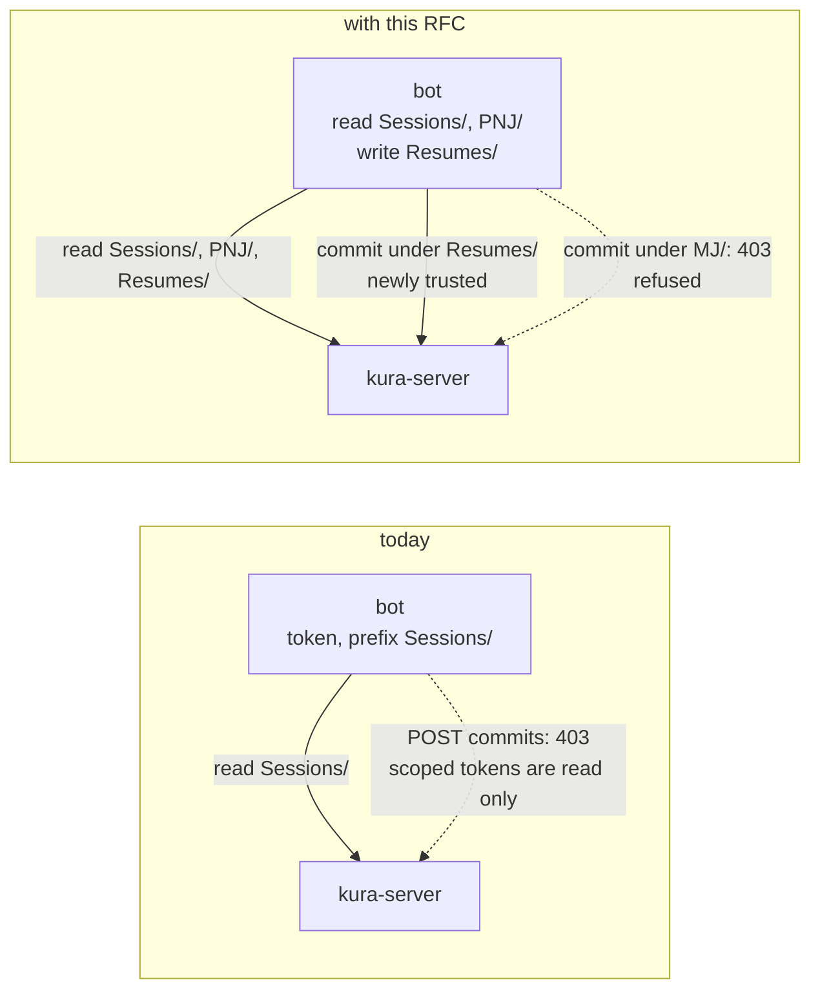
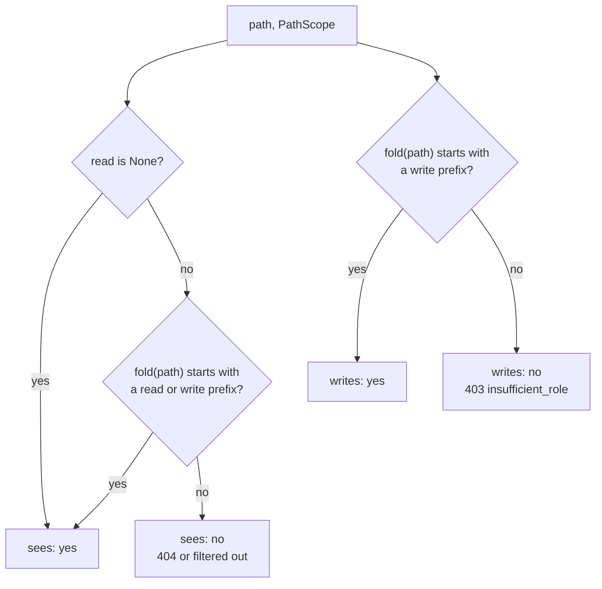
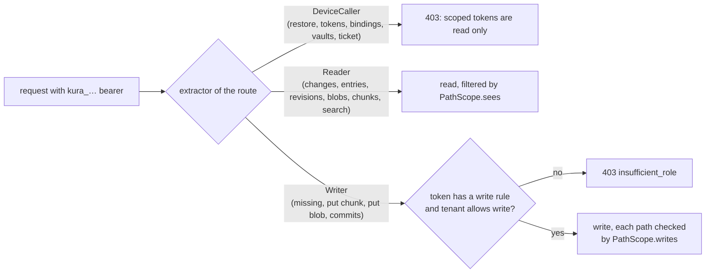
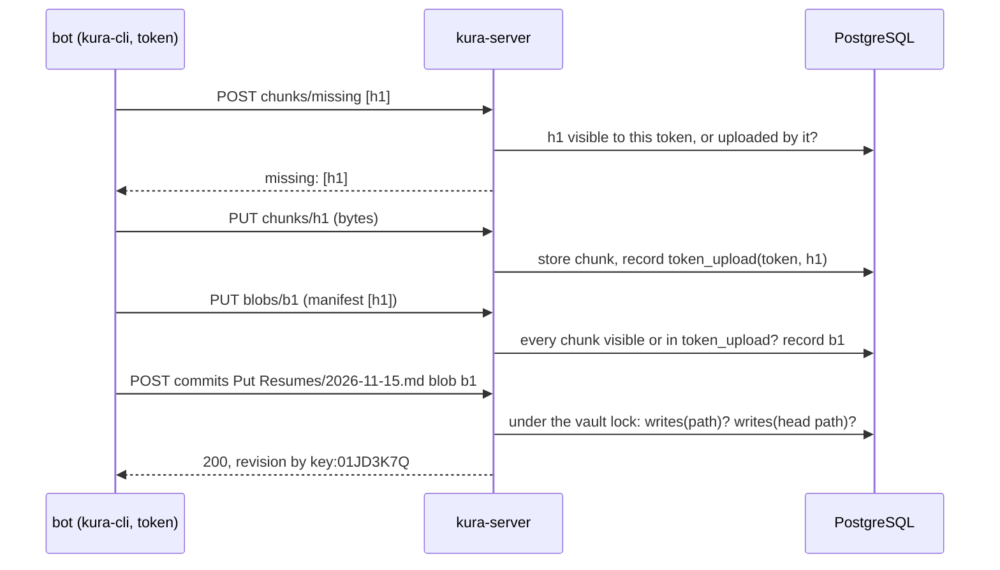
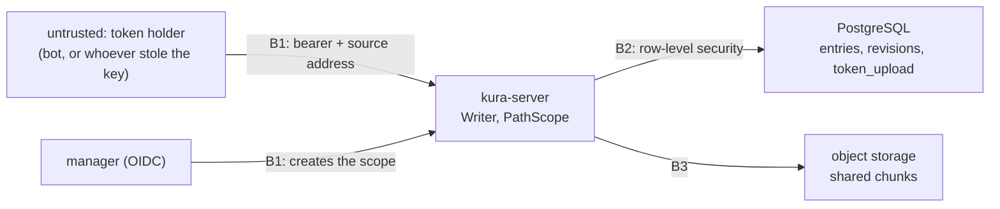

# RFC 0004 — Scoped tokens: several folders, and write access

| Field | Value |
| --- | --- |
| Status | In review (2026-11-15) |
| Short | Folder-scoped write keys |
| Settles | How a scoped token is limited to several folders of one vault, and may write under some of them |
| Author | Maxime (batleforc) |
| Co-author | Claude Fable 5.2 |
| Created | 2026-11-15 |
| Supersedes | — (revisits RFC 0001 decision 10 and its non-goal "write access for agents") |
| Touches | `crates/kura-server` (`authz.rs`, `app/reader.rs`, `app/tokens.rs`, `app/commits.rs`, `app/chunks.rs`, `app/changes.rs`, `app/search.rs`, `app/devices.rs`, `limits.rs`, `reconcile/`, migration `0020`), `crates/kura-api` (`spec.rs`), `crates/kura-cli`, `tests/heavy/keys.sh`, `docs/` |
| Risk | high |

> **Reference material**, about 6,500 words. For the decision, read §1, §3,
> §7.1 and §15; the rest is the design to build and review against.

---

## 1. Summary

A scoped token today reads one vault, either whole or under one folder, and
never writes. This RFC lets a vault manager issue a token with a list of
folder rules, each `read` or `write`, so a non-interactive consumer gets
exactly the folders it works in. The example that drives it is a Discord bot
that reads the session notes of a tabletop campaign and writes its recaps
into one folder, without seeing the game master's notes. Everything else a
token is bound by stays: one vault, an expiry of at most 90 days, a non-empty
address list, revocation with the grant of its creator. Writing is off per
tenant until the tenant turns it on.

### Before / after

```text
# today: one folder, read only
$ kura token create campaign --prefix Sessions/ --expires 30d --cidr 10.42.0.0/16

# with this RFC: several folders, some writable
$ kura token create campaign --name discord-recap \
    --read Sessions/ --read PNJ/ --write Resumes/ \
    --expires 30d --cidr 10.42.0.0/16
```



The diagram shows the one request that becomes trusted (a commit under a
`write` folder) and that a commit anywhere else is still refused.

---

## 2. Motivation

1. **A token sees one folder or everything.** `CreateToken.prefix` is a single
   `String` and `KeyCaller.prefix_key` a single folded prefix [R1][R2]. A
   consumer that needs `Sessions/` and `PNJ/` gets either two tokens to rotate
   or the whole vault, game master notes included.
2. **Nothing non-interactive can write.** Four gates refuse it: the
   `DeviceCaller` extractor calls `refuse_key_on_write` [R3], the table has
   `CHECK (mode = 'read')` [R4], `authz::key_access` always answers
   `VaultRole::Viewer` [R5], and `Reader::access` refuses any role above
   viewer [R2]. A bot that writes recaps must therefore run as a person: a
   device-grant refresh token of an `editor`, on a server, valid on the whole
   vault. That is more privilege, held longer, than the key this RFC proposes.
3. **RFC 0001 deferred the question, it did not close it.** Its non-goal reads
   "read-only in v1, until the write path has run in production" [R6]. This
   RFC states what a write key may do so that the day it is turned on, the
   limits are already built and tested.

---

## 3. Goals / non-goals

**Goals**

- A token carries 1 to 16 folder rules; it reads under every rule and writes
  only under those marked `write`.
- A token with a `write` rule can create, edit, rename and delete notes under
  its `write` folders through the existing sync protocol, and nowhere else.
- A write token never reads content outside its `read` folders, nor learns
  whether given content exists there, including through chunk
  deduplication. (An entry id is not content: T1 states what a guessed id
  reveals.)
- Tokens created before this RFC keep working unchanged.
- Writing by token is off for a tenant until its configuration enables it.

**Non-goals**

- **A token writing the whole vault**: a `write` rule needs a folder; an
  agent with the vault's full write access is an `editor`, and that stays a
  person on a device.
- **Restore, bindings, tokens, vault creation, the event socket and the
  `.obsidian` configuration space through a token**: they stay OIDC-only; a
  key that could restore could rewrite history outside its edits.
- **Deny rules, globs or per-file rules**: folders only, one comparison
  function, as today.
- **Lifting the address list or the 90-day expiry**: unchanged from RFC 0001
  decision 30.
- **One token for several vaults**: the vault stays the unit a manager
  answers for; a consumer of two vaults holds two tokens.
- **A "write one note" HTTP endpoint** that hides chunks and commits: see §12;
  the bot goes through `kura-cli`.
- **Folder-restricted people**: RFC 0005 covers viewers; it reuses the scope
  type defined here.

---

## 4. User-facing design

### 4.1 Configuration

```yaml
apiVersion: kura.weebo.io/v1alpha1
kind: KuraTenant
metadata: { name: jdr }
spec:
  scopedTokens:
    write: true      # tokens of this tenant may carry write rules
```

- `spec.scopedTokens` absent, or `write` absent: `false`. Tokens stay read
  only, as before this RFC. The default is the closed side.
- `write: true` then set back to `false`: write rules stop working at the next
  request (the token still reads); nothing is deleted, and turning it on again
  revives them. This is the kill switch of §13.

The request that creates a token:

```json
{
  "name": "discord-recap",
  "scopes": [
    { "path": "Sessions/", "mode": "read" },
    { "path": "PNJ/",      "mode": "read" },
    { "path": "Resumes/",  "mode": "write" }
  ],
  "expiresInDays": 30,
  "cidrs": ["10.42.0.0/16"]
}
```

### 4.2 Behaviour rules

- `write` implies `read` on the same folder, and on nothing else
  (decision 9).
- A rule covers the folder and everything under it. Paths compare folded
  (full Unicode case folding, then NFC), with `authz::fold`, as prefixes do
  today [R7].
- `"path": ""` means the whole vault and is allowed with `read` only. A token
  may read the whole vault and write one folder.
- `prefix` (the field of RFC 0001) is still accepted and means one `read`
  rule. `prefix` and `scopes` together are refused. Neither: the whole vault,
  read only, as today.
- A token with no `write` rule behaves exactly as before, on the same routes.
- A rename is a write at both ends: the source and the destination must both
  be under `write` rules, of the same token.
- A commit holding one operation outside the `write` folders is refused
  whole; nothing of it is applied.
- What a write token does is ordinary history: each change is a revision
  attributed to `key:<token id>`, and an `editor` can restore over it.
- `name` is 1 to 64 bytes, shown in lists and used where a device name is
  (conflict file names). Absent: `key-` and the first 8 characters of the id.

### 4.3 Validation

Rejected on input (`400 invalid_request` unless noted):

| Condition | Rationale |
| --- | --- |
| More than 16 rules, or an empty `scopes` list | An empty list must never read as "everything" |
| A `path` that is not `""` or a valid vault path ending with `/` | Same rule as `check_prefix` today [R1] |
| `"path": ""` with `mode: write` | Whole-vault write is a non-goal |
| Two rules whose folded paths are equal | Ambiguous mode |
| `prefix` and `scopes` both present | Two sources of truth |
| A `write` rule while the tenant has `scopedTokens.write: false` (`409 token_write_disabled`) | The tenant did not opt in |

Warnings, and where the operator sees them:

| Condition | Behaviour | Surfaced in |
| --- | --- | --- |
| Write tokens exist while `scopedTokens.write` is `false` | Their writes are refused, reads go on | A condition on the tenant's object in `GET /v1/admin/status`, counted by `kura_config_warnings` [R18]. New work: the reconciler sets conditions from files only today, and gains this one database check |
| A rule is covered by a broader rule of the same token | Accepted; the broader `read` and the narrower `write` both hold | `kura token create` prints a note |

### 4.4 API surface

No new route. The handlers are in `app/tokens.rs`, `app/commits.rs` and
`app/chunks.rs`; the spec is regenerated by `task dump-spec`.

| Method | Path | Auth | Who may call | Limit |
| --- | --- | --- | --- | --- |
| POST | `/vaults/{v}/tokens` | OIDC | Vault `manager`, tenant `admin`; body gains `name` and `scopes` | 10/min (unchanged) |
| GET | `/vaults/{v}/tokens` | OIDC | Same; each token shows `name` and `scopes` | 60/min (unchanged) |
| POST | `/vaults/{v}/chunks/missing` | OIDC **or key** | `editor`, or a token with a `write` rule | 600/min per token |
| PUT | `/vaults/{v}/chunks/{hash}` | OIDC **or key** | Same | 600/min per token, 4 MiB |
| PUT | `/vaults/{v}/blobs/{hash}` | OIDC **or key** | Same | 600/min per token |
| POST | `/vaults/{v}/commits` | OIDC **or key** | Same; a token only under its `write` folders | 120/min per token |

New problem type: `token_write_disabled` (409). A write outside the folders is
`403 insufficient_role` with a detail naming the operation.

### 4.5 Mocks

**`kura token create` — nominal**

```text
$ kura token create campaign --name discord-recap \
    --read Sessions/ --read PNJ/ --write Resumes/ --expires 30d --cidr 10.42.0.0/16
Token discord-recap  kura_01JD3..._****  expires 2026-12-15  from 10.42.0.0/16
  read   campaign/Sessions/
  read   campaign/PNJ/
  [yellow]write[/yellow]  campaign/Resumes/

    kura_01JD3K7Q..._v7cX...

This secret is shown once. Store it now.
$ echo $?
0
```

Decides one line per rule, `write` in colour because it is the line to check.

**`kura token create` — errors**

```text
$ kura token create campaign --write / --expires 30d --cidr 10.42.0.0/16
[red]error[/red]: --write needs a folder; a token never writes the whole vault.
$ echo $?
3
$ kura token create campaign --write Resumes/ --expires 30d --cidr 10.42.0.0/16
[red]error[/red]: this tenant does not allow tokens to write (scopedTokens.write).
$ echo $?
3
```

Decides the two refusals a manager will meet first, and that both name the
fix.

**`kura token list` — nominal and empty**

```text
$ kura token list campaign
NAME           ID         SCOPES                               EXPIRES     LAST USED  STATE
discord-recap  01JD3K7Q   r:Sessions/ r:PNJ/ [yellow]w:Resumes/[/yellow]    2026-12-15  2 min ago  active
old-agent      01JC9P2M   r:(whole vault)                      2026-11-20  never      [red]revoked[/red]
$ kura token list empty-vault
No token for empty-vault.
```

Decides the compact `r:`/`w:` form, so a write token is visible in a list.

**The bot, through `kura-cli` — success and the §6.P refusal**

```text
$ KURA_TOKEN=kura_01JD3K7Q..._v7cX... kura sync
campaign  [yellow]token discord-recap[/yellow]  1 pushed  0 pulled
$ echo $?
0
$ mv Resumes/2026-11-15.md MJ/ && KURA_TOKEN=... kura sync
[red]error[/red]: campaign: MJ/2026-11-15.md is outside this token's write folders (Resumes/).
Nothing was pushed. Move the file back, or ask a manager for another token.
$ echo $?
3
```

Decides that the refusal names the path, the folders that would work, and
that nothing was applied.

---

## 5. Architecture

### 5.1 One scope type, two questions

`authz` gains one type that replaces the `prefix_key: String` of `KeyCaller`
and `ReadAccess` [R2]:

```rust
pub struct PathScope {
    /// Folded folder prefixes; `None` is the whole vault.
    read: Option<Vec<String>>,
    /// Folded folder prefixes; each is also readable.
    write: Vec<String>,
}
```

It answers `sees(path)` and `writes(path)`, and gives the SQL patterns for
`path_key LIKE ANY($n)`. **Invariant: because "whole vault" is `None` and not
an empty list, a scope that lost its rules sees nothing.** Today the empty
string means everything [R7]; a list built on that convention would turn a
decoding error into full access.



The diagram shows that `writes` never consults `read`: reading the whole
vault grants no write.

### 5.2 Which routes a token reaches

`refuse_key_on_write` stays inside `DeviceCaller` [R3], so every route that
takes a `DeviceCaller` keeps refusing tokens with no code of its own. The four
routes of §4.4 switch to a new extractor, `Writer` (a device, or a token), the
write-side twin of `Reader` [R2]. **Invariant: because a route must name
`Writer` to accept a token, a write route added later refuses tokens by
default.**



### 5.3 A recap written by the bot



The sequence shows the two places a token's write is decided: possession of
the content before a manifest or commit may name it, and the path under the
vault lock.

---

## 6. Detailed design

### 6.1 Data model (migration `0020_token_scopes.sql`)

- `scoped_token` gains `name text` and `scopes jsonb NOT NULL`, with
  `CHECK (jsonb_array_length(scopes) BETWEEN 1 AND 16)`. Existing rows are
  backfilled with one rule, `{"path": path_prefix, "mode": "read"}`.
- `CHECK (mode = 'read')` [R4] becomes `mode IN ('read', 'write')`; `mode` is
  `write` when any rule is.
- `path_prefix` is kept for rollback. A token with one `read` rule stores that
  folder in it, as today. Any other token stores `'/'`: no vault path starts
  with `/` (`PathError::EmptySegment`, "the path is absolute") [R8], so a
  binary from before this RFC, which only knows `path_prefix`, sees nothing
  through it. Rollback fails closed (§13).
- `kura_scoped_token_lookup` [R4] also returns `scopes` and `name`.
- New table `token_upload (token_id, vault_id, tenant_id, kind, hash,
  created_at)`, primary key `(token_id, kind, hash)`, `kind` in
  `('chunk', 'blob')`, `token_id` referencing `scoped_token` with
  `ON DELETE CASCADE`, row-level security by tenant like every table. It
  records what a token proved it holds (§6.4). Rows older than 24 hours are
  purged by the daily `devices::purge_loop`, next to the idempotency records
  [R9][R19].
- `tenant` gains `token_write boolean NOT NULL DEFAULT false`, set by the
  reconciler from `spec.scopedTokens.write`.
- **Schema floor.** `db::check_schema` refuses a schema older than the
  binary and accepts a newer one on purpose [R20]. It gains the reverse
  check for migrations that are not safe to roll back: a one-row table
  `schema_floor (min_binary_migration)`, and a binary whose newest
  migration is below it refuses to serve. `0020` leaves the floor alone
  (the `'/'` value above already fails closed); RFC 0005's `0021` raises
  it (decision 11).

### 6.2 `authz::PathScope` and the read side

`KeyCaller.prefix_key` and `ReadAccess.prefix_key` become
`scope: PathScope`. The eight places that apply the prefix today are the
whole read inventory, and each changes mechanically [R10]:

| Site | Today | With this RFC |
| --- | --- | --- |
| `app/changes.rs:93` (changes, entries) | `LIKE like_prefix(prefix_key)` | `LIKE ANY(scope.like_patterns())` |
| `app/search.rs:280` | same | same |
| `app/chunks.rs:352`, `:612`, `:718`, `:808` | `sees_content(s)` | unchanged calls; `ReadAccess::sees` asks the scope |
| `app/commits.rs:1308`, `:1334` (revisions) | `ra.sees(path)` | unchanged calls |

`authz::visible_under_prefix` and `like_prefix` are removed with their last
caller, so nothing can keep using the single-prefix form. A device caller
gets `PathScope::whole()` here; RFC 0005 narrows it for restricted viewers.

### 6.3 `Writer`, in `app/reader.rs`

- `enum Writer { Device(DeviceCaller), Key(KeyCaller) }`, extracted like
  `Reader` [R2]: a `kura_` bearer goes through `verify_key` unchanged (hash,
  expiry, revocation, grant, address list, rate limit, audit event).
- `Writer::access(state, v)` returns the `VaultAccess` and the `PathScope`.
  For a device it is `authz::require_role(…, VaultRole::Editor)` as now. For a
  token it requires the token's vault to be `v` (else `404`, as `Reader`
  does), at least one `write` rule, and the tenant's `token_write`; otherwise
  `403 insufficient_role`.
- `authz::key_access` [R5] takes the role to grant: `Viewer` from `Reader`,
  `Editor` from `Writer` once the checks above passed. It is the only place
  a token is given `Editor`.
- A token has no device. Where the commit path needs one, the token's id
  stands in: `revision.device_id` has no foreign key and `commit_record` is
  keyed by `(vault_id, device_id, idempotency_key)` [R9], so idempotency works
  per token. The subject is `Reader::subject`'s `key:<id>` form [R2]; the
  conflict suffix uses the token's `name`.
- `space::resolve` already refuses the configuration space when no device is
  given [R11]; a token passes `None` and stays in `notes`.

### 6.4 What a token may name: possession

Content is addressed by hash and deduplicated per vault, so a hash is a
capability. `chunks/missing` answers for the whole vault [R12], and a commit
may name any blob already stored. A write token could otherwise name the
hash of a note outside its folders, commit it under its own folder, and read
it back. The rule that closes this:

- For a token, a chunk or blob is **known** only if the token can already
  read it (`ReadAccess::sees_contents` [R2]) or it uploaded it itself
  (`token_upload`).
- `PUT chunks/{hash}` by a token records the hash in `token_upload` whether
  or not the chunk was already stored: uploading the bytes is the proof. The
  answer is `204` either way, as today [R12].
- `chunks/missing` by a token reports as missing everything not known, and
  refreshes `last_touched` only on known chunks.
- `PUT blobs/{hash}` by a token refuses a manifest naming a chunk that is not
  known, and records the blob in `token_upload`.
- A commit by a token refuses a `Put` whose blob is not known, in
  `check_blobs` [R13].
- Each refusal is `422 invalid_request` with the same detail ("content not
  uploaded by this token") whether the hash exists elsewhere or not.

### 6.5 The commit, for a token

In `decide` [R13], inside the commit transaction and under the vault lock,
for each operation of a token:

| Operation | Must hold |
| --- | --- |
| `Put` of a new entry | `writes(path)` |
| `Put` on an existing entry | `writes(path)` and `writes(head path)`; the base revision is visible |
| `Delete` | `writes(head path)` |

The head is the one the lock protects, so a rename by someone else between
the check and the write cannot move the target. An entry id that exists
outside the scope is refused like any other outside path; the server-side
merge and the conflict file it may create stay in the folder of the path
being written. The first failing operation refuses the commit with
`403 insufficient_role` and `operations[i]: outside the token's write
folders`; the pre-check sits with the `space.allows` loop [R13] so a refused
commit does no merge work.

### 6.6 `kura-cli`

- `kura token create` gains `--name`, `--read <folder>` and
  `--write <folder>` (repeatable); `--prefix` stays as one `--read`.
- `kura sync` (one pass; it exists today, as does `attach` [R14]) and
  `kura attach` accept `KURA_TOKEN`: with it the CLI sends the
  token as bearer and no `X-Kura-Device`, skips device registration, and
  refuses locally a change outside the write folders with the text of §4.5
  before any upload. The CLI manages tokens today but cannot use one [R14];
  this is what makes it the bot's client.
- The token may also come from `--token-file <path>` (a mounted secret);
  the operator guide recommends the file over the environment
  (decision 7).

### 6.P Proof against a real client

Suite `tests/heavy/keys.sh`, beside `authz.sh` [R15], against the local stack
(`task dev:stack`, `task dev:run`). Clients: the `kura` binary built from the
tree, and `curl` for the requests the CLI refuses to send. The vault
`campaign` holds `Sessions/`, `PNJ/`, `MJ/secret.md` and `Resumes/`; the token
is the one of §4.5.

1. `KURA_TOKEN=… kura sync` after writing `Resumes/2026-11-15.md` exits
   0 with `1 pushed`. Alice's device pulls the file; `GET …/revisions` shows
   it attributed to `key:<id>`. This is the success.
2. `curl` posts a commit with `Put MJ/x.md` using the same token: `403`,
   `type` `insufficient_role`, detail `operations[0]: outside the token's
   write folders`. `SELECT head_seq` is unchanged and no `revision` row names
   `MJ/x.md`. This is the refusal.
3. `curl` puts a blob manifest naming the chunk hash of `MJ/secret.md` (read
   from the database by the test): `422`, same detail as for a random hash.
   `GET chunks/<that hash>` with the token is `404`; the server log shows no
   object-storage read for it. The refused bytes were never fetched.
4. `kura sync` in an empty directory with the token downloads
   `Sessions/`, `PNJ/` and `Resumes/` only; `find . -path './MJ*'` is empty.
5. `mv Resumes/2026-11-15.md MJ/ && kura sync` exits 3 with the text
   of §4.5; the server's `kura_token_writes_total{outcome="refused"}` did not
   move, because the CLI refused before sending.
6. With `scopedTokens.write: false` applied, observation 1 repeated exits 3
   with `403`; a read with the same token still succeeds.

**Deliberately untouched**, so reviewers do not go looking:

- `app/reader.rs` `verify_key` — expiry, revocation, grant and address checks
  are the same for a write token; only what it returns grows.
- `commits.rs` `restore_revision` — stays `DeviceCaller`: a token never
  restores.
- `app/events.rs` — a token still cannot open the event socket; the bot
  pulls.
- `plugin/` — the Obsidian plugin never holds a scoped token.
- The 90-day cap, `MAX_CIDRS` and the `/0` refusal in `check_cidrs` [R1].

---

## 7. Security

**Rating:** high — a long-lived secret that is not a person gains write
access to note content, and deduplication makes hashes a capability.

### 7.1 Threat model

Assets: note content outside the token's folders, the integrity of notes
inside and outside them, history, the tenant's quota, the audit trail.
Actors: the holder of a leaked write token, a compromised bot, a vault
manager who over-grants, another tenant. Attacker-controlled inputs: the
`scopes` of a creation request (from a manager), and for a token holder every
path, entry id, base revision, blob and chunk hash, manifest and chunk body
of the four write routes.



| # | Threat (STRIDE) | Where | Mitigation | Residual risk |
| --- | --- | --- | --- | --- |
| T1 | Elevation: a token writes outside its `write` folders (new path, rename out, delete or overwrite of an outside entry by id) | B1 | `PathScope::writes` on the path and on the locked head, in `decide` (§6.5) | A guessed entry id outside the scope is refused with `403`, which confirms the id exists; ids are random UUIDs, accepted by the owner |
| T2 | Information disclosure: a write token reads outside its `read` folders by committing someone else's blob or chunk under its own folder | B1, B3 | Possession rule (§6.4) in `put_blob`, `check_blobs` and `missing_chunks` | A chunk shared with a visible file stays readable through it, as in RFC 0001 T16 |
| T3 | Information disclosure: `chunks/missing` or `PUT blobs` tells a token whether given content exists in the vault | B1 | Same rule; identical `422` for unknown and for existing-but-outside | Timing of the lookup is not equalised; accepted, the hash of the content is needed first |
| T4 | Elevation: a route written later accepts tokens for writing | B1 | `refuse_key_on_write` stays in `DeviceCaller`; only `Writer` routes accept a token (§5.2); gate test over the route list | None known |
| T5 | Tampering: a leaked write token vandalises or deletes the notes under its folders | B1 | Address list, expiry, revocation (unchanged); every change is a revision; an `editor` restores | Content under the `write` folders is lost for readers until restored; accepted, bounded by the folders |
| T6 | Denial of service: a token fills the tenant's quota or the upload table | B1, B2 | Per-token rate limits (§4.4), `quota_exceeded` as for devices, `token_upload` purged after 24 h | A token can consume the tenant quota up to its limit; accepted for v1 (decision 5) |
| T7 | Elevation: an empty or undecodable scope reads as "everything" | B2 | `read: None` is the only whole-vault form (§5.1); a `scopes` value that fails to decode is `401 invalid_token` | None known |
| T8 | Elevation: a rollback to an older binary widens a multi-folder token to the whole vault | B2 | `path_prefix = '/'` on such tokens (§6.1) | The token stops working until the roll-forward; accepted |
| T9 | Repudiation: writes not attributable | B1 | `revision` rows carry `key:<id>` and the token id as device; `scoped_token_used` audit event per request [R2]; token rows kept 30 days past expiry [R4] | The audit event names the route, not the paths (RFC 0001 T19); paths are in the revisions |
| T10 | Elevation: a manager grants a token more than the manager holds | B1 | Unchanged: only a `manager` issues, and the token dies with that grant [R1][R2]; a token is never above `editor` and only under folders | None new |

### 7.2 Authentication and authorisation

No new unauthenticated surface. Default deny: no `write` rule, or the tenant
flag off, means the four routes answer `403` to a token exactly as today.
Authorisation is on the object (each path, and the locked head of each
entry), not on the route. The role and scope are settled before the commit
body is merged, as T3 of RFC 0001 requires for devices [R13]. Tenants stay
unobservable: a token used on another vault gets `404` [R2].

### 7.3 Input handling and injection

`scopes` is parsed with `deny_unknown_fields`, at most 16 rules, each path
through `VaultPath::parse` like `check_prefix` [R1]; the folded prefixes go to
SQL as bound parameters with `LIKE` wildcards escaped as `like_prefix` does
today [R7]. Commit bodies, manifests and chunks keep their existing parsers
and limits; a token gets no larger body than a device.

### 7.4 Secrets and cryptography

No new secret or primitive. The token format, its SHA-256 at rest and the
constant-time comparison are unchanged [R2]. `KURA_TOKEN` is read from the
environment by `kura-cli` and never written to its config file or logs.

### 7.5 Abuse and resource exhaustion

The write routes count against the token (`key:<id>`) with the limits of
`limits::LIMITS` [R16], after the per-address limit `verify_key` already
applies before any database work [R2]. The possession lookup is one indexed
query per call, bounded by the 1,000 hashes a call may carry.

### 7.6 Existing defences that still hold

Row-level security by tenant, the vault lock, content addressing checked
before storage (`hash_mismatch`), quota, the address list failing closed
when `trustedProxies` is empty, and revocation with the creator's grant
(migrations `0013`, `0019`) are relied on and not weakened.

---

## 8. Supply chain

No new dependency, image, action or tool: the scope is `Vec<String>` and
`jsonb`, the checks reuse `caseless` and `unicode-normalization` already in
`Cargo.lock`, and `task audit` is unchanged.

---

## 9. Data and privacy

| Data | Personal? | Where stored | Retention | Who can read it | Leaves the instance? |
| --- | --- | --- | --- | --- | --- |
| Token `name` and `scopes` (folder names) | No, unless a manager puts a name in them | `scoped_token` | Until expiry plus 30 days [R4] | Vault managers, tenant admins | No |
| `token_upload` (token id, hash) | No | PostgreSQL | 24 hours | Nobody through the API | No |
| Revision author `key:<id>` | No | `revision` | As the vault's history | Readers of the entry | No |

No personal datum is added. Folder names appear in the creation audit event,
as `prefix` already does [R1]; they are not added to metric labels.

---

## 10. Operability

### 10.1 Observability

- **Metrics**: `kura_token_writes_total{outcome}` with `outcome` in `applied`,
  `refused`, `disabled`; no token or path label. Refusals also count in the
  existing `kura_authz_denied_total`.
- **Logs and audit trail**: `scoped_token_created` gains `write=true|false`
  and the rule count; `scoped_token_used` is unchanged and already names the
  route [R2]; every refusal is the `authz_denied` event of `audit_denials`
  [R17].
- **Alerts**: none new. A burst of refusals shows in the existing denial
  rate; RFC 0003 lets a tenant be notified of `token.denied`.

### 10.2 Failure modes

| Failure | Detected by | Behaviour (fail open / closed) | Recovery |
| --- | --- | --- | --- |
| PostgreSQL down | Per-request errors | Closed: `503`, the bot's CLI backs off as a device does | Automatic |
| `scopes` of a row cannot be decoded | `401` on that token, error log | Closed: the token is refused, never widened | Reissue the token |
| `token_upload` purge not running | `kura_maintenance_failures_total` (existing alert) | Table grows; possession stays correct | Maintenance resumes |
| Snapshot not loaded (tenant flag unknown) | `/readyz` | Closed: `503`, as `Reader` today | Automatic |

### 10.3 Performance and capacity

One more indexed lookup per `missing`, `put_blob` and commit of a token; none
for devices. `token_upload` holds at most what a token uploads in 24 hours:
at 600 chunk uploads a minute that is 864,000 rows of about 100 bytes per
token, an upper bound the purge enforces. The device commit path is
unchanged; `task perf:run:commit` must show no regression (§14).

---

## 11. Other concerns

- **Accessibility**: no web UI here; the CLI output marks `write` with a word
  (`write`, `w:`), not only a colour.
- **Internationalisation**: new CLI strings join the CLI's string table,
  English only as RFC 0001 ships.
- **Compliance**: no control touched beyond access control already described
  in §7.
- **Licensing**: unchanged, no dependency.
- **Documentation**: `docs/operator.md` gains `scopedTokens.write` and the
  bot recipe; RFC 0001 gets a header pointer to this RFC for decision 10;
  `docs/api/openapi.json` is regenerated.

---

## 12. Alternatives considered

| Alternative | Why rejected |
| --- | --- |
| Do nothing: the bot signs in as a person with the device grant | An `editor` refresh token on a server writes the whole vault, has no address list and no 90-day cap: strictly more than this key |
| One token per folder, read only, plus a human who pastes the recaps | Does not remove the manual step that motivates the bot |
| A separate `write_prefix` column beside `path_prefix` | Still one read folder; the second folder of motivation 1 stays unsolved |
| Glob or deny rules | A second matching function to keep equal to the SQL filter; folders cover the use case |
| A `PUT /vaults/{v}/notes/{path}` endpoint taking plain text | A second write path beside commits, with its own merge, quota and history rules to keep equal; the CLI already speaks the protocol |
| Skip the possession rule and accept the dedup oracle | A hash seen in an ingress log (RFC 0001 T19 keeps chunk hashes there) would let a write token read that content |
| A new `agent` vault role bound to an OIDC service account | Authentik service accounts are long-lived passwords with no address list here; the scoped token already has expiry, addresses and revocation |

---

## 13. Rollout and compatibility

- **Default behaviour**: `scopedTokens.write` absent, so nothing writes.
  Multi-folder read tokens work as soon as the release is deployed.
- **Configuration compatibility**: an older binary refuses the unknown
  `scopedTokens` field at validation, so, as RFC 0001 §13 requires, the
  release is fully rolled out before any document uses it, and the field is
  removed before a rollback.
- **Migration**: `0020` backfills `scopes` from `path_prefix`; existing tokens
  keep their id, secret and behaviour. Reversible: the old columns stay.
- **Operator prerequisites**: none beyond RFC 0001's `trustedProxies`.
- **Rollback**: an older binary ignores `scopes`. Single-folder read tokens
  behave as before; multi-folder and write tokens see nothing (`'/'`,
  T8) and cannot write (the old gates). No risk of §7 re-opens.
- **Kill switch**: `scopedTokens.write: false` on the tenant stops every
  token write at the next request.
- **Staged rollout**: read folders first (phase 1), write on one tenant and
  one bot after RFC 0001's phase 9 cutover (decision 3).

---

## 14. Test plan

- **Unit** (`authz.rs`): `PathScope` `sees`/`writes` with folded, nested and
  sibling-prefix paths (`Resumes/` does not cover `Resumes2/`); an empty
  rule list sees nothing; `like_patterns` escapes `%` and `_`.
- **Unit** (`app/tokens.rs`): every row of §4.3.
- **Integration** (`app/tests.rs`, PostgreSQL): multi-folder reads on each of
  the eight sites of §6.2; a token commit under `write`; idempotent retry by
  token id; conflict file named after the token.
- **Proof**: §6.P, `tests/heavy/keys.sh`.
- **Security**, one per row of §7.1: `token_cannot_write_outside`
  (T1, four variants: new path, rename out, delete by id, overwrite by id),
  `token_cannot_launder_blob` and `token_cannot_launder_chunk` (T2),
  `missing_is_blind_outside_scope` (T3), gate test
  `only_writer_routes_accept_tokens` over the route list (T4),
  `token_delete_is_restorable` (T5), `token_writes_are_rate_limited` and
  `token_upload_is_purged` (T6), `empty_scope_sees_nothing` (T7),
  `legacy_prefix_matches_no_path` (T8), `token_revision_names_the_key` (T9),
  `revoked_grant_cuts_write_token` (T10). The fuzz target `fuzz_scoped_token`
  of RFC 0001 is extended with the `scopes` body.
- **Audit**: `task audit` unchanged.
- **Existing suites** that must pass unchanged: `tests/heavy/authz.sh`
  (prefix tokens, RFC 0002 observation 2), the `every_route_has_a_limit` gate
  [R16], `task perf:run:commit` within its 200 ms p95.

---

## 15. Decisions and open questions

### Resolved

| # | Question | Decision |
| --- | --- | --- |
| 1 | Does the bot's key write, and in how many folders? | **Read and write, limited to a list of folders.** Chosen by the owner on 2026-11-15; lifts RFC 0001's non-goal for tokens under folders only. |
| 2 | One key for several vaults? | **No: one vault per token.** "Sharing" a key means its vault's managers co-manage it, which the API already allows. |
| 3 | When may `write` be turned on? | **After RFC 0001's phase 9 cutover; phases 1 and 2 are built before.** Keeps RFC 0001's condition that the write path has run in production. |
| 4 | Is the possession table worth its cost? | **Yes, kept.** The owner asked that a read/write split never opens a read on folders the key should not see; this is the control for content named by hash. |
| 5 | A byte budget per token? | **Not in v1.** The tenant quota and the rate limits bound it; RFC 0003's `quota.high` is the signal. |
| 6 | Does a write token need special handling of conflict files? | **No.** A conflict file lands in the written folder, which the token reads. |
| 7 | `KURA_TOKEN` in the environment, or a `--token-file`? | **Both; the file is the documented way.** A mounted secret stays out of `/proc/<pid>/environ`. |
| 8 | Maximum rules per token? | **16.** Unmeasured; it bounds the `LIKE ANY` list, and is raised when someone needs more. |
| 9 | Does `write` give `read` on the same folder? | **Yes, on that folder only.** Without it the bot cannot sync or resolve a conflict on its own files; a write-only key would need a second protocol. |
| 10 | Does the bot call a "write one note" endpoint or `kura-cli`? | **`kura-cli` with a token.** Confirmed by the owner on 2026-11-15; one write path, the commit protocol. |
| 11 | How is a rollback kept from widening access? | **`path_prefix = '/'` for tokens, and a schema floor checked at startup for later migrations.** A binary older than this RFC has no floor check, which is why tokens keep the `'/'` value. |

### Still open

None.

---

## 16. Implementation phases

| Phase | Content |
| --- | --- |
| 1 | Migration `0020` (`scopes`, `name`, legacy `'/'`, `schema_floor` and its check), `PathScope`, the eight read sites, `scopes` in the token API and CLI flags `--read`/`--name`. Tests T7, T8 and the read half of §14. Useful alone: multi-folder read tokens. |
| 2 | `scopedTokens.write` in `kura-api` and the reconciler, `Writer`, `token_upload` and its purge, the possession rule, the commit checks, the metric. Tests T1 to T6, T9, T10. Nothing writes until a tenant opts in. |
| 3 | `kura-cli` with `KURA_TOKEN` and `--write`; `tests/heavy/keys.sh`; operator docs and the bot recipe. |

Each phase leaves the tree green. The controls of T1 to T4 land in phase 2
with the routes they protect, never after.

---

## 17. References and sources

| # | Source | Pinned at | Supports |
| --- | --- | --- | --- |
| R1 | `crates/kura-server/src/app/tokens.rs:27-42` (`MAX_DAYS`, `CreateToken`), `:78-108` (`check_prefix`, `check_cidrs`), `:110-126` (`manage`), `:227` (audit event) | `d1bad91` | §2.1, §4.3, §7.3, T10 |
| R2 | `crates/kura-server/src/app/reader.rs:24-45` (`KeyCaller`, `ReadAccess`), `:70-118` (`sees_contents`), `:141-158` (`Reader`), `:168-229` (`verify_key`), `:249-267` (token is viewer, other vault is 404), `:280` (`subject`) | `d1bad91` | §2, §5, §6.3, §6.4, §7 |
| R3 | `crates/kura-server/src/app/device.rs:31` (`refuse_key_on_write` in `DeviceCaller`) | `d1bad91` | §2.2, §5.2, T4 |
| R4 | `crates/kura-server/migrations/0013_scoped_tokens.sql` (table, `CHECK (mode = 'read')`, lookup, purge at 30 days) | `d1bad91` | §2.2, §6.1, §9 |
| R5 | `crates/kura-server/src/authz.rs:477-512` (`key_access`, always `Viewer`) | `d1bad91` | §2.2, §6.3 |
| R6 | RFC 0001 (Accepted): §3 non-goals, §4.3 warnings, §6.2 scoped tokens, decisions 10 and 30, T16, T19 | `docs/RFC/rfc0001-init-project.md` at `d1bad91` | §2.3, §4.3, §12 |
| R7 | `crates/kura-server/src/authz.rs:411-435` (`fold`, `visible_under_prefix`, `like_prefix`) | `d1bad91` | §4.2, §5.1, §7.3 |
| R8 | `crates/kura-core/src/path.rs:34` (`EmptySegment`: "the path is absolute or has an empty name") | `d1bad91` | §6.1, T8 |
| R9 | `crates/kura-server/migrations/0007_sync.sql:32-67` (`revision.device_id` without foreign key, `commit_record` key, 7-day purge) | `d1bad91` | §6.1, §6.3 |
| R10 | `grep -rn "prefix_key\|like_prefix\|\.sees(\|sees_content" crates/kura-server/src`, run 2026-11-15 | `d1bad91` | §6.2 inventory |
| R11 | `crates/kura-server/src/app/space.rs:65-75` (`resolve`: a token never reads configuration) | `d1bad91` | §6.3 |
| R12 | `crates/kura-server/src/app/chunks.rs:101-135` (`missing_chunks`, vault-wide), `:155-174` (`put_chunk`, `204`) | `d1bad91` | §6.4, T3 |
| R13 | `crates/kura-server/src/app/commits.rs:333-380` (`post_commit`, role before parse, `space.allows` loop), `:472` (`decide`), `:739` (`check_blobs`) | `d1bad91` | §6.4, §6.5, §7.2 |
| R14 | `grep -rn "KURA_TOKEN\|scoped" crates/kura-cli/src`, run 2026-11-15: token management only (`commands.rs:1004`, `api.rs:348`); `crates/kura-cli/src/main.rs:37-54` (`Attach`, `Sync`), `:95` (`KURA_ACCESS_TOKEN`) | `d1bad91` | §6.6, decision 7 |
| R15 | `tests/heavy/authz.sh:1-25` (suite layout, `KURA_ACCESS_TOKEN`) | `d1bad91` | §6.P, decision 7 |
| R16 | `crates/kura-server/src/limits.rs:11-42` (`LIMITS`, gate `every_route_has_a_limit`) | `d1bad91` | §7.5, §14 |
| R17 | `crates/kura-server/src/app/mod.rs:345-400` (`audit_denials`) | `d1bad91` | §10.1 |
| R18 | `crates/kura-server/src/reconcile/status.rs:32-41` (`warnings`: objects whose `Ready` is not `True`), `crates/kura-server/src/app/admin.rs:16-27` (`AdminStatus.objects`) | `d1bad91` | §4.3 |
| R20 | `crates/kura-server/src/db.rs:14-20` (`MIGRATOR`, `ignore_missing`), `:119-139` (`check_schema`: older schema refused, newer accepted) | `d1bad91` | §6.1, decision 11 |
| R19 | `crates/kura-server/src/app/devices.rs:285-310` (`purge_loop`: devices, expired tokens, commit records, daily) | `d1bad91` | §6.1 |
