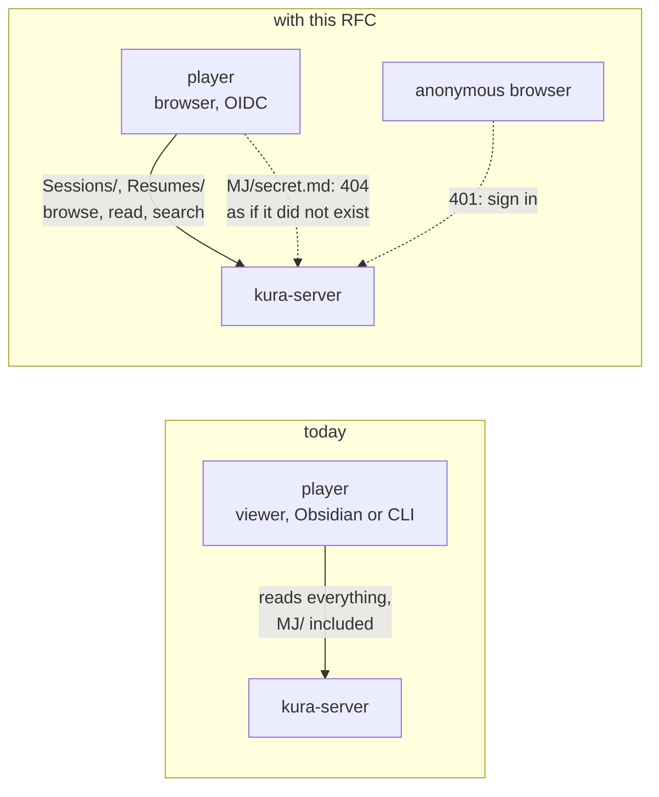
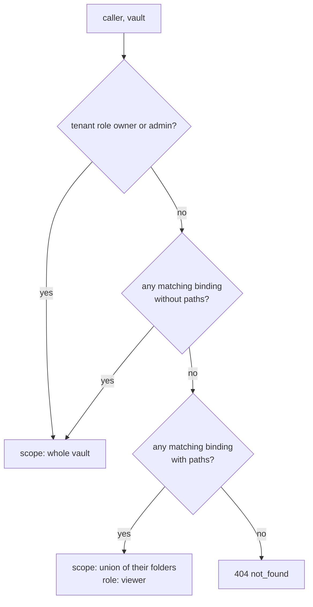
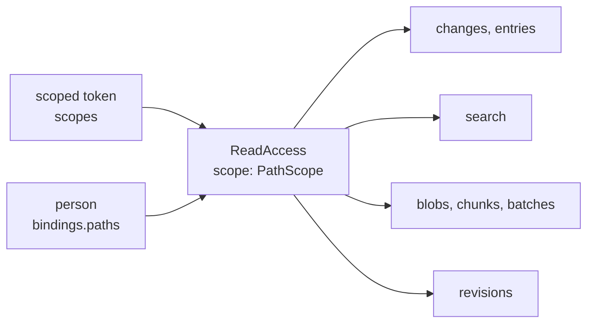
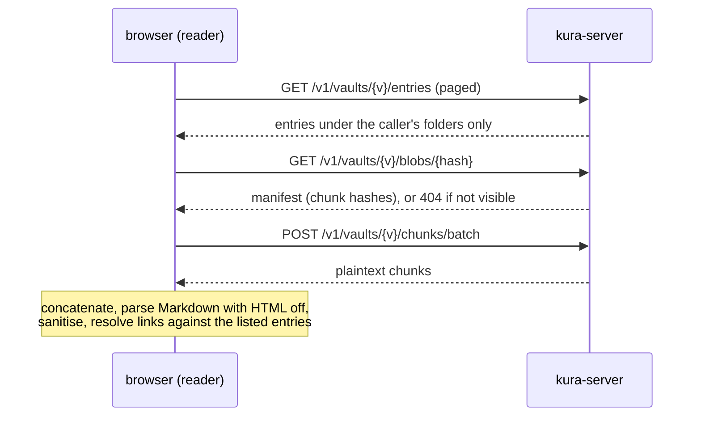
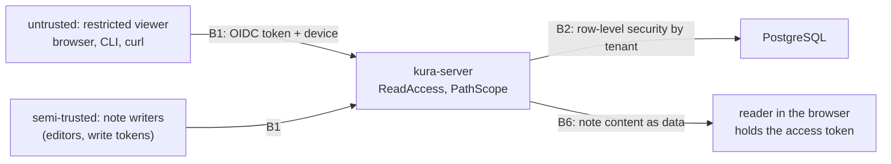

# RFC 0005 — Folder-restricted viewers and the web reader

| Field | Value |
| --- | --- |
| Status | Implemented (2026-11-17) |
| Short | Restricted viewers, web reader |
| Settles | How people without Obsidian (the players of a tabletop campaign) read and search the folders of a vault that a manager opens to them, and nothing else |
| Author | Maxime (batleforc) |
| Co-author | Claude Fable 5.2 |
| Created | 2026-11-15 |
| Supersedes | — (keeps RFC 0001's non-goal "public sharing": every reader stays an authenticated member) |
| Touches | `crates/kura-api` (`spec.rs`, `validate/`, `reason.rs`), `crates/kura-core` (`scope.rs`, `wire.rs`), `crates/kura-server` (`authz.rs`, `config.rs`, `db.rs`, `app/vaults.rs`, `app/reader.rs`, `app/commits.rs`, `app/ui.rs`, `reconcile/status.rs`, migrations `0021` and `0025`, `tests/viewers.rs`), `crates/kura-cli` (`commands.rs`), `ui/` (`src/reader/`, `src/pages/` Vaults, Browse, Search, History, Access, locales, `public/frame.css`, `e2e/reader.spec.ts`), `tests/heavy/reader.sh`, `dev/config/tenants.yaml`, `dev/authentik/blueprints/kura.yaml`, `docs/operator.md`, `docs/api/openapi.json`, `docs/RFC/assets/0005-reader.html` |
| Risk | high |

> **Reference material**, about 6,500 words. For the decision, read §1, §3,
> §7.1 and §15; the rest is the design to build and review against.

---

## 1. Summary

A `viewer` binding already lets an authenticated member read and search a
vault, but the whole vault, and only through Obsidian or `kura-cli`. This RFC
adds two things. A `viewer` binding may list folders, and its holder then
sees only those folders on every read route: a game master opens `Sessions/`
and `Resumes/` to the players and keeps `MJ/` private. And the web
application of RFC 0003 gains its front office: pages to browse, read and
search a vault and a note's history, from a browser, signed in through
Authentik. Nobody reads anonymously; there is no share link.

### Before / after

```yaml
# today: a viewer sees the whole vault, and needs Obsidian or the CLI
bindings:
  - { role: viewer, claimValue: jdr-players }

# with this RFC: the same group sees two folders, in a browser
bindings:
  - { role: viewer, claimValue: jdr-players, paths: [Sessions/, Resumes/] }
```



The diagram shows the request that is newly filtered (a viewer's read of a
hidden folder answers `404`) and that an anonymous caller is still refused.

---

## 2. Motivation

1. **A viewer sees everything.** `authz::vault_accesses` settles one role per
   vault from the bindings [R1], and `Reader::access` gives a device an empty
   prefix, the whole vault [R2]. A campaign vault holds the game master's
   notes beside the session logs, so today the players cannot be bound at
   all without a second vault and a copy step.
2. **Scoped tokens cannot stand in.** They are filtered by folder already,
   but a token needs a non-empty address list that is never `/0` [R3], and it
   is one shared secret, not a person: players at home have neither a fixed
   address nor an identity to revoke one by one.
3. **A reader without Obsidian has no client.** RFC 0001 ships the read and
   search API and names a web UI a non-goal [R4]. A player who wants "what
   happened in session 12" has to install Obsidian and attach a vault.

---

## 3. Goals / non-goals

**Goals**

- A `viewer` binding may carry 1 to 16 folders; its holder reads, searches
  and lists history only under them, on every client.
- A hidden note is indistinguishable from a missing one for a restricted
  viewer: same `404`, absent from listings, search and history.
- A signed-in member browses folders, reads rendered notes, searches and
  opens a note's past revisions from a browser, with no local vault.
- Note content, which may come from untrusted writers (a bot relaying chat
  messages, RFC 0004), cannot run script in the reader.

**Non-goals**

- **Anonymous or link-based access**: every reader has an Authentik account
  and a binding; RFC 0001's non-goal on public sharing stands [R4].
- **Folder-restricted editors or managers**: `paths` is for `viewer` only; a
  person writing in part of a vault needs partial sync in the plugin, which
  nothing here designs.
- **Editing in the browser**: the reader is read only, whatever the role.
- **Hiding what a visible note says about a hidden one**: a session log that
  quotes the game master's notes is visible; the rule is by folder, not by
  content.
- **Graph view, backlinks, plugins' rendering (Dataview, Canvas)**: plain
  Markdown, wikilinks and images only.
- **Deny rules or per-note sharing**: folders only, the scope type of
  RFC 0004.
- **Account creation**: players get their account and group in Authentik;
  Kura maps groups, it does not invite people.

---

## 4. User-facing design

### 4.1 Configuration

```yaml
apiVersion: kura.weebo.io/v1alpha1
kind: KuraTenant
metadata: { name: jdr }
spec:
  claimMappings:
    claim: groups
    roles: { owner: [jdr-mj], member: [jdr-players] }
  search: { enabled: true }      # needed for the search page (RFC 0001 §6.7)
---
apiVersion: kura.weebo.io/v1alpha1
kind: KuraVault
metadata: { name: campaign, namespace: jdr }
spec:
  tenantRef: { name: jdr }
  bindings:
    - role: viewer
      claimValue: jdr-players
      paths: [Sessions/, Resumes/]   # absent: the whole vault, as today
```

- `paths` absent: the whole vault. This is today's behaviour and the only
  default that keeps existing bindings unchanged; it is the open side, and
  §4.3 makes the closed mistake (an empty list) a hard error instead of
  letting it mean either.
- The web reader is part of the application of RFC 0003 and is off until
  that application is enabled (`ui.enabled`, default `false`).

The same binding through the API, for an API-managed vault:

```text
PUT /v1/vaults/{v}/bindings/claim:jdr-players
{ "role": "viewer", "paths": ["Sessions/", "Resumes/"] }
```

### 4.2 Behaviour rules

- A folder covers itself and everything under it; paths compare folded, by
  `authz::PathScope` (RFC 0004 §5.1).
- **The widest grant wins.** A caller's scope on a vault is the whole vault
  if the tenant role opens it (`owner`, `admin`) or if any matching binding
  has no `paths`; otherwise it is the union of the `paths` of the matching
  bindings. A restricted binding never narrows another grant.
- A restricted viewer's hidden entries answer `404 not_found`, exactly as a
  missing entry. Listings, changes, search results and revision lists omit
  them.
- A note renamed out of the folders disappears with its history; one renamed
  in shows only the revisions made under the folders. This is the rule
  scoped tokens already follow [R4].
- A restricted viewer syncing with `kura-cli` or the plugin receives only the
  visible folders; nothing else changes for those clients.
- `GET /vaults` shows the vault, its name and `headSeq` to a restricted
  viewer, with the folders they see.
- The uninteresting case: a binding without `paths`, and every role above
  `viewer`, behave exactly as before.
- In the reader, a wikilink or an image whose target is not in the entries
  the caller can list renders as plain text; the reader never asks the
  server about a target it was not shown.
- The reader renders notes up to 1 MiB; a larger note, or a file that is not
  Markdown or an image, is offered as a download.

### 4.3 Validation

Rejected at startup (configuration) and on input (`400 invalid_request`):

| Condition | Rationale |
| --- | --- |
| `paths` present on an `editor` or `manager` binding | Restricted writers are a non-goal; silently ignoring it would grant the whole vault |
| `paths: []` | Would read as "nothing" to one reader and "everything" to another; a binding that grants nothing is deleted instead |
| More than 16 folders, or a folder that is not a valid vault path ending with `/` | Same rule as token scopes (RFC 0004 §4.3) |
| Two folders of one binding whose folded forms are equal | Duplicate |

Warnings, and where the operator sees them:

| Condition | Behaviour | Surfaced in |
| --- | --- | --- |
| A restricted binding whose subject also matches an unrestricted grant in the configuration (same claim value mapped to `owner`/`admin`, or bound twice) | The widest grant wins | A condition on the vault's object in `GET /v1/admin/status`, counted by `kura_config_warnings` [R5], for grants declared in files (the reconciler sees those); for API-managed bindings, only the bindings page of RFC 0003, which shows "effective: whole vault" |
| A folder that matches no entry at reconcile time | Accepted: the folder may be created later | The bindings page shows "0 notes" |
| Restricted viewers exist on a tenant with `search.enabled: false` | The search page says search is off | The reader, `409 search_disabled` [R4] |

### 4.4 API surface

No new route in this RFC; the routes the web application itself needs
(`GET /me`, listing bindings) are RFC 0003's. Handlers: `vaults::put_binding`
and `vaults::list_vaults`.

| Method | Path | Auth | Who may call | Limit |
| --- | --- | --- | --- | --- |
| PUT | `/vaults/{v}/bindings/{b}` | OIDC | Vault `manager`, tenant `admin`; body gains optional `paths` | 10/min (unchanged) |
| GET | `/vaults` | OIDC or key | Unchanged; each vault gains `paths` (absent: whole vault) | 60/min (unchanged) |
| GET, POST | every read route of RFC 0001 §4.4 | OIDC or key | Unchanged callers; a restricted viewer is filtered | Unchanged |

### 4.5 Mocks

The pages live in the application shell of RFC 0003 (its §4.5 draws the
header, sign-in and navigation). `batlehub-design` is not installed in this
repository, so these are wireframes; the HTML mocks are built with it in
phase 3, from its tokens only. Each wireframe is the content area.

**Vaults — nominal, and empty**

```text
 My vaults
 ┌──────────────────────────────────────────────────────────────┐
 │ campaign      jdr      viewer · 2 folders      updated 2 h ago│
 │ notes         maxime   editor · whole vault    updated now    │
 └──────────────────────────────────────────────────────────────┘

 My vaults
   No vault is shared with you yet.
   Ask a vault manager to add you, then reload.
```

Decides that the role and the reach ("2 folders") are on the first screen,
and that the empty state says who can fix it.

**Browse and read — nominal**

```text
 campaign ▸ Sessions ▸ 2026-11-08 Session 12             [ Search… ]
 ┌───────────────────┬──────────────────────────────────────────────┐
 │ ▾ Sessions        │ # Session 12 — The salt mine                 │
 │     Session 10    │                                              │
 │     Session 11    │ The party reached the mine at dusk. See      │
 │   ▸ Session 12    │ [[Session 11]] for the map.                  │
 │ ▸ Resumes         │                                              │
 │                   │ The foreman mentioned Plan du MJ (no link:   │
 │                   │ not shared with you).                        │
 │                   │                                              │
 │                   │ Last edited 2026-11-08 by alice · History (4)│
 └───────────────────┴──────────────────────────────────────────────┘
```

Decides the two-pane layout, that only shared folders appear in the tree,
and that a link to a hidden note is plain text with no hint beyond "not
shared with you" on focus.

**Read — not found or hidden (the §6.P refusal as the player sees it)**

```text
 campaign ▸ MJ ▸ secret
   This note does not exist, or is not shared with you.
   [ Back to campaign ]
```

Decides one message for both cases: the page cannot tell them apart either.

**Search — nominal, no result, search off**

```text
 Search in campaign: [ mine de sel            ] [Search]
   3 results
   Sessions/2026-11-08 Session 12     …reached the «mine» at dusk…
   Resumes/Session 12                 …la «mine de sel» abandonnée…
   Sessions/2026-10-25 Session 11     …a map of the «mine»…

 Search in campaign: [ dragon                 ] [Search]
   No note matches "dragon" in the folders shared with you.

 Search in campaign
   Search is not enabled for this vault. Browse the folders instead.
```

Decides that the empty state names the limit ("in the folders shared with
you") so a player does not conclude the word appears nowhere.

**History — nominal**

```text
 Session 12 ▸ History
   2026-11-08 21:14  alice (laptop)         current
   2026-11-08 20:02  key discord-recap      [ View ]
   2026-11-07 09:30  alice (phone)          [ View ]
```

Decides that a revision written by a token shows the token's name
(RFC 0004), and that viewing is the only action.

**Session expired, and server unavailable**

```text
   Your session ended. [ Sign in again ]

   Kura is not answering (503). Retrying in 30 s…  [ Retry now ]
```

Decides that an expired session never shows stale content behind it.

---

## 5. Architecture

### 5.1 The scope of a person

`VaultAccess` [R1] gains `scope: PathScope`, the type RFC 0004 introduces for
tokens. `authz::vault_accesses` already walks every binding matching the
caller to keep the highest role [R1]; it now also keeps the reach.
**Invariant: because `paths` is only valid on `viewer` and the widest grant
wins, a role above `viewer` always comes with the whole vault, so no write
handler ever needs to consult a scope for a person.**



### 5.2 One filter for tokens and people

`Reader::access` builds a `ReadAccess` for a device with an empty prefix
today [R2]; it now copies `VaultAccess.scope`. From there the eight read
sites listed in RFC 0004 §6.2 apply it, with no code of their own.
**Invariant: because a token and a person go through the same `ReadAccess`,
a read route cannot filter one and forget the other.**



### 5.3 Reading a note in the browser



The sequence shows that the reader uses only routes that exist [R6], and
that link resolution never leaves the browser.

---

## 6. Detailed design

### 6.1 `kura-api`

- `spec::Binding` [R7] gains `paths: Option<Vec<String>>`, camelCase,
  `skip_serializing_if` none.
- `validate()` adds the rows of §4.3 beside the existing "set exactly one"
  check of `spec.bindings[i]` [R7], with reason codes in the kit's shape.

### 6.2 Data model (migration `0021_binding_paths.sql`)

- `role_binding` [R8] gains `paths text[]`, `NULL` for the whole vault, with
  `CHECK (paths IS NULL OR (role = 'viewer' AND cardinality(paths) BETWEEN 1
  AND 16))`. The constraint makes the invariant of §5.1 hold in the database,
  not only in the handlers.
- `0021` sets `schema_floor.min_binary_migration` to 21 (RFC 0004 §6.1,
  [R17]).
- `kura_bindings_replace` [R8] reads `paths` from the reconciled JSON and
  sets it on insert and on update, so a configuration change of `paths`
  alone reaches the row and keeps its id (scoped tokens hang on that id).
- An update that raises a binding's role above `viewer` must set `paths` to
  `NULL` in the same statement; the check refuses it otherwise.

### 6.3 `authz`

- `vault_accesses` selects `paths` with the bindings and computes the scope
  of §5.1 in the loop that computes the role [R1].
- `check_binding` [R9] is unchanged in who may bind; `put_binding` validates
  `paths` and refuses them above `viewer`.
- The `EXISTS` filter that lists the vaults a caller may open [R1] is
  unchanged: a restricted binding opens the vault.

### 6.4 Server routes that take a person but not a `Reader`

Two handlers call `authz::require_role(…, Viewer)` directly [R10]:

- `events::create_ticket` and the socket's periodic re-check: a notice
  carries a `seq`, never a path [R11], so a restricted viewer may hold a
  socket. It learns that the vault changed, not where (§7, T5).
- `vaults::put_binding`'s helper, which then requires a manager.

Every other read goes through `Reader`. A gate test lists the routes and
fails on a handler that reads vault content without `ReadAccess` (§14).

### 6.5 The reader (`ui/`, front office of RFC 0003)

- Pages: vaults, browse and read, search, history, as drawn in §4.5. Routing,
  sign-in, the device record and the Content-Security-Policy are RFC 0003's.
- Data: the generated HeyApi client over `GET /vaults`, `GET …/entries`,
  `GET …/blobs/{hash}`, `POST …/chunks/batch`, `POST …/search`,
  `GET …/entries/{e}/revisions`. The folder tree is built in the browser
  from the paged entries.
- Content requests are sent with `cache: "no-store"`: chunk answers carry
  `Cache-Control: private, immutable, max-age=31536000` [R6], right for a
  syncing device and wrong for a shared family computer.
- Rendering: `markdown-it` with `html: false`, its output passed through
  `DOMPurify`, then shown in an `<iframe sandbox="allow-scripts">` without
  `allow-same-origin`, filled through `srcdoc` (decision 9). The frame has
  an opaque origin: whatever runs in it has no access to the application's
  storage, where RFC 0003 keeps the refresh token, nor to its memory. No
  `v-html` exists outside the component that builds that document.
- The frame runs exactly one script, a fixed bridge of a few lines that
  reports the document's height and the link a user clicked, by
  `postMessage`. The frame inherits the application's policy, which allows
  that script by its hash and no other, and under which the frame can call
  no host. The application treats what the bridge sends as untrusted: a
  number for the height, and for a link only navigation to an entry the
  caller was listed, or an external URL opened with
  `rel="noreferrer noopener"`.
- Images are fetched through the API by the application and inlined as
  `data:` URLs, at most 8 MiB each (larger: a link to the file, which opens as
  a download). A remote image URL in a note is not loaded, so opening a note
  never calls a third party.
- Mermaid blocks (amendment of 2026-11-18): the application loads Mermaid
  only when a note has one, draws it in `strict` mode (Mermaid's own
  DOMPurify, no click handlers, no HTML labels) and inlines the SVG as a
  `data:` image, so it runs no script in the frame and loads nothing. This
  parses note text in the application's origin, a trade the owner accepted
  over a dedicated diagram frame; a source over 50,000 characters, or one
  Mermaid cannot draw, stays a code block.
  The policy directives the frame needs are RFC 0003 §6.1's.
- Search sends the query in the body [R4] and shows the server's snippets as
  text, never as HTML.

### 6.P Proof against a real client

Suite `tests/heavy/reader.sh`, beside `authz.sh` [R12], on the local stack.
Clients: `curl`, the `kura` binary from the tree, and for the pages a
headless Chromium driven by Playwright at the version `ui/` pins (RFC 0003
§8). Users of the dev Authentik: `alice` (owner), `bob` in `jdr-players`,
bound as in §4.1; the vault holds `Sessions/s12.md`, `Resumes/s12.md` and
`MJ/secret.md` containing the word `xyzzy`.

1. Bob, in the browser, opens `campaign`: the tree shows `Sessions` and
   `Resumes`; the note `s12` renders. Success.
2. Bob's token on `GET …/entries` with `curl`: no entry whose path starts
   with `MJ/`. `GET …/blobs/<hash of MJ/secret.md>` (hash read from the
   database by the test): `404`, body identical to the answer for a random
   hash; the server log shows no object-storage read. The refused bytes were
   never fetched. This is the refusal.
3. Bob searches `xyzzy`: `200` with zero hits in the API, and the page shows
   the "No note matches" text of §4.5. Alice gets one hit.
4. Bob runs `kura sync` in an empty directory: `Sessions/` and
   `Resumes/` arrive, `find . -path './MJ*'` is empty.
5. Alice moves `Sessions/s12.md` to `MJ/`; Bob reloads: the note is gone
   from the tree and its URL shows the not-found text; `GET …/revisions` for
   the entry is `404`.
6. A note under `Sessions/` containing
   `` and ``
   is opened by Bob: Playwright records no request to `/x` nor to
   `example.org`, and no console CSP violation from an executed script. A
   second document, injected past the sanitiser by the test with an inline
   script, logs a policy violation and runs nothing. Playwright then
   evaluates `parent.localStorage` inside the frame: it throws a
   `SecurityError`.
7. An anonymous `curl` on `GET /v1/vaults`: `401 invalid_token`.

**Deliberately untouched**, so reviewers do not go looking:

- `app/commits.rs` `post_commit`, `app/chunks.rs` uploads — writes need
  `editor`, which always has the whole vault (§5.1).
- `app/tokens.rs` — issuing needs `manager`; RFC 0004 owns token scopes.
- `app/space.rs` — a viewer's own `.obsidian` space is theirs and is not
  under the vault's folders.
- `plugin/` — receives a filtered change feed like a prefixed token's client
  would; no code change.
- `app/search.rs` indexing — the index stays per vault; only the query is
  filtered.

---

## 7. Security

**Rating:** high — the confidentiality of part of a vault now rests on one
filter applied to people, and note content is rendered as HTML in a browser
that holds an access token.

### 7.1 Threat model

Assets: the hidden folders (content, names, existence), the access token in
the browser, the players' identities. Actors: a restricted viewer (curious
player), a writer of visible notes who is not trusted with script (a bot
relaying chat, RFC 0004; any editor), a manager who mis-binds, an anonymous
client, someone else using the same computer later. Attacker-controlled
inputs: every path, hash and query a viewer sends; the Markdown, file names
and images of any note a viewer opens.



| # | Threat (STRIDE) | Where | Mitigation | Residual risk |
| --- | --- | --- | --- | --- |
| T1 | Information disclosure: a restricted viewer reads a hidden note through a read route (listing, change feed, blob, chunk, batch, revision, search) | B1 | `ReadAccess.scope` from `VaultAccess.scope`, applied at the eight sites of RFC 0004 §6.2; gate test over the route list | A chunk shared with a visible file is readable through it (RFC 0001 T16) |
| T2 | Information disclosure: hidden notes' existence or names leak (distinct errors, counts, link resolution, search "n hidden results") | B1, B6 | `404` identical to missing; listings filtered in SQL; the reader resolves links only against listed entries | `seq` gaps in the change feed show that hidden changes happened; accepted, as for tokens |
| T3 | Elevation: a restricted binding grants more than its folders (role above viewer keeps `paths`, empty list means all, a config update drops `paths`) | B2 | The `CHECK` of §6.2, `validate()`, `kura_bindings_replace` writing `paths` | None known |
| T4 | Elevation by confusion: a manager believes a group is restricted while another grant opens the whole vault | B1 | Widest-wins is stated; the warning of §4.3; `GET /vaults` and the bindings page show the effective reach | A manager who ignores the warning over-shares; accepted by the owner |
| T5 | Information disclosure: the event socket or `headSeq` tells a restricted viewer when hidden notes change | B1 | Notices carry `seq` only [R11] | Timing of activity is visible; accepted |
| T6 | Tampering / elevation: stored XSS, a note's Markdown runs script in the reader and steals the access token or reads as the victim | B6 | `markdown-it` `html: false`, `DOMPurify`, then a sandboxed frame with an opaque origin where only the hashed bridge script may run (§6.5) | A sanitiser bypass and a policy bypass together run script in the frame, which still reaches no storage and no host; a browser flaw in frame sandboxing on top of both; both libraries tracked by `task audit` |
| T7 | Information disclosure: a note makes the reader call a third party (remote image, link prefetch), revealing who reads what | B6 | Images inlined by the application from the API only; the frame's inherited policy allows no remote load or request; links open on click with `rel="noreferrer noopener"` | A player who clicks an external link visits it; expected |
| T8 | Information disclosure: decrypted content stays in the browser cache of a shared computer | B6 | `cache: "no-store"` on content requests; the service worker caches the application shell only, never an API response (RFC 0003 §6.1) | Memory of an open tab; a session left signed in is RFC 0003 T14 |
| T9 | Denial of service: a viewer makes the server or the browser work without bound (huge note, deep tree, search flood) | B1, B6 | Existing per-device limits (search 60/min, 50 results, 1 MiB of snippets) [R4]; 1 MiB render cap; entries paged by 1,000 | A vault of very many entries makes the tree slow in the browser; measured in phase 3 (decision 5) |
| T10 | Spoofing: an anonymous or other-tenant caller reaches the reader's data | B1 | Unchanged: `verify_access_token`, `require_device`, `404` across tenants [R4] | None new |

### 7.2 Authentication and authorisation

No unauthenticated surface: the static pages hold no data, and every data
call carries an OIDC access token and a device (RFC 0003 §7.2). Default
deny: no matching binding is `404`. Authorisation is on the object, each
path and each content hash, not on the route. A bypassed filter gains a
restricted viewer the rest of one vault of their own tenant, which is why
T1 has a gate test and a real-client proof.

### 7.3 Input handling and injection

`paths` are parsed as token scopes are (RFC 0004 §7.3) and reach SQL as
bound parameters. In the browser, note content is untrusted input to an HTML
sink: Markdown is parsed with raw HTML disabled, the result sanitised,
snippets and file names inserted as text. File names never become URLs
without encoding. A fuzz target is not added on the server (no new parser);
the renderer gets a corpus test of XSS payloads (§14).

### 7.4 Secrets and cryptography

No new secret or primitive. The access token's handling in the browser is
RFC 0003 §7.4.

### 7.5 Abuse and resource exhaustion

A restricted viewer has the limits of any device [R13]. The filter adds one
`LIKE ANY` of at most 16 patterns to queries that already filter by prefix
for tokens. The reader debounces search input and never polls: it holds one
event socket, as the plugin does.

### 7.6 Existing defences that still hold

Row-level security by tenant, `404` for unreadable vaults, the search query
in the body (never the URL), spans without path parameters, device
revocation, and the `sees_contents` rule for shared chunks are relied on and
not weakened.

---

## 8. Supply chain

Server: no new dependency. Browser: two packages, in the `ui/` package that
RFC 0003 creates (framework, build and audit tooling are listed there).

| Dependency / image / tool | Version | Why this one | Licence | Known CVEs (`task audit`) | Maintenance |
| --- | --- | --- | --- | --- | --- |
| `markdown-it` | 15.0.3 [R14] | CommonMark parser with raw HTML off by one option; writing a Markdown parser is not a few lines | MIT [R14] | Not yet audited: `pnpm audit` runs once `ui/` has a lockfile, in phase 3 | To be checked with the audit (release recency, maintainers) |
| `dompurify` | 3.4.18 [R14] | The sanitiser; never home-made | MPL-2.0 OR Apache-2.0 [R14] | Same | Same |

- **Build and release**: unchanged by this RFC beyond RFC 0003's `ui/` build.
- **Updates**: the `ui/` lockfile is bumped by the same mechanism RFC 0003
  sets for the application; a sanitiser advisory is a release trigger.

---

## 9. Data and privacy

| Data | Personal? | Where stored | Retention | Who can read it | Leaves the instance? |
| --- | --- | --- | --- | --- | --- |
| `role_binding.paths` (folder names) | No | PostgreSQL, configuration files | As the binding | Vault managers, tenant admins | No |
| A player's `sub` in a `user:` binding, device row and audit events | Yes: an identifier | As RFC 0001 §9 (unchanged tables) | Unchanged | Tenant admins, operators | No |
| Search queries of players | Yes when typed by a person | Not stored: the body is not logged [R4] | None | Nobody | No |
| Rendered notes in the browser | Content | Memory of the tab only | Until the tab closes | The signed-in user | No (T7) |

No new personal datum is collected. Erasure of a player is removing their
group or binding in configuration and their devices through the existing
routes.

---

## 10. Operability

### 10.1 Observability

- **Metrics**: none new. A hidden read is a `not_found`, which `is_denial`
  already counts in `kura_authz_denied_total{problem="not_found"}` and
  audits as `authz_denied` with the route template [R16]. Hidden and missing
  are deliberately not told apart there either: a separate count would be a
  record of which paths are hidden.
- **Logs and audit trail**: `binding_changed` audit events gain `restricted=
  true|false` and the folder count, not the folder names.
- **Alerts**: none; the configuration warning of §4.3 is the signal.

### 10.2 Failure modes

| Failure | Detected by | Behaviour (fail open / closed) | Recovery |
| --- | --- | --- | --- |
| `paths` of a row unreadable or empty at runtime | Error log, `404` for that caller | Closed: an unusable list sees nothing (RFC 0004 §5.1) | Fix the binding |
| Snapshot not loaded | `/readyz` | Closed: `503` | Automatic |
| Search index behind | Existing queue alerts | Search returns older results; reading is unaffected | Automatic |
| API down while the reader is open | Fetch errors | The page shows the retry state of §4.5 and no stale note | Automatic retry with backoff |

### 10.3 Performance and capacity

The filter is the one prefixed tokens already pay; the 5-second statement
timeout and the `sees_contents` shortcut of 200 revisions per hash are
unchanged [R2]. The reader's first load of a vault lists its entries, 1,000
per request: a 10,000-note vault is ten requests within the 60/min limit of
`entries` [R13]. Measured in §6.P on the 10,000-note fixture of
`task perf:attach`; the number is not known yet (decision 5).

---

## 11. Other concerns

- **Accessibility**: the reader meets WCAG 2.2 AA: the tree is a keyboard
  navigable `tree` with visible focus, the note is a `main` landmark with a
  heading, search results are a list announced with their count, the
  "not shared with you" hint is text, not colour; contrast comes from the
  design system's tokens; no motion beyond the system preference.
- **Internationalisation**: reader strings in English and French from one
  table (the players are French speakers); dates through `Intl`.
- **Compliance**: none touched beyond access control (§7).
- **Licensing**: MPL-2.0 OR Apache-2.0 for `dompurify`: used unmodified under
  Apache-2.0; `deny.toml`'s JavaScript counterpart is set in RFC 0003.
- **Documentation**: `docs/operator.md` gains `paths` and the "players"
  recipe (Authentik group, tenant mapping, binding); RFC 0001 gets a header
  pointer.

---

## 12. Alternatives considered

| Alternative | Why rejected |
| --- | --- |
| Do nothing: a second vault for players, the game master copies notes into it | Two sources of truth and a manual step per session; history and search split in two |
| An anonymous share link per folder | Reverses RFC 0001's non-goal; content reachable by anyone holding a URL, no per-person revocation, and the owner chose accounts on 2026-11-15 |
| Scoped tokens handed to players | Mandatory address list never `/0` [R3]; one shared secret per group; no identity in the audit trail |
| A `player` role instead of `paths` on `viewer` | A role says what one may do, not where; every vault would need its own definition of "player folders" anyway |
| Deny lists (`hide: [MJ/]`) | Fails open: a new private folder is visible until someone remembers to hide it |
| Render Markdown on the server and send HTML | The server would parse untrusted Markdown and the browser would still need a sanitiser; two places to get wrong instead of one |
| A static export (publish) regenerated on change | A copy outside the access model; revocation would not reach it |

---

## 13. Rollout and compatibility

- **Default behaviour**: no binding has `paths`; nothing changes.
- **Migration**: `0021` adds a nullable column; reversible by dropping it.
- **Operator prerequisites**: an Authentik group for the players mapped to
  the tenant's `member` role; `search.enabled` for the search page; the
  application of RFC 0003 enabled.
- **Rollback**: an older binary ignores `paths` and would show the whole
  vault to restricted viewers, which **re-opens T1**. Migration `0021`
  therefore raises the schema floor of RFC 0004 §6.1: any binary that has
  the floor check and predates `0021` refuses to serve. RFC 0004 phase 1,
  which lands first (decision 3), is the oldest release with that check, so
  it is the oldest a deployment can roll back to without thought. A binary
  from before RFC 0004 has no check: rolling back that far needs the
  restricted bindings removed first, and the runbook gives the query that
  lists them. That last case is the residual risk of this RFC.
- **Configuration compatibility**: as RFC 0001 §13 requires, the release that
  knows `paths` is fully rolled out before any document uses it; an older
  binary refuses the unknown field at validation, which is the safe failure.
- **Staged rollout**: server filter first, proven with `kura-cli` (phase 1
  and 2), then the reader.

---

## 14. Test plan

- **Unit** (`kura-api`): each row of §4.3.
- **Unit** (`authz.rs`): scope computation for every branch of §5.1,
  including claim and user bindings together.
- **Integration** (PostgreSQL): a restricted viewer on each of the eight
  read sites; rename in and out; `kura_bindings_replace` keeps the row id
  when only `paths` changes.
- **Proof**: §6.P, `tests/heavy/reader.sh`.
- **Security**, one per row of §7.1: `restricted_viewer_reads_nothing_outside`
  (T1, one case per read route) and the gate `content_routes_use_read_access`;
  `hidden_is_identical_to_missing` (T2, byte-equal bodies);
  `paths_refused_above_viewer`, `empty_paths_refused`,
  `config_update_keeps_paths` (T3); `widest_grant_warns` (T4);
  `notice_has_no_path` (T5, existing behaviour pinned);
  `reader_renders_no_script` with an XSS corpus and
  `note_frame_is_opaque_and_runs_only_the_bridge` in the `ui/` tests, and §6.P
  observation 6 (T6); `reader_loads_no_remote_image` (T7);
  `content_requests_are_no_store` (T8); `render_cap_offers_download` (T9);
  `anonymous_is_401` (T10, existing).
- **Audit**: `task audit` green with the two packages once `ui/` exists.
- **Existing suites** that must pass unchanged: `tests/heavy/authz.sh`,
  `tests/heavy/sync.sh`, the plugin tests (a filtered feed must not break an
  unrestricted client).

---

## 15. Decisions and open questions

### Resolved

| # | Question | Decision |
| --- | --- | --- |
| 1 | Do players have accounts, and do they see the whole vault? | **Authentik accounts, a `viewer` binding limited to folders.** Chosen by the owner on 2026-11-15; no anonymous access. |
| 2 | A new role, or folders on `viewer`? | **Folders on `viewer`.** Reuses the scope type of RFC 0004 and its eight enforcement sites. |
| 3 | Does RFC 0004 phase 1 land first? | **Yes.** It brings `PathScope`, the list-aware read sites and the schema floor check. |
| 4 | How is the rollback of T1 guarded? | **By the schema floor, raised by `0021` and checked at startup, not by a runbook alone.** The runbook step remains only for a binary older than RFC 0004 phase 1 (§13). |
| 5 | Is listing all entries acceptable for the tree? | **Yes until measured: a `prefix` query on `GET …/entries` is added only if the first load of 10,000 notes exceeds 2 s in phase 3.** |
| 6 | French and English from day one? | **Yes, for the whole web application.** The players are French speakers; the CLI and the plugin stay English. |
| 7 | Does a restricted viewer see who wrote a revision? | **Yes.** Same tenant; a token shows its name. |
| 8 | Assemble content in TypeScript or through `kura-wasm`? | **TypeScript.** It is a concatenation, and `kura-wasm` exports no reader API [R15]. |
| 9 | Is sanitising enough to render notes beside a stored refresh token? | **No: notes render in a sandboxed frame with an opaque origin and no script.** Raised on 2026-11-15 when RFC 0003 settled on a refresh token in web storage (its decision 17); the frame cuts untrusted content from it. |

### Still open

None.

---

## 16. Implementation phases

| Phase | Content |
| --- | --- |
| 1 | The filter first: migration `0021`, `VaultAccess.scope`, `Reader::access` for devices, `GET /vaults` `paths`, the route gate test. No way to set `paths` yet, so every scope is the whole vault and nothing changes. Tests T1, T2, T5, T10 with rows written by the tests. |
| 2 | The field: `spec::Binding.paths`, `validate()`, `kura_bindings_replace`, `put_binding`, the warning. Tests T3, T4; §6.P observations 2, 4, 5, 7 with `curl` and `kura-cli`. Useful alone: restricted viewers through Obsidian and the CLI. |
| 3 | The reader pages in `ui/` with the renderer, HTML mocks from the design system, French and English. Tests T6 to T9; §6.P observations 1, 3, 6. |

The filter lands before the field that asks for it: a binding with `paths`
accepted by a server that does not filter would be T1.

---

## 17. References and sources

| # | Source | Pinned at | Supports |
| --- | --- | --- | --- |
| R1 | `crates/kura-server/src/authz.rs:122-142` (`VaultAccess`), `:188-282` (`vault_accesses`: `EXISTS` filter, role as the maximum over bindings) | `d1bad91` | §2.1, §5.1, §6.3 |
| R2 | `crates/kura-server/src/app/reader.rs:37-50` (`ReadAccess`), `:70-118` (`sees_contents`, 200-revision shortcut), `:244-248` (a device gets an empty prefix) | `d1bad91` | §2.1, §5.2, §10.3 |
| R3 | `crates/kura-server/src/app/tokens.rs:89-108` (`check_cidrs`: non-empty, never `/0`) | `d1bad91` | §2.2, §12 |
| R4 | RFC 0001 (Accepted): §3 non-goals (web UI, public sharing), §4.4 (routes, limits, `search_disabled`), §6.2 (rename rule, T16), §6.7 | `docs/RFC/rfc0001-init-project.md` at `d1bad91` | §2.3, §3, §4, §7 |
| R5 | `crates/kura-server/src/app/mod.rs:132-140` (`config_warnings` gauge from the snapshot), `crates/kura-server/src/reconcile/status.rs:32-41` (`warnings`: objects whose `Ready` is not `True`) | `d1bad91` | §4.3 |
| R6 | `crates/kura-server/src/app/chunks.rs:345-367` (`get_chunk`, plaintext, `Cache-Control`), `:605-630` (`get_blob`, manifest), `:710`, `:794` (batches) | `d1bad91` | §5.3, §6.5, T8 |
| R7 | `crates/kura-api/src/spec.rs:183-192` (`Binding`), `crates/kura-api/src/validate/mod.rs:209` (bindings loop) | `d1bad91` | §6.1 |
| R8 | `crates/kura-server/migrations/0001_phase1_identity.sql:63-72` (`role_binding`), `0017_bindings_keep_ids.sql` (`kura_bindings_replace`) | `d1bad91` | §6.2 |
| R9 | `crates/kura-server/src/authz.rs:357-409` (`check_binding`) | `d1bad91` | §6.3 |
| R10 | `grep -rn "VaultRole::Viewer" crates/kura-server/src/app`, run 2026-11-15: `events.rs:102`, `:262`, `vaults.rs:215` outside `Reader` | `d1bad91` | §6.4 |
| R11 | `crates/kura-server/src/app/events.rs:62-76` (`Notice`), `crates/kura-server/src/notify.rs:16-18` (payloads never a path) | `d1bad91` | §6.4, T5 |
| R12 | `tests/heavy/authz.sh:1-40` (suite layout, dev users) | `d1bad91` | §6.P |
| R13 | `crates/kura-server/src/limits.rs:11-42` (`LIMITS`) | `d1bad91` | §7.5, §10.3 |
| R14 | `pnpm view markdown-it version license`, `pnpm view dompurify version license`, run 2026-11-15 | npm registry, 2026-11-15 | §8 |
| R15 | `grep -n "pub fn" crates/kura-wasm/src/lib.rs`, run 2026-11-15 (`path_problem`, `config_synced`, sync entry points) | `d1bad91` | decision 8 |
| R17 | `crates/kura-server/src/db.rs:119-139` (`check_schema`: a newer schema is accepted today) | `d1bad91` | §6.2, §13 |
| R16 | `crates/kura-server/src/problem.rs:37-47` (`is_denial` includes `NotFound`), `crates/kura-server/src/app/mod.rs:345-400` (`audit_denials`) | `d1bad91` | §10.1 |
| R18 | `c2449ce` feat: folder-restricted viewers and the web reader (RFC 0005) | `c2449ce` | §18.1, phases 1 to 3 |
| R19 | `49e1b7d` feat: close the remaining gaps of RFC 0003, 0004 and 0005 | `49e1b7d` | §18.1, D3 to D6 |
| R20 | [Implementation plan](rfc0005-implementation-plan.md): progress and divergences D1 to D8 | `49e1b7d` | §18 |
| R21 | `tests/heavy/reader.sh`, `ui/e2e/reader.spec.ts` (Playwright 1.64.1, Chromium), run on the dev stack 2026-11-17 | `49e1b7d` | §18.3 |
| R22 | `docs/RFC/assets/0005-reader.html` (HTML mock, batlehub-design tokens) | `49e1b7d` | §18.6 |
| R24 | The change closing the landing gaps (§18.8): `authz::settle` and its tests, `BindingView.{widened, emptyFolders}`, `VaultView.updatedAt`, the `kura::object_read` debug event, `ui/src/reader/{events,retry,time}.ts`, `perf/attach.sh` (decision 5); 283 Rust tests, 96 console tests and the six heavy suites green on the dev stack | 2026-11-17, the commit after `1c22fce` | §18.8 |
| R23 | `ui/package.json`, `ui/pnpm-lock.yaml` (`markdown-it` 14.3.3, `dompurify` 3.4.18), `ui/src/reader/vault.ts` (`MAX_PAGES`), `ui/src/reader/render.ts` (`MAX_RENDER`, `MAX_IMAGE`), `crates/kura-server/src/app/vaults.rs` (`binding_changed`), `deny.toml`; `task audit` run 2026-11-17 | `49e1b7d` | §18.2, §18.5 |

---

## 18. Revision against the tree (2026-11-17)

Every question of §15 is settled and every phase of §16 is done. Landing
first found behaviour the text promises and the tree lacked (§18.2, the
divergences the plan does not record); §18.8 records how each was closed the
same day [R24], after which the maintainer moved the RFC to `Implemented`. It
was never formally `Accepted`. The implementation plan [R20] holds the
detail and the divergence table D1 to D8; this section is the delta.

### 18.1 What shipped

| Phase | Commit | What |
| --- | --- | --- |
| 1 | `c2449ce` [R18] | Migration `0021` (`role_binding.paths` with its `CHECK`, `schema_floor` raised to 21, `kura_bindings_replace` carrying `paths` and keeping ids); `VaultAccess.paths` and its scope in `vault_accesses`, widest grant wins; `Reader::access` copying a person's scope into `ReadAccess`; `GET /vaults` with `paths` |
| 2 | `c2449ce` [R18] | `spec::Binding.paths`, `validate::check_paths`, `put_binding` and `list_bindings` with `paths` (a role raised clears them), the `RestrictedBindingWidened` warning counted by `kura_config_warnings`; `docs/operator.md` "Viewers restricted to folders" |
| 3 | `c2449ce` [R18] | The reader pages in `ui/` (vaults, browse and read, search, history), the renderer, the sandboxed frame and its hashed bridge (`frame-csp.txt`), French and English; `tests/heavy/reader.sh` and `ui/e2e/reader.spec.ts` |
| Gaps | `49e1b7d` [R19] | Revision authors (migration `0025`, `RevisionInfo.author`) shown in History; the route gate test; tenant `jdr` in the dev stack, so search and the §6.P setup are as written; the HTML mock `docs/RFC/assets/0005-reader.html` with the design system's tokens; the scope rules moved to `kura_core::scope`, shared by server and CLI (RFC 0004) |

### 18.2 Divergences from the text

Recorded in the plan [R20], in one line each:

- **D1** (§4.3): in files, two folders of a binding compare lowercased, not
  fully folded; `kura-api` does not depend on `caseless`, and a duplicate
  that differs beyond lowercasing is harmless in a union. The server
  compares them folded.
- **D2** (§4.3, the warning): warned only for a restricted claim value the
  tenant maps to `owner` or `admin`. "Bound twice" cannot happen in one
  vault (one row per subject), and a person who is also in an unrestricted
  group is known only at request time.
- **D3** (§14, the gate test): first left out, then closed by
  `no_route_shows_a_restricted_viewer_a_hidden_note`, which walks every
  vault route of `limits::LIMITS` as a restricted viewer.
- **D4** (§6.P observation 3): first not observed (search off on the dev
  tenant), then closed by tenant `jdr` with search on; see §18.3.
- **D5** (§4.5, History authors): first absent, then closed by migration
  `0025` and `RevisionInfo.author`, a key's or a device's name, never a
  subject.
- **D6** (§6.P setup): first run on a `campaign` vault of the dev tenant,
  then closed by tenant `jdr` (groups `jdr-mj`, `jdr-players`) as written.
- **D7** (§6.P observation 6): the injected document's `script-src`
  violation is read from the browser console, and the test also checks
  that no request left for `/x` or `example.org`.
- **D8** (RFC 0003 §4.4): the console reads its own application's discovery
  document (`ui.oidc.discovery`), because Authentik answers a cross-origin
  read of another application's discovery with that application's redirect
  URIs only.

Found in the tree on 2026-11-17 and not recorded in the plan:

- **§8**: `markdown-it` shipped at 14.3.3, not 15.0.3; the reason was not
  recorded (§18.5).
- **§7.5**: the reader holds no event socket, and search runs when the form
  is submitted, not on debounced input. It still never polls; a reader
  sees new notes on reload.
- **§4.2, T9**: the reader lists at most 50 pages of 1,000 entries
  (`ui/src/reader/vault.ts`, `MAX_PAGES`); a larger vault's tree is cut
  there. The RFC set no such bound.
- **§10.3, decision 5**: the first load of a 10,000-note vault in the reader
  was not measured; no `prefix` query was added on `GET …/entries`.
- **§10.1**: the `binding_changed` audit event carries `role` and `folders`
  (the count, 0 for the whole vault), not a separate `restricted=` field;
  folder names are not logged, as written.
- **§13**: `docs/operator.md` gives no query listing restricted bindings for
  a rollback past RFC 0004; it says "Roll forward, never back". The schema
  floor (decision 4) is the guard that shipped.
- **§4.3, warnings**: the Access page shows each binding's folders or
  "whole vault", and the tenant role's grant as a row of its own; it does
  not mark a widened binding "effective: whole vault", and shows no "0
  notes" for a folder that matches nothing.
- **§11, accessibility**: the folder tree is nested `<details>` and links in
  a labelled `nav`, keyboard reachable, not an ARIA `tree`.
- **§14, test names**: the tests landed under other names, several rows per
  test (§18.4); `authz.rs` has no unit test of its own for the scope of
  §5.1, whose branches are covered by the integration tests of
  `tests/viewers.rs` and the rules by `kura_core::scope`'s unit tests.

### 18.3 What the proof observed

`tests/heavy/reader.sh` [R21] on the local stack, with `curl`, the `kura`
binary and Playwright 1.64.1 driving Chromium (`ui/e2e/reader.spec.ts`), in
tenant `jdr` (bob in `jdr-players`, alice in `jdr-mj`). The notes carry the
run's process id in their names (`Sessions/s12-<pid>.md`, …).

1. **Observed.** In Chromium, bob's tree shows `Sessions` and `Resumes`, not
   `MJ`; the note renders, `[[Session 11]]` and `[[MJ/secret]]` both as
   plain text with no link.
2. **Observed**, in part. Bob's listing has no `MJ/` entry; the hidden
   note's blob (hash read from the database) answers `404` with a body
   byte-equal to a random hash's. The server log is not checked for the
   absence of an object-storage read; the in-process tests do not check it
   either.
3. **Observed** (D4). Alice finds `xyzzy` once indexed; bob gets `200` with
   no hit, and the search page shows the "No note matches … shared with
   you" text.
4. **Observed.** Bob's `kura attach` into an empty folder brings `Sessions/`
   and `Resumes/`; nothing matching `MJ` arrives.
5. **Observed**, in part. After alice moves the note under `MJ/`,
   `GET …/revisions` for it is `404` to bob. The not-found page is observed
   on the hidden note's address in Chromium, before the move, not on the
   moved note's address after it.
6. **Observed** (D7). No request to `/x` or `example.org`; evaluating
   `parent.localStorage` in the frame throws `SecurityError`; a script
   injected past the sanitiser logs a `script-src` violation and runs
   nothing.
7. **Observed.** An anonymous `GET /v1/vaults` is `401`.

All seven `ok` on the dev stack on 2026-11-17 [R20].

### 18.4 Threats against the tests

| # | Proven by | Notes |
| --- | --- | --- |
| T1 | `crates/kura-server/tests/viewers.rs`: `a_restricted_viewer_reads_its_folders_only`, `no_route_shows_a_restricted_viewer_a_hidden_note` (the gate, every vault route of `limits::LIMITS`); `reader.sh` observations 2 and 4 | Holds as written |
| T2 | `tests/viewers.rs`: `a_restricted_viewer_reads_its_folders_only` (chunk, blob and revisions of a hidden note byte-equal to a missing one; a batch lists it as `missing`); `ui/src/reader/reader.spec.ts`: "links listed notes by entry id, and leaves hidden ones as plain text", "resolves a target by path or by name, and only among listed entries"; `ui/src/pages/reader-pages.spec.ts`: "says a hidden note does not exist, the same as a missing one" | Holds as written |
| T3 | `tests/viewers.rs`: `folders_are_a_viewers_only` (the `CHECK`, files, API, id kept on a `paths` change); `crates/kura-api/src/validate/tests.rs`: `binding_paths_are_checked` | Holds as written |
| T4 | `tests/viewers.rs`: `folders_are_a_viewers_only` (the `RestrictedBindingWidened` warning), `a_restricted_viewer_reads_its_folders_only` (the widest grant wins) | Holds, narrowed by D2 and without "effective: whole vault" (§18.2) |
| T5 | `crates/kura-server/src/notify.rs`: `payloads_become_events` (a notice is a vault and a `seq`) | Existing behaviour; no new `notice_has_no_path`. The reader holds no socket (§18.2) |
| T6 | `ui/src/reader/reader.spec.ts`: "leaves nothing that runs or calls out from %s" (the XSS corpus), "is sandboxed without same-origin, and trusts only its own frame's messages", "has the hash the build writes"; `ui/e2e/reader.spec.ts`: "a restricted viewer reads the shared folders, and a hostile note runs nothing" (observation 6) | Holds as written |
| T7 | `ui/src/reader/reader.spec.ts`: "keeps external links, embeds listed images and drops remote ones"; observation 6 (no request to `example.org`) | Holds as written |
| T8 | `ui/src/pages/reader-pages.spec.ts`: "shows the shared folders and renders a note in the sandboxed frame" (every content call `cache: "no-store"`) | Holds as written |
| T9 | `ui/src/pages/reader-pages.spec.ts`: "offers a file that is not Markdown as a download, and follows only listed links" | The download of a non-Markdown file is tested; the 1 MiB render cap (`MAX_RENDER`) and the 8 MiB image cap (`MAX_IMAGE`) have no test of their own. The entries cap of §18.2 bounds the tree |
| T10 | `reader.sh` observation 7 | No in-process `anonymous_is_401`; `crates/kura-server/tests/console.rs` `me_shows_only_own_tenants` covers an invalid token on `GET /v1/me` |

### 18.5 Supply chain

| Dependency | RFC | Shipped (`ui/pnpm-lock.yaml`) |
| --- | --- | --- |
| `markdown-it` | 15.0.3 | 14.3.3 (`^14.3.3`, with `@types/markdown-it` `^14.2.0`) |
| `dompurify` | 3.4.18 | 3.4.18 |
| `@playwright/test` (proof only) | the version `ui/` pins | 1.64.1 |

No server dependency was added. `task audit` is green on 2026-11-17,
`pnpm audit` of `ui/` included; its dated exceptions (`deny.toml`:
RUSTSEC-2026-0542 and RUSTSEC-2026-0543, both via `object_store`) are not
this RFC's.

### 18.6 Mocks against what shipped

The wireframes of §4.5 stay as written; the HTML mock built with the design
system is `docs/RFC/assets/0005-reader.html` [R22].

- **Vaults**: role and reach ("2 folders", "whole vault") on the first
  screen as drawn, with tenant, a manage link and the source as extra
  columns; no "updated" column. The empty state reads "No vault is open to
  you yet." without the line on whom to ask.
- **Browse and read**: two panes, shared folders only, hidden links as plain
  text, as drawn. Under the note a History link, not "Last edited … by
  alice · History (4)".
- **Not found or hidden**: one message, "This note does not exist, or is not
  shared with you.", and "Back to campaign", as drawn.
- **Search**: the no-hit text and the search-off text are the mock's, word
  for word; hits show as text.
- **History**: date, path, state and author; a key reads "key <name>", a
  device its name, not "alice (laptop)" (D5).
- **Session expired, server unavailable**: RFC 0003's shell states: "Your
  session ended. …" and an error with a Retry button; no automatic retry
  every 30 s.

### 18.7 Header

`Risk` stays high: the filter on people is one place, as the rating of §7
says, and the deltas above do not widen it.

### 18.8 Gaps closed on landing (2026-11-17)

Each gap of §18.2 found in the tree, and each §7 row §18.4 left without a
test of its own, closed the same day [R24]:

- **§8**: `markdown-it` 15.0.3 as written (released 2026-10-16; it ships
  its own types, so `@types/markdown-it` is gone); `task ui:audit` adds
  nothing.
- **§7.5**: the reader holds one event socket per open vault
  (`ui/src/reader/events.ts`, a ticket then `…/events`), refreshes once per
  burst of notices, reconnects from 1 s to 60 s, stops on `4002` and `4005`,
  and never polls; search runs 400 ms after typing stops, the button still
  at once. The socket's survival without a close frame has no watchdog
  (a `shortcut:` comment).
- **§4.2, T9**: the 50,000-entry bound stays and the Browse page says the
  tree was cut and that search finds the rest.
- **§10.3, decision 5**: measured by `perf/attach.sh`: the first load of
  10,000 notes (the vault list, then 10 pages of entries) takes 247 to
  262 ms, under the 2 s that would call for a `prefix` query, so none was
  added.
- **§10.1**: `binding_changed` carries `restricted=true|false` beside the
  `folders` count.
- **§13**: `docs/operator.md` gives the query listing restricted bindings,
  which must return no row before a binary older than RFC 0004 starts.
- **§4.3 warnings**: the bindings listing gains `widened` (a restricted
  claim value the tenant maps to owner or admin, D2's rule, now also for
  bindings made through the API) and `emptyFolders` (bound folders with no
  note, one `NOT EXISTS` query); the Access page shows "effective: whole
  vault" and "(0 notes)". A person also in an unrestricted group is still
  known only at request time (D2).
- **§6.P observation 2**: `open_object` logs a debug event under target
  `kura::object_read`; `reader.sh` requires the line for a visible chunk
  and its absence for the hidden one (`KURA_DEV_LOG`, the server run with
  `RUST_LOG=info,kura::object_read=debug`). Observation 5 now checks the
  not-found page at the moved note's new address and its old one.
- **§4.5**: an Updated column (`updatedAt`, the time of the vault's latest
  revision; a restricted viewer sees it move for hidden folders, as
  `headSeq` already did), "Ask a vault manager to add you, then reload.",
  "Last edited … by …" under a note, and a retry by itself after 30 s on a
  `503` beside the Retry button. Not drawn as mocked: the "History (4)"
  count and a live countdown.
- **§11**: the tree stays native `<details>` in a labelled `nav`: §11's
  "keyboard navigable `tree`" is read as the kind of widget, which the
  native one is. Search results are announced in a live region, and Browse
  and Search gained their headings.
- **§14 and §7**: `authz::settle`, the scope rule of §5.1 as a pure
  function, has six unit tests; T5 is `tests/events.rs::notice_has_no_path`;
  T10 is `tests/viewers.rs::anonymous_is_401` (six reader routes); T9's caps
  are tested in `reader.spec.ts` (`MAX_IMAGE`, never fetched above) and
  `reader-pages.spec.ts` (`MAX_RENDER`, a download link and no frame).

Still divergences, accepted as written in §18.2: D1 to D8, the remaining
§14 names, and `reader.sh`'s suite counting only its own run's secret note,
since earlier runs leave theirs in the vault.
