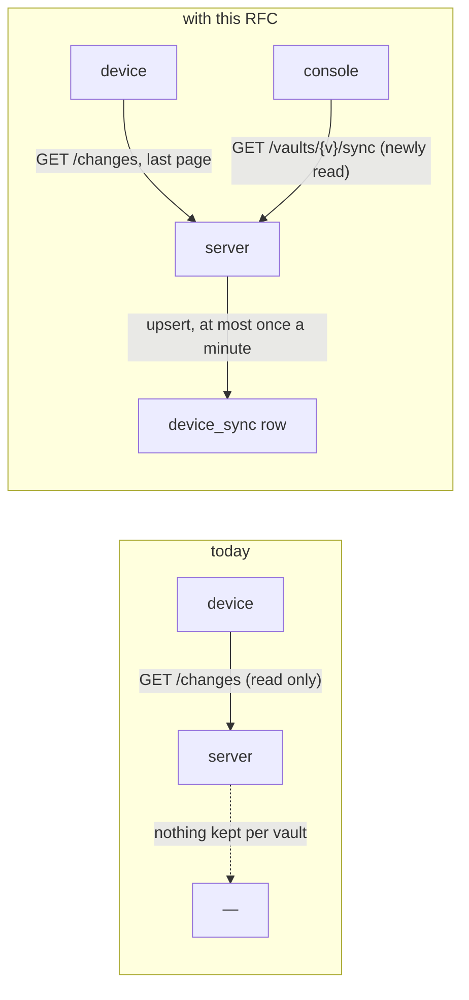
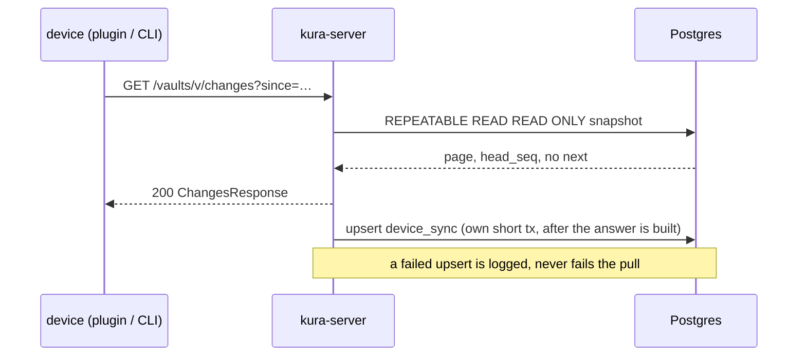
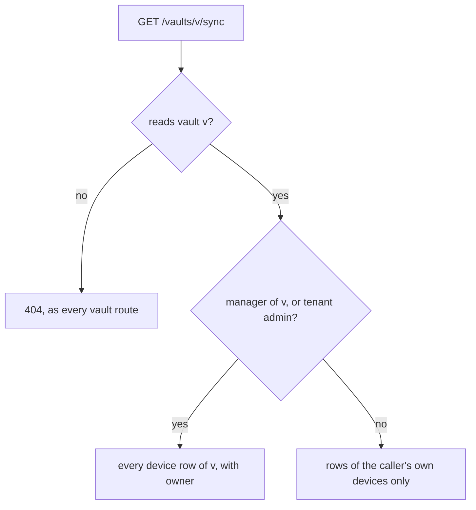
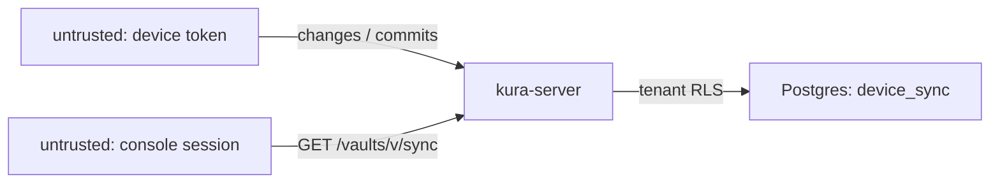

# RFC 0006 — Sync state per device and per vault

| Field | Value |
| --- | --- |
| Status | Implemented (2026-11-18) |
| Short | Device sync state |
| Settles | How the console shows, for one vault, which devices sync it, when each last caught up, and how far behind it is |
| Author | Maxime (batleforc) |
| Co-author | Claude Opus 5.5 |
| Created | 2026-11-18 |
| Supersedes | — |
| Touches | `crates/kura-core` (`wire.rs`, `sync.rs`), `crates/kura-cli` (`api.rs`, `commands.rs`), `crates/kura-wasm`, `plugin/` (`main.ts`, `remote.ts`), `crates/kura-server` (migrations `0027_device_sync.sql` and `0028_device_sync_report.sql`, `app/changes.rs`, `app/commits.rs`, `app/devices.rs`, `app/vaults.rs`, new `app/sync_state.rs`, `app/mod.rs`, `limits.rs`, `metrics.rs`, `tests/sync_state.rs`), `ui/` (`src/sync.ts`, `src/components/VaultDevices.vue`, `src/pages/VaultOverview.vue`, `src/pages/DevicesPage.vue`, `src/pages/HelpPage.vue`, locales), `tests/heavy/devices.sh`, `perf/k6/scenarios/04_sync_state.js`, `docs/api/openapi.json`, `docs/operator.md` |
| Risk | medium |

---

## 1. Summary

Today the console says when a device was last *seen* by the server, across
every vault at once (`device.last_seen` [R1]), and nothing else. Nobody can
tell from it whether bob's laptop has the session notes of yesterday, or
whether the phone that stopped syncing a month ago still holds the vault.

This RFC records, for each device and each vault it reads, the head it last
caught up to and when, and the last time it pushed. The server writes it
from the two calls it already answers: the last page of `GET
/vaults/{v}/changes` and `POST /vaults/{v}/commits`. A new read route,
`GET /vaults/{v}/sync`, returns it, and the vault overview shows it as a
table: device, owner, last caught up, behind by N notes.

### Before / after

```text
# today — Devices page, for the caller's own devices only
NAME            KIND      LAST SEEN     STATE
laptop          desktop   2 min ago     active
pixel           mobile    34 days ago   active

# with this RFC — vault "campaign", overview, a manager's view
DEVICE          OWNER   CAUGHT UP     BEHIND     LAST PUSH
laptop          alice   2 min ago     up to date 1 h ago
pixel           alice   34 days ago   212 notes  35 days ago
desktop         bob     yesterday     3 notes    —
```



The device sends nothing new: the server keeps what it already knew for one
request, and the console reads it back through one route that applies the
role checks of §7.2.

---

## 2. Motivation

1. **A stale device is invisible.** `list_devices` returns `last_seen` per
   device [R2], refreshed by any authenticated call [R1]; a phone that only
   opens the web console, or syncs one vault out of three, looks alive for
   all of them. Alice cannot tell which vault it stopped following.
2. **A manager cannot see who has a vault.** `GET /vaults/{v}/bindings` says
   who *may* read a vault [R3]; nothing says which devices *hold* a copy, so
   removing a member leaves the manager guessing which machines carried it.
3. **Support has no fact to start from.** "My notes are not on my phone" is
   answered today by asking the user to open the plugin's problems modal.
   The server knows the head it handed the device and when; it throws it away.
4. **The plugin's own state is local only.** `Report` (pending, conflicts,
   unsyncable [R4]) lives on the device; the console cannot point at it.
   Phase 2 addresses this one, under question 2.

---

## 3. Goals / non-goals

**Goals**

- For each (device, vault): the head it last caught up to, when, and the
  last time it pushed a commit.
- "Behind by N notes", computed against the vault's head and within what the
  device's owner may read.
- One read route, its visibility set by the vault role (§7.2).
- The caller's own devices, with the vaults each follows, on the Devices page.

**Non-goals**

- **Live presence ("online now")**: the event sockets live in each replica's
  memory [R5]; a shared view needs a new store for a fact that is stale in a
  minute anyway.
- **Per-file progress**: what a device applied is known only to the device;
  the server knows what it *handed out*, and says so (§4.2).
- **Scoped tokens**: they have `last_used_at` already [R6]; a bot does not
  "follow" a vault the way a device does.
- **Alerting on a stale device**: notifications (RFC 0003) could carry a
  `device.stale` event later; not until the data exists and is trusted.
- **History of sync times**: one row per (device, vault), overwritten; a
  timeline of when someone opened their vault is surveillance, not support.

---

## 4. User-facing design

### 4.1 Configuration

None. The recording is always on: it stores less than `device.last_seen`
already does per call, and the route is closed by role. No option means no
"off" that leaves the page silently empty.

### 4.2 Behaviour rules

- **Caught up** is written when a `GET /vaults/{v}/changes` answer has no
  `next` (the last page of a pass): the device now holds everything up to
  that answer's `head_seq` [R7]. A middle page writes nothing.
- **Handed, not applied**: the row says what the server answered. A device
  that failed to write a file still counts it until phase 2's report.
- **Pushed** is written when `POST /vaults/{v}/commits` succeeds for a device.
- **At most one write a minute** per (device, vault), as `last_seen` [R1],
  unless the caught-up `head_seq` moved: a device that follows a busy vault
  writes once per change, an idle one once a minute at most.
- **Behind** = entries the device's owner may read (their `PathScope`) with
  `last_seq > caught_up_seq`, counted up to 1,000 and shown as "1,000+"
  above. A device whose epoch differs from the vault's shows "full resync
  needed" instead of a number.
- **Never caught up**: a device that read the vault but never finished a pass
  shows "not yet" and no number.
- **Revoked or signed-out devices** keep their row until purged, and are
  hidden behind the existing revoked toggle.
- **Scoped tokens** write nothing (§3).

### 4.3 Validation

No new input: the route takes a vault id from the path, parsed as a `Uuid`
by axum as every other route [R8]. Nothing is rejected that is not today.

### 4.4 API surface

| Method | Path | Auth | Who may call | Limit |
| --- | --- | --- | --- | --- |
| GET | `/vaults/{v}/sync` | device token (`DeviceCaller`) | any member of the vault; sees their own devices, a manager or tenant admin sees every device (§7.2) | the existing per-device rate limit; at most 1,000 rows |
| GET | `/devices` (changed) | unchanged | unchanged | each device gains `vaults: [{vault, caughtUpAt}]` |

Handler `sync_state::vault_sync` with `#[utoipa::path]`; the spec in
`docs/api/openapi.json` and the HeyApi client are regenerated.

### 4.5 Mocks

**Vault overview, "Devices" section — a manager, nominal**

```text
DEVICES                                              [show revoked (1)]
DEVICE      OWNER   CAUGHT UP      BEHIND              LAST PUSH
laptop      alice   2 min ago      ● up to date        1 h ago
pixel       alice   34 days ago    ◐ 212 notes         35 days ago
desktop     bob     yesterday      ◐ 3 notes           —
tablet      carol   —              ○ not yet           —
```

Order: most behind first, then by name; the state mark is `StateMark`, so
colour is never the only signal.

**Same section — a viewer or editor**

```text
YOUR DEVICES ON THIS VAULT
DEVICE      CAUGHT UP      BEHIND
laptop      2 min ago      ● up to date
```

A member sees only their own rows, under a heading that says so.

**Empty**

```text
YOUR DEVICES ON THIS VAULT
No device has synced this vault yet. Install the Obsidian plugin to start.
```

**Error — the route failed**

```text
DEVICES
Could not load the devices of this vault.  [Retry]
```

The `AsyncState` component, as every other section of the overview.

**Full resync needed**

```text
pixel       alice   34 days ago    ✕ full resync needed  35 days ago
```

**Devices page — the caller's own, with the vaults each follows**

```text
NAME      KIND      LAST SEEN     VAULTS                      STATE
laptop    desktop   2 min ago     campaign, notes             active
pixel     mobile    34 days ago   campaign (34 days ago)      active
```

A vault caught up more than a day before `last_seen` shows its own date.

---

## 5. Architecture

### 5.1 Where the fact comes from



The pull reads in a read-only snapshot [R9]; the record is a second,
separate statement, so the snapshot rule of `get_changes` is untouched.

**Invariant**: because the row is written only by the server, from the
caller's own authenticated device id and a vault it just read, a device
cannot claim to hold a vault it cannot read, nor write another device's row.

### 5.2 Who sees which row



---

## 6. Detailed design

### 6.1 Data model (migration `0027_device_sync.sql`)

```sql
CREATE TABLE device_sync (
    vault_id       uuid NOT NULL,
    tenant_id      uuid NOT NULL,
    device_id      uuid NOT NULL REFERENCES device (id) ON DELETE CASCADE,
    epoch          uuid,
    caught_up_seq  bigint CHECK (caught_up_seq >= 0),
    caught_up_at   timestamptz,
    pushed_at      timestamptz,
    PRIMARY KEY (vault_id, device_id),
    FOREIGN KEY (vault_id, tenant_id) REFERENCES vault (id, tenant_id) ON DELETE CASCADE
);
CREATE INDEX device_sync_tenant ON device_sync (tenant_id);
CREATE INDEX device_sync_device ON device_sync (device_id);
```

Row-level security as `ws_ticket` [R10]: `owner_all`, and `app_tenant` for
`kura_app` on `tenant_id = kura_current_tenant()`, with `SELECT, INSERT,
UPDATE` granted. Deleting a device (the 180-day purge [R11]) or a vault
removes its rows by cascade.

### 6.2 `app/changes.rs`

After `response(...)` is built and the snapshot committed, when the caller
is `Reader::Device` and the response has no `next`:

```sql
INSERT INTO device_sync (vault_id, tenant_id, device_id, epoch, caught_up_seq, caught_up_at)
VALUES ($1, $2, $3, $4, $5, now())
ON CONFLICT (vault_id, device_id) DO UPDATE
SET epoch = EXCLUDED.epoch, caught_up_seq = EXCLUDED.caught_up_seq, caught_up_at = now()
WHERE device_sync.caught_up_seq IS DISTINCT FROM EXCLUDED.caught_up_seq
   OR device_sync.caught_up_at < now() - interval '1 minute';
```

in a `begin_tenant` transaction of its own. An error is logged at `warn`
with the vault and device ids and does not change the answer.

### 6.3 `app/commits.rs`

`post_commit`, after its transaction commits, upserts `pushed_at = now()`
the same way, for a `Writer::Device` only.

### 6.4 `app/sync_state.rs` (new)

`vault_sync`: `require_role(Viewer)`, then one query joining `device_sync`,
`device` (name, profile, owner, revoked) and, for "behind", a lateral
`count(*)` on `entry` with `last_seq > caught_up_seq AND path_key LIKE
ANY(scope)` capped by `LIMIT 1001`, where the scope is the *owner's* read
scope for that vault as `authz` settles it. For a non-manager, `WHERE
device.user_sub = $caller`. The view type, `DeviceSyncView`, lives in
`kura-core::wire` beside `ChangesResponse`.

### 6.5 `ui/`

`VaultOverview.vue` gains the Devices section of §4.5 with `AsyncState`,
`StateMark`, `RevokedToggle` and `TableFilter`; `DevicesPage.vue` gains the
vaults column. Strings in `en.json` and `fr.json`.

### 6.P Proof against a real client

Suite `tests/heavy/console.sh` against the dev stack, with the Kura CLI of
this tree and Obsidian with the plugin of this tree; the console in
Chromium through the existing Playwright e2e.

1. `kura sync` on alice's laptop in vault `campaign`, then `GET
   /vaults/{campaign}/sync` as alice (owner): her laptop's row has
   `caughtUpSeq` equal to the `head_seq` of the last `changes` page and
   `behind = 0`.
2. bob commits three notes from another device; alice's row now reports
   `behind = 3` without alice's laptop making any request.
3. As carol, a `viewer` of `campaign` with no device on it: `200` with an
   empty list — not alice's rows.
4. **Refusal**: as dave, not a member of `campaign`: `404 not_found`, the
   same answer as for a vault that does not exist; the server log shows no
   query on `device_sync` for that request.
5. **Refusal**: with a scoped token of `campaign`: `403` "scoped tokens are
   read only" [R12], and no `device_sync` row is written by its `changes`
   calls.
6. A middle page (`next` set) leaves `caught_up_at` unchanged; the following
   last page moves it.
7. The vault overview in the browser shows the rows of 1 and 2 in the order
   of §4.5, and the empty state for carol.

**Deliberately untouched**, so reviewers do not go looking:

- `app/events.rs` — the sockets would give presence (non-goal), and only on
  one replica.
- `device.last_seen` — kept as it is; it answers "is this device alive",
  not "which vaults".
- `crates/kura-core/src/sync.rs` — no client change in phase 1.

---

## 7. Security

**Rating:** medium — a new read route over a new record of when people sync,
gated by the existing vault roles.

### 7.1 Threat model



| # | Threat (STRIDE) | Where | Mitigation | Residual risk |
| --- | --- | --- | --- | --- |
| T1 | Information disclosure: a member reads other members' activity | `GET /sync` | non-managers filtered to `user_sub = caller` in `vault_sync`; test `member_sees_only_own_devices` | none known |
| T2 | Information disclosure: a non-member learns a vault exists or who syncs it | `GET /sync` | `require_role` answers 404 as every vault route [R8]; test `stranger_gets_404` | none |
| T3 | Information disclosure across tenants | Postgres | `app_tenant` RLS on `tenant_id`; test `other_tenant_rows_invisible` | none |
| T4 | Tampering: a device forges another's state | `changes` / `commits` | the device id comes from `DeviceCaller` [R13], never from input; no route writes `device_sync` from a body | none |
| T5 | Information disclosure: "behind" counts notes outside the owner's folders, revealing activity there | `GET /sync` | counted under the owner's `PathScope`, not the vault's; test `behind_counts_only_owner_scope` | a manager already sees everything |
| T6 | Denial of service: write amplification on pulls | `changes` | at most one write a minute per row unless the head moved (§4.2) | one write per change on a busy vault, as `commit` already does |

### 7.2 Authentication and authorisation

A device token is required (`DeviceCaller`); a scoped token is refused by the
`DeviceCaller` extractor as on every person route [R12]. A viewer or editor
sees their own devices; a vault manager or tenant admin sees all, with the
owner's subject — the same people who already see bindings [R3] and, for a
tenant admin, every device's owner [R2]. Question 1 is whether a vault
manager who is not a tenant admin should see owners.

### 7.3 Input handling and injection

The only input is the path's vault id, a `Uuid`; queries are bound
parameters. No parser is added, so no fuzz target.

### 7.4 Secrets and cryptography

No secret is created, stored or returned; device ids are already visible to
their owner and to tenant admins.

### 7.5 Abuse and resource exhaustion

`GET /sync` is bounded by 1,000 rows and a count capped at 1,001 per row,
under the existing per-device rate limit. The write path is throttled as in
§4.2; a failed write never retries.

### 7.6 Existing defences that still hold

The read-only snapshot of `get_changes` [R9]; tenant RLS; `require_role`'s
404 for strangers; revoked devices are refused before any handler runs [R1].

---

## 8. Supply chain

No new dependency, image, action or tool: the route uses axum, sqlx and
utoipa already in `Cargo.lock`, and the UI reuses its components; `task
audit` is unchanged.

---

## 9. Data and privacy

| Data | Personal? | Where stored | Retention | Who can read it | Leaves the instance? |
| --- | --- | --- | --- | --- | --- |
| `caught_up_at`, `pushed_at` per (device, vault) | **Yes**: when a person synced a vault | `device_sync` | until the device is purged (180 days unused, 30 for web [R11]) or the vault deleted | the device's owner; the vault's managers and tenant admins (question 1) | no |
| `caught_up_seq`, `epoch` | no | `device_sync` | same | same | no |

- One row per (device, vault), overwritten: no timeline is kept (§3).
- Purpose: support and access review by the people who manage the vault.
  Lawful basis: legitimate interest of the tenant, as `last_seen`.
- Erasure: revoking and purging the device removes its rows (cascade);
  removing a person from a vault leaves their rows until the device is
  purged — question 3.
- Not in logs beyond the existing access log; no metric label carries it.

---

## 10. Operability

### 10.1 Observability

- **Metrics**: `kura_device_sync_write_failures_total` (counter, no label),
  so a broken upsert is visible without reading logs.
- **Logs and audit trail**: a failed upsert at `warn`. Reading `/sync` is
  not an audit event: it changes nothing and is gated by role.
- **Alerts**: none; a failing write degrades the page, not sync.

### 10.2 Failure modes

| Failure | Detected by | Behaviour | Recovery |
| --- | --- | --- | --- |
| Upsert fails (lock, DB hiccup) | the counter, `warn` log | **fail open on recording**: the pull still answers; the row is stale | next pass writes it |
| `/sync` query slow on a large vault | request latency | capped counts; the overview section shows its own error | none needed |
| Server rolled back below `0027` | — | the table stays, unread | roll forward |

Failing open is right here: the record is informational, and refusing a
pull because a dashboard row could not be written would break sync for a
display.

### 10.3 Performance and capacity

- Storage: one row (~100 bytes) per (device, vault) pair; for the dev
  tenant's 6 devices × 4 vaults, under 3 KB.
- Writes: at most one per minute per pair, or one per change pulled.
- Reads: a count per row, on the existing `entry_changes (vault_id,
  last_seq)` index [R14], capped at 1,001. To be measured in phase 1 on the
  `perf/k6` vault before landing.

---

## 11. Other concerns

- **Accessibility**: the table has `<th scope="col">`, the states are
  `StateMark` (word and mark, not colour alone), the section heading names
  whose devices are shown; the filter is `TableFilter` with its live status.
- **Internationalisation**: every string in `en.json` and `fr.json`; counts
  with plural forms; dates through the existing `ago()`/`when()`.
- **Compliance**: personal activity data, declared in §9 and in
  `docs/operator.md`'s data section.
- **Licensing**: unchanged.
- **Documentation**: `docs/operator.md` (what is recorded, for how long, who
  sees it); the console's help page gains one paragraph.

---

## 12. Alternatives considered

| Alternative | Why rejected |
| --- | --- |
| Do nothing; `last_seen` is enough | It cannot answer motivation 1 or 2: it is per device, not per vault |
| The client reports its state (`PUT /sync`) | Trusts the device for a fact the server already has; kept for the local-only facts (question 2) |
| Record every pull (a log table) | A timeline of reading activity; storage grows with use, not with devices (§3) |
| Derive "caught up" from the WebSocket | Per-replica memory [R5]; a device without a socket (CLI) would never show |
| Seq gap (`head_seq - caught_up_seq`) as "behind" | Counts revisions, not notes, and counts folders the owner cannot read (T5) |

---

## 13. Rollout and compatibility

- **Default behaviour**: recording starts with the deploy; every device shows
  "not yet" until its next full pass.
- **Migration**: `0027` is additive; the floor check of RFC 0004 is not
  involved since no authorization data changes.
- **Operator prerequisites**: none.
- **Rollback**: an older binary ignores the table; rows stay until the next
  forward deploy or a manual `DROP`. No risk of §7 reopens.
- **Feature flag**: none (§4.1).

---

## 14. Test plan

- **Unit** (`app/sync_state.rs`): ordering of rows; "1,000+" cap; epoch
  mismatch maps to "full resync needed".
- **Integration** (`tests/sync_state.rs`): a last page writes, a middle page
  does not; throttling; a commit writes `pushed_at`; a scoped token writes
  nothing; cascade on device and vault delete.
- **Proof**: §6.P, in `tests/heavy/console.sh`.
- **Security** (`tests/sync_state.rs`): T1 `member_sees_only_own_devices`,
  T2 `stranger_gets_404`, T3 `other_tenant_rows_invisible`, T4
  `device_cannot_write_other_row` (no route accepts a device id in the
  body: asserted on the OpenAPI document), T5
  `behind_counts_only_owner_scope`.
- **UI** (`ui/src/pages/vault-pages.spec.ts`): manager and member views,
  empty, error.
- **Audit**: `task audit` unchanged.
- **Existing suites**: `tests/sync.rs` (a pull never skips a change [R15]),
  `tests/heavy/sync.sh`, `authz.sh`, `reader.sh` unchanged.

---

## 15. Decisions and open questions

### Resolved

| # | Question | Decision |
| --- | --- | --- |
| 1 | Does a vault manager who is not a tenant admin see owners? | **Yes, on that vault only.** Chosen by the owner on 2026-11-18, as recommended: the manager already sees bindings and history authors, and without owners the table cannot answer motivation 2. |
| 2 | Phase 2: the client's local state? | **Counts only, reported by the plugin and the CLI after each run (phase 3).** As recommended; first deferred, then built the same day at the owner's request (§18.7). |
| 3 | Removed from a vault, rows kept? | **Deleted with a `user:` binding, in its transaction.** As recommended. A group binding's members are not known to the server; theirs stay until the device is purged (§18 D4). |
| 4 | How is "behind" measured? | **Entries under the owner's scope with `last_seq` past the caught-up seq, capped at 1,000.** A seq gap counts revisions and folders the owner cannot read (T5). |
| 5 | When is "caught up" written? | **On the last page of a pass only.** A middle page proves nothing about the head. |

### Still open

None. (Questions 1 to 3 were open in the draft of 2026-11-18; see above.)

---

## 16. Implementation phases

| Phase | Content |
| --- | --- |
| 1 | Migration, recording in `changes` and `commits`, `GET /vaults/{v}/sync`, tests T1–T5, the vault overview section. Useful alone. |
| 2 | Devices page vaults column; question 3's cleanup. |
| 3 | If question 2 is accepted: the client counts, wire field, plugin and CLI. |

---

## 17. References and sources

All code references at commit `4d04302`.

| # | Source | Pinned at | Supports |
| --- | --- | --- | --- |
| R1 | `crates/kura-server/src/app/device.rs:96-104` (`UPDATE device SET last_seen … interval '1 minute'`, revoked refused before) | `4d04302` | §1, §4.2 throttle, §7.6 |
| R2 | `crates/kura-server/src/app/devices.rs:59-63,247-248` (`last_seen`; owner shown only to a tenant admin) | `4d04302` | §2.1, §7.2, question 1 |
| R3 | `crates/kura-server/src/app/vaults.rs:457-480` (`list_bindings`, manager or tenant admin) | `4d04302` | §2.2, §7.2 |
| R4 | `crates/kura-core/src/sync.rs:245-268` (`Report`) | `4d04302` | §2.4, question 2 |
| R5 | `crates/kura-server/src/app/events.rs:227` (`state.hub.enter(device)`: sockets held in this replica's memory) | `4d04302` | §3, §12 |
| R6 | `crates/kura-server/migrations/0013_scoped_tokens.sql:19,54` (`last_used_at`) | `4d04302` | §3 |
| R7 | `crates/kura-core/src/wire.rs:172-181` (`ChangesResponse.head_seq`, `next`) | `4d04302` | §4.2 |
| R8 | `crates/kura-server/src/app/changes.rs:115-127` (vault routes: path `Uuid`, 404 for no vault) | `4d04302` | §4.3, T2 |
| R9 | `crates/kura-server/src/db.rs:178-185` (`REPEATABLE READ READ ONLY` snapshot) | `4d04302` | §5.1, §7.6 |
| R10 | `crates/kura-server/migrations/0009_events.sql:3-25` (`ws_ticket` RLS pattern) | `4d04302` | §6.1 |
| R11 | `crates/kura-server/migrations/0022_web_profile.sql:15-16` (180/30-day purge) | `4d04302` | §6.1, §9 |
| R12 | `crates/kura-server/src/app/reader.rs:134-140` (scoped tokens refused off `Reader`/`Writer`) | `4d04302` | §6.P.5, §7.2 |
| R13 | `crates/kura-server/src/app/device.rs:18-21` (`DeviceCaller.device`) | `4d04302` | T4 |
| R14 | `crates/kura-server/migrations/0007_sync.sql:27-28` (`entry_changes` index) | `4d04302` | §10.3 |
| R15 | `crates/kura-server/tests/sync.rs:653` (`a_pull_during_commits_never_passes_an_unseen_change`) | `4d04302` | §14 |

---

## 18. Revision against the tree (2026-11-18)

### 18.1 What shipped

Phases 1 and 2 together: migration `0027_device_sync.sql`, the recording in
`get_changes` and `post_commit`, `GET /v1/vaults/{v}/sync` (60 a minute),
`vaults` on `GET /v1/devices`, the cleanup on a `user:` binding's removal,
the counter, the vault overview's Devices section and the Devices page's
Vaults column, the help entry and `docs/operator.md`. Phase 3 (question 2)
is not built.

### 18.2 Divergences from the text

| # | Section | Divergence | Reason |
| --- | --- | --- | --- |
| D1 | §6.4 ("the owner's read scope as `authz` settles it") | The row stores the `LIKE` patterns the device last read with (`scope text[]`); "behind" counts under them | `authz` settles a person's scope from their token's claims; the server cannot know another person's groups when a manager asks. The device's own last read is the scope it actually holds |
| D2 | §6.4 (one query joining `device`) | Three `SECURITY DEFINER` functions: `kura_vault_sync`, `kura_my_device_vaults`, `kura_device_sync_forget`, each filtered on `kura_current_tenant()` or `kura_current_subject()` | `device` rows are visible to their owner only (policy `app_subject`); the functions follow `kura_tenant_devices` [R2] |
| D3 | §6.4 (`DeviceSyncView` in `kura-core::wire`) | `DeviceSync` in `app/sync_state.rs` | No client crate reads it; only the console, through the generated client |
| D4 | Question 3 | Rows go with a `user:` binding; a `claim:` binding's members keep theirs until the device is purged | The server does not know who is in a group |
| D5 | §4.2, §6.2 | A pull or commit of the configuration space records nothing | The row speaks of the notes; the configuration space has its own namespace and no "behind" |
| D6 | §6.3 ("the same way") | `pushed_at` is written on every successful commit, not throttled | A commit already writes revisions; one more row per commit is in the same order |
| D7 | §6.P | Carried in process by `tests/sync_state.rs` (observations 1–5) and by the console's component tests (observation 7); `tests/heavy/console.sh` is unchanged | The heavy suite needs the full dev stack with Authentik; the in-process tests run the real router against PostgreSQL, OpenBao and S3, as RFC 0003 D17–D18 did |
| D8 | §6.P observation 6, §14 | The middle-page case is not tested | It needs more than 1,000 entries; the condition is one `page.next.is_none()` beside the page's own construction |
| D9 | §10.3 | The count was not measured on the `perf/k6` vault | Left for the first vault large enough to matter; the count is capped at 1,001 per row on the existing index |
| D10 | §4.5 | The section adds a line under the table: what "caught up" means (handed, not applied) | §4.2's limit, said where the reader looks |

### 18.3 What the proof observed

`cargo test -p kura-server --test sync_state` against the local PostgreSQL,
OpenBao and S3 (`task dev:up`, `dev:vault`, `dev:s3`): 4 passed. A first
pass records `behind = 0`; two commits by another device make it 2 with no
call from the device; a member sees only their row, a member with no device
an empty list; a tenant admin sees owners and their own push; an epoch
change answers `resync: true` with no count; a stranger from another tenant
gets `404` on the vault and on an unknown id; a scoped token gets `403
insufficient_role`; a restricted viewer of `Sessions/` is behind by 1 after
one note there and one outside; removing her `user:` binding removes her row.
The whole workspace suite stayed green, `every_route_has_a_limit` included.

### 18.4 Threats against the tests

| Row | Test |
| --- | --- |
| T1 | `a_pass_records_where_the_device_stands` (bob sees his row only; carol an empty list) |
| T2 | `a_stranger_gets_404` |
| T3 | `a_stranger_gets_404` (a member of tenant `other`) and the `app_tenant` policy |
| T4 | No test: no route takes a device id from its input; the writes take `DeviceCaller.device` [R13] |
| T5 | `behind_counts_only_the_device_scope` |
| T6 | No test: the throttle is the upsert's `WHERE`, as `last_seen`'s [R1] |

### 18.5 Supply chain

No dependency added; `Cargo.lock` and `pnpm-lock.yaml` unchanged.

### 18.6 Mocks against what shipped

The manager's and member's tables, the empty and error states and the
resync row ship as drawn, with `StateMark` marks: up to date (live), behind
(waiting), not yet (off), full resync needed (refused). A manager's own
devices read "you" in the owner column. The Devices page's Vaults column
ships as drawn. The table gains the filter of the other back-office tables.

### 18.7 Phase 3 and the proofs, landed the same day

**Phase 3 (question 2).** `kura_core::wire::SyncCounts` (`pending`,
`conflicts`, `unsyncable`, `failed`; unknown fields refused) and
`Report::counts()`, one definition for both clients: pending is what a
refused push kept plus what lay outside the caller's write folders.
`PUT /v1/vaults/{v}/sync/report` (a device, any reader of the vault, 60 a
minute, each count at most 1,000,000) stores them in the row with
`reported_at` (migration `0028`); `GET /sync` returns them as `report`. The
CLI sends them after each `kura sync` of the notes, never on a dry run nor
with a scoped token, and prints a `note:` when the server did not take them;
the plugin sends them after each run of the notes, and a failure is ignored.
The vault overview gains a "Last run" column ("2 changes not sent · 1 file
cannot sync", "nothing left", or "—" for a client that does not report).

| # | Section | Divergence | Reason |
| --- | --- | --- | --- |
| D11 | §4.4 | One more route, `PUT /v1/vaults/{v}/sync/report` | Question 2's decision; the device writes only its own row, keyed by `DeviceCaller` |
| D12 | §7.1 | A new input from the device: four integers, bounded and closed (`deny_unknown_fields`), never a path | A client could lie about its own counts; it can only mislead the console about itself, which it already could by not syncing |
| D13 | §4.5 | The owner column shows the OIDC subject, as the tenant's Devices page already does | Kura stores no display name for another person; with Authentik's hashed `sub` the column is an opaque id. Naming people is its own change |

**§6.P, now observed (supersedes D7).** `tests/heavy/devices.sh` against
the dev stack (`task dev:stack`, `RELEASE=1 task dev:run`), with the `kura`
CLI of this tree, alice (tenant owner) and bob (member), vault `notes`:

1. bob's `kura attach notes` with a file named `Q3: plan.md`: his row is up
   to date and carries `report.unsyncable = 1`; no owner is named to him.
2. alice attaches three notes: bob is 3 behind with no call from him, and
   alice sees his owner and her own push.
3. bob syncs: 0 behind; alice's device is absent from his list.
4. **Refusal**: bob on `elsewhere` (tenant `other`) and on an unknown id
   gets `404`, also for a report; no row exists on `elsewhere`.
5. **Refusal**: a scoped token gets `403` on the list and on the report.
6. **Refusal**: a report carrying `paths` gets `400`.

`tests/heavy/sync.sh` and `authz.sh` pass unchanged on the same stack. The
middle-page case (D8) stays covered by reading only.

**§10.3, now measured (supersedes D9).** `task perf:run:sync-state`
(`perf/k6/scenarios/04_sync_state.js`, release build, 5 devices reading the
list of `notes` for 30 s): p95 6.92 ms, 0 failures of 150 requests. The
worst case, run as `EXPLAIN ANALYZE` of `kura_vault_sync` in a rolled-back
transaction on a disabled 10,000-note perf vault with every row at
`caught_up_seq = 0` (each count reaching its cap of 1,001): 8.6 ms for 20
devices, 61.6 ms for 197. About 0.3 ms a device at the cap; a vault would
need over 1,500 devices all far behind to pass a second, and the list stops
at 1,000 rows.

### 18.8 Owners by name, and the browser proof (supersedes D13)

Migration `0029` keeps the owner's `name` (else `preferred_username`) claim
on each device, from the owner's own token: written at registration,
refreshed with `last_seen`, cut to 128 characters
(`Principal::display_name`, shared with `GET /me`). `GET /devices` and
`GET /vaults/{v}/sync` return it as `ownerName` beside `owner`, in the same
answers only: a member is never told it. The console shows the name, the
subject in a tooltip. Test: `an_owner_is_named_by_their_name_claim`. It is
personal data already shown on the owner's own `/me`; it now reaches the
people who could already see the owner's subject.

`tests/heavy/devices.sh` checks bob's name (`Bob`, from Authentik) in
observation 2 and runs observation 7 in Chromium (`ui/e2e/devices.spec.ts`,
Playwright): alice's page for `notes` shows bob's device, named, up to date,
with "1 file cannot sync". 7 of 7 observations pass on the dev stack.

