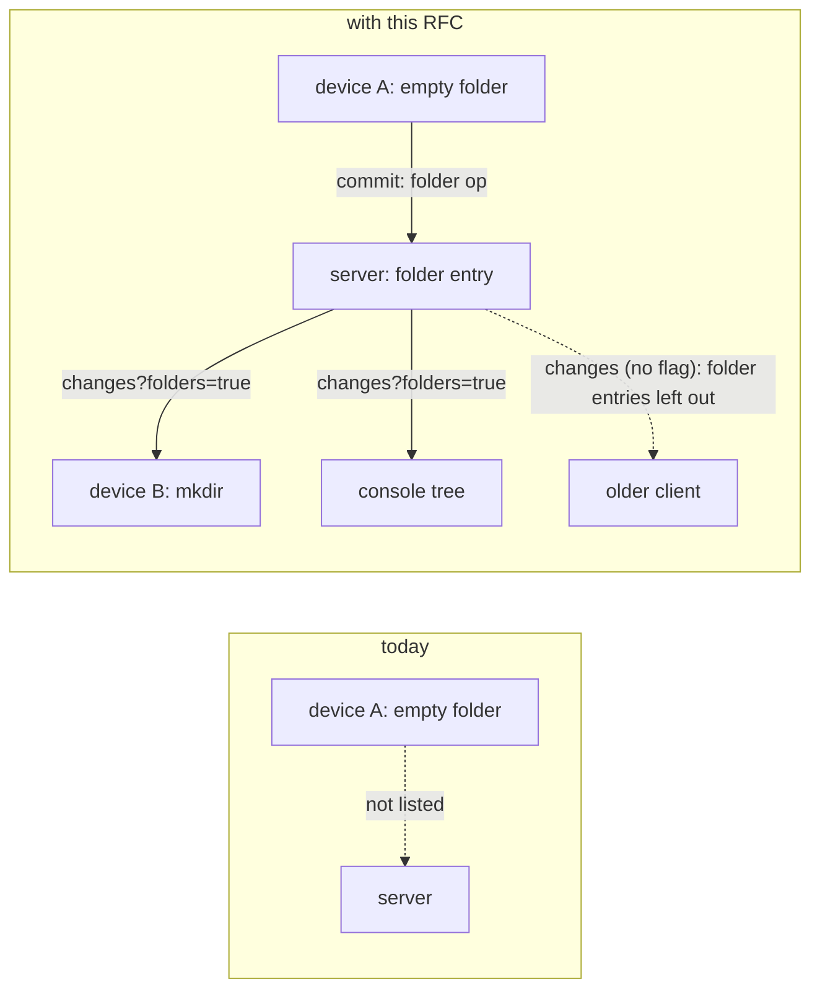
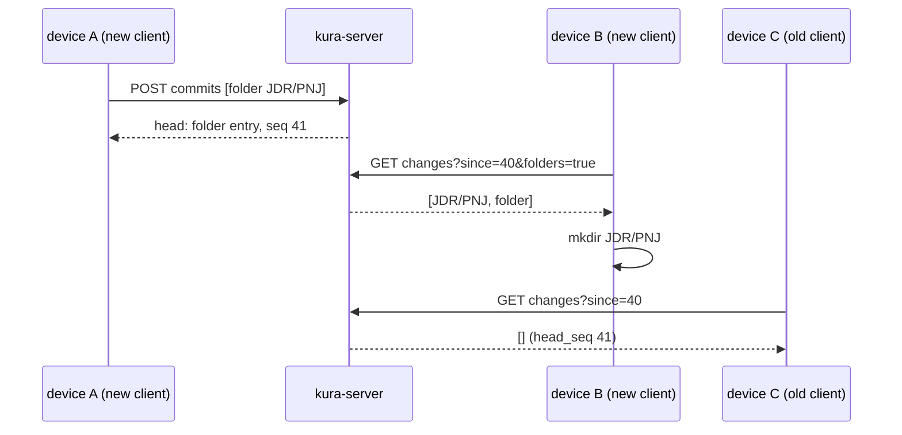

# RFC 0007 — Folders as synced entries

| Field | Value |
| --- | --- |
| Status | Implemented (2026-11-18) |
| Short | Folder entries |
| Settles | How a folder, empty or not, reaches every device and the console: created, renamed and removed like a note |
| Author | Maxime (batleforc) |
| Co-author | Claude Opus 5.5 |
| Created | 2026-11-18 |
| Supersedes | — |
| Touches | `crates/kura-core` (`wire.rs`, `sync.rs`), `crates/kura-server` (migration, `app/commits.rs`, `app/changes.rs`, the indexer), `crates/kura-cli` (`fs.rs`, `api.rs`), `crates/kura-wasm`, `plugin/` (`host.ts`, `remote.ts`), `ui/` (`reader/tree.ts`, `reader/FolderTree.vue`), `tests/heavy/sync.sh`, `docs/api/openapi.json`, `docs/operator.md` |
| Risk | medium |

---

## 1. Summary

Kura syncs files only. A folder exists on the server, on other devices and
in the console only as the path of the files under it: the plugin's host
walks folders but lists files [R1], the wire has two operations, `put` a
file and `delete` an entry [R2], and an entry always carries a blob or is
deleted [R3]. An empty folder made in Obsidian therefore stays on the
device that made it; the console's tree, built from file paths [R4], never
shows it.

This RFC makes a folder an entry of its own kind: no content, a path, a
revision, created and deleted by the same commits as notes. A client that
says it understands folders gets them on its pulls; an older client never
sees one.

### Before / after

```text
# today — device A
JDR/Sessions/            (empty)
$ kura sync              → nothing to push
# device B, console: no JDR/Sessions

# with this RFC — device A
$ kura sync              → 1 folder pushed
# device B: JDR/Sessions/ created · console: JDR ▸ Sessions (empty)
```



The dotted path is the compatibility rule of §4.2: a client that did not
ask for folders is never sent one.

---

## 2. Motivation

1. **Empty folders do not sync.** A structure prepared ahead (a campaign's
   `Sessions/`, `Resumes/`, `PNJ/` before the first note) exists on one
   device only. `ObsidianHost.list` recurses into folders and returns files
   only [R1].
2. **The console cannot show them.** `buildTree` makes folders from file
   paths [R4]; the server has nothing else to give it.
3. **A folder removed on one device lingers on the others** once its last
   file is gone: the files are trashed there, the empty folder stays.

---

## 3. Goals / non-goals

**Goals**

- A folder, empty or not, created on one device appears on the others and
  in the console; removed on one, it is removed on the others when empty.
- Folders under a restricted viewer's or a token's folders follow the same
  scope as notes.
- Older clients keep working, unchanged, and never receive a folder.

**Non-goals**

- **Folder renames as one operation.** A folder rename is a delete and a
  create; its files already move as renames of their own [R2]. A folder has
  no content and no history worth keeping.
- **Folder history, restore or metadata** (icons, colours, sort order):
  nothing in the Obsidian vault format carries them.
- **The configuration space** (`.obsidian`): its categories are files [R5].
- **Removing a folder that still holds files elsewhere**: a remote folder
  deletion never removes a file (§4.2).

---

## 4. User-facing design

### 4.1 Configuration

None. Clients opt in per request (§4.4), so a server with this RFC serves
old and new clients side by side.

### 4.2 Behaviour rules

- **Every folder is an entry**, empty or not, outside dot-segments (which
  the notes namespace refuses [R6]). Making only empty folders entries
  would churn entries each time a folder gains or loses its last file.
- **Push**: a local folder with no live folder entry at its path is pushed
  as `folder` (create); a folder entry whose folder is gone locally is
  pushed as `delete`.
- **Pull**: a live folder entry creates the folder (and its parents); a
  deleted one removes the local folder **only if it is empty**, never its
  files, which leave through their own deletions (to `.trash` [R7]).
- **Rename** on a device: its files are pushed as renames, the old folder
  as `delete`, the new one as `folder`.
- **A folder and a file at the same path** cannot both be live: the
  existing unique index on live paths refuses the second [R3]. The client
  reports the folder as unsyncable ("a file has this name").
- **Scope**: a folder's path goes through the same `sees`/`writes` checks
  as a note's [R8]: a restricted viewer sees the folders under its folders;
  a token writes a folder only where it writes notes.
- **Older clients**: `GET /changes` and `GET /entries` leave folder entries
  out unless the request carries `folders=true`. Their cursors still move
  past them, since a page's `head_seq` covers them.

### 4.3 Validation

| Condition | Rationale |
| --- | --- |
| A `folder` op on the configuration space | Refused `422 invalid_path`: categories are files [R5] |
| A `folder` op outside a token's write folders | Refused like a `put` there [R8] |
| A `folder` op at a path with a dot-segment | Refused by `VaultPath` [R6] |

No new warning.

### 4.4 API surface

| Method | Path | Change |
| --- | --- | --- |
| POST | `/vaults/{v}/commits` | New operation `{"op": "folder", "entry", "path", "base"?}` |
| GET | `/vaults/{v}/changes`, `/vaults/{v}/entries` | New query `folders=true`; each item gains `"folder": true` for a folder entry |

Same callers, same limits; the spec and the HeyApi client are regenerated.

### 4.5 Mocks

**CLI — a sync that pushes a new empty folder**

```text
$ kura sync notes
notes  1 folder pushed  0 pulled
```

**Console — the notes tree**

```text
▾ JDR
  ▸ PNJ                 ← empty folder: shown, opens to "No note in this folder"
  ▾ Sessions
      2026-11-15
```

An empty folder is a folder like any other; opened, it says it holds no note.

---

## 5. Architecture



**Invariant**: because a folder entry has no blob and the server leaves it
out of every answer that did not ask for folders, a client that cannot
handle one is never handed one; and because a remote folder deletion only
removes an empty local folder, it can never remove a file.

---

## 6. Detailed design

### 6.1 `kura-core`

- `Operation::Folder { entry, path, base: Option<Uuid> }`.
- `EntryState.folder: bool`, `#[serde(default)]`, skipped when false.
- `Host` gains `folders()`, `make_folder(path)` and `remove_folder_if_empty(path)`;
  `Options.folders: bool` is set only by hosts that implement them, so a
  host that lists no folders never pushes their deletion.
- `Known` gains `folder: bool`; the push compares local folders with known
  folder entries, the pull applies folder entries as in §4.2.

### 6.2 Server

- Migration: `entry.kind` and `revision.kind` (`'file'` default,
  `'folder'`), and the revision check becomes
  `(kind = 'folder' AND blob_hash IS NULL AND NOT deleted) OR (kind = 'file' AND deleted = (blob_hash IS NULL))`
  (a folder deletion stays `deleted` with no blob).
- `post_commit` accepts `folder`, with the scope and space checks of `put`.
- `changes` and `entries` add `AND e.kind = 'file'` unless `folders=true`.
- The search indexer and the blob possession checks skip folder entries.

### 6.3 Clients

- CLI `FsHost` and the plugin's `ObsidianHost` list folders (dot-segments
  skipped), create them and remove them when empty; both ask `folders=true`.
- Console: `buildTree` adds folder entries as folders; the reader asks
  `folders=true`.

### 6.P Proof against a real client

Suite `tests/heavy/sync.sh` (dev stack, `kura` of this tree), vault `notes`:

1. alice `mkdir JDR-$$/Empty` then `kura sync`: `1 folder pushed`; bob's
   `kura sync` creates `JDR-$$/Empty`, empty.
2. alice removes it, syncs; bob's sync removes it.
3. bob puts a note in a folder alice then removes: the note stays on both,
   the folder stays where the note is.
4. **Refusal**: `GET /changes` without `folders=true` returns no item with
   `"folder": true` while one exists (an older client's view).
5. **Refusal**: a scoped token reading `Sessions/` only lists no folder
   outside it, and a token without write there gets `422` for a `folder` op.
6. The console's tree, in Chromium, shows `JDR-$$/Empty` as a folder.

**Deliberately untouched**: the configuration space, chunks and blobs (a
folder has none), and conflict files (a folder never conflicts on content).

---

## 7. Security

**Rating:** medium — a new operation on the commit route and a new item
kind on the read routes, under the existing role and scope checks.

### 7.1 Threat model

| # | Threat | Where | Mitigation | Residual |
| --- | --- | --- | --- | --- |
| T1 | Information disclosure: a restricted viewer learns folder names outside its folders | `changes`, `entries` | folder entries go through the same `LIKE ANY(scope)` filter as notes [R8]; test | none |
| T2 | Tampering: a token creates folders outside its write folders | `commits` | `writes(path)` checked as for `put`; test | none |
| T3 | Tampering: a remote folder deletion removes files | client pull | only an empty folder is removed; test in core | none |
| T4 | DoS: a commit of many folders | `commits` | the existing 1,000-operation and body limits [R2] | as today |

### 7.2 Authentication and authorisation

Unchanged: editor or a writing token for `folder`, viewer or a reading
token for the read routes.

### 7.3 Input handling

The new op carries a `VaultPath`, parsed by the existing strict parser [R6];
the `fuzz_commit_body` target covers the new variant.

### 7.4 Secrets and cryptography

No secret, no content: a folder entry has no blob to encrypt.

### 7.5 Abuse

One entry per folder; bounded by the commit limits; zero bytes of quota.

### 7.6 Existing defences that still hold

The unique live-path index, `VaultPath`'s rules, the scope filter, and the
`.trash` rule for files.

---

## 8. Supply chain

No new dependency, image, action or tool; `task audit` is unchanged.

---

## 9. Data and privacy

A folder's path, as personal as a note's path, stored like one (the entry
and revision tables, the same retention). Nothing new leaves the instance.

---

## 10. Operability

- **Metrics**: none new; `commits_total` counts commits with folders.
- **Failure**: a client that cannot make or remove a folder reports it in
  `failed` and retries next run; nothing is refused server-side for it.
- **Capacity**: one entry per folder, typically a few percent of notes.

---

## 11. Other concerns

- **Accessibility**: an empty folder in the tree is a folder control like
  the others, with its expanded state announced.
- **Internationalisation**: "No note in this folder", "1 folder pushed",
  in EN and FR.
- **Compliance**, **Licensing**: unchanged.
- **Documentation**: `docs/operator.md` (folders sync; older clients do not
  see them), the console's help.

---

## 12. Alternatives considered

| Alternative | Why rejected |
| --- | --- |
| Document the limit | Motivations 1–3 stay; a campaign's prepared structure never reaches the players |
| A hidden marker file per empty folder (`.keep`) | Dot-paths are refused in the notes namespace [R6]; a visible marker pollutes every vault |
| Entries only for empty folders | An entry created and deleted each time a folder gains or loses its last file |
| Show folders in the console only | The server never receives them |

---

## 13. Rollout and compatibility

- Additive migration; older clients see no change (§4.2).
- Rollback: an older server refuses the `folder` op (`deny_unknown_fields`
  on the tagged enum), so new clients' folder pushes fail and their notes
  still sync; folder entries stay in the database, ignored.

---

## 14. Test plan

- **Unit** (`kura-core`): push and pull of folders; removal only when
  empty; a folder never deleted by a host without `folders`.
- **Integration** (`tests/sync.rs`, `tests/viewers.rs`): the op, the flag,
  T1, T2.
- **Proof**: §6.P.
- **Fuzz**: `fuzz_commit_body` with the new variant.

---

## 15. Decisions and open questions

### Resolved

| # | Question | Decision |
| --- | --- | --- |
| 1 | Every folder, or empty ones only? | **Every folder.** No churn when a folder gains or loses its last file. |
| 2 | A rename operation for folders? | **No: delete and create.** A folder has no content or history to keep. |

| 3 | Is the root of a restricted viewer's folder shown when empty? | **Yes.** Chosen by the owner on 2026-11-18, against the draft's recommendation: a folder is checked with a trailing `/`, so `Sessions` matches `sessions/%`. |
| 4 | Does a remote deletion remove a folder holding only files the device failed to write? | **No.** As recommended: only a truly empty folder goes (`remove_dir`, `rmdir` not recursive). |

### Still open

None.

---

## 16. Implementation phases

| Phase | Content |
| --- | --- |
| 1 | Wire, migration, server op and flag, tests T1–T2. Useful alone: nothing changes for clients. |
| 2 | Core, CLI host; `sync.sh` observations 1–5. |
| 3 | Plugin host, console tree; observation 6. |

---

## 17. References and sources

All code references at commit `15f99e0`.

| # | Source | Pinned at | Supports |
| --- | --- | --- | --- |
| R1 | `plugin/src/host.ts:72-94` (`list`: recurses folders, returns files) | `15f99e0` | §1, §2.1 |
| R2 | `crates/kura-core/src/wire.rs:60-86` (`Operation::Put`, `Delete`; a rename is a `put`) | `15f99e0` | §1, §3, §7.1 |
| R3 | `crates/kura-server/migrations/0007_sync.sql:28,48` (`entry_path` unique live path; `CHECK (deleted = (blob_hash IS NULL))`) | `15f99e0` | §1, §4.2, §6.2 |
| R4 | `ui/src/reader/tree.ts:13-33` (`buildTree` from entry paths) | `15f99e0` | §1, §2.2 |
| R5 | `crates/kura-server/src/app/space.rs:26-32,71` (the notes space and the configuration categories) | `15f99e0` | §3, §4.3 |
| R6 | `crates/kura-core/src/path.rs:56,198` (`VaultPath::parse`; dot-segments refused) | `15f99e0` | §4.2, §4.3, §7.3 |
| R7 | `crates/kura-core/src/sync.rs:170` (`Host::trash`: files go to `.trash`) | `15f99e0` | §4.2 |
| R8 | `crates/kura-core/src/scope.rs:143,150` (`sees`, `writes`) | `15f99e0` | §4.2, §7.1 |

---

## 18. Revision against the tree (2026-11-18)

### 18.1 What shipped

The three phases together: the `folder` operation and the `folder` flag
(`kura-core::wire`), migration `0030_folder_entries.sql`, the commit engine
(`app/commits.rs`), `folders=true` on `changes` and `entries`, the core's
folder push and pull (`sync.rs`), the CLI host (`fs.rs`), the wasm bridge,
the plugin host (`host.ts`), and the console tree (`tree.ts`,
`FolderTree.vue`, "No note in this folder.").

### 18.2 Divergences from the text

| # | Section | Divergence | Reason |
| --- | --- | --- | --- |
| D1 | §6.2 (`entry.kind`, `revision.kind`) | No kind column: a live revision without a blob is a folder; the check becomes "deleted ⇒ no blob, no blob ⇒ size 0" | A file always has a blob and a deletion never does, so the kind is already in the row; one column fewer to keep in step |
| D2 | §6.1 (`Known.folder`) | Folders live in their own map, `LocalState.folders` (`KnownFolder`: path, revision), absent from older states | A file's `Known` carries its blob and stamp; a folder has neither. The state version stays, older states read as "no folder known" |
| D3 | §6.1 (`Options.folders` set by the host) | Set by the caller: the CLI and the plugin for the notes, never for the configuration space | The host methods have defaults; the option says the run wants folders |
| D4 | §4.2 (push) | Folders go in a commit of their own, after the files | A rename moves the files first; a folder never waits on an upload |
| D5 | §4.2 (older clients) | A deleted folder entry still reaches an older client, as a deletion of an entry it never had: a no-op in its `apply` | Only live folders carry the kind; a deletion is harmless to a client that never knew the entry |
| D6 | §4.5 (CLI) | `notes: 2 folders created or removed.` on a line of its own | The existing summary line is read by scripts |
| D7 | §11 (help page) | Not changed; `docs/operator.md` says it | Nothing for a reader to do |

### 18.3 What the proof observed

`tests/heavy/sync.sh` on the dev stack, `kura` of this tree, alice and bob
on `notes`: 1. an empty folder made by alice reaches bob; 2. a removed one
leaves him; 3. one holding his new note stays, and the note reaches alice;
4. `changes` without `folders=true` holds no folder item while one exists;
5. **refusal**: a token with write on `<d>/w/` gets `403` for a folder at
`<d>/elsewhere`, `200` inside. 6. In Chromium, the console's tree shows the
empty folder `Probe` with "Aucune note dans ce dossier.". Every older
observation of `sync.sh` passed unchanged. In process:
`tests/folders.rs` (create, unify, a file holding the name, `put` on a
folder refused, delete, older-client view; T1 with the viewer's root folder
shown and `MJ/` hidden; configuration space refused `422`) and
`tests/cli.rs::folders_sync_between_devices`.

### 18.4 Threats against the tests

| Row | Test |
| --- | --- |
| T1 | `folders_follow_the_scope_of_notes` |
| T2 | `sync.sh` rfc0007-5 (a real token, `403`) |
| T3 | `folders_sync_between_devices` (bob's note stays) and `host.test.ts` (`removeFolderIfEmpty` keeps a folder with a file) |
| T4 | The existing commit limits; no new test |

