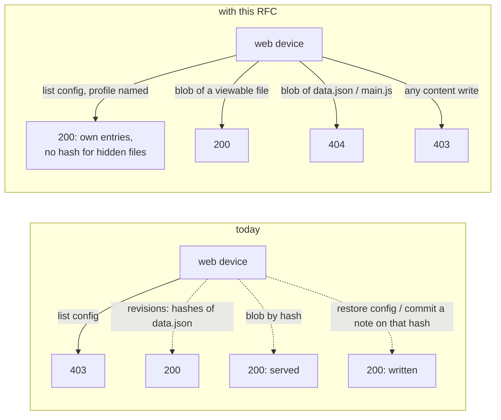
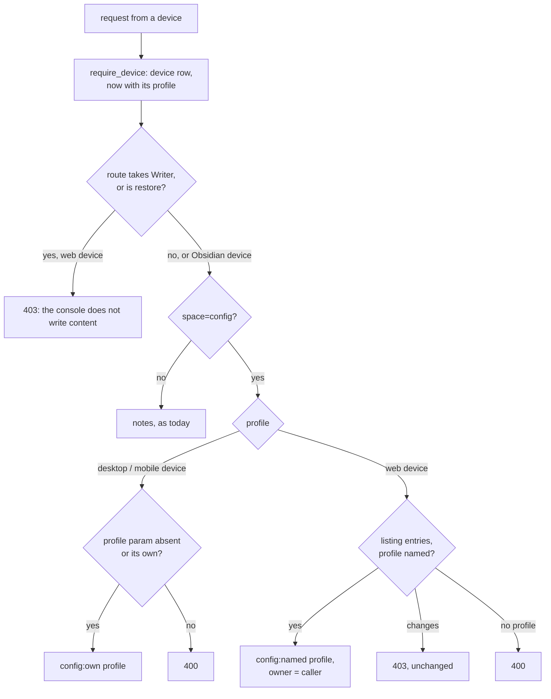
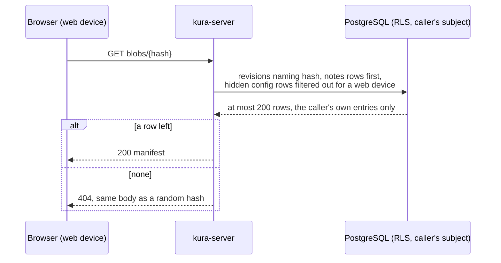
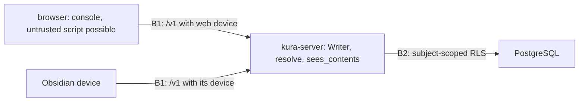

# RFC 0008 — The synced Obsidian configuration in the console

| Field | Value |
| --- | --- |
| Status | Implemented (2026-11-18) |
| Short | Configuration view |
| Settles | How a member sees, from a browser, which Obsidian configuration files sync for them, per device profile, and reads the ones that hold no secret |
| Author | Maxime (batleforc) |
| Co-author | Claude Opus 5.5 |
| Created | 2026-11-18 |
| Supersedes | — (amends RFC 0003 §6.2: a web device lists and reads its owner's configuration, and writes no content at all) |
| Touches | `crates/kura-core` (`config.rs`), `crates/kura-server` (`app/device.rs`, `app/reader.rs`, `app/space.rs`, `app/changes.rs`, `app/commits.rs`), `crates/kura-server/tests/config.rs`, `docs/api/openapi.json`, `ui/` (`vaults.ts`, `router.ts`, `synced.ts`, `pages/ConfigPage.vue`, strings, e2e), `tests/heavy/config-view.sh`, `.tasks/test.yaml`, `docs/operator.md`, RFC 0003 §6.2 (pointer) |
| Risk | medium |

> **Reference material**, about 6,200 words. For the decision, read §1, §3,
> §4.5, §7.1 and §15; the rest is the design to build and review against.

---

## 1. Summary

With `configSync` on a vault, each member's `.obsidian` (plugins, snippets,
themes, `hotkeys.json`) syncs per device profile, `desktop` or `mobile`,
and never between members [R1]. Nobody can see what is synced without
opening Obsidian on a device of that profile: the console's web device is
refused the configuration listing [R2][R3].

This RFC lets the console **list** the caller's own configuration, for each
profile, plugins named by their manifest, and **show the text** of the
files that cannot hold a secret: snippets, theme CSS and manifests, plugin
manifests and styles, `hotkeys.json`. A plugin's settings (`data.json`)
and code (`main.js`) are listed, never fetched by a browser: the server
withholds their hashes and refuses their content to a web device. The web
device, which writes no content today in practice, is refused every content
write by the server.

### Before / after

```text
# today — console, vault "obsidian"
GET  /v1/vaults/{v}/entries?space=config                 (web device)
→ 403 insufficient_role "configuration is served to Obsidian devices only"
GET  /v1/vaults/{v}/entries/{e}/revisions                (web device, own config entry)
→ 200, every revision with its blob hash
POST /v1/vaults/{v}/entries/{e}/restore                  (web device, own config entry)
→ 200, the configuration is rewritten on every device of the profile

# with this RFC
GET  /v1/vaults/{v}/entries?space=config&profile=desktop (web device)
→ 200 { items: [ { path: "snippets/wide.css", blob: "…", … },
                 { path: "plugins/dataview/data.json", (no blob), … } ] }
GET  /v1/vaults/{v}/blobs/{hash of snippets/wide.css}    → 200 (manifest)
GET  /v1/vaults/{v}/blobs/{hash of plugins/dataview/data.json} → 404, as a random hash
POST /v1/vaults/{v}/commits, restore, any upload         (web device) → 403
```



The diagram shows the one widened read (listing) and what narrows: today a
web device can learn the hashes of its owner's configuration through the
history route, read any of them, and restore configuration or commit a note
that reuses a hash [R4][R13][R14]; after this RFC it sees viewable content
only and writes nothing.

---

## 2. Motivation

1. **Nobody can check what syncs.** The categories are set on the vault
   [R1], the plugin filters with `kura_core::config::category` [R5], and a
   last write wins with no conflict file [R1]. To know whether a snippet
   reached the server, or which version of `hotkeys.json` the mobile
   profile holds, a member must open Obsidian on a device of that profile.
2. **The console is refused even the list.** `space::resolve` returns
   `403` for a `web` device [R2], asserted by
   `a_web_device_never_gets_the_configuration_space` [R3]; RFC 0003 made the
   console hold no configuration so it could never push one [R6].
3. **A browser can already read plugin secrets.** The refusal guards the
   listing only. `get_revisions` returns every revision's blob hash under
   the caller's subject, configuration entries included [R13], and
   `ReadAccess::sees_contents` serves any hash a visible row names [R4],
   which row-level security makes the owner's own configuration [R7]. Some
   plugins keep API tokens in `data.json`; a browser tab is the client RFC
   0003 trusts least (T8, T14) [R6].
4. **A browser can already write configuration.** `restore_revision` takes
   any `DeviceCaller` with the editor role and rebuilds the configuration
   space from the entry's own namespace, never asking `resolve` [R14]; and a
   device's commit may name any stored blob, since only a scoped token must
   prove it uploaded it [R15]. RFC 0003's "the console never writes
   configuration" holds by the console's code, not by the server.

---

## 3. Goals / non-goals

**Goals**

- A member lists, in the console, their own synced configuration of a
  vault, per profile and per category, plugins named and versioned, with
  each file's size.
- They read the text of a file that cannot hold a secret, and see when and
  from which device it last changed.
- A browser never receives a plugin's settings or code, nor their hashes,
  whether through the page or a hand-made request.
- The server refuses every content write from a web device.

**Non-goals**

- **Editing or deleting a file from the console**: a change would reach
  every device of the profile, and plugin code arrives disabled only
  because the device asks (decision 34) [R1]; the console has no such step.
- **Another member's configuration**, including for a manager or an owner:
  decision 34 keeps it per user [R1]; a manager learns nothing new here.
- **`data.json` with secrets masked**: its shape is the plugin's; a
  redaction rule that misses one key leaks it (question 4).
- **Which plugins each device agreed to run**: that consent is kept on the
  device, in the Kura plugin's own settings, not on the server [R8].
- **A restricted viewer's configuration** (RFC 0005): the listing applies
  the caller's path scope to every space [R16], so configuration paths,
  under no shared folder, are never theirs; the console hides the page when
  `Vault.paths` is set [R9].
- **Applying a snippet or theme to the console**: shown as text only, T4.
- **A live view**: the page lists, it does not follow (question 5).

---

## 4. User-facing design

### 4.1 Configuration

No new setting. The page exists for a vault whose `configSync` lists at
least one category [R9]; a vault without it has no configuration space and
no page. There is deliberately no switch to let a browser read `data.json`
or let the console write.

### 4.2 Behaviour rules

- The list is the caller's own entries of `config:desktop` or
  `config:mobile`, the profile in the page's URL (`?profile=`, `desktop`
  when absent); a profile nobody synced yet is an empty list, not an error.
- Only live files are listed; a deleted file is absent, as in the notes
  tree.
- A file is **viewable** when its path, compared without regard to case as
  `category` does [R5], is one of: any `.css` file under `snippets/`;
  `themes/<name>/theme.css`; `themes/<name>/manifest.json`;
  `plugins/<id>/manifest.json`; `plugins/<id>/styles.css`;
  `hotkeys.json`. Everything else, `data.json` and `main.js` first, is
  hidden: listed with its size, its `blob` omitted for a web device.
- Plugins are listed one by one under their folder id, with the `name` and
  `version` of their `manifest.json` when it is synced, at most 16 KiB,
  valid JSON and with string fields (each cut to 100 characters).
  Otherwise the id alone, with the reason in words (no manifest synced,
  too large, unreadable). Each manifest is fetched and parsed on its own:
  one failure leaves that plugin by its id, never the others. Past 200
  plugins, the rest are listed by id with no manifest fetched.
- Sizes come from the listing, so the 16 KiB and 256 KiB limits are applied
  before any content is fetched. A viewable file over 256 KiB is listed and
  not shown ("too large to show here").
- Text is decoded as UTF-8 with replacement and shown as text, never as
  HTML or style.
- The open file is in the URL (`?profile=desktop&file=snippets/wide.css`):
  Back closes it, a reload reopens it, a link to it works for its owner.
- An answer for a profile or a file no longer selected is dropped.
- An Obsidian device may send `profile` only equal to its own registered
  profile; absent, as today, means its own.

### 4.3 Validation

Rejected on input:

| Condition | Rationale |
| --- | --- |
| `space=config` from a web device without `profile` | The web device has no profile of its own; guessing one would show the wrong list without saying so (`400 invalid_request`) |
| `profile` other than `desktop` or `mobile` | Only those namespaces exist [R2] (`400 invalid_request`) |
| `profile` from an Obsidian device that is not its own | Its sync reads its own namespace only (`400 invalid_request`); today the parameter is ignored, see §13 |
| `space=config` on `changes` from a web device | The page needs no change feed (`403`, unchanged; question 5) |
| Any content write from a web device: commits, restore, blob and chunk uploads, `missing` | The console writes no content (`403 insufficient_role`, "the console does not write content") |
| A restore of a configuration entry whose namespace is not `config:{the device's profile}` | One rule for restores: a device rewrites its own profile only (`403`) |

No warning: nothing here degrades instead of failing.

### 4.4 API surface

| Method | Path | Auth | Who may call | Limit |
| --- | --- | --- | --- | --- |
| `GET` | `/v1/vaults/{v}/entries?space=config&profile=…` (`changes::get_entries`, changed) | bearer + `X-Kura-Device` | any device of a viewer or above, own entries only; a web device now included; `blob` omitted for a hidden file to a web device | pages of 1 000, as today |
| `GET` | `/v1/vaults/{v}/entries/{e}/revisions` (`commits::get_revisions`, changed) | as today | as today; `blob` omitted, to a web device, on a revision whose path or entry is a hidden configuration file | as today |
| `GET` / `POST` | `blobs/{hash}`, `chunks/{hash}`, `blobs/batch`, `chunks/batch` (unchanged routes) | as today | a web device: no content of a hidden configuration file | as today |
| `POST` / `PUT` | every route taking a `Writer` (`commits`, `missing`, uploads, `PUT blobs/{hash}`) | as today | refused to a web device | — |
| `POST` | `/v1/vaults/{v}/entries/{e}/restore` (`commits::restore_revision`, changed) | as today | refused to a web device; a configuration entry only in the device's own profile | as today |

No field is added to the wire types (question 7); `blob` is already
optional on `EntryState` and `RevisionInfo` [R17]. The spec is regenerated
by utoipa (new `profile` parameter, new `403` answers) and the console's
client by HeyApi.

### 4.5 Mocks

**Vault menu — a member, and a manager, on a vault with `configSync`**

```text
 obsidian (member)          obsidian (manager)
   Overview                   Overview
   Notes                      Notes
   Configuration   ← new      Configuration   ← new
                              Access
                              Keys
                              Notifications
```

Decides the place, next to Notes since both are the vault's files, and that
it is every member's, not a manager's. Absent when `configSync` is empty or
for a restricted viewer.

**Configuration — nominal**

```text
 dev / obsidian ▸ Configuration
 Your Obsidian settings that sync with this vault. Only you see them.

 Desktop | Mobile                (links; the current one bold, aria-current)
 Synced here: plugins, snippets, themes, hotkeys

 SNIPPETS
   wide.css                                1.2 kB
 THEMES
   Minimal/theme.css                      84.0 kB
   Minimal/manifest.json                   0.3 kB
 PLUGINS (2)
   Dataview 0.5.68 · dataview
     manifest.json                         0.4 kB
     styles.css                            2.1 kB
     main.js                               2.3 MB   code, not shown
     data.json                             0.9 kB   settings, not shown
   tasks-x · its manifest is not synced
     main.js                               1.1 MB   code, not shown
 HOTKEYS
   hotkeys.json                            1.0 kB
```

Decides the grouping by category, the profile as two links, the plugins
under their name and version, and that a hidden file is a row of text with
its reason, not a link (it cannot be opened, so it takes no focus). A
viewable row is a link to `?file=`. Category names are translated; a
category the vault does not sync is named under the list: "Not synced on
this vault: themes".

**Configuration — a file open**

```text
 ◂ Back to the list                         snippets/wide.css
 Last edited Nov 18, 2026 by desk-linux

 .markdown-preview-view { max-width: 60rem; }
```

Decides that the text is plain (monospace, no colouring of CSS), and
reuses the reader's last-edit line (`reader.lastEditedBy`) [R18].

**Configuration — loading, too large, empty**

```text
 Loading…

 Minimal/theme.css — too large to show here (384.0 kB; the limit is 256 kB).

 Desktop | Mobile
 Nothing synced from this profile yet. Open the vault in Obsidian with the
 Kura plugin on a computer (Desktop) or a phone or tablet (Mobile) to sync
 its settings.
```

Decides the loading line (the console's `state.loading`), the size reason,
and one empty text for both profiles.

**Configuration — a hidden file, explained**

```text
 data.json — settings, not shown
 A plugin's settings can hold its passwords or API keys: they stay on your
 devices and are never shown in a browser.
```

Shown once under the list when a hidden settings file is in it; it explains
the refusal of §6.P observation 3 as the user meets it.

**Configuration — error, and a page that does not apply**

```text
 ┌────────────────────────────────────────────┐
 │ Could not load your configuration          │
 │ The server is unavailable for now.         │
 │ [ Retry ]                                  │
 └────────────────────────────────────────────┘

 This vault does not sync Obsidian settings.     (configSync empty, by URL)
 This page is not available to you.              (restricted viewer, by URL)
```

The error block is the console's `AsyncState` (title, the problem's text,
Retry) [R18]; a `400` from §4.3 cannot come from the page, which always
names a profile, and shows the same block. Opened by URL where it does not
apply, the page says why in one line, as the console's `ForbiddenState`
does.

---

## 5. Architecture

### 5.1 The web device on the server



The profile is read once, where the device row already is
(`require_device` [R19]), and carried on `DeviceCaller`: `resolve` and
`ReadAccess` read it from there, with no new query. A device row that
cannot be read is already a refusal there; nothing defaults to "not web".
Writes are refused in `Writer::from_request_parts` [R15], so a write route
added later refuses the console by default, and in `restore_revision`,
which takes a `DeviceCaller`.

### 5.2 Content gate



**Invariant:** a web device can neither read nor make readable the bytes of
a hidden configuration file. It cannot read them, because every content
route goes through `sees_contents` [R4], which for a web device drops each
configuration row whose path or head is hidden. It cannot learn their hash
from Kura, because the listing and the history omit it (§4.4). And it
cannot make them readable another way, as by committing a note on that
hash, because it writes no content (§5.1). A hidden file whose bytes
equal a viewable file's or a note's is served through that file: the same
bytes, as T16 already accepts for prefixes [R4].

The filter runs in SQL, inside the window that keeps 200 rows per hash,
with notes rows ordered first: a hash many hidden revisions share can never
push out the note or viewable row that should serve it [R4].

---

## 6. Detailed design

### 6.1 `kura-core`

- `config::viewable(path) -> bool` in `crates/kura-core/src/config.rs`,
  beside `category` [R5]: the list of §4.2, case-folded as `category` is.
  Unit tests: each pattern, `data.json`, `main.js`, `weebo-kura`'s files,
  `SNIPPETS/A/B.CSS` (viewable), `themes/x/other.json` (hidden). The server
  keeps its own `space::category` [R2]; `viewable` is used by the server
  only, so there is one copy of the rule that enforces.

### 6.2 Server

- `app/device.rs`: `require_device` selects `profile` in its existing query
  [R19]; `DeviceCaller` gains `profile: Profile`.
- `app/reader.rs`: `Writer::from_request_parts` refuses a web device;
  `ReadAccess` gains a required `web: bool` (no `Default`), set by
  `Reader::access` from the caller and `false` for a key; `sees_contents`
  selects `e.namespace`, and for a web device adds to both queries
  `AND (e.namespace = 'notes' OR (viewable path and head))`, with the
  viewable test as a parameterised SQL predicate generated from the same
  list and checked against `viewable` by a test, and orders each window by
  `(e.namespace = 'notes') DESC`.
- `app/space.rs`: `resolve` takes the `DeviceCaller`'s profile instead of
  querying it, and `Use::{List { profile }, Changes}`; `changes::open`
  passes it on. `post_commit` no longer needs the web branch: `Writer`
  refused it first.
- `app/changes.rs`: `EntriesQuery` gains `profile: Option<String>`;
  `get_entries` passes `Use::List`, `get_changes` `Use::Changes`; to a web
  device, `blob` is `None` on a hidden configuration entry.
- `app/commits.rs`: `get_revisions` omits `blob`, to a web device, on a
  revision of a hidden configuration path or entry; `restore_revision`
  refuses a web device, and a configuration entry whose namespace is not
  `config:{the caller's profile}`.

### 6.3 Console

- `ui/src/vaults.ts`: `sectionsOf` adds `vault-config` when
  `configSync` is non-empty and `paths` absent; `sectionOf` knows it (today
  an unknown route counts as Notes [R18]). `router.ts`: the route
  `vault-config` at `/vaults/:v/config`, `ConfigPage.vue`.
- The list from `getEntries` with `space: "config"` and the profile, grouped
  by a mirror of `category` (a few lines, tested on §6.1's cases); a
  hidden file is one whose `blob` is absent while `deleted` is false.
- Manifests: one `fileBytes` call each [R10], up to 200, at most four at a
  time, each in its own `try`; `JSON.parse`, only string `name` and
  `version` kept, shown by text binding.
- A viewable file: `fileBytes` (`cache: "no-store"` [R10]), decoded with
  `TextDecoder` (non-fatal) into a `<pre>` by text binding; the last change
  from `getRevisions`, as the reader's last-edit line.
- A size formatter on `Intl.NumberFormat` with `style: "unit"` (`kB`, `ko`
  in French); none exists yet.
- Strings in `en.json` and `fr.json`.

### 6.P Proof against a real client

Suite `tests/heavy/console.sh` (§6.P of RFC 0003), the console built
(`task ui:build`) and served by `task dev:run`, driven by Playwright 1.64.1
[R20] with the Chromium it installs; the CLI pushes the desktop profile,
since `kura sync` syncs `.obsidian` as `desktop` [R1]. Vault
`suite-config`, never `obsidian`.

1. alice's CLI syncs a folder whose `.obsidian` holds `snippets/s-$$.css`,
   `plugins/p-$$/manifest.json` (name `Probe $$`) and
   `plugins/p-$$/data.json`. In Chromium, signed in as alice, the
   Configuration page of `suite-config`, Desktop, lists the snippet and the
   plugin as `Probe $$`; opening the snippet shows its text and her CLI's
   device name.
2. The `data.json` row reads "settings, not shown"; Playwright's request
   log has no `blobs/…` or `chunks/…` request for it, and the `entries` and
   `revisions` answers the page received hold no `blob` for it.
3. With alice's web device id and token, `curl` `GET blobs/{hash of
   data.json}` (the hash taken from her CLI's state) answers `404` with a
   body byte-identical to a random hash's; the same request with her CLI
   device answers `200`.
4. With the same web device, `POST commits` putting `x-$$.md` on that hash
   answers `403 insufficient_role`, and so does `POST
   entries/{snippet}/restore`; the vault's `head_seq` is unchanged.
5. bob, signed in, opens the same page: Desktop lists none of alice's
   files; `GET entries?space=config&profile=desktop` from his web device
   holds no `s-$$` path.
6. A scoped token on `suite-config` asking `space=config&profile=desktop`
   answers `403`, as today.

**Deliberately untouched**, so reviewers do not go looking:

- `crates/kura-server/migrations/0001_init.sql` — the RLS policy
  that hides another member's configuration [R7] is relied on, not changed.
- `plugin/src/plugins.ts` — the per-device consent to run plugin code [R8]
  is not read or shown.
- `ui/src/reader/` — configuration is not rendered by the note reader or
  its frame; it is text in the page.
- `crates/kura-server/src/app/search.rs` — the index covers `notes` only
  [R11].
- `crates/kura-server/src/app/events.rs` — the vault socket carries `seq`
  numbers only, no path or hash [R21].

---

## 7. Security

**Rating:** medium — it widens what a browser may list, of the owner's own
data only; it narrows what a browser may read, and closes the browser's
content writes.

### 7.1 Threat model

Assets: plugin settings (may hold third-party tokens), plugin code, the
integrity of every device's configuration and of the shared notes. Actors:
the member in a browser, script injected into the console (RFC 0003 T8),
whoever next uses a shared computer, another member.



| # | Threat (STRIDE) | Where | Mitigation | Residual risk |
| --- | --- | --- | --- | --- |
| T1 | Information disclosure: a member lists or reads another member's configuration through the console | B1, B2 | Entries, revisions and content read under the caller's subject; RLS `app_tenant` on `entry` [R7]; `resolve` sets the owner to the caller | None known |
| T2 | Information disclosure: a plugin's settings or code reach a browser (injected script, shared computer, hand-made request) | B1 | `sees_contents` drops hidden configuration rows for a web device, in SQL (§5.2); `entries` and `revisions` withhold their hashes; the page never asks; content `no-store` [R10] | Viewable files reach the browser by design; a hash learnt outside Kura (another device's disk) still meets the gate |
| T3 | Information disclosure: the hidden bytes made readable by committing a note on their hash, which also hands them to every member | B1 | `Writer` refuses a web device (§5.1); the hash is not served to it (T2) | An Obsidian device may still commit any stored hash (today's rule [R15]); it already holds the file |
| T4 | Tampering / elevation: the console restores or pushes configuration, so code or settings reach every device of a profile | B1 | `Writer` and `restore_revision` refuse a web device; a restore must match the device's own profile | None: the console holds no other write path (RFC 0003 T7) |
| T5 | Elevation: a synced snippet, theme or manifest runs in the console (CSS `url()` exfiltration, markup in a `name`) | page | Text by framework binding in a `<pre>` or a text node; never `v-html`, never a stylesheet; CSP without inline style [R12] | None known |
| T6 | Information disclosure: an Obsidian device reads the other profile's namespace with `profile=` | B1 | `resolve` refuses a `profile` other than the device's own | None |
| T7 | Denial of service: a large configuration slows the page or the server | B1 | Pages of 1 000 entries as today; limits checked on listed sizes before any fetch; at most 200 manifests of 16 KiB, four at a time; no file over 256 KiB fetched | A member with 10 000 configuration files pages through them |
| T8 | Information disclosure: an editor tests whether a guessed small file exists in another member's configuration, through `missing` | B1 | Refused to a web device (`Writer`); for an Obsidian device unchanged | Existing before this RFC [R22]; noted, not changed |

### 7.2 Authentication and authorisation

Every route is the existing authenticated `/v1` one, with a device header;
a scoped token is refused the configuration space as before (decision 34)
[R2]. Authorisation is on the object: the subject in the transaction, not
a parameter, chooses whose entries are seen. The web profile is read from
the device row the request is already checked against, so it cannot be
claimed by a header. A bypass of the page gains nothing: every gate is the
server's, and each fails closed (a write refused, a row dropped, a hash
withheld).

### 7.3 Input handling and injection

New inputs: `profile`, matched against two literals; paths come from the
database and are compared, never used as file paths or HTML; the viewable
predicate in SQL takes no input from the request. File text and manifest
fields are untrusted and only ever displayed as text (T5).

### 7.4 Secrets and cryptography

No new secret. The change keeps plugin secrets in `data.json` out of the
browser (T2, T3); content stays encrypted at rest as today.

### 7.5 Abuse and resource exhaustion

Covered by T7. The listing filters on the namespace; the `entry_path`
index is `(vault_id, namespace, coalesce(owner_sub, ''), path_key) WHERE NOT
deleted` [R7], of which the listing uses the `(vault_id, namespace)` prefix
(it sorts by `e.id` and leaves the owner to RLS [R16]). The content gate's
query is unchanged in shape: one more predicate and an `ORDER BY` inside a
window it already computes [R4].

### 7.6 Existing defences that still hold

RLS by subject [R7]; `require_device` binding a device to its subject and
session (RFC 0003 §6.2) [R19]; `no-store` [R10]; the CSP without inline
style [R12]; plugins received disabled until agreed on the device [R8];
the 5 s statement timeout on the gate's query [R4].

---

## 8. Supply chain

No new dependency, image, action or tool: the page uses Vue, the HeyApi
client, `TextDecoder` and `Intl`, already in the console; `task audit` is
unchanged.

---

## 9. Data and privacy

No new datum is stored. Configuration text, the member's own, now reaches
their browser memory for viewable files only, never its HTTP cache
(`no-store`) [R10]; it is not logged, and nothing leaves the instance.

---

## 10. Operability

### 10.1 Observability

- **Metrics**: none new; the routes are counted by the existing HTTP
  metrics per route.
- **Logs and audit trail**: refusals are `403`/`404` problems as for every
  route; reads are not audited, as note reads are not (RFC 0005). The
  write refusal of a web device is a `403` before any work; no write path
  is added, so no audit event is.
- **Alerts**: none; nothing here is worth waking anyone.

### 10.2 Failure modes

| Failure | Detected by | Behaviour | Recovery |
| --- | --- | --- | --- |
| PostgreSQL down | the page's error block | fails closed: nothing listed or shown | Retry |
| Object store or the vault key store down | the open file's error block | the list shows (it is database only); opening a file fails | Retry |
| The device row unreadable | `require_device` | the request fails, as every device request does today: no route treats the caller as "not web" | Retry |
| One manifest unreadable or refused | the page | that plugin listed by its id with the reason; the others unaffected | none needed |
| The gate's query slow | the 5 s statement timeout | `5xx`, content not served (closed) | Retry |

### 10.3 Performance and capacity

No new query on any route: the profile rides on the device row already
read, and the gate adds a predicate and an order to its existing query. One
listing page per profile opened; manifests fetched once per page load, at
most 200 of at most 16 KiB (3.2 MiB, under the batch limits [R22]); a file
read only on a click.

---

## 11. Other concerns

- **Accessibility**: the profiles are links with `aria-current`, as the
  vault menu's sections are [R18]; the list has a heading per category;
  a hidden file's reason is text and the row takes no focus; "Back" returns
  focus to the file's row. The diff gets the `accessibilite-check` review
  agent (RGAA 4 / WCAG 2.1 AA) before merge.
- **Internationalisation**: every string, category names included, in
  `en.json` and `fr.json`; dates by the reader's formatter, sizes by the new
  `Intl` one (`kB` / `ko`).
- **Compliance**: none touched beyond the access control evidence of T1 to
  T4.
- **Licensing**: unchanged.
- **Documentation**: `docs/operator.md`, "Obsidian configuration": the
  console view, what it never shows, and that the console writes no
  content; RFC 0003 §6.2 gains a pointer here.

---

## 12. Alternatives considered

| Alternative | Why rejected |
| --- | --- |
| Do nothing | Motivation 1 stays, and motivations 3 and 4 (a browser reading `data.json` by hash, restoring configuration) stay open |
| Phase 1 alone, and a `kura config ls` in the CLI | Closes motivations 3 and 4 and gives a listing, but on a machine with the CLI and a device grant: the person who asked wants it in the browser they already use (motivation 1) |
| Hide `data.json` in the page only | A hand-made request or injected script still gets it (T2); the gate must be the server's |
| Show `data.json` with values masked | The shape is each plugin's; one key the rule misses is a leaked token (question 4) |
| Prove possession for a web device's commits, as for tokens [R15], instead of refusing them | Keeps a write path the console does not use, and a rule to get right on every write route; a refusal in `Writer` covers routes added later (question 6) |
| A `viewable` field on `EntryState` | A shared wire type persisted in clients' journals [R17] grows for one page; the absent `blob` already says it (question 7) |
| Let the console write (edit a snippet) | Reaches every device of the profile with no on-device step; out of scope (non-goals) |

---

## 13. Rollout and compatibility

- **Default behaviour**: a vault without `configSync` is unchanged. With
  it, the page appears. Obsidian devices see no change: no field is added,
  and `profile` is not sent by any client today.
- **Deliberate changes**: a web device's content writes, which the console
  never makes, now answer `403`; `profile` from an Obsidian device, ignored
  today, is checked; a mobile device can no longer restore a desktop
  configuration entry (today it can [R14]).
- **Migration**: none.
- **Operator prerequisites**: none.
- **Rollback**: revert the release; nothing persisted. Rolling back reopens
  motivations 3 and 4, today's state.
- **Feature flag**: none; the page is behind `configSync`, which is
  already opt-in per vault.

---

## 14. Test plan

- **Unit** (`crates/kura-core/src/config.rs`): `viewable` cases of §6.1;
  (`crates/kura-server/src/app/reader.rs`) the SQL predicate agrees with
  `viewable` on the same cases.
- **Integration** (`crates/kura-server/tests/console.rs`, `config.rs`):
  `a_web_device_never_gets_the_configuration_space` extended: `changes`
  still `403`, `entries` with a profile now `200` with the caller's own
  entries; `a_web_device_needs_a_profile` (`400`);
  `an_obsidian_device_reads_its_own_profile_only` (T6);
  `a_note_sharing_bytes_with_hidden_configuration_stays_readable` (a note
  and 200 hidden revisions on `{}`: the web device reads the note).
- **Proof**: §6.P.
- **Security**: T1 `config_namespace_hidden_from_other_member` extended
  with a web device; T2 `a_web_device_never_reads_plugin_settings_or_code`
  (single blob, single chunk, both batches: `404` identical to a random
  hash; `entries` and `revisions` hold no hash for them); T3
  `a_web_device_cannot_commit_a_note_on_a_hidden_hash`; T4
  `a_web_device_never_writes_or_restores` (commit, restore, `missing`,
  uploads: `403`; new behaviour, no existing test to change) and
  `a_device_restores_its_own_profile_only`; T5
  `ui/src/pages/config-page.spec.ts` "shows a snippet as text" and "shows a
  manifest name with markup as text"; T6 above; T7 "does not fetch a file
  over 256 KiB" and "lists a plugin by its id when its manifest is over
  16 KiB, not JSON, or has a non-string name, and the others still by
  name".
- **Console** (a new `ui/src/vaults.spec.ts`): `sectionsOf` with and without
  `configSync` and `paths`; `sectionOf("vault-config")`.
- **Audit**: `task audit` green, unchanged.
- **Existing suites** that must pass unchanged: `tests/heavy/sync.sh` and
  the config tests (Obsidian devices sync and restore as before),
  `tests/heavy/reader.sh` (the notes content gate), the restore tests of
  `tests/config.rs`.

---

## 15. Decisions and open questions

### Resolved

| # | Question | Decision |
| --- | --- | --- |
| 1 | What the view offers | **A list, and the text of files that hold no secret; no write.** The owner's choice on 2026-11-18. |
| 2 | RFC or amendment | **An RFC first**, since it revisits RFC 0003 §6.2. The owner's choice on 2026-11-18. |
| 3 | The viewable list | **As in §4.2, `plugins/<id>/styles.css` shown; and the plugins listed one by one with their name and version.** The owner's choice on 2026-11-18: CSS is code only for a browser that applies it, which this page never does. |
| 4 | `data.json` masked rather than hidden | **Hidden.** The owner's choice on 2026-11-18, as recommended: a mask that misses one key leaks it. |
| 5 | `changes` for the web device | **Refused.** The owner's choice on 2026-11-18, as recommended: the page lists, it does not follow. |
| 6 | How a web device is kept from making hidden bytes readable (last review, blocker of the security and code quality lenses) | **Every content write refused to a web device in `Writer` and `restore_revision`, and hidden hashes withheld from it in `entries` and `revisions`.** The owner's choice on 2026-11-18, as recommended: the console writes no content, and the extractor covers routes added later. |
| 7 | `viewable` on the wire, or not (code quality and stability lenses) | **No new field**; a hidden file is one whose `blob` is withheld. The owner's choice on 2026-11-18, as recommended: `EntryState` is persisted in clients' journals. |

### Still open

None.

---

## 16. Implementation phases

| Phase | Content |
| --- | --- |
| 1 | The profile on `DeviceCaller`; `Writer` and `restore_revision` refuse a web device, restore keeps to the device's profile; `viewable`, the SQL gate in `sees_contents` with its ordering, hashes withheld in `revisions`; their tests. Useful alone: closes motivations 3 and 4 before any listing opens |
| 2 | `resolve` without its own profile query, `Use` and `profile`, hashes withheld in `entries`; spec and client regenerated; tests |
| 3 | The console page, `sectionsOf`/`sectionOf`, the route, the size formatter, strings, specs, `docs/operator.md`; §6.P in `tests/heavy/console.sh` |

Each phase leaves the tree green: phase 1 changes no answer an existing
client relies on (the console makes none of the refused writes, and no
test reads configuration from a web device), phase 2 only adds.

---

## 17. References and sources

| # | Source | Pinned at | Supports |
| --- | --- | --- | --- |
| R1 | `docs/operator.md:324-338` "Obsidian configuration"; RFC 0001 decision 34 (Accepted) | `833a813` | §1, §2.1, non-goals, §6.P |
| R2 | `crates/kura-server/src/app/space.rs:48-110` (`category`, `resolve`, the `web` refusal at `:94`, the profile query at `:87`) | `833a813` | §1, §2.2, §4.3, §6.1, §7.2 |
| R3 | `crates/kura-server/tests/console.rs:258-290` (`a_web_device_never_gets_the_configuration_space`) | `833a813` | §1, §2.2, §14 |
| R4 | `crates/kura-server/src/app/reader.rs:74-122` (`sees_contents`: subject transaction, `row_number() OVER (PARTITION BY …)` without order, `n <= 200`, the Rust filter, the 5 s timeout note at `:86`); `app/chunks.rs:429, 715, 821, 911` (every content route through it) | `833a813` | §1, §2.3, §5.2, §7.5, §7.6 |
| R5 | `crates/kura-core/src/config.rs:12-31` (`category`, `synced`) | `833a813` | §2.1, §4.2, §6.1 |
| R6 | RFC 0003 §6.2 and §7.1 T7, T8, T14 (Implemented) | `833a813` | §2.2, §2.3, T4 |
| R7 | `crates/kura-server/migrations/0001_init.sql` (`owner_sub`, the `entry_path` index, the `app_tenant` policy) | `833a813` | §2.3, T1, §7.5 |
| R8 | `plugin/src/plugins.ts:17-20` (consent kept in the plugin's `data.json`) | `833a813` | non-goals, §7.6 |
| R9 | `crates/kura-server/src/app/vaults.rs:44-45` (`config_sync`), `docs/api/openapi.json` `Vault.configSync`, `Vault.paths` | `833a813` | §3, §4.1, §6.3 |
| R10 | `ui/src/reader/content.ts:20-36, 64-110` (`call` with `cache: "no-store"`, `fileBytes`) | `833a813` | T2, §6.3, §9 |
| R11 | `crates/kura-server/src/app/search.rs:263-270` (`namespace = 'notes'`) | `833a813` | §6.P untouched |
| R12 | `crates/kura-server/src/app/ui.rs:58` (`style-src 'self'`) | `833a813` | T5 |
| R13 | `crates/kura-server/src/app/commits.rs:1463-1540` (`get_revisions`, under the caller's subject, `blob` in each item) | `833a813` | §1, §2.3, §4.4 |
| R14 | `crates/kura-server/src/app/commits.rs:1579-1650` (`restore_revision`: `DeviceCaller`, editor, `Space` rebuilt from the entry's namespace, no `resolve`) | `833a813` | §1, §2.4, §13 |
| R15 | `crates/kura-server/src/app/commits.rs:409-433` (possession checked for a `KeyCaller` only, `knows`), `:893-918` (a device's blob checked for existence and size only); `app/reader.rs:167-184` (`Writer`) | `833a813` | §2.4, §5.1, T3, §12, question 6 |
| R16 | `crates/kura-server/src/app/changes.rs:206-230` (`get_entries`: scope `LIKE` patterns and namespace, order by `e.id`) | `833a813` | non-goals, §7.5 |
| R17 | `crates/kura-core/src/wire.rs:140-159, 219-235` (`EntryState.blob`, `RevisionInfo.blob` optional); `crates/kura-core/src/sync.rs:75-76` (`EntryState` persisted in the `Pending` journal) | `833a813` | §4.4, §12, question 7 |
| R18 | `ui/src/vaults.ts:42-77` (`sectionsOf`, `sectionOf` defaulting to Notes); `ui/src/components/ui/AsyncState.vue:24-35`; `ui/src/locales/en.json:90, 118` (`unavailable`, `reader.lastEditedBy`) | `833a813` | §4.5, §6.3, §11 |
| R19 | `crates/kura-server/src/app/device.rs:65-85` (`require_device`, its device row query) | `833a813` | §5.1, §6.2, §7.6 |
| R20 | `ui/package.json` (`@playwright/test` 1.64.1) | `833a813` | §6.P |
| R21 | `crates/kura-server/src/app/events.rs:70-74` (socket messages carry `seq` only) | `833a813` | §6.P untouched |
| R22 | `crates/kura-server/src/app/chunks.rs:28` (`MAX_BATCH_BYTES`, 4 MiB), `:92-131` (`missing_chunks` for a device, vault-wide) | `833a813` | T7, T8, §10.3 |

---

## 18. Revision against the tree (2026-11-18)

### 18.1 What shipped

Phases 1 to 3 at once, uncommitted at the time of writing (to be signed by
the owner): `config::viewable` and `VIEWABLE_LIKE` in `kura-core`; the
profile on `DeviceCaller`, the write refusal in `Writer` and
`restore_revision`, the own-profile restore rule, `resolve` with `Use` and
no query, the SQL gate in `sees_contents`, hashes withheld in `entries` and
`revisions`; the spec regenerated (`profile`, `400`/`403` answers); the
Configuration page, the menu entry, strings in `en` and `fr`.

### 18.2 Divergences from the text

- **The SQL predicate** is the `LIKE` patterns of `VIEWABLE_LIKE` (a
  superset) with `viewable` deciding exactly in Rust, not a predicate
  generated from the list; the unit test `like_patterns_cover_viewable`
  proves the superset never drops a viewable path.
- **Manifests** are read with one `fileBytes` call each, four at a time,
  not one batch pair: each failure stays its own, as §4.2 asks.
- **The proof** is its own suite, `tests/heavy/config-view.sh` (with
  `ui/e2e/config.spec.ts`), in `task test:heavy`, not part of
  `console.sh`; `--api-only` runs its curl half against any server.
- **French strings**: the profile `desktop` reads "Ordinateur"; the last
  edit line has its own keys (`config.lastEdited*`), since the reader's are
  feminine ("Modifiée", a note) and a file is masculine.
- **Fixtures**: five console specs gained `configSync: []` on their mocked
  vaults, a field the API always sends.

### 18.3 What the proof observed

`tests/heavy/config-view.sh` on 2026-11-18 against `task dev:run` at
127.0.0.1:58080, Playwright 1.64.1 with its Chromium: observations 1 to 6
hold as written (`ok` for each, then "RFC 0008 §6.P holds"); in Chromium
the page listed `Probe $$ 1.0.0`, showed the snippet's text and its last
edit, returned focus to its row on Back, and made no request naming the
hash of `data.json`. The suite left no file, device or key behind in
`suite-config`.

### 18.4 Threats against the tests

| # | Test | Holds |
| --- | --- | --- |
| T1 | `tests/config.rs` `a_web_device_lists_and_reads_only_what_holds_no_secret` (another member's console lists nothing, reads nothing); §6.P 5 | As written |
| T2 | the same test (single blob, chunk, both batches, `entries`, `revisions`); `a_note_sharing_bytes_with_hidden_configuration_stays_readable`; §6.P 2, 3 | As written |
| T3 | the same test (a note on the hidden hash: `403`); §6.P 4 | As written |
| T4 | the same test (commit, restore, chunk upload: `403`; a mobile device's restore of a desktop entry: `403`) | As written |
| T5 | `ui/src/pages/config-page.spec.ts` "shows a snippet as text, never as style or markup", the manifest name with markup | As written |
| T6 | `a_web_device_lists_and_reads_only_what_holds_no_secret` (`profile=mobile` from a desktop device: `400`) | As written |
| T7 | `config-page.spec.ts` "does not fetch a file over 256 KiB"; `synced.spec.ts` (manifest limits, four at a time, a failure isolated) | As written |
| T8 | covered by the `Writer` refusal; `missing` is a `Writer` route | Not tested on its own |

`task audit` unchanged (no dependency); the workspace's Rust tests, 143
console tests, `task lint` and `task ui:build` (112.8 kB up front) pass.

