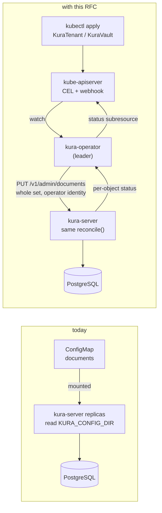
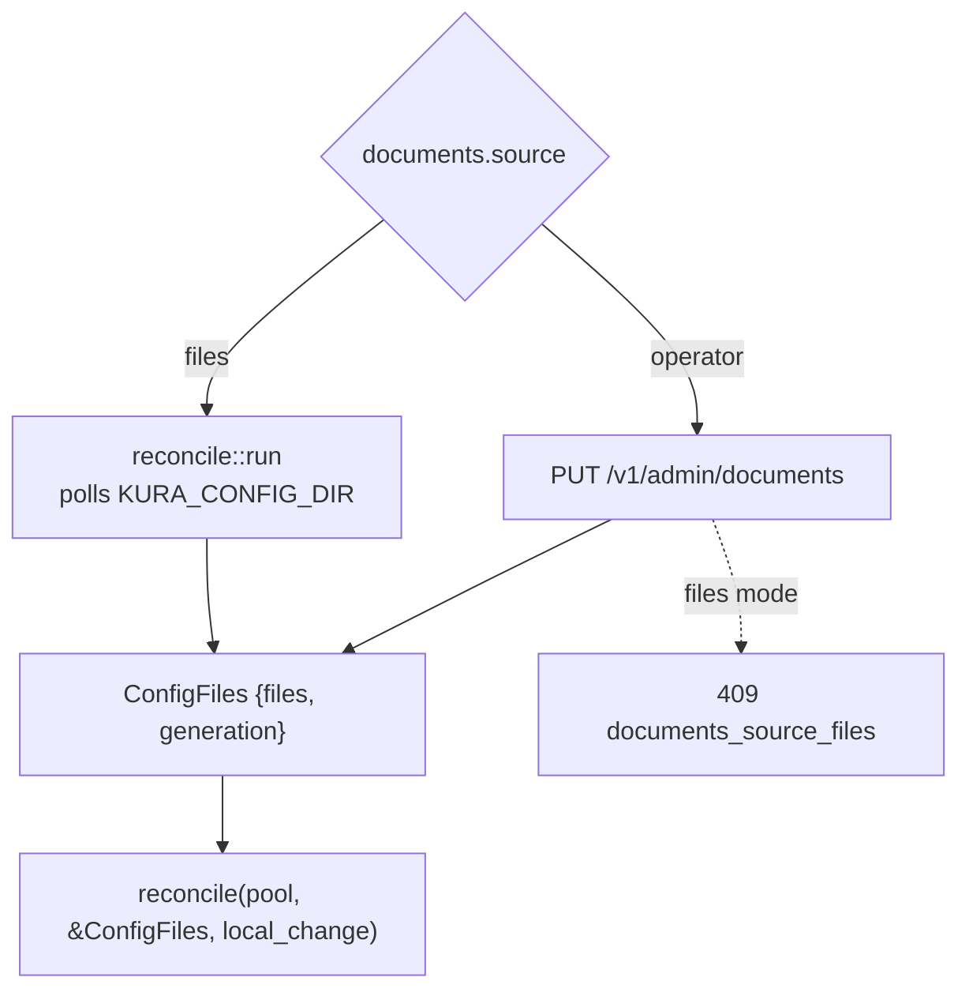
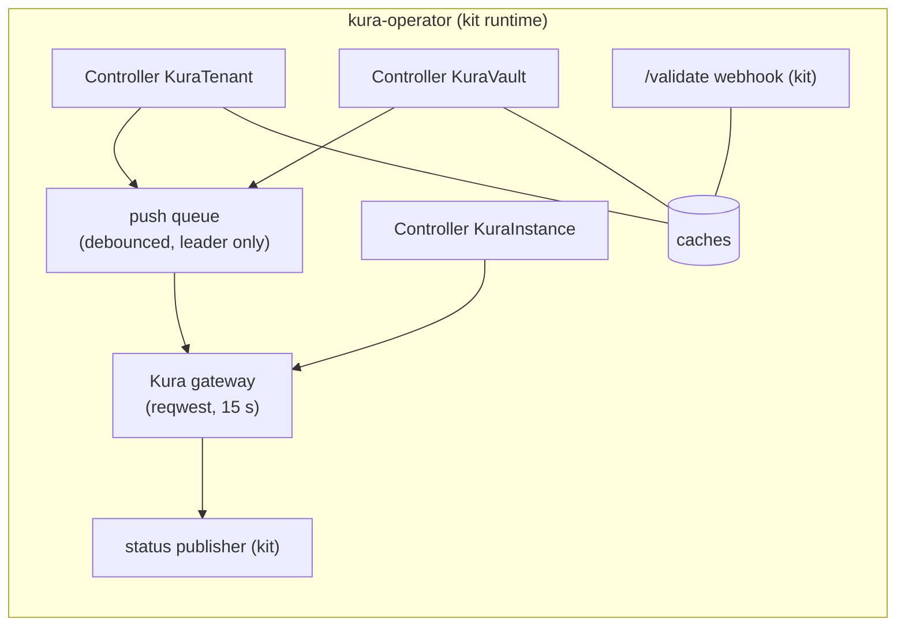
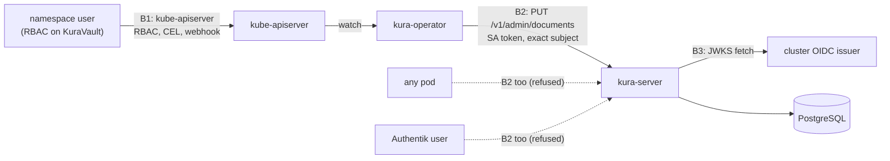

# RFC 0009 — Kura operator

| Field | Value |
| --- | --- |
| Status | Implemented (accepted 2026-11-21, implemented 2026-11-22; §6.P not run on a cluster, see §18) |
| Short | Kura operator |
| Settles | How tenants and vaults are declared as Kubernetes custom resources and reach Kura through an operator built on `weebo-operator-kit`, and what replaces the file loader |
| Author | Maxime (batleforc) |
| Co-author | Claude Opus 5.5 |
| Created | 2026-11-21 |
| Supersedes | — (amends RFC 0001 decision 49 and §14 "Toward the operator": the file loader is kept as the other, exclusive, source; settles decision 51's tenant API) |
| Touches | new `crates/operator/{domain,application,adapters-outbound,adapters-inbound,operator,testkit}` (the kit template's layers), `crates/kura-api` (`crd` feature: `KuraInstance`, status, reason codes; `Metadata.generation`, `pushed_name`), `crates/kura-crdgen`, `crates/kura-server` (`config.rs`, `auth/keys.rs`, new `auth/operator.rs`, new `app/documents.rs`, `app/admin.rs`, `reconcile/`, `metrics.rs`, `limits.rs`, `problem.rs`, `main.rs`, `lib.rs`), new `deploy/charts/kura-operator`, `deploy/helm/kura` (documents source, NetworkPolicy, `extraEnv`), `deploy/crd/`, new `Containerfile.operator`, `.github/workflows/` (`ci.yml`, `security.yml`, `release.yml`), `.tasks/` (new `operator.yaml`, `deploy.yaml`, `release.yaml`, the `--workspace` tasks), `Taskfile.yaml` (the kit's `helm.yaml` as `operator-chart:`), `Cargo.toml` (kit source and tag), `deny.toml`, `mise.toml` (`go`), `fuzz/`, `tests/heavy/operator.sh`, `docs/` (site guides and reference), `docs/api/openapi.json` |
| Risk | high |

> **Reference material**, about 7,400 words. For the decision, read §1, §3,
> §5, §7.1 and §15; the rest is the design to build and review against.

---

## 1. Summary

An operator, `kura-operator`, watches `KuraTenant` and `KuraVault` custom
resources and hands them to Kura. It does not reimplement Kura's rules: each
time a resource changes, it builds the whole set of documents from its cache,
sends that set to a new admin route, `PUT /v1/admin/documents`, and the server
applies it through the code that applies the files today (`reconcile()`:
validation of the whole set, one writer at a time, `deletionPolicy`). The
server answers with the status of every object, which the operator writes on
each resource. A cluster-scoped `KuraInstance` says where the server is and how
the operator proves who it is. The YAML a tenant owner writes does not change:
the documents of today are applied with `kubectl` instead of being mounted from
a ConfigMap.

### Before / after

```text
# today: a ConfigMap of documents, mounted into every replica
$ helm upgrade kura … --set-file documents.tenants\.yaml=tenants.yaml
  # 10 s later each replica re-reads KURA_CONFIG_DIR; one writes PostgreSQL
$ curl -H "Authorization: Bearer $ADMIN" -H "X-Kura-Device: $D" \
       https://kura.example.org/v1/admin/status      # the only place errors show

# with this RFC: the same documents, as resources
$ kubectl apply -f tenants.yaml
kuratenant.kura.weebo.io/maxime created
kuravault.kura.weebo.io/knowledge created
$ kubectl get kuravaults -n maxime
NAME        TENANT   READY   REASON
knowledge   maxime   True    Reconciled
$ kubectl apply -f vault-in-wrong-namespace.yaml
Error from server (Forbidden): admission webhook "validate.kura.weebo.io" denied
the request: VaultNamespaceNotAllowed: namespace `team-b` is not in
vaultNamespaces of tenant `maxime`
```



The new request is the `PUT` from the operator: it is the only new way to
change who may open which vault, so it is authenticated as one named workload
and refused to anything else (§7.2); the write itself stays in `reconcile()`.

---

## 2. Motivation

1. **Errors land where nobody looks.** A bad document today is rejected into
   `GET /v1/admin/status` (`rejection`, `app/admin.rs:22-26` [R1]) and the
   `KuraConfigRejected` alert [R2]; the person who wrote the YAML sees nothing.
   With resources, `kubectl apply` refuses what can be refused at once
   (CEL, webhook) and `kubectl get` shows `Ready` and the reason on the object.
2. **One ConfigMap means one owner.** Every tenant's documents sit in the
   `kura-documents` ConfigMap of the release (`templates/configmap.yaml`
   [R3]): whoever may change one tenant may change all, and a team cannot
   declare its own vault from its own namespace. Resources give Kubernetes RBAC
   per namespace for `KuraVault` and per cluster for `KuraTenant`, which
   `vaultNamespaces` was written for (RFC 0001 §4.1 [R4]).
3. **Decision 51 is due.** RFC 0001 deferred the tenant API to this RFC
   [R4]; until it exists, a tenant can only come from a file baked into a Helm
   release.
4. **The kit's estate.** Every weebo product is driven by an operator on
   `weebo-operator-kit` (decision 49 [R4]); Kura is the one whose
   configuration still rides in a chart value, without the kit's status,
   Events, metrics and release pipeline.

---

## 3. Goals / non-goals

**Goals**

- `KuraTenant` and `KuraVault` are applied as custom resources, in the YAML of
  today, and reach Kura within seconds.
- Each resource shows `Ready` with a reason from Kura's catalogue, and an Event
  on failure.
- What Kubernetes can refuse at admission is refused there: field rules by
  CEL, cross-object rules by the operator's webhook.
- The server stays the only judge: the rules that decide what is stored run in
  the server, on the whole set, as today.
- Only the operator's workload may change the documents; every change is an
  audit event naming it.
- The operator is a kit operator, generated from the kit's operator template
  at the pinned tag and kept in step with `task kit:sync`: the kit's crates,
  runtime, instance resolution, webhook, library chart, metrics, alerts,
  checks and publishing workflows; the only Kura-specific code is the
  gateway to Kura and the push of the set.

**Non-goals**

- **Deploying kura-server.** The `kura` chart installs it and keeps doing so;
  a `KuraInstance` points at a running server, as the kit's instances do for
  Authentik or Forgejo [R5].
- **`KuraLocalInstance`.** Tenants are cluster-scoped and one server serves
  the cluster; a namespaced instance has nothing to scope.
- **Running both sources at once.** Files and resources never merge: two
  sources of one authorization table is how a removed grant survives (§4.2).
- **Retiring the file loader.** Local stacks, tests and installs without the
  CRDs keep it (decision 3, reversing RFC 0001 §14's "the file loader is
  retired").
- **Vaults and bindings created through the API.** They stay `managed_by =
  api`, untouched by the operator, as by the files (`validate/mod.rs:193-199`
  [R6]).
- **Destroying a tenant's Transit key.** Still a human with a separate Vault
  role (decision 33 [R4]); the operator never holds Vault credentials.
- **A per-object admin API** (`PUT /admin/tenants/{t}` …). Rejected in §12:
  it would rebuild the whole-set validation incrementally.
- **Users, groups, devices as resources.** Membership comes from Authentik
  claims; devices are people's, not configuration.

---

## 4. User-facing design

### 4.1 Configuration

The resources are the documents of RFC 0001 §4.1, unchanged; their CRDs are
generated today by `kura-crdgen` into `deploy/crd/` [R7]. New are the instance,
the server's source switch and the operator's identity.

```yaml
apiVersion: kura.weebo.io/v1alpha1
kind: KuraInstance                     # cluster-scoped, one per server
metadata: { name: kura }
spec:
  url: http://kura.kura.svc:8080       # the server's API; https when it leaves the node
  tls: { caSecretRef: { name: kura-ca, namespace: kura-operator, key: ca.crt } }  # kit TlsOptions, optional
  auth:
    serviceAccountToken: { audience: kura }   # decision 4: no secret at rest
```

```yaml
# server.yaml (kura chart: server.documents)
documents:
  source: files            # files (default) | operator
  operator:                # read only when source is operator
    issuer: https://kubernetes.default.svc.cluster.local
    audience: kura
    subject: system:serviceaccount:kura-operator:kura-operator
```

- `documents` absent: `source: files`, today's behaviour, and
  `PUT /v1/admin/documents` answers `409 documents_source_files`. The new
  route is closed unless the operator source is chosen.
- `source: operator`: the file loader does not start, `KURA_CONFIG_DIR` is
  ignored, and the route accepts exactly the configured identity. `issuer`,
  `audience` and `subject` are all required; there is no wildcard subject.
- `spec.auth` absent on the instance is refused by CEL: an operator that
  cannot prove who it is must not be configured as if it could.
- `KuraTenant` and `KuraVault` keep their defaults, all on the closed side
  (RFC 0001 §4.1 [R4]); `metadata.namespace` of a `KuraVault` is now the real
  Kubernetes namespace, which `vaultNamespaces` checks.

### 4.2 Behaviour rules

- **The uninteresting case**: one change to one resource. The operator sends
  the whole set; the server upserts every object with its current values, so
  only the changed one differs, and removes nothing; the resource turns
  `Ready` within the operator's debounce (1 s) plus one round trip.
- **One source.** In `files` mode the operator's pushes are refused (`409`)
  and every resource shows `Ready=False` `SourceIsFiles`; in `operator` mode
  the files are not read. Switching is a server restart (`server.yaml`), and
  the first push after the switch writes the full set (§13).
- **Absence is removal.** A resource deleted is absent from the next set, and
  the server applies its `deletionPolicy` exactly as for a removed file:
  `Orphan` disables, `Delete` disables and purges after 30 days unless it comes
  back, `kura.weebo.io/force-orphan` releases without cleanup
  (`reconcile/mod.rs:241-260` [R8]). No finalizer is needed: the operator never
  has to see a resource disappear to act on it (decision 2).
- **Never an empty set.** The operator does not push before its caches of both
  kinds have synced, and the server refuses a set with no `KuraTenant`, as it
  refuses an empty directory (`validate/mod.rs:264` [R6]).
- **Whole set or nothing.** One invalid resource makes the server refuse the
  whole set, as one invalid file does today; the last valid configuration stays
  in force (RFC 0001 §4.3 [R4]). The operator marks the offending resource
  `Ready=False` `InvalidDocument` with the server's message and the others
  `Ready=False` `SetRejected`, naming it: a refusal is never silent on a
  resource the user did not touch.
- **What is sent.** Each resource becomes a document with `apiVersion`,
  `kind`, `metadata.{name, namespace, labels, annotations}` and `spec`;
  `status`, `uid`, `resourceVersion`, `managedFields` and the last-applied
  annotation are dropped, because `Metadata` refuses unknown fields
  (`spec.rs:19-29` [R7]).
- **Generations.** The server records, per object, the `metadata.generation`
  the operator sent, and the operator writes it as `observedGeneration`
  (status of the kit's shape [R5]).
- **Several operator replicas**: only the kit's leader pushes (Lease 15 s
  [R5]); a stale leader's push is refused by `kura_config_begin`'s generation
  guard (`reconcile/mod.rs:215` [R8]).
- **Several kura-server replicas**: unchanged; one writes, every replica
  authorizes from PostgreSQL (decision 31 [R4]).

### 4.3 Validation

Refused at admission (the user sees it in `kubectl apply`):

| Condition | Where | Rationale |
| --- | --- | --- |
| A field rule: name pattern, quantity format, binding names exactly one of `claimValue` and `subject`, `paths` on `viewer` only | CEL in the CRD (`kura-crdgen` output [R7]) | Field-local; no operator needed |
| `KuraVault` whose namespace is not in its tenant's `vaultNamespaces`, or naming a tenant that does not exist | operator webhook, from its cache | The rule Kura applies; refusing it here saves a round trip and tells the author |
| `KuraInstance` without `spec.auth`, or a second `KuraInstance` | CEL; webhook | One server, one identity |

Refused by the server, shown on the resource (`Ready=False`):

| Condition | Reason | Rationale |
| --- | --- | --- |
| Anything `kura_api::validate()` refuses | `InvalidDocument` (offender), `SetRejected` (others) | The server is the judge; the webhook is a convenience that can be stale |
| A `KuraVault` naming a vault created through the API | `VaultManagedByApi` | A resource never takes over what a person created through the API (`validate/mod.rs:193-199` [R6]); only the server knows which vaults are API-managed, so the webhook cannot refuse it |
| Push in `files` mode | `SourceIsFiles` | One source |
| Server unreachable, `401`, `403` | `InstanceUnreachable`, `InstanceUnauthorized` (kit codes [R5]) | The operator retries with the kit's backoff |

Warnings, and where they are seen:

| Condition | Behaviour | Surfaced in |
| --- | --- | --- |
| A resource created while the webhook was down (`failurePolicy: Fail` refuses it; see §10.2) | — | `kubectl` error |
| Advisory conditions the server already computes (`QuotaBelowUsage`, `RestrictedBindingWidened` [R1]) | copied to the resource | `kubectl get`, `kura_config_warnings`, Event |
| The server removed objects on a push (`Orphan`/`Delete`) | applied | audit log, `KuraDeletionScheduled` [R2], Event on the instance |

### 4.4 API surface

| Method | Path | Auth | Who may call | Limit |
| --- | --- | --- | --- | --- |
| `PUT` | `/v1/admin/documents` | Bearer: a Kubernetes ServiceAccount token (decision 4) | exactly `documents.operator.subject`; `409` in `files` mode | 30/min per subject, body 4 MiB, 2,000 documents |
| `GET` | `/v1/admin/status` | unchanged (platform admin) **or** the operator identity | as today, plus the operator | unchanged (60/min) |

`PUT /v1/admin/documents` takes `{ "documents": [<document>…] }` and answers
`200` with the `AdminStatus` of `app/admin.rs` [R1] whether the set was applied
or refused (`applied: bool` added), so the operator learns the per-object
status in the same round trip. Handler `app/documents.rs::put_documents`,
spec regenerated by utoipa; no console change, so no HeyApi regeneration.

### 4.5 Mocks

**`kubectl get` — nominal, one rejected, source wrong**

```text
$ kubectl get kuratenants
NAME     READY   REASON
maxime   True    Reconciled
family   False   SetRejected

$ kubectl get kuravaults -A
NAMESPACE   NAME        TENANT   READY   REASON
maxime      knowledge   maxime   True    Reconciled
family      recipes     family   False   InvalidDocument

$ kubectl describe kuravault recipes -n family
Status:
  Conditions:
    Type:     Ready
    Status:   False
    Reason:   InvalidDocument
    Message:  KuraVault family/recipes spec.chunking: min 64 to 1Mi, avg 256 to 4Mi, max at least 1Ki, all even
    Observed Generation:  3
Events:
  Warning  InvalidDocument  12s  kura-operator  the set was refused; the last valid configuration stays in force
```

The printer columns are the CRD's (`kura-crdgen` [R7]); the message is the
server's `ConfigError`, path included, so the author fixes the field without
reading server logs.

**`kubectl get` — the server in `files` mode**

```text
$ kubectl get kuratenants
NAME     READY   REASON
maxime   False   SourceIsFiles
$ kubectl describe kuratenant maxime | grep Message
    Message:  kura-server reads its documents from files (documents.source: files); set documents.source: operator to hand them to the operator
```

**`kubectl apply` — refused at admission (the §6.P refusal)**

```text
$ kubectl apply -f recipes.yaml
Error from server (Forbidden): error when creating "recipes.yaml": admission
webhook "validate.kura.weebo.io" denied the request: VaultNamespaceNotAllowed:
namespace `team-b` is not in vaultNamespaces of tenant `family`
$ echo $?
1
```

**`kubectl get kurainstance` — unreachable, then unauthorized**

```text
$ kubectl get kurainstances
NAME   URL                            READY   REASON
kura   http://kura.kura.svc:8080      False   InstanceUnauthorized
```

These decide the wording and the reasons a person reads; no web UI changes
(the console never shows where a document came from beyond `/admin/status`'s
`source`, which becomes `KuraVault/family/recipes` instead of `file#index`).

---

## 5. Architecture

### 5.1 The push

```mermaid
sequenceDiagram
    participant K as kube-apiserver
    participant O as kura-operator (leader)
    participant S as kura-server
    participant P as PostgreSQL
    K->>O: watch event (any KuraTenant / KuraVault)
    Note over O: debounce 1 s; caches synced?
    O->>O: build the set from the caches (sorted, metadata trimmed)
    O->>S: PUT /v1/admin/documents (Bearer SA token)
    S->>S: verify issuer, audience, exact subject, source = operator
    S->>P: kura_config_begin(generation) … reconcile() … commit
    S-->>O: 200 AdminStatus {applied, objects[], rejection[]}
    O->>K: patch status of each resource whose status changed
    O->>K: Events (Warning on Ready=False)
```

It proves the operator holds no rule of its own: what is stored is decided by
`reconcile()` between `kura_config_begin` and `commit`, the function that
handles files today [R8].

### 5.2 The server's two sources



`ConfigFiles` (`reconcile/files.rs:14-19` [R9]) is the seam: the route turns
the pushed documents into `(name, content)` pairs, one per resource named
`KuraVault/<ns>/<name>`, and the generation is the same SHA-256 over them, so
an unchanged set is a no-op exactly like an unchanged directory.

**Invariant**: because both sources end in the one `reconcile()` and only one
is wired at startup, a document cannot be accepted by one path that the other
would refuse, and a grant removed from the resources cannot survive in a file.

### 5.3 The operator inside



The controllers are the kit's skeleton (`controller.rs`, requeue 300 s steady,
30 s doubling on failure [R5]); unlike Forgejo's, they do not write per object
but enqueue one push, because the server takes the set, not the object.

---

## 6. Detailed design

### 6.1 `kura-api`

- `KuraInstanceSpec` with `url`, `tls: Option<TlsOptions>` (kit [R5]) and
  `auth: InstanceAuth { service_account_token: { audience } }`, behind the
  `crd` feature, with its CEL rules; `kura-crdgen` writes
  `deploy/crd/kurainstance.yaml`.
- Reason codes added to `reason.rs` [R10]: `SetRejected`, `SourceIsFiles`,
  `VaultNamespaceNotAllowed`, `TenantNotFound`, `VaultManagedByApi`; the kit's
  `InstanceUnreachable`, `InstanceUnauthorized`, `Reconciled` are reused from
  the template's catalogue [R5]. `InvalidDocument`, defined but never set today
  (finding of the docs review, `reason.rs:17` [R10]), becomes set.
- No change to `KuraTenant`/`KuraVault` specs: the operator serializes them
  through the same `serde` types the server parses (`Document<S>`, `spec.rs`
  [R7]).

### 6.2 `kura-server`

- `config.rs`: `documents: { source, operator: { issuer, audience, subject } }`,
  closed default; startup refuses `operator` without all three.
- `auth/`: a second verifier for the operator only, on the kit's own approach
  to keys: JWKS from `<issuer>/openid/v1/jwks` discovered through
  `<issuer>/.well-known/openid-configuration`, cached, refetched on an unknown
  `kid` at most once a minute, algorithms pinned to `RS256`, `aud` and `iss`
  exact, `exp` checked with 30 s leeway, `sub` compared byte for byte with the
  configured subject. It reuses `auth::keys::Keys` with a `KeySource::Http`
  (`auth/keys.rs` [R11]) and never shares its cache or its principal type with
  user tokens: an operator token cannot reach a user route, and a user token
  cannot reach this one (§7.2).
- `app/documents.rs`: `put_documents` — source check, then identity, then body
  limits, then `ConfigFiles` from the documents, then `reconcile()`; answers
  `AdminStatus` with `applied`. Audit event on every call (applied, refused,
  generation, removed objects, subject).
- `reconcile/`: `run` starts only in `files` mode; `status::build` takes the
  generation per object from the pushed metadata.
- `limits.rs`: `("PUT", "/v1/admin/documents", 30)` keyed by subject.
- `metrics.rs`: `kura_documents_pushes_total{result}` (`applied`, `unchanged`,
  `rejected`, `refused`), bounded labels.

### 6.3 `kura-operator`, generated from the kit

Generated, not hand-written (decision 5):
`cargo generate --git https://github.com/weebo-si-operator/weebo-operator-kit --tag <pinned> templates/operator`
with `product = Kura`, `license = Apache-2.0` [R14], into a scratch
directory, then merged into this workspace. Each generated layer keeps its
role and becomes a member under `crates/operator/`:

| Template crate | In weebo-kura | What it holds here |
| --- | --- | --- |
| `api` | **`kura-api`** (existing, `crd` feature) | `KuraTenant`, `KuraVault`, and `KuraInstance` in place of the template's `<Product>Instance`; the template's `LocalInstance` and example `Object` are deleted, as its comments ask ("replace it with the real kinds") |
| `crdgen` | **`kura-crdgen`** (existing, already the template's shape) | writes the three CRDs and `links.json` |
| `domain` | `kura-operator-domain` | the operator's reason codes through the kit's `reason_codes!` (as `kura-api`'s `ReasonCode` already does, `reason.rs:6` [R10]), the set-building rules |
| `application` | `kura-operator-application` | the "push the set" use case; instance resolution through the kit's `instances.rs` (the only cluster instance by default, `BoundInstance` pinned in status [R5]) |
| `adapters-outbound` | `kura-operator-adapters-outbound` | the Kura gateway in place of the template's `http_gateway.rs` placeholder: `reqwest`, rustls, 15 s timeout as the placeholder [R5], bearer from the projected token re-read on every push; `408`/`429`/`5xx` transient (the kit's requeue), `401`/`403` → `InstanceUnauthorized` |
| `adapters-inbound` | `kura-operator-adapters-inbound` | the controllers on the kit's skeleton (`controller.rs`), the kit's `/validate` (`admission.rs`, fail closed, 403 with a reason code [R5]) calling the cross-object parts of `kura_api::validate()` |
| `operator` | `kura-operator` (the binary) | the kit runtime's wiring: telemetry, leader election, health, metrics, shutdown |
| `testkit` | `kura-operator-testkit` | the template's static gateway factory, the kit's envtest harness |

- The controllers do not write per object as Forgejo's do: each enqueues one
  push, a `tokio::sync::Notify` coalescing events within 1 s, drained by the
  leader only, because the server takes the set.
- Status: `kura-api`'s `Status` gains the kit's `instance: BoundInstance`
  (template `status.rs:9-26` [R5]); one merge patch per resource whose
  conditions changed, the kit's publisher with its 3 retries; Events through
  the kit.
- The generated `.tasks/kit.yaml` is included as `kit:` for `task kit:sync`;
  `task kit:cog` is not run, because `cog.toml` holds Kura's own hooks (it
  would render the kit's over them).

### 6.4 Charts

- New `deploy/charts/kura-operator`, the template's generated chart: one
  include of the kit's `weebo-operator-lib` [R5], RBAC generated (watch the three kinds, patch
  their status, Events, Lease), CRDs under `crds.install` with
  `helm.sh/resource-policy: keep`, webhook Service and certificate, metrics,
  `OperatorDown`/`NoLeader`/`ReconcileErrors` alerts. The projected token
  volume with `audience: kura` and a 1 h expiry is added to the Deployment.
- `deploy/helm/kura`: `server.documents` in values; the NetworkPolicy lets
  the operator's namespace reach port 8080 when `documents.source` is
  `operator` (`templates/networkpolicy.yaml:15-17` [R12] admits only the
  ingress namespace today); `documents` (the ConfigMap) is rendered only in
  `files` mode.

### 6.P Proof against a real client

Client: `kubectl` v1.36 against a kind cluster (Kubernetes 1.36) running the
`kura` chart, the `kura-operator` chart and the dev Authentik; the real
`kura` CLI (this release) as a user; suite `tests/heavy/operator.sh`, new,
beside `tests/heavy/authz.sh`.

1. `kubectl apply -f dev/config/tenants.yaml` (the documents of the local
   stack, unchanged) exits 0; within 5 s `kubectl wait --for=condition=Ready
   kuravault/knowledge -n maxime` succeeds, and `kura attach knowledge` as
   alice lists the vault: the YAML of today works as resources.
2. A `KuraVault` in namespace `team-b`, absent from `vaultNamespaces`:
   `kubectl apply` exits 1 with `denied the request: VaultNamespaceNotAllowed`;
   `kubectl get kuravault -n team-b` finds nothing and the server's audit log
   shows **no** `documents` push for it — refused before any request reached
   Kura.
3. `curl -X PUT` to `/v1/admin/documents` with alice's access token (a
   platform admin) answers `401 invalid_token`, and with a projected token of
   another ServiceAccount answers `403 insufficient_role`; `GET /v1/admin/status`
   shows the generation unchanged both times: no user and no other workload can
   write the documents.
4. With `documents.source: files`, the resources show `SourceIsFiles` and
   the server's `kura_documents_pushes_total{result="refused"}` moves while
   PostgreSQL's `config_state` keeps its generation.
5. `kubectl delete kuravault knowledge -n maxime` (policy `Orphan`): alice's
   next `kura sync` answers the vault is gone (`404`), `kubectl apply` of the
   same file brings it back with its notes: removal is the server's, reversible.
6. `kubectl scale deploy/kura-operator --replicas=0`, then edit a binding:
   the old grant stays in force (Kura keeps the last valid set), `OperatorDown`
   fires; scaling back applies the edit within 10 s.

**Deliberately untouched**, so reviewers do not go looking:

- `crates/kura-server/src/app/vaults.rs` — the API-managed vaults keep their
  routes; the operator never calls them.
- `crates/kura-core`, `plugin/`, `ui/` — clients see vaults and bindings,
  never where their documents came from.
- `crates/kura-api/src/validate/` — not rewritten; the webhook calls it.
- Vault (OpenBao) policies — the operator holds no Vault access.

---

## 7. Security

**Rating:** high — the new route writes the authorization table of every
tenant: who may open which vault, and with which role.

### 7.1 Threat model

Assets: the documents (every grant of every tenant), the notes they protect,
the server's availability. Actors: tenant owners and namespace users with
Kubernetes RBAC, cluster admins, any pod in the cluster, a user with a valid
Authentik token, the operator's workload. Attacker-controlled inputs: resource
specs (anyone with `create` on the kinds), the pushed body (anyone who reaches
port 8080 with a token), the webhook's admission requests.



| # | Threat (STRIDE) | Where | Mitigation | Residual risk |
| --- | --- | --- | --- | --- |
| T1 | Spoofing: a pod or a user presents a token to write the documents | B2 | Operator verifier (§6.2): issuer, audience `kura`, `RS256`, `exp`, `sub` equal to the configured one; user tokens are verified by another verifier that this route never calls; test `documents_refuses_other_identities` | A stolen projected token works ≤ 1 h; accepted (author) |
| T2 | Elevation: a namespace user grants themselves `manager` on a vault | B1 | Intended: `create KuraVault` in a namespace listed by the tenant **is** vault administration; the tenant (cluster-scoped, cluster RBAC) chooses the namespaces. Documented in the guide; test `webhook_refuses_unlisted_namespace` | A cluster admin who binds `kuravaults` to a namespace delegates it; accepted (author) |
| T3 | Tampering: the operator's push modified in transit | B2 | `url` may be in-cluster HTTP; NetworkPolicy admits only the operator's namespace on 8080 (§6.4); `https` with `tls.caSecretRef` for anything leaving the node | In-cluster plaintext readable by a node-level attacker, who owns the pods anyway; accepted (author) |
| T4 | Elevation: the webhook is bypassed (down, `failurePolicy: Ignore`) | B1 | `failurePolicy: Fail` (kit, fail closed [R5]); and the server re-validates the whole set regardless, so a bypassed webhook yields `InvalidDocument`, never a stored invalid grant; test `server_rejects_what_the_webhook_would` | None for integrity; availability of `kubectl apply` depends on the operator (§10.2) |
| T5 | Denial of service: huge or frequent pushes | B2 | Body 4 MiB, 2,000 documents, 30/min per subject, checked before parsing; `reconcile()` is O(documents) | A compromised operator can still churn a valid set; bounded by the rate |
| T6 | Tampering: a stale operator leader pushes an old set over a newer one | B2 | `kura_config_begin` refuses an older writer; the kit's Lease makes one leader; the set is rebuilt from the cache on each push | A partitioned leader may push once before losing its Lease; the next push corrects it |
| T7 | Repudiation: who changed a grant | B2 | Audit event per push: subject, generation, applied, objects removed (`target: "audit"`); Kubernetes audit logs keep who changed the resource | Kura sees the operator, not the human: the Kubernetes audit log is the link; accepted |
| T8 | Info disclosure: the status names tenants and vaults to the operator | B2 | The operator already watches every resource; nothing else is returned | None |
| T9 | Spoofing: the JWKS fetched from a forged issuer | B3 | `issuer` is configured, fetched over the cluster CA (`https://kubernetes.default.svc`), no redirects (as `KeySource::http` [R11]) | — |
| T10 | Elevation: mass removal by an empty or partial set | B2 | Operator pushes only after both caches synced; server refuses a set without a tenant (`validate/mod.rs:264` [R6]); removals are `Orphan` by default and reversible 30 days under `Delete` | A user with `delete` on every resource removes them all — that is their right |

### 7.2 Authentication and authorisation

- `PUT /v1/admin/documents` is unreachable without a token, answers `409` in
  `files` mode **before** reading the token (no oracle on identities either
  way), then requires the operator identity; a platform admin's Authentik token
  is refused: humans change grants through resources, where Kubernetes audits
  them.
- The operator's principal is a separate type (`OperatorCaller`), so no user
  route's extractor accepts it (the compiler refuses the mix), and
  `DeviceCaller` never accepts an operator token (different verifier, different
  issuer).
- `GET /v1/admin/status` admits the operator too, read only.
- No break-glass push (decision 8): a platform admin's token never writes the
  documents; switching `documents.source` to `files` is the way back.
- Kubernetes side: the operator's ClusterRole lists, watches and patches the
  status of the three kinds, creates Events and owns its Lease — nothing else
  (kit-generated RBAC [R5]). It cannot read Secrets: its token is projected,
  not stored.

### 7.3 Input handling and injection

- The body is JSON, bounded (4 MiB, 2,000 documents) before parsing; each
  document goes through `kura_api::parse` with `deny_unknown_fields`, as files
  do; names are RFC 1123 labels (`DnsLabel`), so the `KuraVault/<ns>/<name>`
  source string cannot carry a path separator or a newline into logs.
- The webhook's `AdmissionReview` is parsed by the kit's admission router [R5].
- No URL is taken from a resource: `KuraInstance.spec.url` is set by whoever
  may create the cluster-scoped instance, i.e. a cluster admin.

### 7.4 Secrets and cryptography

- No secret at rest (decision 4): the operator reads a projected
  ServiceAccount token the kubelet rotates; Kura holds none, only the issuer's
  public keys. Token verification uses `jsonwebtoken` with `aws_lc_rs`, as the
  user verifier (Cargo.toml [R13]).
- The token never reaches logs (`BearerToken`'s redacted `Debug`,
  `auth/principal.rs` [R11]).

### 7.5 Abuse and resource exhaustion

- 30 pushes a minute per subject, checked before the body is read; the
  operator coalesces events (1 s) so a burst of `kubectl apply` is one push.
- The JWKS refetch is rate-limited (once a minute on an unknown `kid`), so a
  stream of forged tokens cannot make the server hammer the issuer.

### 7.6 Existing defences that still hold

- Whole-set validation and the last-valid-configuration rule (RFC 0001 §4.3).
- `kura_config_begin`'s writer guard and the single writer (decision 31).
- Row-level security on every table (decision 26): the push writes through the
  same functions as the files.
- `deletionPolicy` and `force-orphan` semantics, applied by the server only.

---

## 8. Supply chain

| Dependency / image / tool | Version | Why this one | Licence | Known CVEs (`task audit`) | Maintenance |
| --- | --- | --- | --- | --- | --- |
| `kube` (`runtime`, `client`, `rustls-tls`) | 4.x, the kit's [R5] | The kit's controller runtime is built on it; already in `Cargo.lock` with `derive` only (`kura-crdgen`) | Apache-2.0 | checked at implementation | kube-rs, CNCF sandbox, monthly releases |
| `weebo-kit-runtime`, `-application`, `-adapters`, `-testkit`, and the kit's `templates/operator`, library chart and reusable workflows | the kit tag pinned at implementation (≥ v0.32.0) | The house operator kit (decision 49), used as generated | Apache-2.0 | `cargo deny`, Grype in `publish.yml` | in-house |
| `reqwest` | 0.13, already in the lock | The gateway; the server already links it | MIT/Apache-2.0 | none today | seanmonstar, active |
| `gcr.io/distroless/cc-debian13:nonroot` | digest-pinned, as `Containerfile` | The operator image's runtime | Apache-2.0 | Trivy in the release gate | Google |
| envtest (Go `setup-envtest`) | the kit's pin | The kit's integration tests [R5] | Apache-2.0 | tool only, not shipped | kubernetes-sigs |

- **Build and release**: the template's operator Containerfile; the
  operator's image and chart are published by the kit's reusable
  `publish.yml` [R14] (version gate, provenance and SBOM, Grype before and
  after push, smoke run, cosign keyless, signed CRD bundle), called from
  Kura's `release.yml` on the same `v*` tag rather than rewritten; CI calls
  the kit's `checks.yml`.
- **Updates**: the kit tag by `task kit:sync` (`pin-kit.sh` [R5]); bases by
  updatecli as today.
- The kit pin moves from v0.31.0 to the latest tag (v0.32.0 today) in phase 0,
  for the library chart's `CiliumNetworkPolicy` and to stay current; the kit
  source in `Cargo.toml` moves from `batleforc/weebo-operator-kit` to
  `weebo-si-operator/weebo-operator-kit`, the repository `pin-kit.sh` and
  `kit:sync` rewrite [R14].

---

## 9. Data and privacy

| Data | Personal? | Where stored | Retention | Who can read it | Leaves the instance? |
| --- | --- | --- | --- | --- | --- |
| Resource specs: claim values (group names), `subject` bindings (OIDC `sub`) | `sub` is a pseudonymous identifier | etcd (and its backups), PostgreSQL as today | until the resource is deleted | anyone with `get` on the kinds; the operator | no |
| Resource status: conditions, server messages | no (names of tenants, vaults, fields) | etcd | life of the resource | as above | no |
| Audit line per push | the operator's SA name only | logs | log retention | log readers | no |

- Today the same data sits in a ConfigMap of the release; moving it to
  resources changes who may read it from "readers of that ConfigMap" to
  "readers of the kinds", which the chart's RBAC aggregation leaves to cluster
  admins by default.
- No human identity is logged by the operator or the new route.

---

## 10. Operability

### 10.1 Observability

- **Metrics**: server `kura_documents_pushes_total{result}`; operator, the
  kit's `weebo_kura_reconcile_total`, `_reconcile_duration_seconds`,
  `_remote_writes_total`, `weebo_kura_leader`, `_webhook_decisions_total` [R5].
- **Logs and audit trail**: every push (`target: "audit"`): subject, applied,
  generation, removed objects; every webhook denial (kit, with reason code);
  Events on resources (`Warning` on `Ready=False`).
- **Alerts**: the kit's `OperatorDown`, `NoLeader`, `MultipleLeaders`,
  `ReconcileErrors` [R5]; the server's `KuraConfigRejected` and
  `KuraDeletionScheduled` [R2] keep their meaning.

### 10.2 Failure modes

| Failure | Detected by | Behaviour (fail open / closed) | Recovery |
| --- | --- | --- | --- |
| Operator down | `OperatorDown` | Kura keeps the last valid set (closed for changes, open for reads); `kubectl apply` refused by the webhook (`failurePolicy: Fail`) | restart; the next push applies the current resources |
| Server down or `5xx` | `InstanceUnreachable` on the instance, `ReconcileErrors` | nothing changes; kit backoff 30 s → 300 s | automatic |
| Token refused (`401`/`403`): subject renamed, issuer changed | `InstanceUnauthorized`, Event | closed: no write | fix `documents.operator` or the ServiceAccount |
| Cluster JWKS unreachable | push answers `503`; `InstanceUnreachable` on the instance | closed | automatic on refetch |
| Set rejected | `KuraConfigRejected`, resources `InvalidDocument`/`SetRejected` | closed: last valid set in force | fix the resource |
| Partial cache after a restart | never pushed before sync | closed | automatic |

### 10.3 Performance and capacity

- A push of the dev set (2 tenants, 4 vaults) is ~3 KiB; at the cap,
  2,000 documents of ~1 KiB fit in 4 MiB. `reconcile()` time grows linearly;
  the probe in phase 3 measures it at 2,000 documents and records it in §18.
- The operator holds two informer caches (KiB per resource) and one HTTP
  client; the kit's `Budget::small_cluster` [R5] is the target, measured by
  `weebo-kit-perf` in phase 4.

---

## 11. Other concerns

- **Accessibility**: no web UI; terminal output is plain text with reasons
  readable without colour.
- **Internationalisation**: operator messages and Events are English, as
  every kit operator's; the console is unchanged.
- **Compliance**: changes of grants become Kubernetes-audited (who, when) in
  addition to Kura's audit line, which strengthens access-control evidence.
- **Licensing**: Apache-2.0 throughout; no change.
- **Documentation**: the site gains an "Operator" guide (install, migrating
  from files, RBAC delegation per namespace), `KuraInstance` in the generated
  reference, `server.yaml`'s `documents`, and the API page's new route; the
  install guide says which source to pick.

---

## 12. Alternatives considered

| Alternative | Why rejected |
| --- | --- |
| Operator renders the resources into the documents ConfigMap | No new API, but status comes back only through polling `/admin/status`, the ConfigMap stays one object every tenant shares (motivation 2), and a ConfigMap edit reaches the pods only after the kubelet's sync (commonly up to a minute, not measured here), before `files.rs`'s own 10 s poll |
| Per-object admin API (`PUT /admin/tenants/{t}`, `/admin/vaults/{ns}/{n}`), finalizers for `deletionPolicy` | The kit's usual shape, but `validate()` judges the whole set (tenants referenced, namespaces, API-managed names): each call would rebuild it from stored state plus one object, two concurrent calls could each pass alone and fail together, and `deletionPolicy` would be implemented twice (server for files, operator finalizers) |
| The server watches the resources itself (in-process kube client) | Rejected by RFC 0001 already [R4]: a Kubernetes client and RBAC in the server, and the kit's runtime unused |
| Authentik client credentials for the operator | A secret at rest in the cluster (client secret), a token through Authentik for an in-cluster call, and a "machine user" with claims in Authentik; the projected token is rotated by the kubelet and named by Kubernetes itself (decision 4) |
| A static admin token in a Secret (the kit template's `tokenSecretRef`) | Kura has no static credential besides scoped tokens (RFC 0001 goal: OIDC only [R4]); a long-lived bearer that writes every grant is the worst secret to leak |
| An operator written by hand beside the kit, or trimmed to one crate | Fewer crates, but off `task kit:sync`, `checks.yml` and `publish.yml`, so every kit fix and policy (Grype gates, library chart, envtest harness) would be ported by hand (decision 5) |
| Do nothing (files only) | Motivations 1–3 stay: errors invisible to authors, one shared ConfigMap, no tenant API |

---

## 13. Rollout and compatibility

- **Default behaviour**: `documents.source: files`; nothing changes for an
  install that does not deploy the operator.
- **Migration** (files → operator), reversible:
  1. Install the operator chart (CRDs, `KuraInstance`), server still in `files`
     mode: resources show `SourceIsFiles`, nothing is written.
  2. `kubectl apply` the same documents (the ConfigMap's content): CEL and the
     webhook check them; `kubectl get` lists them all `SourceIsFiles`.
  3. Set `documents.source: operator` in the `kura` chart and upgrade: the
     file loader stops, the operator's first push carries the full set; since
     every object is the same, the server upserts identical rows and removes
     nothing (`kura_config_disable_missing` sees every name [R8]).
  4. Check `GET /v1/admin/status`: every object `Ready`, sources
     `KuraTenant/…` and `KuraVault/…`.
  Rolling back is step 3 reversed: `files` mode reads the ConfigMap again.
- **Schema**: one migration adds `generation` per object to the stored status
  (JSON, additive); `schema_floor` unchanged.
- **Operator prerequisites**: Kubernetes ≥ 1.30 (projected token audiences,
  CEL on CRDs), the cluster's OIDC discovery reachable from Kura (it is
  in-cluster: `https://kubernetes.default.svc`), cert-manager or the kit's
  self-signed webhook certificate.
- **Rollback**: removing the operator leaves Kura with the last pushed set;
  CRDs stay (`resource-policy: keep`), so resources are not lost.
- **Staged rollout**: per cluster, by the `documents.source` switch.

---

## 14. Test plan

- **Unit** (`kura-operator`): set building (sorted, metadata trimmed,
  generation), push coalescing, status mapping from `ObjectStatus` to
  conditions; (`kura-server` `auth/`): operator token checks (issuer, audience,
  `exp`, subject, `alg`).
- **Integration** (`crates/kura-server/tests/documents.rs`, PostgreSQL as the
  other suites): a push applies like files, an unchanged push is `unchanged`,
  an invalid one leaves the stored generation, removal follows
  `deletionPolicy`; (`crates/kura-operator/tests/`, kit envtest): resources →
  fake Kura gateway → statuses and Events; leader-only pushes.
- **Proof**: §6.P, `tests/heavy/operator.sh` on kind.
- **Security**, one per §7.1 row:
  - T1 `documents_refuses_other_identities` (user token, other SA, wrong
    audience, expired, `alg: HS256`);
  - T2 `webhook_refuses_unlisted_namespace`;
  - T3 chart test: NetworkPolicy admits only the operator namespace on 8080
    in operator mode (`task helm:lint` render);
  - T4 `server_rejects_what_the_webhook_would` (webhook disabled in envtest);
  - T5 `documents_body_and_count_limits`, rate limit gate test;
  - T6 `older_writer_refused` (existing guard, through the new route);
  - T7 audit line asserted in `documents.rs`;
  - T9 `operator_jwks_no_redirect`;
  - T10 `operator_waits_for_sync`, `empty_set_refused`;
  - fuzz target `fuzz_documents_body` for the route's parser.
- **Audit**: `task audit` green with `kube` runtime and the kit crates.
- **Existing suites** unchanged: `tests/reconcile.rs`, `tests/config.rs`
  (files mode is the default and unchanged), `tests/heavy/*.sh`.

---

## 15. Decisions and open questions

### Resolved

| # | Question | Decision |
| --- | --- | --- |
| 1 | What does the operator send to Kura? | **The whole set of documents, to one admin route that feeds `reconcile()`.** The server's whole-set validation and `deletionPolicy` are reused, not rewritten (§5.2). |
| 2 | Finalizers on `KuraTenant`/`KuraVault`? | **None.** Removal is absence from the next set, applied by the server; a finalizer would duplicate `deletionPolicy` and block deletion when the operator is down. |
| 3 | Is the file loader retired (RFC 0001 §14)? | **No: it stays, exclusive with the operator by `documents.source`.** Local stacks, tests and installs without CRDs need it; one source at a time keeps one authorization table. This reverses RFC 0001's sentence. |
| 4 | How does the operator prove who it is to Kura? | **A projected ServiceAccount token, audience `kura`, verified by the server against the cluster's OIDC issuer, subject matched exactly.** No secret at rest and rotation by the kubelet outweigh a second trust root; the kit's `tokenSecretRef` and Authentik client credentials would each store a long-lived credential. The one departure of `KuraInstance` from the kit's instance shape. As recommended. |
| 5 | Crate layout | **Generated from the kit's `templates/operator` at the pinned tag, every layer kept as a `kura-operator-*` crate; `kura-api` and `kura-crdgen` fill the template's `api` and `crdgen`.** A hand-trimmed operator would fall off `task kit:sync`'s path and miss the kit's fixes. The draft proposed one crate with modules; reversed on review. |
| 6 | `KuraLocalInstance`? | **No.** Tenants are cluster-scoped; one server per cluster. |
| 7 | Does the operator deploy kura-server? | **No.** The `kura` chart does (§3). |
| 8 | May a platform admin push documents by hand (break-glass)? | **No.** Switching `documents.source` back to `files` is the break glass; humans change grants through resources or files, where Git or the Kubernetes audit log records them. As recommended. |
| 9 | Webhook `failurePolicy` | **`Fail`** (the kit's default). Without the operator, applies of the three kinds are refused while Kura keeps serving the last valid set; the server's re-validation (T4) remains the integrity control. As recommended. |

### Still open

None: questions 4, 8 and 9 were settled on 2026-11-21, as recommended.

---

## 16. Implementation phases

| Phase | Content |
| --- | --- |
| 0 | Kit source and pin to the latest tag (`weebo-si-operator`); `cargo generate` the operator template and merge its crates, chart, Containerfile, workflows and `kit.yaml`, the example kinds replaced by `KuraInstance` in `kura-api`; new reason codes; `kura-crdgen` writes three CRDs; docs reference regenerated. Green: the generated operator builds and its template tests pass, nothing is deployed. |
| 1 | Server: `documents` config (default `files`), operator verifier, `PUT /v1/admin/documents` with limits, audit and metric, `GET /admin/status` for the operator; tests T1, T5, T6, T7, T9, T10 (server half). Useful alone: the route can be driven by a script in a test. |
| 2 | `kura-operator`: controllers, push queue, gateway, status and Events, webhook; envtest tests T2, T4, T10 (operator half). |
| 3 | Charts (`kura-operator`, `kura` NetworkPolicy and `documents`), `Containerfile.operator`, release jobs; T3; the §6.P proof on kind; capacity probe at 2,000 documents. |
| 4 | Docs (operator guide, migration), perf budget with `weebo-kit-perf`; status `Implemented` with §18. |

The route (phase 1) lands with its identity check and limits: no phase exposes
the write surface before its control.

---

## 17. References and sources

| # | Source | Pinned at | Supports |
| --- | --- | --- | --- |
| R1 | `crates/kura-server/src/app/admin.rs:15-26` (`AdminStatus`), `:46` (platform admin gate), quota advisory | weebo-kura `a6cd96d` | §2.1, §4.3, §4.4 |
| R2 | `deploy/helm/kura/files/alerts.yaml:47` `KuraConfigRejected`, `:52` `KuraDeletionScheduled` | `a6cd96d` | §2.1, §4.3, §10.1 |
| R3 | `deploy/helm/kura/templates/configmap.yaml` (`kura-documents`) | `a6cd96d` | §2.2 |
| R4 | RFC 0001, Accepted: §4.1 (documents, defaults), §4.3, decisions 26, 31, 33, 49, 51, §14 "Toward the operator", alternatives table (line 1008) | `docs/RFC/rfc0001-init-project.md` at `a6cd96d` | §2, §3, §4, §7.6, §12 |
| R5 | weebo-operator-kit: `weebo-kit-runtime` (`controller.rs:29-45,165-170,267-330`, `status.rs:1-24`, `admission.rs`, `leader.rs:19-20,41`, `metrics.rs:20-27`), `weebo-kit-api` (`instance.rs`, `tls.rs:14-45`, `annotations.rs:4-28`), `weebo-kit-application/src/instances.rs`, library chart `_rbac.tpl`, `_all.tpl:67-89`, `_monitoring.tpl:121-148`, template `crates/api/src/instance.rs:29-35`, `domain/src/error.rs:8-61`, `adapters-outbound/src/http_gateway.rs:22,96`, `templates/pin-kit.sh`; `CiliumNetworkPolicy` from `c6c5cdc` (v0.32.0) | tag v0.31.0 = `0d145a869cfedd57e90e4026b9e630719f08ae5e` (crates identical at `867d287`); weebo-forgejo `19693483` as the example operator; read 2026-11-21 | §3, §4, §5.3, §6.3, §6.4, §7, §8, §10 |
| R6 | `crates/kura-api/src/validate/mod.rs:193-199` (API-managed vault refused), `:264` (no tenant: never a removal) | `a6cd96d` | §3, §4.2, §7.1 T10 |
| R7 | `crates/kura-api/src/spec.rs` (`Metadata` with `deny_unknown_fields`, `Document<S>`, the `crd` derives), `crates/kura-crdgen/src/main.rs`, `deploy/crd/` | working tree on `a6cd96d` (uncommitted docs change of 2026-11-21) | §4.1, §4.2, §4.5, §6.1 |
| R8 | `crates/kura-server/src/reconcile/mod.rs:205-283` (`reconcile`: `kura_config_begin`, `check`, upserts, `kura_config_disable_missing`, `kura_config_state_insert`), `:369` (removal audit) | `a6cd96d` | §1, §4.2, §5.1, §13 |
| R9 | `crates/kura-server/src/reconcile/files.rs:14-19` (`ConfigFiles`) | `a6cd96d` | §5.2 |
| R10 | `crates/kura-api/src/reason.rs:17` (codes defined, some never set — docs review of 2026-11-21) | `a6cd96d` | §6.1 |
| R11 | `crates/kura-server/src/auth/keys.rs` (`KeySource::http`, no redirects, refetch once a minute), `auth/principal.rs` (`BearerToken` redacted) | `a6cd96d` | §6.2, §7.1 T9, §7.4 |
| R12 | `deploy/helm/kura/templates/networkpolicy.yaml:15-17` (only the ingress namespace on 8080) | `a6cd96d` | §6.4, §7.1 T3 |
| R13 | `Cargo.toml` workspace dependencies (`jsonwebtoken` with `aws_lc_rs`, `kube` with `derive`) | working tree on `a6cd96d` | §7.4, §8 |
| R14 | weebo-operator-kit `templates/operator/cargo-generate.toml` (generation command, placeholders), `templates/kit.yaml` (`kit:sync`, `kit:cog`), `templates/pin-kit.sh`, `templates/operator/.github/workflows/publish.yml:29` and `ci.yml:15` (the reusable `publish.yml` and `checks.yml`) | `867d287` (v0.32.0 plus RFC docs), read 2026-11-21 | §3, §6.3, §8, §16 |

---

## 18. Revision against the tree (2026-11-22)

What shipped, on branch `feat/rfc0009-operator` (PR #19), and every point
where it differs from the text above. The earlier sections are left as
accepted; the [implementation plan](rfc0009-implementation-plan.md) holds
the step-by-step record, its divergences D1 to D22 with their reasons.

### What shipped

- **Server** (`kura-server`): `server.yaml` `documents` (default `files`);
  `PUT /v1/admin/documents` (`app/documents.rs`) checked in the order of
  §7.2 — source (`409 documents_source_files`, before the token), identity
  (`auth/operator.rs`, `RS256`, `iss`/`aud` exact, `sub` byte-equal, keys of
  their own, never persisted), 30 a minute per subject, 4 MiB and 2,000
  documents — then the reconciler that applies files (`ConfigFiles::new`,
  `reconcile()`). One audit line per push, `kura_documents_pushes_total
  {outcome}`, `metadata.generation` as `observedGeneration`.
- **Operator**: six crates in the template's layers; one push loop over the
  kit's shared watches (1 s debounce, caches synced first, resync 300 s,
  retry 30 s), statuses through the kit's `status::publish` only when they
  change; the admission webhook on the kit's `/validate`; Lease, telemetry,
  metrics and webhook server from `weebo-kit-runtime`.
- **Deploy**: `deploy/charts/kura-operator` on the kit's library chart,
  `deploy/helm/kura`'s operator mode, `Containerfile.operator`, the image
  and chart in `release.yml`, `crds.yaml` on each release.
- **Docs**: the "Operator" guide; `server.yaml`, Helm values, API, problem
  types, rate limits, metrics and reason codes pages.

### Where it differs from the text

| Section | Shipped | Plan |
| --- | --- | --- |
| §4.1, §6.4 (projected token volume) | The operator mints its token through the TokenRequest API, audience from `KuraInstance.spec.auth`, renewed 10 min before its hour ends; `create` on its own `serviceaccounts/token` only | D18 |
| §4.1, §6.2 (`issuer`, `audience`, `subject`) | Also `caFile` and `tokenFile`: Kubernetes serves its issuer's discovery and keys to authenticated ServiceAccounts only | D6 |
| §13 (rollout) | In operator mode the server is ready before the first push, else a fresh install could never receive one | D7 |
| §4.4, §7.2 (`GET /admin/status` for the operator) | Not opened: every push answers with the full status | D3 |
| §7.1 T6 ("refused by the generation guard") | `kura_config_begin` refuses an older server version; a stale operator leader of the same version can push once, the next push corrects it | D8 |
| §5.3, §6.3 (one kit `Controller` per kind) | One push loop over the kit's shared watches | D10 |
| §6.3 (operator reason codes in their own catalogue) | One catalogue, `kura_api::ReasonCode`, `InstanceNotFound` added | D11 |
| §4.3 (`VaultManagedByApi` on the resource) | `InvalidDocument` with the server's message | D12 |
| §4.3 (webhook "from its cache") | The tenant read live; a second instance refused with `InvalidDocument` | D13 |
| §7.2 ("cannot read Secrets") | `tls.caSecretRef` is read, by name, in the release namespace only (`caSecrets`) | D15 |
| §8 (the kit's `publish.yml` and `checks.yml`) | Kura's own release and CI jobs carry the operator | D19 |
| §6.3 (`task kit:sync`) | Not wired; the kit's `helm.yaml` only | D20 |
| §6.1, §13 (no spec change, one migration) | `Metadata.generation` (optional); no migration | D5 |
| §10.1 (`weebo_kura_*` metrics) | `kura_operator_*`, the template's prefix | D14 |
| §6.4 | `extraEnv` in the `kura` chart | D22 |

### What the proof observed

`tests/heavy/operator.sh` (§6.P on kind, `task operator:proof`) is written
and lint-clean but **has not run**: on the maintainer's machine kube-proxy
exits with "too many open files" (`fs.inotify.max_user_instances` 128; kind
asks for 512, which needs root). The maintainer chose on 2026-11-22 to land
without it (D21). What was observed instead, per observation:

1. Resources become statuses: envtest `a_push_becomes_every_resources_status`
   (real kube-apiserver 1.36.2, in-memory Kura): `Ready`, `observedGeneration`,
   the bound instance, Kubernetes' fields not sent. The documents reaching
   PostgreSQL: `tests/documents.rs` `a_push_applies_like_files`.
2. The webhook's refusal: envtest `webhook_refuses_unlisted_namespace`
   (``VaultNamespaceNotAllowed: namespace `team-b` is not in vaultNamespaces of
   tenant `family` ``, the text of §4.5). Not observed through `kubectl apply`.
3. Other identities refused: `documents_refuses_other_identities` (a
   platform admin's Authentik token 401, another ServiceAccount 403, another
   audience and an expired token 401, generation unchanged).
4. Files mode: `files_mode_refuses_every_push` (409, counted `refused`); the
   operator's `SourceIsFiles` in `push.rs`'s unit test.
5. Removal reversible: `a_push_applies_like_files` (`Orphaned`, then back
   `Reconciled`).
6. Operator down: not observed (needs a cluster).

Measured: one push of 2,000 documents (457 KB) applied in 0.68 s, the same
set `unchanged` in 24 ms (release build, dev PostgreSQL). The operator's
release binary against envtest (`task operator:perf`, the kit's
`Budget::small_cluster`): idle RSS 19.2 MiB, peak 20.7 MiB, startup 0.1 s,
about 2 API requests and 0.3 ms of CPU per object, 100 vaults converged in
1.5 s, idle RSS growth 7.6 % across a create-edit-delete cycle of 100 new
vaults (limit 10 %). A first run without warm-up measured 28 % (the caches
sizing); a residual growth of about 1.5 MiB per 100 objects never seen
before remains, small but not explained: worth a look before large
clusters.

### §7.1, row by row

| # | Shipped proof |
| --- | --- |
| T1 | `documents_refuses_other_identities`; unit `only_the_configured_service_account_passes`, `audience_issuer_expiry_and_algorithm_are_checked` (`HS256`, `alg: none`, oversized) |
| T2 | envtest `webhook_refuses_unlisted_namespace` |
| T3 | `task helm:lint`: the operator's namespace on 8080 in operator mode only, no documents ConfigMap |
| T4 | `server_rejects_what_the_webhook_would` |
| T5 | `documents_body_and_count_limits` (4 MiB, 2,000 documents, the 31st call 429); the `LIMITS` gate test |
| T6 | `older_writer_refused` (the version guard; see D8 for what it does not cover) |
| T7 | `tests/documents_audit.rs` `every_push_is_an_audit_line` (subject, removals, no token in logs) |
| T8 | Holds as written: the answer carries the stored status only |
| T9 | `keys_come_from_the_cluster_issuer_with_a_bearer_and_no_redirect` |
| T10 | `empty_set_refused`; envtest: no push without a tenant |
| — | `fuzz_documents_body`: 2,310,464 runs in 61 s, no finding |

### §8, as shipped

weebo-operator-kit v0.32.0 (`8284bb9f`, `weebo-si-operator`), `kube` 4.2.0
with `client` and `runtime` (operator crates only), `reqwest` 0.13 (already
linked), envtest 0.3 (test-only, behind `task operator:test`), the
distroless `cc-debian13` digest of `Containerfile`. `cargo deny check`:
advisories, bans, licences, sources ok (the kit's git source allowed, four
duplicates of envtest's build tools skipped); `cargo audit` clean with the
two existing dated exceptions; Trivy on the operator image: no fixable
HIGH or CRITICAL.

### §4.5, against what shipped

The printer columns are as drawn. The `InvalidDocument` message reads
`KuraVault/family/recipes spec.chunking: …; the last valid configuration
stays in force` (the mock: `KuraVault family/recipes spec.chunking: …`), the
other resources `SetRejected` with `the set was refused:
KuraVault/family/recipes was refused; …`. The webhook and `SourceIsFiles`
texts are the mocks' word for word. None of it was seen through a real
`kubectl` (D21).

### Sources added

| # | Source | Pinned at | Supports |
| --- | --- | --- | --- |
| R15 | Branch `feat/rfc0009-operator`: `67c3145` (plan), `32da4a6` (phase 0), `9a2e79c` (phase 1), `98f50fb` (phase 2), `e88fc2b` (phase 3), and the commit landing this section | 2026-11-22 | §18 |
| R16 | `gh api repos/weebo-si-operator/weebo-operator-kit/tags`: v0.32.0 = `8284bb9f`, published 2026-11-14 | read 2026-11-22 | §18, §8 |
| R17 | kind v0.31.0 with the podman provider, kube-proxy log "too many open files", `fs.inotify.max_user_instances = 128` | observed 2026-11-22 | §18 (D21) |
| R18 | weebo-operator-kit `charts/weebo-operator-lib/templates/_deployment.tpl` (fixed volumes), `.github/workflows/publish.yml` `github-release` job (`gh release edit --notes-file`) | v0.32.0 | §18 (D18, D19) |

