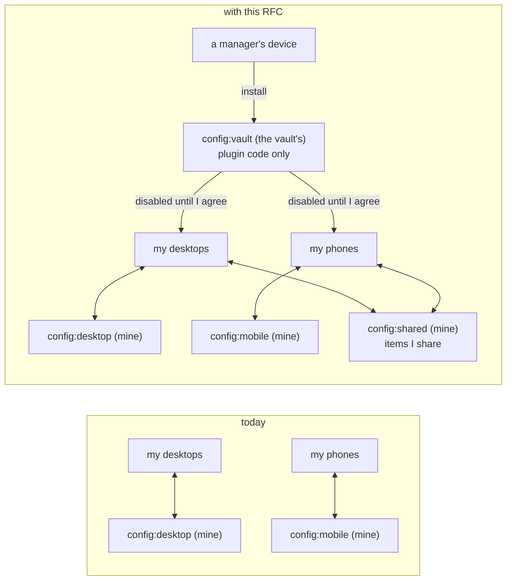
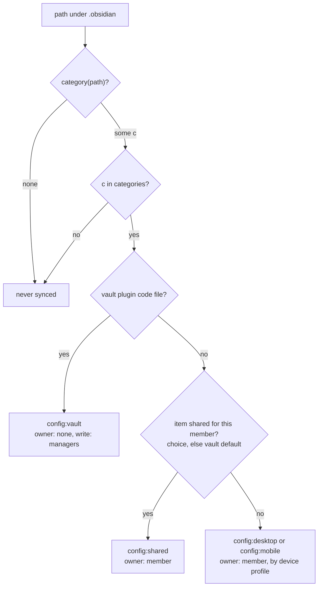
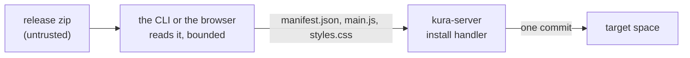
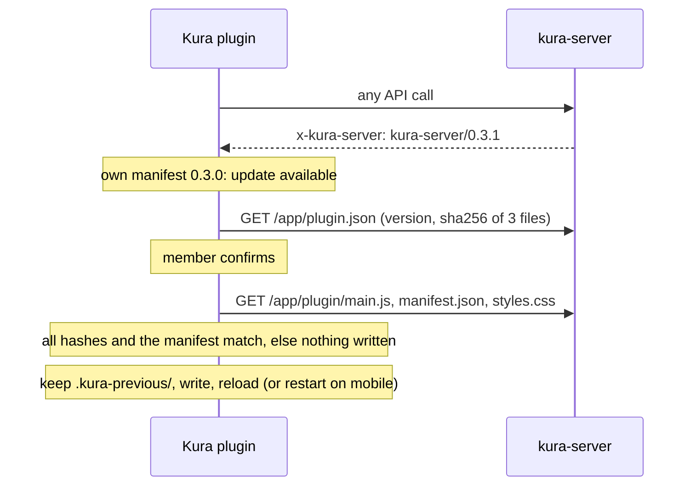
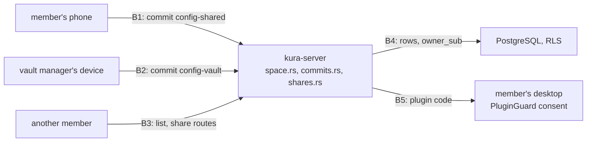

# RFC 0010 — Obsidian configuration across profiles, plugins on a vault, and client updates

| Field | Value |
| --- | --- |
| Status | Accepted (2026-11-23) |
| Short | Shared configuration |
| Settles | How each member chooses, plugin by plugin, what of their `.obsidian` reaches both their desktop and mobile devices; how a vault's managers install plugins that every member's devices receive; and how the plugin and the CLI tell a version different from the server's, the plugin updating itself in one click |
| Author | Maxime (batleforc) |
| Co-author | Claude Opus 5.5 |
| Created | 2026-11-23 |
| Supersedes | — (amends RFC 0001 §6.8 and decision 34: a member's own items may cross profiles, and a vault's plugin code may reach its members; amends RFC 0008 §4.5 with two views, and decision 6 for one route: the console installs a plugin into the member's own configuration) |
| Touches | `crates/kura-api` (`spec.rs`, validation, `reason.rs`), `crates/kura-server` (`migrations/0003_*`, `app/space.rs`, `app/vaults.rs`, `app/commits.rs`, a new `app/shares.rs`, `authz.rs`), `crates/kura-core` (`config.rs`), `crates/kura-cli` (`commands.rs`, plugin zip reading), `fuzz/`, `plugin/` (`main.ts`, `remote.ts`, `settings.ts`, `plugins.ts`, a new `update.ts`), `ui/plugin-zip.ts`, `ui/` (`pages/ConfigPage.vue`, `synced.ts`, strings), `deploy/crd/kuravault.yaml`, docs |
| Risk | high |

> **Reference material**, about 10,000 words. For the decision, read §1, §3,
> §4.1, §4.5, §7.1 and §15; the rest is the design to build and review
> against.

---

## 1. Summary

A member's Obsidian configuration syncs today in two copies, one per device
profile: every desktop shares `config:desktop`, every phone and tablet shares
`config:mobile`, they never meet, and nothing ever travels between members
[R1][R2]. This RFC adds two things.

**Personal sharing across profiles.** Each member chooses, item by item —
one plugin at a time, or the snippets, themes or hotkeys as a whole — what
reaches both their desktop and their mobile devices. Those items sync in a
third copy that is still the member's own, `config:shared`; everything not
chosen stays per profile. The vault's managers decide what may sync at all
and which items are shared by default; each member overrides the defaults
for themselves.

**Plugins installed on a vault.** A vault's manager installs a plugin on the
vault from one of their Obsidian devices (or, failing that, from a release
zip with the CLI). Its code — `manifest.json`,
`main.js`, `styles.css`, never its settings — goes to a vault-wide copy,
`config:vault`, and reaches every member's Obsidian devices **disabled**, to
be enabled on each device after the member agrees to that exact code, as any
received plugin today [R9]; an update keeps the agreed version running
until the member agrees to the new one, and a member may refuse a vault
plugin for good on a device. The plugin's settings stay personal.

**Client versions and one-click update.** The server names its version on
every answer; the plugin and the CLI compare it with their own and say so
when they differ — older, newer, or below the server's minimum. The plugin
then offers to update itself in one click, from the build of the same
version that the server's image already carries, its SHA-256 checked before
anything is written.

**Plugins installed for oneself from the console.** A member may also install
a plugin into their own configuration from the console, from its release
zip; it reaches their devices disabled, like any other.

### Before / after

```yaml
# today: what syncs, each item in two personal copies
spec:
  configSync:
    categories: [plugins, snippets, themes, hotkeys]

# with this RFC
spec:
  configSync:
    categories: [plugins, snippets, themes, hotkeys]  # what may sync (managers)
    sharedByDefault: [snippets, themes, plugin:dataview]  # members may override
    vaultPlugins: true  # managers may install plugins on the vault
```



Two new paths: both of a member's profiles read and write the member's own
`config:shared`; and code flows from a manager into every member's devices
through `config:vault`, newly trusted only after each member's consent on
each device.

---

## 2. Motivation

1. **A snippet, a theme or a plugin's settings written on the PC never reach
   the phone.** The server picks the configuration namespace from the
   device's registered profile, never from the client (`resolve`, "a device
   reads its own profile only") [R3]. A member who wants the same plugin
   settings on both sets them up twice. Observed by the owner on
   kura.weebo.fr, 2026-11-23.
2. **What should cross profiles is plugin by plugin.** Dataview's settings
   suit both devices; a desktop-only plugin's do not. The unit today is the
   whole profile [R1]; the owner asked for one plugin at a time (§15,
   decision 4).
3. **A vault cannot provide its plugins.** A family or team vault whose notes
   depend on a plugin (Dataview queries, Excalidraw drawings) has no way to
   give it to its members: each installs it by hand, at whatever version, and
   decision 34 forbids configuration between members [R2].
4. **Nothing tells a member their plugin is behind the server.** The server
   refuses a client below its minimum (`client_too_old`) [R26], but a plugin
   one release behind gets no word until that minimum moves; and the plugin
   announces itself as `kura-plugin/0.1.0` whatever its version, a constant
   [R27], so the server cannot even tell. On kura.weebo.fr, 2026-11-22, a
   pre-RFC 0007 build ran against a 0.3.0 server and silently pushed no
   folder.
5. **Updating the plugin is a manual file copy.** The console offers a zip
   to download [R28]; a member unzips it into a hidden folder, on a phone
   through a file manager (the plugin guide's install steps) — the step
   where the stale build above came from.

---

## 3. Goals / non-goals

**Goals**

- A member marks, for themselves, each plugin and each of `snippets`,
  `themes`, `hotkeys` as shared between their profiles or not.
- The vault's managers set which items are shared by default; a member's
  choice overrides the default for that member only.
- A shared item syncs in one copy per member, read and written by all of
  that member's Obsidian devices and by the CLI.
- An item not shared behaves exactly as today.
- A vault's managers install a plugin on the vault from an Obsidian device;
  its code reaches every member's Obsidian devices, written disabled, and is
  enabled per device only after the member agrees to that code.
- The console shows the member's shared copy and the vault's plugins beside
  the two profiles, lets the member change their choices, and lets them
  install a plugin for themselves from its release zip.
- On a manager's update, a member's device keeps running the version it
  agreed to until the member agrees to the new one; a member may decline a
  vault plugin for good on a device.
- The plugin and the CLI show when their version differs from the
  server's, and which way.
- The plugin updates itself to the server's version in one click, after the
  member sees the version and the hash, and can go back to the previous one.

**Non-goals**

- **Sharing a member's settings with other members.** Only plugin *code*
  goes vault-wide; every `data.json` and every snippet, theme and hotkey
  stays one member's own (decision 34 holds for them) [R2].
- **Enabling a plugin for members.** Enabling stays a per-device act:
  `community-plugins.json` never syncs [R4], and consent is per code hash
  [R9].
- **Fetching plugins from the community directory server-side**: the
  server makes no outbound request; a manager's device uploads the bytes it
  already runs, or a person uploads a zip they downloaded (§12).
- **Reading zips on the server**: a zip is opened by the client that holds
  it (the CLI or the browser); the server receives only the three named
  files (§5.3).
- **Installing on the vault from the console**: the console installs for
  the member only (decision 12).
- **Silent automatic updates** of the plugin: code that runs with Node.js on
  a desktop changes only on the member's click.
- **Updating the CLI itself**: it is installed by mise or a package; it
  prints the command to run (`mise up`), nothing more.
- **Updating the server**: the operators' job (Helm, Argo CD).
- **Vault-wide snippets, themes or hotkeys**: plugins only, the one case the
  owner raised (motivation 3).
- **Merging files** between profiles: one file per path, last write wins, as
  every configuration space today [R6].
- **Configuration on API-created vaults**: `POST /v1/vaults` sets no
  `configSync` today [R14]; giving it one is its own change.

---

## 4. User-facing design

### 4.1 Configuration

The vault's document, written by the tenant's operators:

```yaml
apiVersion: kura.weebo.io/v1alpha1
kind: KuraVault
metadata: { name: notes, namespace: max }
spec:
  tenantRef: { name: max }
  configSync:
    categories: [plugins, snippets, themes, hotkeys]
    # Items shared between a member's profiles unless the member says no.
    # `plugin:<id>` for one plugin, or `snippets`, `themes`, `hotkeys`.
    sharedByDefault: [snippets, themes, plugin:dataview]
    # Whether the vault's managers may install plugins on the vault.
    vaultPlugins: true
```

Each member's own choices, made in the plugin's settings or the console
(§4.4, §4.5), stored per member and per vault:

```json
{ "plugin:dataview": false, "plugin:calendar": true }
```

- `sharedByDefault` absent or empty: nothing is shared unless a member
  shares it. `vaultPlugins` absent: **false**, managers cannot install
  plugins on the vault. Both safe defaults: a vault upgraded to this release
  behaves exactly as before.
- A member's choice absent for an item: the vault's default applies. A
  member's `false` overrides a default `true`, and `true` overrides an
  absent default.
- An item is `plugin:<id>`, where `<id>` is an Obsidian plugin id: 1 to 64
  characters of `a-z`, `0-9`, `-` (this RFC's rule, matching the folder
  names of `.obsidian/plugins/`), never `weebo-kura`; or `snippets`,
  `themes`, `hotkeys` as a whole (decision 7).
- Security-relevant: sharing a plugin lets a member's phone write that
  plugin's code where their desktop runs it; `vaultPlugins` lets a manager
  write code that every member's desktop may run. Neither is implied by any
  other setting; both reach code only through per-device consent (§7.1).

### 4.2 Behaviour rules

**Where a file lives.** Every configuration file has exactly one home,
decided by the server from the path, the vault's document and the member's
choices, never from the client's word:

| The file | Lives in |
| --- | --- |
| a path no category covers | nowhere: never synced [R4] |
| a category not in `categories` | nowhere |
| `plugins/<id>/{manifest.json,main.js,styles.css}` of a plugin installed on the vault | `config:vault` (the vault's, read-only to members) |
| any other path of an item the member shares | `config:shared` (the member's) |
| any other synced path | `config:desktop` or `config:mobile` (the member's, by the device's profile) |

So a vault plugin's settings (`plugins/<id>/data.json` and any other file
of its folder) follow the member's choice for that plugin, shared or per
profile; only its three code files are vault-wide.

**Changing a choice.** When an item becomes shared for a member, the first
of their devices to sync afterwards seeds the shared copy with its local
files of that item; every later device takes that copy first
(`prefer_remote`, the CLI's rule today [R7]) and its own local files of the
item go to `.trash`. The per-profile copies of the item are kept, not served
and not deleted: unsharing the item finds them again. The same holds the
other way.

**Installing on the vault.** A manager installs a plugin on the vault from
the plugin's settings (*Install on this vault*) on a device where the plugin
is installed: its three code files are committed to `config:vault`. Where no
device of the manager runs it, the fallback is the CLI with the plugin's
release zip: `kura vault plugin install <vault> <file.zip>` (decision 9). Every
member's device then receives them at its next configuration run, written
disabled, and asks the member once per new code hash before enabling it
(`PluginGuard`) [R9]. A manager's later update (*Update on this vault*)
commits new bytes; each device keeps running the version it agreed to and
asks for the new one, applying it only once agreed (decision 10). *Remove from
this vault* deletes the three files there; each device moves them to
`.trash` unless the member has the same plugin as their own (then the
member's copy stays, as their own).

**Declining for good.** *Never on this device* in the consent prompt keeps a
vault plugin off that device: its files are not written there again, until
the member lifts it in the plugin's settings (decision 11). Other devices of
the member are not affected.

**Installing for oneself.** From the console, a member uploads a plugin's
release zip; the browser opens it, sends its three code files, and the
member picks where they go: *both my desktop and mobile* (`config:shared`,
and the plugin becomes shared for them), *my desktop devices* or *my mobile
devices*. They reach those devices disabled, as any received plugin
(decision 12). The console never installs on the vault.

**A member's own copy of a vault plugin.** If a member already has the
plugin locally when the vault installs it, the vault's code wins at the next
run (the member's code files go to `.trash`), its settings stay theirs.

**Client versions.** Every API answer carries `x-kura-server: kura-server/<version>`.
The plugin and the CLI compare it with their own version (the plugin's from
its `manifest.json`, no longer a constant [R27]):

| Comparison | The plugin shows | The CLI shows |
| --- | --- | --- |
| equal | nothing | nothing |
| client older, still served | *Update available* in settings and the status menu, with the update button | one line on stderr, at most once a day: `kura 0.3.0, server 0.3.1: mise up kura` |
| client newer than the server | *The server is older than this plugin* in settings; nothing blocks | one line on stderr, at most once a day |
| client below the server's minimum | the existing *update required* word [R26], with the update button | exit 4 with `client_too_old`, as today |
| no header (an older server) | nothing: unknown, not different | nothing |

Only major, minor and patch are compared; a pre-release compares as its
release, as the server does [R26].

**One-click update.** *Update to <version>* in the plugin's settings (or the
status menu) fetches `/app/plugin.json` from the configured server, which
now also lists the SHA-256 of `main.js`, `manifest.json` and `styles.css`
[R28]; shows the version and the hashes; on the member's confirmation
fetches the three files from `/app/plugin/`, checks each against its
SHA-256 and the manifest's `id` (`weebo-kura`) and `version` (the one
announced), and, when GitHub answers, against the release's signed
`checksums.txt` (decision 13) [R30], keeps the current files as `.kura-previous/` in the plugin's
folder, writes the new ones, and reloads the plugin. *Go back to <previous
version>* restores `.kura-previous/` the same way. Rules:

- nothing is written unless all three files match their hashes and the
  manifest; a failure leaves the running version untouched;
- never to a version older than the running one (no downgrade), except
  *Go back*, which restores the exact files that ran before;
- the update is offered only when the server's console is on
  (`server.ui.enabled`): `/app/plugin.json` is part of it [R28]; otherwise
  the plugin shows the release page's address instead of the button;
- on mobile, where reloading a plugin is not offered by Obsidian's public
  API, the plugin asks the member to restart Obsidian.

**Conflicts**: none. Each copy is one file per path, last write wins, as in
every configuration space [R6]; `config:vault` is written by managers only.

### 4.3 Validation

Rejected when the document is loaded, or on input:

| Condition | Rationale |
| --- | --- |
| `sharedByDefault` names an item whose category is not in `categories` | A default for something that does not sync is a contradiction. `InvalidDocument` at `spec.configSync.sharedByDefault[i]`. |
| An item that is not `plugin:<id>` with a valid id, nor `snippets`/`themes`/`hotkeys`; or `plugin:weebo-kura` | The Kura plugin never syncs [R4]; ids are folder names. 400 `invalid_path` on the API, `InvalidDocument` in a document. |
| `vaultPlugins: true` without `plugins` in `categories` | A vault plugin that never syncs has no meaning. `InvalidDocument`. |
| A commit to `config:vault` by a caller who is not a vault manager | 403 `insufficient_role`, before any write. |
| A commit to `config:vault` of a path other than `plugins/<id>/{manifest.json,main.js,styles.css}` | Settings and anything else never go vault-wide (T3). 400 `invalid_path`. |
| A commit to `config:vault` on a vault without `vaultPlugins` | 400, "this vault does not take plugins". |
| A commit to a member space of a path whose home (§4.2) is another space | 400 `invalid_path`, naming the space the path belongs to. |
| More than 200 choices for one member on one vault | 400: bounds the per-member rows (§7.5). |
| An install whose `manifest.json` is not JSON, is over 64 KiB, or whose `id` differs from the route's or is `weebo-kura` | The id names the folder; a mismatch would write one plugin under another's name. 400 `invalid_path`. |
| An install without `manifest.json` or `main.js`, or a file over the vault's `maxFileSize` | A plugin needs both; sizes follow the existing limit. 400. |
| An install with `target=vault` from the web device | The console installs for the member only (decision 12). 403 `insufficient_role`. |

Warnings, and where they are seen:

| Condition | Behaviour | Surfaced in |
| --- | --- | --- |
| `vaultPlugins: true` | Accepted; a manager can now send code to members | Advisory `VaultPluginsEnabled` on the vault's status (`GET /v1/admin/status`; the `KuraVault` status with the operator) |
| `sharedByDefault` holds a `plugin:` item | Accepted; code crosses profiles by default | Advisory `PluginsSharedByDefault`, same place |
| A stored `config_sync` the server cannot parse | Today it silently becomes "no categories" [R11]; now logged at `error` with the vault, counted in `kura_config_rejected_total`, and the vault serves no configuration | Server log, metric |

### 4.4 API surface

| Method | Path | Auth | Who may call | Limit |
| --- | --- | --- | --- | --- |
| GET | `/v1/vaults` | bearer | any member | unchanged; each vault gains `configShared: string[]` (the caller's effective shared items) and `vaultPlugins: boolean` |
| GET | `/v1/vaults/{v}/config/shares` | bearer | the member (any of their devices, the console) | the read limit |
| PUT | `/v1/vaults/{v}/config/shares/{item}` body `{ "shared": true }` | bearer + device | the member, for themselves | the write limit |
| DELETE | `/v1/vaults/{v}/config/shares/{item}` | bearer + device | the member | the write limit; back to the vault's default |
| GET | `/v1/vaults/{v}/entries`, `/changes` with `space=config-shared` | bearer + device | the member's Obsidian devices; the console lists only | unchanged |
| GET | `/v1/vaults/{v}/entries`, `/changes` with `space=config-vault` | bearer + device | every member's Obsidian devices; the console lists only | unchanged |
| POST | `/v1/vaults/{v}/commits` with `"space": "config-shared"` | bearer + device | the member's Obsidian devices | unchanged |
| POST | `/v1/vaults/{v}/commits` with `"space": "config-vault"` | bearer + device | a vault manager's Obsidian device | unchanged |
| PUT | `/v1/vaults/{v}/config/plugins/{id}?target=vault\|shared\|desktop\|mobile`, multipart `manifest.json`, `main.js`, optional `styles.css` | bearer + device | `vault`: a manager, never the web device; the others: the member, the web device included | the write limit; body at most `3 × maxFileSize` |

Two changes outside `/v1`: every answer gains the header
`x-kura-server: kura-server/<version>` (the existing `client_version`
middleware [R26]); `/app/plugin.json`, served with the console, gains
`sha256: { "main.js": …, "manifest.json": …, "styles.css": … }`, and the
three files are served unzipped under `/app/plugin/` beside
`/app/kura-sync.zip` [R28]. Both are as public as the console's assets
already are; the version is already public in `/app/plugin.json` and in the
OpenAPI document's `info.version` [R29].

`app/shares.rs` holds the three share handlers and the install handler
(utoipa-documented); the install handler checks the files and commits them
in the target space as one commit, so the web device never commits directly
(RFC 0008 decision 6 still holds for every other write) [R18]; the
console client is regenerated by HeyApi. A scoped token never reaches any
configuration space or share (`Writer::Key(_) => None`) [R10], and a
restricted viewer, whose scope never holds configuration, gets 403 on every
share route as on the configuration spaces today [R16].

### 4.5 Mocks

**Plugin settings, Advanced › Synced settings — a member of a vault with
plugins installed**

```text
 Synced settings
   Set by the vault: Plugins, Snippets, Themes, Hotkeys may sync.

   Share between my desktop and mobile
     Snippets                         [x]  default of the vault
     Themes                           [x]  default of the vault
     Hotkeys                          [ ]
     Dataview                         [ ]  you turned off the vault's default
     Calendar                         [x]

   Installed on this vault by its managers
     Excalidraw 2.6.1                 enabled on this device
     Tasks 7.14.0                     new version: review before enabling  [ Review ]
```

Each toggle is the member's own; the line under it says whether it follows
the vault's default. Vault plugins are listed apart, with their state on
this device, never a toggle to share their code.

**Plugin settings, a manager's view of one of their plugins**

```text
 Kanban 2.0.51 (yours)                [ Install on this vault ]
 Excalidraw 2.6.1 (on this vault)     [ Update on this vault ]  [ Remove from this vault ]
```

The install button exists only for a manager, on a vault with
`vaultPlugins`; it sends the three code files of the installed version.

**Consent prompt on a member's device — a vault plugin received**

```text
 ┌──────────────────────────────────────────────────────────────┐
 │ Excalidraw was installed on the vault "notes" by its         │
 │ managers. It is disabled on this device.                     │
 │                                                              │
 │ Plugins run with full access to this device. Enable it only  │
 │ if you trust the vault's managers and this plugin.           │
 │                                                              │
 │ Code: main.js 4.1 MB, sha256 3f9a…c2d1                       │
 │                              [ Keep disabled ]  [ Enable ]   │
 └──────────────────────────────────────────────────────────────┘
```

The existing consent modal of decision 34 [R9], naming who installed it and
the hash; *Keep disabled* is the focused default.

**Consent prompt — an update of a vault plugin**

```text
 ┌──────────────────────────────────────────────────────────────┐
 │ The vault's managers updated Excalidraw: 2.6.1 → 2.7.0.      │
 │ 2.6.1 keeps running on this device until you agree.          │
 │                                                              │
 │ Code: main.js 4.2 MB, sha256 7b01…9e44                       │
 │      [ Never on this device ]  [ Not now ]  [ Use 2.7.0 ]    │
 └──────────────────────────────────────────────────────────────┘
```

The old version keeps running (decision 10); *Never on this device* is the
decline for good (decision 11), reversible in the plugin's settings.

**Console, Configuration tab — install a plugin for myself**

```text
  Install a plugin for yourself
  Release zip:  [ Choose file… ]  obsidian-kanban-2.0.51.zip
  Found: Kanban 2.0.51 (kanban) — manifest.json, main.js, styles.css
  For:  (•) my desktop and mobile devices  ( ) my desktop devices  ( ) my mobile devices
  It will arrive disabled; enable it on each device.        [ Install ]

  Release zip:  [ Choose file… ]  photos.zip
  This zip holds no Obsidian plugin (no manifest.json with an id).
```

Nominal and error states; the zip is read in the browser and only the three
files are sent; there is no *the vault* choice here.

**CLI — a manager's fallback install on the vault**

```text
$ kura vault plugin install notes ./obsidian-excalidraw-plugin-2.6.1.zip
Excalidraw 2.6.1 (obsidian-excalidraw-plugin) installed on notes:
  manifest.json  0.4 KB  sha256 1c2e…
  main.js        4.1 MB  sha256 3f9a…
  styles.css     2.3 KB  sha256 a07d…
Members' devices receive it disabled.
$ echo $?
0
```

Exit 3 with `this zip holds no Obsidian plugin` for a zip without a valid
`manifest.json`; exit 3 with the server's 403 for a caller who is not a
manager.

**Plugin settings, top — the plugin behind the server**

```text
 Kura Sync 0.3.0 · server 0.3.1
 Update available.  [ Update to 0.3.1 ]
```

**Plugin, update confirmation**

```text
 ┌──────────────────────────────────────────────────────────────┐
 │ Update Kura Sync 0.3.0 → 0.3.1 from kura.weebo.fr            │
 │                                                              │
 │ main.js        874 KB  sha256 fe8e…0a22                      │
 │ manifest.json  0.3 KB  sha256 41b7…c9d0                      │
 │ styles.css     1.8 KB  sha256 0c55…7e12                      │
 │                                                              │
 │ The current version is kept: you can go back to it.          │
 │                                  [ Cancel ]  [ Update ]      │
 └──────────────────────────────────────────────────────────────┘
```

Version, source and hashes before anything is written; *Cancel* focused.

**Plugin, after the update, and its failure**

```text
 Kura Sync updated to 0.3.1.  [ Go back to 0.3.0 ]
 (mobile) Restart Obsidian to use 0.3.1.

 Update failed: main.js does not match its sha256. Nothing was changed.
```

**Plugin settings — the server older than the plugin, or without a console**

```text
 Kura Sync 0.3.1 · server 0.3.0
 The server is older than this plugin. Its operators update it.

 Kura Sync 0.3.0 · server 0.3.1
 Update available: https://github.com/batleforc/weebo-kura/releases/tag/v0.3.1
```

**CLI — a version different from the server's**

```text
$ kura sync
kura 0.3.0, server 0.3.1: update with `mise up kura`
notes: pushed 0, pulled 2, removed 0, 0 conflicts.
$ echo $?
0
```

One stderr line at most once a day; the exit code does not change.

**Console, Configuration tab — the Shared view**

```text
 notes › Configuration
  Desktop   Mobile   [Shared]   Vault plugins
  Shared between your desktop and mobile devices:
    Snippets, Themes (defaults of the vault), Calendar
  Not shared: Hotkeys, Dataview                       [ Change ]

  snippets/
    reading.css                         2.1 KB   2 min ago
  plugins/calendar/
    data.json                           (hidden: may hold a secret)
```

The member's shared items, in words, with a link to change them; the file
list follows the gate of RFC 0008 [R18].

**Console, Configuration tab — Vault plugins, empty and error** (list only,
decision 12)

```text
  Desktop   Mobile   Shared   [Vault plugins]
  No plugin is installed on this vault.
  Its managers install one from Obsidian: Kura settings › Install on this vault.

  Desktop   Mobile   Shared   [Vault plugins]
  Could not load the vault's plugins.                  [ Retry ]
```

**Refusal (§6.P observation 6) — a member's crafted commit**

```text
$ curl -s -X POST …/v1/vaults/$V/commits -d '{"space":"config-vault",…}'
{"type":"/v1/problems/insufficient_role","status":403,
 "detail":"installing a plugin on the vault needs the manager role"}
```

What a member sees if a client tries what only a manager may do.

---

## 5. Architecture

### 5.1 The home of a configuration file



A pure function of the path, the vault's document, the member's choices and
the vault's installed plugins; the client only says which space it syncs,
and the server refuses a path whose home is another (§4.3).

**Invariants**:

- because every `config:shared`, `config:desktop` and `config:mobile` row
  carries `owner_sub` and the row policy requires
  `owner_sub = kura_current_subject()` [R12], a member's own configuration
  never reaches another member;
- because `config:vault` admits only the three code files of a plugin
  folder, never `data.json`, no member's settings or secrets can become
  vault-wide;
- because a received plugin is written disabled and enabled only after
  consent to its exact hash, on that device [R9], code from another device
  or from a manager never runs without that device's owner agreeing.

### 5.2 One configuration run on a device

```mermaid
sequenceDiagram
    participant D as Obsidian device
    participant S as kura-server
    D->>S: GET /v1/vaults (configSync, configShared, vaultPlugins)
    D->>S: space config: per-profile items
    D->>S: space config-shared: the member's shared items
    D->>S: space config-vault: plugin code (read; write if manager)
    S-->>D: each commit refused if a path is not of that space
    Note over D: vault plugin code written disabled, consent per hash
```

Three passes, each with its own category and path filter and its own state
file (`config-state`, `config-shared-state`, `config-vault-state`), so the
copies never mix in one local state.

### 5.3 Where a zip is opened



A zip never reaches the server: the client that holds it opens it with
bounds (§7.3), takes the three named files from the root or a single top
folder, and sends only those. **Invariant**: because the server receives
three named files and builds every path from the checked `id` and fixed
names, no name inside a zip ever becomes a path.

### 5.4 One-click update



The plugin writes only after the three hashes match what the same server
announced and the member confirmed; because the running files are kept,
every update has a one-click way back.

---

## 6. Detailed design

### 6.1 `kura-api`

- `ConfigSync` gains `#[serde(default)] shared_by_default: Vec<ConfigItem>`
  and `#[serde(default)] vault_plugins: bool` [R5]; `ConfigItem` parses
  `plugin:<id>` or a category name; the CRD is regenerated by `kura-crdgen`.
- Validation (`validate/`): the rules of §4.3 for the document.
- `ReasonCode`: `VaultPluginsEnabled`, `PluginsSharedByDefault` [R22].

### 6.2 `kura-server`

- **Migration `0003_config_shared.sql`**:
  - the check constraint on `entry` [R13] becomes
    `namespace IN ('notes', 'config:desktop', 'config:mobile',
    'config:shared', 'config:vault') AND (namespace IN ('notes',
    'config:vault')) = (owner_sub IS NULL)`;
  - a table `config_share (tenant_id, vault_id, owner_sub, item, shared,
    PRIMARY KEY (vault_id, owner_sub, item))`, row policy
    `tenant_id = kura_current_tenant() AND owner_sub =
    kura_current_subject()`, forced, as `entry` [R12];
  - the unique index on `entry` already keys on
    `coalesce(owner_sub, '')` [R13]: `config:vault` paths are unique per
    vault.
- **`Space`** (`app/space.rs`) [R3]: `resolve` accepts `config-shared` and
  `config-vault`. Both need an Obsidian device for changes and writes; the
  web device lists only. `config-shared`: `owner: Some(sub)`, its items the
  member's effective shared set. `config-vault`: `owner: None`, refused
  unless `vault_plugins`; writes need the manager role (the check of
  `authz.rs:433` [R23]). `config` keeps `owner: Some(sub)` and the items not
  shared and not vault code. `Space` carries an item filter instead of a
  category list; `allows` applies it.
- **`check_space_operations`** (`app/commits.rs`) [R10]: the refusals of
  §4.3; for `config-vault`, the path must be one of the three code files.
- **Restore** [R10]: `config:shared` for any Obsidian device of its owner;
  `config:vault` for a manager's device.
- **`app/shares.rs`**: the three share routes; `item` validated; the 200-row
  bound; effective set = vault defaults overridden by the member's rows. The
  install handler: multipart with at most three named parts, `manifest.json`
  parsed (64 KiB at most, `id` equal to the route's), sizes against
  `maxFileSize`, blobs stored as uploads are, then one commit in the target
  space with the caller's rights for it (`vault` needs a manager and a
  non-web device).
- **`config_of`** (`authz.rs`) [R11]: a parse error logged at `error`,
  counted in `kura_config_rejected_total`, and the vault serves no
  configuration.
- **`GET /v1/vaults`** (`app/vaults.rs`) [R14]: `configShared` (effective,
  for the caller), `vaultPlugins`.
- **Audit**: a commit to `config:vault` writes an audit line (who, vault,
  plugin id, files, hashes) at `info` on `kura::audit`, as the operator push
  does today.

### 6.3 `kura-core`, the plugin and the CLI

- `kura-core::config`: `item_of(path)` beside `category` (`plugin:<id>` for
  a plugin folder, else the category) and `vault_code(path)` for the three
  code files [R4].
- **Plugin** (`plugin/src/main.ts`) [R8]: `syncConfig` runs three passes —
  `config`, `config-shared`, `config-vault` — each with `preferRemote: true`
  (the plugin never sets it today: phase 0) and its own state. The vault
  pass writes through `PluginGuard.beforeWrite` [R9], which already writes
  code disabled and asks per hash; the modal names the vault as the source.
  *Install / Update / Remove on this vault* commit the three code files to
  `config-vault`, shown to managers only. On a new hash of a plugin already
  agreed, the vault pass writes the new files under
  `.obsidian/plugins/<id>/.kura-pending/` (a dot folder Obsidian does not
  load) and swaps them in once the member agrees (decision 10). The consent
  state (`plugins.ts`, `Consent`) gains `never: string[]`; the vault pass
  skips those ids (decision 11).
- `remote.ts`: `remote(vault, space?: "config" | "config-shared" |
  "config-vault")` [R15]; `shares(vault)` and `setShare(vault, item, shared)`.
- **Settings tab** (`settings.ts`): the toggles and the vault plugins list of
  §4.5.
- **CLI** (`commands.rs`) [R7]: `sync_config` runs the `config` and
  `config-shared` passes and reads `config-vault`; it never installs on the
  vault from a device but `kura vault plugin install <vault> <zip>` is the
  manager's fallback (decision 9); `kura config share <item> on|off` sets the
  member's choice. The zip is read with the `zip` crate under the bounds of
  §7.3, then sent to the install route.

### 6.4 Console

- `ConfigPage.vue` [R16]: *Shared* and *Vault plugins* views beside the two
  profiles; *Change* opens the member's choices (the same toggles as the
  plugin), written through the share routes; *Install a plugin for yourself*
  reads the zip in the browser (`fflate`, §8) under the bounds of §7.3 and
  calls the install route with a personal target. The web device writes no
  other content.
- `synced.ts`: `itemOf` mirrors `kura-core::config::item_of` for grouping.

### 6.5 Client versions and update

- **Server** (`app/mod.rs`) [R26]: the `client_version` middleware sets
  `x-kura-server` on every answer from `CARGO_PKG_VERSION`.
- **Console build** (`ui/plugin-zip.ts`) [R28]: `plugin.json` gains the
  three SHA-256 and the files are emitted unzipped under `plugin/`.
- **Plugin**: `CLIENT` built from the manifest's version, not the constant
  `kura-plugin/0.1.0` [R27] (phase 0); `remote.ts` records the server's
  header; a new `update.ts` compares versions, fetches with `requestUrl`,
  checks hashes with Web Crypto (`crypto.subtle.digest`), writes through the
  vault adapter into the plugin's own folder only, keeps `.kura-previous/`,
  and reloads on desktop.
- **CLI** (`api.rs`): reads the header; `commands.rs` prints the line of
  §4.2 at most once a day (a timestamp in `config.json`) and in `kura
  status`.

### 6.P Proof against a real client

Suite `tests/heavy/config-share.sh`, against the local stack (`task
dev:stack`), with this release's plugin in Obsidian desktop (the version
installed at run time, recorded in §18; `minAppVersion` 1.11.4 [R17]) and in
Obsidian for Android in the `kura-dev` emulator (`task android:deploy`). Two
members: alice (vault manager) and bob (editor). The vault document:
`categories` all four, `sharedByDefault: [snippets]`, `vaultPlugins: true`.

1. alice creates `snippets/reading.css` on desktop; after a run, `entry` holds
   one live `config:shared` row for it owned by alice, none in
   `config:desktop`; alice's Android receives the same bytes (equal SHA-256).
2. alice shares `plugin:dataview` from her phone's settings: the next desktop
   run puts `plugins/dataview/data.json` in `config:shared`; editing it on
   desktop reaches the phone; `hotkeys.json` edited on desktop does not.
3. bob lists `space=config-shared`: 200, empty, though alice has rows — RLS,
   not the query, hides them.
4. alice installs Excalidraw on the vault from desktop: `config:vault` holds
   exactly `plugins/obsidian-excalidraw-plugin/{manifest.json,main.js,
   styles.css}`, no `data.json`; an audit line names alice and the hashes.
5. bob's desktop at its next run writes the three files, does **not** list
   the plugin in `community-plugins.json`, and shows the consent prompt;
   *Keep disabled* leaves it off and the prompt does not return for the same
   hash — the refusal by the member.
6. bob's crafted commit with `"space":"config-vault"` answers 403
   `insufficient_role`; `seq` is unchanged — the refusal by the server.
7. alice's crafted commit to `config-vault` of
   `plugins/obsidian-excalidraw-plugin/data.json` answers 400 `invalid_path`
   — settings never go vault-wide.
8. alice updates Excalidraw on the vault; bob's device keeps running the old
   version (its `main.js` hash unchanged on disk) and asks for the new one;
   after *Use 2.7.0* the new hash is on disk.
9. bob picks *Never on this device* on his phone: later runs write no file of
   the plugin there (no `.obsidian/plugins/obsidian-excalidraw-plugin/` on the
   phone), while his desktop still has it.
10. bob installs Kanban for himself from the console with its release zip,
    *my desktop and mobile devices*: `config:shared` holds its three files
    owned by bob, `config:vault` has nothing new, and both his devices
    receive it disabled.
11. bob's console call with `target=vault` answers 403; a zip with a
    `manifest.json` whose id is `weebo-kura` is refused in the browser and,
    sent by hand, 400 by the server.

12. With a 0.3.0 plugin against a 0.3.1 server, the settings show *Update
    available*; *Update to 0.3.1* fetches `/app/plugin.json` and the three
    files (server access log: four `GET`s, no other host), the plugin's folder
    then holds 0.3.1 files whose SHA-256 equal the release's `checksums.txt`
    [R30], `.kura-previous/` holds the 0.3.0 ones, and the next API call
    carries `x-kura-client: kura-plugin/0.3.1`.
13. With `main.js` altered on the server, *Update* stops at the hash check:
    the plugin's folder is byte-for-byte unchanged and the notice quotes
    the mismatch — the refusal.
14. *Go back to 0.3.0* restores the previous files (hashes equal the 0.3.0
    release's).
15. `kura sync` with a 0.3.0 CLI against 0.3.1 prints the one stderr line
    and exits 0; a second run the same day prints nothing.

**Deliberately untouched**, so reviewers do not go looking:

- `crates/kura-core/src/sync.rs` — the engine syncs whatever space and filter
  the shell gives it.
- `kura_current_subject()` and the `app_tenant` policy on `entry` [R12] —
  they already key on `owner_sub`; `config:vault` rows, with no owner, are
  read through the vault check of `Space`, as notes are.
- `community-plugins.json` — never synced; enabling stays per device [R4].
- Search indexing, which reads `namespace = 'notes'` only [R13].

---

## 7. Security

**Rating:** high — plugin code, which runs with Node.js access on a desktop,
gains three new routes into a device: from the member's own phone, from a
vault manager to every member, and from the server to the Kura plugin itself
on the member's click.

### 7.1 Threat model

Assets: each member's configuration (plugin `data.json` may hold API keys),
and the integrity of the code a member's desktop runs. Actors: the member's
devices, a lost or compromised phone, another member, a vault manager or a
compromised manager device, a scoped token. Attacker-controlled inputs: the
commit body (`space`, paths, bytes), the `space` query parameter, the share
routes' `item` and body.



| # | Threat (STRIDE) | Where | Mitigation | Residual risk |
| --- | --- | --- | --- | --- |
| T1 | Information disclosure: a member reads another's shared configuration or choices | B3, B4 | `owner: Some(sub)`; RLS on `owner_sub` for `entry` [R12] and for `config_share`; tests `shared_config_hidden_from_other_member`, `shares_hidden_from_other_member` | none known |
| T2 | Elevation: a compromised phone writes code a desktop runs | B1, B5 | a plugin crosses profiles only when its member shares it; code written disabled, consent per hash per device [R9]; test `shared_plugin_arrives_disabled` | the member enables changed code unread; accepted by the owner, as for desktop-to-desktop today |
| T3 | Information disclosure: a member's settings become vault-wide | B2 | `config:vault` admits only `manifest.json`, `main.js`, `styles.css` of a plugin folder (`check_space_operations`); test `vault_space_refuses_data_json` | none known |
| T4 | Elevation: a manager, or a compromised manager device, sends malicious code to every member | B2, B5 | `vaultPlugins` off by default with an advisory when on; manager role checked before any write [R23]; audit line per install; written disabled, consent per hash per device, naming the vault [R9]; tests `member_cannot_write_vault_space`, `vault_plugin_arrives_disabled` | a member trusting the vault enables code unread; accepted by the owner and stated in the consent prompt |
| T5 | Elevation: a member writes `config:vault` | B2 | manager check in `resolve` [R23]; test `member_cannot_write_vault_space` | none known |
| T6 | Tampering: a path written in a space that is not its home | B1, B2 | per-space item filter in `check_space_operations` [R3][R10]; test `path_refused_outside_its_home` | none known |
| T7 | Elevation: a scoped token or a restricted viewer reaches a configuration space or a share | B1, B3 | `Writer::Key(_) => None` [R10]; restricted scope holds no configuration [R16]; tests `scoped_token_never_reaches_config_spaces`, `restricted_viewer_has_no_shares` | none known |
| T8 | Spoofing: the web device writes configuration | B1, B2 | `resolve` refuses web changes and writes for every configuration space [R3]; test `web_device_lists_config_spaces_only` | none known |
| T9 | Information disclosure: the console shows a secret-bearing file | B3 | the RFC 0008 gate applies to every non-notes namespace [R18]; test extended | none known |
| T10 | Tampering on rollout: an old server misreads the new fields | B4 | release rolled out before a document uses them (RFC 0001 §6.10) [R19]; parse failure loud and closed (§6.2) | a document applied mid-rollout stops configuration sync on old replicas until upgraded — closed, not wrong |
| T11 | DoS: a member floods share rows, or a manager floods the vault copy | B2, B3 | 200 choices per member per vault; vault copy bytes count toward the tenant quota through the blobs; commit rate limits | none known |
| T12 | DoS / tampering: a crafted zip (bomb, path traversal) opened by the CLI or the browser | client | bounds in §7.3; only three fixed names taken; no zip name used as a path; fuzz target `fuzz_plugin_zip`, vitest on the browser reader | a hostile zip can only waste the uploader's own client, which refuses it |
| T13 | Elevation: the web device installs on the vault | B2 | install handler refuses `target=vault` from a web device; test `console_cannot_install_on_vault` | none known |
| T14 | Spoofing: an install names one plugin and ships another's id, or `weebo-kura` | B1, B2 | `manifest.json` id must equal the route's and pass the grammar; test `install_refuses_mismatched_id` | none known |
| T15 | Elevation: a compromised server, or a forged answer on the way, delivers a malicious Kura plugin that runs with Node.js on every desktop | update path | only on the member's click, showing version, source and hashes; HTTPS only (the plugin already refuses an `http` server [R31]); every file checked against the announced SHA-256 and the manifest before any write; no downgrade; previous files kept | a compromised server announces hashes of its own malicious build: caught when GitHub is reachable (decision 13); on an air-gapped install the member sees *not verified* and decides — accepted by the owner — open: question 13 |
| T16 | Tampering: an update writes outside the plugin's folder | update path | fixed names `main.js`, `manifest.json`, `styles.css` joined to the plugin's own folder; nothing from the server becomes a path; test `update_writes_only_three_files` | none known |
| T17 | DoS: a half-written update breaks the plugin | update path | all three verified in memory before the first write; previous files kept; *Go back*; test `update_failure_changes_nothing` | a crash between writes leaves `.kura-previous/` to restore by hand |

### 7.2 Authentication and authorisation

No unauthenticated surface. The share routes need the member's bearer; their
writes need one of the member's devices, so a stolen access token without a
device id cannot change them. Every check is on the object: the share rows
and the member spaces are the authenticated subject's own, the vault space
is checked against the caller's role on that vault before any write [R23].
A bypassed item check gains a device nothing beyond writing its owner's own
configuration in another of the owner's copies; a bypassed manager check
would gain code delivery to members, hence T4 and T5 each have a negative
test and consent remains the last barrier.

### 7.3 Input handling and injection

New inputs: two `space` values, the `item` path segment and body, the
document's two fields, all parsed against closed grammars (`plugin:` +
`[a-z0-9-]{1,64}`, or a category name; `shared` a boolean); and the install
route's three parts, `manifest.json` parsed as JSON of at most 64 KiB, the
others stored as opaque bytes under `maxFileSize`. Zips are read only by
clients, with these bounds: at most 64 entries, 64 MiB uncompressed in all,
a compression ratio of at most 100 per entry, names taken only if they are
`manifest.json`, `main.js` or `styles.css` at the root or under one top
folder, everything else ignored, and no name ever used as a path. Paths still go
through `VaultPath` and `category` [R3][R4]. Fuzz targets:
`fuzz_config_item` for the item parser, `fuzz_plugin_zip` for the CLI's zip
reader; `fuzz_commit_body` covers the commit body.

### 7.4 Secrets and cryptography

No new secret. Plugin `data.json` may hold a member's API keys; it reaches
the member's phones when they share that plugin (their own data, their own
devices) and never the vault copy (T3), and stays hidden from the console
[R18].

### 7.5 Abuse and resource exhaustion

At most 200 share rows per member per vault; one more configuration copy per
member and one per vault, all under the tenant quota and the commit rate
limits; the plugin adds two `changes` requests per configuration run (every
5 minutes [R8]).

### 7.6 Existing defences that still hold

Row-level security on `owner_sub` [R12], the per-space path check [R3],
the console content gate [R18], plugin code written disabled with consent
per hash [R9], scoped tokens kept out of configuration [R10], and the Kura
plugin never synced [R4].

---

## 8. Supply chain

Two new dependencies, each on a client only, for reading release zips; the
server gains none.

| Dependency | Version | Why this one | Licence | Known CVEs (`task audit`) | Maintenance |
| --- | --- | --- | --- | --- | --- |
| `zip` (crate), in `kura-cli` only | 9.8.1, latest on crates.io on 2026-11-23 [R24] | the maintained zip reader of the Rust ecosystem (zip-rs/zip2); writing one is a parser to own | MIT | to be checked by `cargo audit` / `cargo deny` when added; the merge waits for green | active project, several maintainers [R24] |
| `fflate` (npm), in `ui` only | 0.8.3, latest on npm on 2026-11-23 [R25] | small, dependency-free deflate and zip reader for the browser; the platform's `DecompressionStream` inflates but does not read a zip's directory | MIT | to be checked by `pnpm audit` when added | last published 2026-07-20, one maintainer [R25]; the smallest surface of the options, accepted for that |

- **Build and release**: unchanged; no image, action or CI change. The `zip`
  crate's default features are trimmed to `deflate` (no AES, no bzip2, no
  zstd): release zips of Obsidian plugins are deflate.
- **Updates**: Dependabot, as every crate and npm package of the repo.
- Plugin bytes installed on a vault or for oneself are a person's content,
  not a build input.

---

## 9. Data and privacy

| Data | Personal? | Where stored | Retention | Who can read it | Leaves the instance? |
| --- | --- | --- | --- | --- | --- |
| A member's share choices (`config_share`) | yes: which plugins a person uses | PostgreSQL, RLS on `owner_sub` | until the member or the vault goes | the member | no |
| `config:shared` files | yes: the member's settings | as configuration today | as configuration today | the member's devices | no |
| `config:vault` plugin code | no (public plugin code); the installing manager is named in the audit log | as configuration; audit in logs | as configuration; logs per log retention | the vault's members | no |

The version header and `plugin.json` carry no personal data. The CLI keeps
one timestamp (the last version notice) in its own `config.json`.

Erasure: a member's share rows and configuration rows go with the member,
keyed on `owner_sub`. Logs carry no path of a member's configuration (§10.1);
the audit line names the manager, the plugin id and hashes only.

---

## 10. Operability

### 10.1 Observability

- **Metrics**: none new; an unparseable `config_sync` increments the
  existing, unlabelled `kura_config_rejected_total` (§6.2). Configuration
  commits are counted with the other commits.
- **Logs and audit trail**: a refused configuration commit logs at `info`
  with the vault, the space and the problem type, no path. Every commit to
  `config:vault` writes an audit line (manager, vault, plugin id, file
  hashes); a share change logs at `debug` only.
- **Alerts**: none new.

### 10.2 Failure modes

| Failure | Detected by | Behaviour | Recovery |
| --- | --- | --- | --- |
| `config_sync` unparseable on a replica | `error` log, metric | closed: no configuration served | upgrade the replica; fix the document |
| A pass refused (path of another space) | plugin notice, server `info` log | that pass fails, the others and the notes go on | a correct client; a buggy one is a bug |
| One pass fails mid-way | plugin notice | passes are independent, state saved per space | retried in 5 minutes [R8] |
| The share routes unavailable | plugin notice | the last effective set from `GET /v1/vaults` stays in use | next run |

### 10.3 Performance and capacity

Two more `changes` requests per device per configuration run, three small
state files, at most 200 rows per member per vault in `config_share`.
Storage: one more personal copy of the shared items (kilobytes for snippets,
up to megabytes per shared plugin) and one vault copy of each installed
plugin's code (a few megabytes for the largest common plugins). To be
measured on the owner's vault in §6.P.

---

## 11. Other concerns

- **Accessibility**: the toggles are labelled checkboxes; the consent modal
  focuses *Keep disabled* first and is announced as a dialog; the console
  views reuse the profile `nav` with `aria-current` [R16]; no colour-only cue.
- **Internationalisation**: new plugin and console strings in English and
  French.
- **Compliance**: none touched.
- **Licensing**: Kura stores plugin bytes a manager chose to distribute to
  members; redistributing a plugin is under that plugin's own licence and the
  manager's responsibility, stated in the docs.
- **Documentation**: `guides/obsidian-plugin.mdx`, `guides/tenants-and-vaults.mdx`,
  the CRD reference (generated), `reference/reason-codes.mdx`,
  `reference/api.mdx`; pointers from RFC 0001 §6.8 and RFC 0008.

---

## 12. Alternatives considered

| Alternative | Why rejected |
| --- | --- |
| Do nothing | Motivations 1 to 3 stay. |
| Share whole categories, decided by the vault (this RFC's first draft) | The owner wants plugin by plugin, and the choice personal (decisions 4, 5). |
| One single copy for both profiles | Overwrites a desktop layout and hotkeys with a phone's, the reason profiles exist [R1]. |
| The client names the namespace freely | Breaks "the profile is the device's, never the client's word" [R20]. |
| Store a member's choices in a file synced in their own configuration | The server must know the choices to route each path to its home; a file it would parse on every commit is worse than a row. |
| The server fetches vault plugins from the community directory | An outbound fetch from a URL a manager names (SSRF, supply chain, air-gapped installs); the manager's device already holds the bytes it runs. |
| Vault plugins enabled automatically | Code from a manager would run on every member's desktop without consent; decision 34's consent stays. |
| The plugin updates itself from the GitHub release | Fails on air-gapped installs and when GitHub is unreachable; the server already carries the matching build [R28]. Kept as the provenance check of question 13. |
| Automatic updates without a click | Code with Node.js access changing under the member without their act; the click is the consent. |
| A new `GET /v1/version` route | A header on every answer gives the same at no extra request, and the version is already public [R29]. |
| The server reads the uploaded zip | A decompression and archive parser on the server, reachable by any member: a bomb or traversal there hurts everyone; a client-side reader hurts only the uploader. |
| On an update, disable the plugin until agreed | A member's working plugin stops at a manager's update; keeping the agreed version is what the owner chose (decision 10). |

---

## 13. Rollout and compatibility

- **Default behaviour**: no `sharedByDefault`, no `vaultPlugins`, no member
  choice: exactly today.
- **Migration**: `0003_config_shared.sql` widens a check constraint and adds
  a table; reversible by dropping the table and narrowing the constraint once
  no row of the new namespaces is live.
- **Order** (RFC 0001 §6.10 [R19]): the server first, fully rolled out; then
  the plugin and the CLI; only then may a document name the new fields. An
  old plugin ignores them and keeps syncing everything per profile; the new
  server refuses its writes of shared items with a notice, and the rest
  syncs.
- **Operator prerequisites**: none.
- **Rollback**: removing the fields returns every item to the profile copies,
  which were kept; rolling the server back needs the documents stripped first
  (an old server fails closed on them, T10).
- **Feature flag**: the document fields; `vaultPlugins` is its own switch.
- **Client versions**: an older server sends no `x-kura-server`; the new
  plugin and CLI then show nothing. A plugin before this RFC cannot update
  itself: its first update is a manual one, the last.

---

## 14. Test plan

- **Unit** (`kura-api`): item grammar, the document rules of §4.3.
  (`app/space.rs`): `resolve` for both new spaces, the effective shared set.
  (`kura-core::config`): `item_of`, `vault_code`.
- **Integration** (`crates/kura-server/tests/config.rs`, `tests/shares.rs`):
  share routes; an item moved to and from shared; vault install, update,
  remove; last write wins across profiles.
- **Proof**: §6.P, `tests/heavy/config-share.sh`.
- **Security**, one per §7.1 row: `shared_config_hidden_from_other_member`
  and `shares_hidden_from_other_member` (T1), `shared_plugin_arrives_disabled`
  (T2, plugin vitest with the real core), `vault_space_refuses_data_json`
  (T3), `vault_plugin_arrives_disabled` (T4), `member_cannot_write_vault_space`
  (T4, T5), `path_refused_outside_its_home` (T6),
  `scoped_token_never_reaches_config_spaces` and
  `restricted_viewer_has_no_shares` (T7), `web_device_lists_config_spaces_only`
  (T8), the viewable gate on both new spaces (T9),
  `unparseable_config_sync_serves_none_loudly` (T10), `share_rows_bounded`
  (T11), `fuzz_plugin_zip` and the browser reader's vitest (T12),
  `console_cannot_install_on_vault` (T13), `install_refuses_mismatched_id`
  (T14); fuzz targets `fuzz_config_item`, `fuzz_plugin_zip`.
- **Plugin** (`plugin/test/engine.test.ts`): three passes with their own
  states; `preferRemote` on first contact.
- **Update** (`plugin/test/update.test.ts`): version comparison table of
  §4.2; `update_writes_only_three_files` (T16), `update_failure_changes_nothing`
  (T17), a hash mismatch refused (T15), no downgrade, *Go back*. Server:
  `every_answer_names_the_server_version`. Console build: `plugin.json`
  hashes equal the emitted files. CLI: the once-a-day notice.
- **Audit**: `task audit` green with `zip` and `fflate` added.
- **Existing suites** unchanged [R21]: they prove a vault using none of this
  behaves as before.

---

## 15. Decisions and open questions

### Resolved

| # | Question | Decision |
| --- | --- | --- |
| 1 | Should configuration cross a member's profiles at all? | **Yes, only what is marked as shared.** The owner, 2026-11-23. |
| 2 | Is anything shared by default? | **Only what the vault lists in `sharedByDefault`; nothing when absent.** Safe default; plugins never implied. |
| 3 | Does a member's configuration go to other members? | **No.** Shared items are still the member's own (decision 34) [R2]. |
| 4 | Granularity: category or plugin? | **Plugin by plugin**, plus `snippets`, `themes`, `hotkeys` as whole items. The owner, 2026-11-23; against this RFC's first draft, which proposed categories. |
| 5 | Who decides what is shared? | **Both**: the vault's managers set defaults, each member overrides for themselves. The owner, 2026-11-23; against the first draft (vault only). |
| 6 | Is the shared copy the vault's or the member's? | **The member's**: "la synchro du .obsidian est personnelle". The first of the member's devices seeds it (`prefer_remote`). The owner, 2026-11-23. |
| 7 | May `hotkeys` be shared? | **Yes.** The owner, 2026-11-23. |
| 8 | May plugins be installed on a vault for its members? | **Yes**: "on doit pouvoir installer des plugins sur un vault". Code only, written disabled, consent per hash per device. The owner, 2026-11-23. |
| 9 | How does a manager install a plugin on the vault? | **From an Obsidian device where it runs; failing that, from its release zip with the CLI.** The owner, 2026-11-23: the recommendation, "fall back sur le zip dans le pire des cas". |
| 10 | On a manager's update, does the old version keep running? | **Yes, until the member agrees to the new hash**, the update named in the prompt. The owner, 2026-11-23: the recommendation. |
| 11 | May a member decline a vault plugin for good on a device? | **Yes**: *Never on this device*, in the consent state, reversible. The owner, 2026-11-23. |
| 12 | May the console install plugins? | **Yes, for the member only**: a release zip into the member's own configuration (shared or one profile); never on the vault. The owner, 2026-11-23: "aussi permettre mais uniquement pour soi"; against the recommendation (list only). |
| 13 | How is a one-click update's provenance checked? | **Against the release's signed `checksums.txt` when GitHub is reachable, shown as *verified against the release* or *not verified* in the confirmation; the update stays possible when unverified (air-gapped installs), that word shown in text and colour.** The owner, 2026-11-23: the recommendation, option (b). |

### Still open

None. Decision 12 rests on a reading of the owner's answer ("aussi permettre
mais uniquement pour soi": the console installs for the member, never on the
vault); a correction reopens it.

---

## 16. Implementation phases

| Phase | Content |
| --- | --- |
| 0 | The plugin sets `preferRemote` on its configuration run [R8]; `config_of` fails loudly (§6.2); the plugin's `CLIENT` from its manifest version [R27]. Useful alone. |
| 0b | Client versions and one-click update (§6.5), independent of the rest: `x-kura-server`, `plugin.json` hashes and unzipped files, the plugin's notice and update, the CLI's notice; T15–T17 tests. Can ship first. |
| 1 | `kura-api` fields, items, validation, CRD, advisories; server: migration, `config-shared` space, `config_share` routes, effective set, refusals, `configShared` on `GET /v1/vaults`; T1, T2, T6–T11 tests. Rolled out before any document uses the fields. |
| 2 | Plugin and CLI: the `config-shared` pass, toggles, `kura config share`; engine tests. |
| 3 | Server: `config-vault` space with its manager check, path rule and audit line; the install route; T3–T5, T13, T14 tests (the controls land with the surface). Plugin: vault pass through `PluginGuard`, pending swap, *Never on this device*, install, update, remove for managers. CLI: `kura vault plugin install` with `zip` and `fuzz_plugin_zip`. |
| 4 | Console: *Shared* and *Vault plugins* views, choices, *Install a plugin for yourself* with `fflate`; strings; docs; `tests/heavy/config-share.sh` and §6.P on the owner's stack. |

---

## 17. References and sources

| # | Source | Pinned at | Supports |
| --- | --- | --- | --- |
| R1 | RFC 0001 §6.8, `docs/RFC/rfc0001-init-project.md:748` | Accepted, `98694fe` | §1, §2, §12: configuration per user and per device profile |
| R2 | RFC 0001 decision 34, `docs/RFC/rfc0001-init-project.md:1094` | Accepted, `98694fe` | §1, §2, §3, §15: never between members; received plugin written disabled |
| R3 | `crates/kura-server/src/app/space.rs:13-19, 30-38, 72-145` | `98694fe` | §2, §5, §6.2, §7: `Space`, `is_config`, `allows`, `resolve` and its refusals |
| R4 | `crates/kura-core/src/config.rs:1-30, 44-57` | `98694fe` | §3, §4.1, §6.3, §7.6: categories, what never syncs, `viewable` |
| R5 | `crates/kura-api/src/spec.rs:232-235, 270-289` | `98694fe` | §6.1: `VaultSpec.config_sync`, `ConfigSync`, `ConfigCategory` |
| R6 | `crates/kura-server/src/app/commits.rs:416-418, 1249-1253` | `98694fe` | §3, §4.2: last write wins in a configuration space |
| R7 | `crates/kura-cli/src/commands.rs:693-733` | `98694fe` | §4.2, §6.3: the CLI's `sync_config`, `prefer_remote: true` |
| R8 | `plugin/src/main.ts:94, 406, 414-416, 449-487`; `crates/kura-wasm/src/lib.rs:442-444` | `98694fe` | §6.3, §7.5, §10.2, §16: `CONFIG_EVERY_MS`; `syncConfig` never sets `preferRemote` |
| R9 | `plugin/src/plugins.ts:177-195` (`PluginGuard.beforeWrite`) | `98694fe` | §1, §3, §4.2, §4.5, §5.1, §7: code written disabled, consent per hash |
| R10 | `crates/kura-server/src/app/commits.rs:371-380, 451-473, 1839-1843` | `98694fe` | §4.4, §6.2, §7: commit space, `check_space_operations`, restore, `Writer::Key` |
| R11 | `crates/kura-server/src/authz.rs:149-155` (`config_of`) | `98694fe` | §4.3, §6.2: a parse error becomes "no categories" |
| R12 | `crates/kura-server/migrations/0001_init.sql:685-687` (policy `app_tenant`) | `98694fe` | §5.1, §6.2, §6.P, §7: RLS on `owner_sub` |
| R13 | `crates/kura-server/migrations/0001_init.sql:597-621, 1116` | `98694fe` | §6.2, §6.P: namespace constraint, unique index, search reads notes only |
| R14 | `crates/kura-server/src/app/vaults.rs:44-45, 86-91, 104-109, 296-310` | `98694fe` | §3, §6.2: `configSync` on `GET /v1/vaults`; `CreateVault` holds `tenant` and `name` only |
| R15 | `plugin/src/remote.ts:138-140, 205-210` | `98694fe` | §6.3: `remote(vault, space)` |
| R16 | `ui/src/pages/ConfigPage.vue:42-51, 211-219`; `ui/src/vaults.ts` `sectionsOf` | `98694fe` | §4.4, §6.4, §7.1 T7, §11: profile links; a restricted viewer has no configuration |
| R17 | `plugin/manifest.json` `minAppVersion` | `98694fe` | §6.P: 1.11.4 |
| R18 | RFC 0008 decisions 3, 6, `docs/RFC/rfc0008-console-config-view.md:696-702`; `crates/kura-server/src/app/changes.rs:249-255` | Implemented, `98694fe` | §4.5, §7: viewable gate, web hashes withheld |
| R19 | RFC 0001 §6.10, `docs/RFC/rfc0001-init-project.md:769` | Accepted, `98694fe` | §7.1 T10, §13: a field rolled out before a document uses it |
| R20 | RFC 0001 implementation plan, PR 8.1, `docs/RFC/rfc0001-implementation-plan.md:82` | `98694fe` | §12: the profile is the device's, never the client's word |
| R21 | `crates/kura-server/tests/config.rs:281, 299, 575`; `crates/kura-server/tests/cli.rs:755`; `crates/kura-core/tests/engine.rs:803` | `98694fe` | §14: the existing per-profile suites |
| R22 | `crates/kura-api/src/reason.rs:6-15` (`reason_codes!`) | `98694fe` | §6.1: the advisory catalogue |
| R23 | `crates/kura-server/src/authz.rs:433-434` (manager or tenant admin) | `98694fe` | §6.2, §7.1 T4, T5, §7.2: the manager check reused for `config:vault` writes |
| R24 | `cargo info zip` (crates.io): version 9.8.1, MIT, repository zip-rs/zip2, rust-version 1.89 | probe 2026-11-23 | §8: the `zip` row |
| R26 | `crates/kura-server/src/app/mod.rs:502-541` (`MIN_CLIENT_VERSIONS`, `CLIENT_HEADER`, `client_too_old`, `client_version`) | `98694fe` | §2, §4.2, §4.4, §6.5: the client gate and the middleware the header joins |
| R27 | `plugin/src/remote.ts:7` (`export const CLIENT = "kura-plugin/0.1.0"`) | `98694fe` | §2, §4.2, §6.5, §16: the plugin's version is a constant |
| R28 | `ui/plugin-zip.ts:1-7, 40-49`; `Containerfile:31-77` (the plugin built into the image) | `98694fe` | §2, §4.2, §4.4, §6.5, §12: `/app/kura-sync.zip` and `/app/plugin.json`, built with the server |
| R29 | `crates/kura-server/src/app/mod.rs:360` (`info.version` from `CARGO_PKG_VERSION`) | `98694fe` | §4.4, §12: the version already public |
| R30 | Release v0.3.1 assets `checksums.txt` and `checksums.txt.sigstore.json` (keyless cosign) | release published 2026-11-23 | §6.P, §15: the signed checksums |
| R31 | `plugin/src/main.ts` `secureUrl` checks before sign-in and start | `98694fe` | §7.1 T15: the plugin refuses a non-HTTPS server |
| R25 | `npm view fflate version license time.modified maintainers`: 0.8.3, MIT, modified 2026-07-20, one maintainer | probe 2026-11-23 | §8: the `fflate` row |
